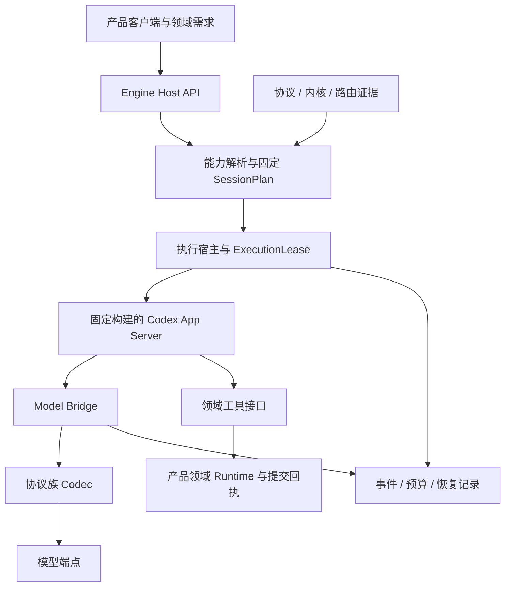

# Eternal Light 多模型 Codex 引擎理想架构

版本：1.1 · 日期：2026-09-20 · 类型：目标架构、实施基线与验收状态

本文整合当前基础层方案、既有重构方向及源码核查结果，定义最终应达到的架构。全文中的“应”“必须”和目标接口表示设计要求；第 14 节单独记录当前实现差距。本文不构成真实供应商接入或跨平台发布的通过证明。

前置文档：[多模型 Codex 引擎基础层技术方案](ENGINE_FOUNDATION_TECHNICAL_DESIGN.md)。后续引擎建设以本文的职责边界、契约与验收要求为目标；历史方案保留作为演进记录。当前处于测试阶段，可直接替换旧接口、删除重复逻辑，不增加旧内部接口兼容层。对上游 Codex 接口则通过明确版本与适配测试管理变化。

## 1. 架构目标

构建一个独立产品可复用的 Agent Engine，让不同协议、不同供应商的模型通过统一宿主接口，使用官方 Codex 的 Agent 循环、工具执行、上下文管理与原生多 Agent 调度能力，同时持续合入官方 Codex 主分支。

“理想”指职责单一、契约明确、执行可验证、故障可定位、升级可重复。它不承诺所有模型达到相同智能水平，也不要求所有模型通过同一组高级能力测试。

具体目标：

- 新协议族通过 Codec 接入；同协议的新模型主要通过连接配置与测量接入。
- 模型能够表达的语义被保真传递；不可表达的能力返回明确缺项。
- Codex 内核统一承担执行与子 Agent 生命周期，产品无需自行实现调度器。
- 每次执行使用固定模型路由、工具范围、权限及预算，结果能够关联到真实证据。
- 模型质量影响推荐与产品策略；执行资格由协议、内核、组合路径和权限共同决定。
- 桌面产品独立安装、独立凭据、独立状态与模型计费，不依赖官方 Codex 桌面版或用户安装的 CLI 环境。

## 2. 四个职责边界

| 边界 | 负责 | 对外输出 |
| --- | --- | --- |
| 产品与领域 Runtime | 用户交互、业务操作、领域数据、提交审批、事务与回执 | 通用能力需求、领域工具、业务提交结果 |
| Agent Engine | 模型连接、协议转换、执行计划、宿主管理、权限预算、证据与诊断 | 稳定宿主 API、执行事件、能力解释、恢复结果 |
| Codex 内核 | Agent 循环、工具调用、线程历史、原生子任务与上下文生命周期 | App Server 协议、工具执行结果、生命周期事件 |
| 模型端点 | 推理与生成、结构化工具选择、供应商专有状态 | 文本、工具调用、终态、usage 等协议数据 |

Agent Engine 是 Codex 的接入与执行边界。产品通过它调用 Codex；模型请求经过 Bridge 和 Codec；领域工具通过 MCP 或经过验证的内核扩展执行。



桌面部署默认使用本机子进程。App Server 的“Server”指本机协议服务进程，Bridge 的回环 HTTP 端口用于本机请求转换，不要求部署远程业务服务器。远程模型调用仍需要供应商网络连接。

## 3. 三层能力与执行资格

| 类型 | 示例 | 判定主体 |
| --- | --- | --- |
| 模型原语 | `text`、`structuredToolCalls`、`streaming`、`usage`、图像输入、供应商状态 | Codec 契约与真实端点测量 |
| 引擎能力 | `toolLoop`、`childSpawn`、`childWait`、取消、恢复、上下文生命周期 | 固定 Codex 构建与实际组合路径测试 |
| 产品能力 | 生成大纲、章节修改、固定角色评审、领域数据提交 | 产品工作流与领域规则 |

模型目录只记录 endpoint、model、protocol、受约束的 protocolOptions、credentialRef、原语声明及限额来源。模型目录不能声明“能创建子 Agent”，也不包含小说操作清单。

执行资格是一次解析的结果：

```text
当前模型原语证据 ∩ 内核能力证据 ∩ 组合路径证据
               ∩ 工具授权 ∩ 当前权限 ∩ 可用预算
                         ↓
                    ExecutionPlan
```

其中 `SessionPlan` 表达可复用的固定会话配置，`ExecutionLease` 为具体 run 授予有期限、可撤销的执行权。两者使用相同计划摘要，产品 UI、宿主、配置编译器和 Bridge 不各自推断模型能力。

能力解析必须展开依赖闭包。可选能力缺少依赖时移出可用集合并给出原因；只有必需能力缺失才拒绝整个请求。新增无关模型、产品 UI 修改或无关能力的失败，不应导致原有基础任务失效。

## 4. 引擎能力契约

以下统一采用代码中的标识 `childDirectedRoute`；旧文档中的 `directedChildRoute` 指相同概念，后续统一命名。

| 能力 | 核心断言 | 主要依赖 |
| --- | --- | --- |
| `toolLoop` | 工具身份、参数验证、callId 与结果关联、后续输入和终态正确 | 文本、结构化工具调用 |
| `childSpawn` | 真实子线程、可信父子身份、深度/并发限制 | 工具循环 |
| `childMessageRunning` | 运行中投递，入队与实际消费可区分 | 子线程与工具循环 |
| `childFollowupIdle` | 对空闲子线程启动新轮次，明确新 turnId | 子线程与工具循环 |
| `childWait` | 等待指定目标并区分成功、失败、取消和超时 | 子线程与工具循环 |
| `childFailure` | 子失败能够被父线程观察与处理 | 创建与等待 |
| `childCancelTree` | 撤销子树执行权、取消在途请求、阻止新增工作 | 可信子树身份与宿主取消 |
| `childRecovery` | 重启后重建身份、核对回执、保留未知副作用 | 持久化记录与状态核对 |
| `childDirectedRoute` | 只执行授权的父连接→子连接 | 对应有向路径证据 |
| `contextLifecycle` | 增量历史、大小上限、工具关联、受支持的压缩 | 对应协议状态支持 |

Profiles 是可展开的需求模板，不是另一套权限系统。文本、基础工具、基础委派和可恢复委派分别定义需求。基础委派的目标基线包括创建、等待、失败传播、取消及有向路由；运行中消息、空闲续跑和恢复按任务需要增加。

实际工具暴露必须与资格一致。若一个上游 feature flag 同时暴露多项工具，必须满足整组要求，或使用经测试的工具过滤接口限制暴露范围。声明了能力枚举、打开了 feature flag、看到一次成功演示，都不足以单独授予能力。

## 5. 协议适配：统一语义，按协议族投影

对接入模型统一规定工具 schema、调用身份、结果关联、终态与资源约束；由 Codec 转换为 Responses、Chat Completions、Messages、Generate Content 等协议。

每个 Codec 负责请求编码、响应解码、流分片组装、工具命名映射、schema 转换、usage 归一化以及供应商状态处理。Bridge 负责身份、路由、授权、取消和预算。Codec 不调度子 Agent，也不直接执行工具。

必须保持以下不变量：

1. 工具命名空间扁平化可逆，别名不碰撞；未知名称不能被解释为已授权工具。
2. 工具结果绑定原调用 ID；并发、流式与多轮情况下仍能唯一关联。
3. 不完整参数、截断流或错误终态不能提交为可执行调用。完整合法调用仍交由 Codex 验证与执行。
4. 文本中的 DSML/XML/伪 JSON 工具指令作为文本处理；只有协议确认的结构化调用进入执行链路。
5. 参数或 schema 错误按合法协议反馈给模型；不能在适配层无限重试或猜测补全危险参数。
6. reasoning/opaque 状态带供应商、模型和会话范围；无法保真迁移时拒绝该路径并解释原因。
7. 转换支持程度明确标为 native、lossless-adapted、unsupported 或 unknown，不能把有损转换标为等价。

供应商差异通过有界、经过验证的选项描述，例如工具强制选择方式、输出 token 字段和命名空间模式。配置不是任意代码入口。只有协议语义确实不同且现有选项无法表达时才新增适配实现，避免按模型名称不断增加分支。

## 6. 宿主接口与生命周期

目标公共接口如下；这些名称是目标契约，不表示目前全部导出：

| API | 输入与职责 | 输出 |
| --- | --- | --- |
| `inspectConnection` | 读取连接、访问状态和证据 | 原语、执行能力、缺项与原因 |
| `qualifyCapabilities` | 指定连接、能力、构建和测试范围 | 逐项报告及可采用证据 |
| `resolveSession` | required/preferred、路由、工具、权限、预算 | 固定 SessionPlan 或结构化缺项 |
| `startTurn` | session、输入、执行租约 | run/turn 标识和事件订阅 |
| `cancelRun` | run 与取消原因 | 撤销回执和终态进度 |
| `resumeSession` | 会话引用和恢复约束 | 核对结果、恢复会话或明确阻塞原因 |
| `subscribeEvents` | 会话/run、可选事件游标 | 有序有界事件流 |

目标 SessionPlan 至少包含：计划 ID、依赖摘要、连接与模型版本、各路由可用能力、有向边、实际工具集合、权限引用、证据引用、有效期、预算约束。计划生成后深度不可变；增加权限、更换模型或扩展路由需在新轮次前重新解析。

状态机必须区分：准备、执行、等待工具/用户/子任务、取消中、完成、失败、已取消和结果未知。未知副作用是恢复判定，不能通过关闭进程直接变成成功或已取消。

宿主需要保证初始化和会话创建并发安全、事件严格关联 thread/turn、超时触发实际取消、关闭完成可等待、进程退出统一清理。JSONL 大小限制应在流缓冲增长时生效，事件消费者异常不能破坏协议客户端。

审批与结构化用户输入是宿主的可注入策略。无交互认证运行可拒绝审批；通用客户端不能把该策略硬编码为所有产品的行为。

## 7. 多 Agent 执行路径

父模型决定是否委派、委派内容及后续处理，Codex 使用原生工具创建子线程。Bridge 对每个子请求检查其可信身份、父子路由、执行租约和预算；产品不在外部模拟子线程生命周期。

标准链路：父模型选择工具 → Codex 创建子线程 → 记录可信 lineage → 校验父→子连接 → 子模型调用工具 → 结果进入子线程 → Codex 等待结果进入父线程 → 父模型形成答复。

`A→B`、`B→A` 和 `A→A` 分别授权与测量。消息入队不等于消息已被模型消费，子 MCP 执行成功不等于父模型已收到结果，父回复未复述某个字符串也不等于结果传输失败。

线程身份来自 Codex 的运行元数据，不接受模型在工具参数中自行声明父线程或角色。领域 Runtime 还应校验项目、任务、权限和版本；身份真实不自动代表有写权限。

子任务缺少能力或失败时，向父任务提供有类型的结果。是否换模型或回退单 Agent 由预先授权策略决定；任何回退都记录原因并使用新的合格计划，不能在原租约中静默扩大能力。

## 8. 证据体系与最小失效范围

证据按模型原语、内核执行与组合路由分层保存，最终由同一个 resolver 使用。行为质量报告单独保存，明确 `authorizationEffect: none`。

目标证据字段包括：`capability`、派生 `domain`、测量状态、scope、suite ID/version、断言结果、dependencies、时间窗口、报告引用及 supersedes。断言应含 expected/observed/result/traceRef，不能仅保存“通过了某断言”的自由文本。

测量状态与准入状态分别表达。测量使用 passed、failed、unsupported、unknown、not-run；过期、撤销或缺依赖属于当前可采用状态。只有有效且可信的通过证据可授予执行资格。

| 依赖类别 | 绑定内容 | 失效范围 |
| --- | --- | --- |
| 模型协议 | 连接语义、模型修订、Codec 版本/配置、原语契约、限额来源 | 受影响原语及其下游 |
| 内核构建 | 源码树、补丁集、工具链、平台架构、二进制 BuildIdentity | 对应构建的执行能力 |
| 组合路径 | 原语证据、内核证据、父子模型、有向边、工具模式 | 对应组合路径 |
| 访问权限 | 凭据作用域、授权范围与访问时间 | 当前租约和访问资格 |
| 行为质量 | 任务集、提示、设置、评分器、预算及运行依赖 | 对应质量结论 |

不把整个产品目录摘要作为所有原语的失效条件。新增模型、UI 变化不应重测无关连接。供应商使用可变模型别名时记录无法固定版本的限制，并设置适当重验期限。

同范围新失败优先于旧成功；恢复资格需显式替代失败证据。未执行的测试不能覆盖已有成功或被写成失败。先原子写报告，再发布引用该报告的证据；崩溃后允许清理孤立报告，不能接受失联证据。

摘要校验内容完整性，报告发行者与发布流程提供可信性。测试夹具证据只在测试入口构造，不应出现在生产公共 API。真实端点 smoke 未选择某工具时，记录“未观察到调用”，不得据此认定内核执行失败。

## 9. 隔离、预算与恢复

每个产品拥有独立配置根目录、会话库、缓存、凭据命名空间和固定内核产物。打包后不搜索用户 PATH 中的 Codex，不借用官方桌面版登录态或额度。开发环境同样通过显式连接配置运行。

模型凭据仅由凭据提供器交给实际调用供应商的进程；Renderer、事件、报告和配置文件使用引用。Bridge 只监听回环地址，并校验每次请求的身份与执行权。产品权限仍在本产品宿主与工具边界执行。

ExecutionLease 绑定 run、plan、epoch、有效期及权限引用。取消先撤销执行权，再终止在途请求并清理子树，最后持久化结果。即使事件滞后，已撤销租约也不能发出新请求。

预算以整个任务树为单位，原子预留请求数、并发、时间和 token。缺少 usage 时记录估算来源与保守值；没有可靠 tokenizer 时使用经过验证的上界。金额硬上限还依赖价格版本和供应商可核验计费，不能把本地估算当成账单保证。

预算拒绝是宿主约束的终态，不是供应商临时不可用。独立 Rust Bridge 将
token/request/duration 拒绝编码为 HTTP 400、`budget_exhausted`、固定原因码
和 `retryable=false`，使当前 Codex 的 InvalidRequest 路径终止任务；不能仅
依赖 retryable 字段或采用仍被 sampling 层重试的未知 HTTP 状态。验证必须
覆盖真实 CLI 仅一次拒绝、供应商请求前拦截、预算不变，以及未知 host/供应商
失败不被误分类。该边界修复不修改上游内核，便于继续同步官方主分支。

正常回合的预算终态只有一个写入者：执行 Runtime 在获知 completed/failed/cancelled 后持久化；Bridge 的 `budget:end` 只释放绑定，不先写另一个 terminal 终态。Bridge worker 崩溃时可保守回收未结算预留并记录 `outcome-unknown`，不能抹掉未知用量或记作成功。真实进程/持久账本回归覆盖正常成功、失败和 worker 丢失，避免重复结算掩盖执行结果。

内核的逻辑模型路由使用连接 ID，供应商请求编码使用供应商模型名；两者不能假设相同。产品 Adapter 保持公开模型标签与 `modelRoute` 分离，启动与切换均传连接 ID。同名 DeepSeek 配置不是通用路由正确性的证据。

恢复区分只读、可幂等重试和未知写入。写入意图在调用前持久化，结果通过领域回执核对；未知写入保持待核对状态。恢复路径使用重建后的预算和新租约，历史未结算请求仍占用保守预留。

## 10. 事件与故障定位

事件统一包含 runId、threadId、parentThreadId、turnId、requestId、callId、connectionId、时间及序号；不同事件按需要携带相应关联字段。原始诊断和用户可见摘要分开，二者都设置大小、条数和保留期限。

故障定位链路为：工具暴露 → 合法调用 → 内核接受 → 工具返回 → 后续输入收到结果 → 模型利用 → 正确终态。

错误至少区分 `tool-not-exposed`、`tool-not-selected`、`invalid-tool-arguments`、`transport-result-missing`、`result-consumption-failed`、`lifecycle-failed` 和 `inconclusive`，同时提供责任层、可重试性、影响范围与 trace 引用。观测丢失、截断和乱序不能被推断成通过。

UI 只展示由事件派生的真实进度；未观测到工具调用时不显示“执行工具完成”。领域提交成功由领域回执确认，不能由 `turn/completed` 推断。

## 11. 验证体系与接入流程

| 验证层 | 输入 | 证明范围 |
| --- | --- | --- |
| Codec 契约 | 固定 fixture、流分片、异常载荷 | 协议转换与状态保真 |
| 内核确定性集成 | 固定 Codex、可控 Provider、真实 MCP | 工具/子任务/取消/恢复执行语义 |
| 真实连接 smoke | 指定供应商、模型、凭据范围与设置 | 实际组合路径可观察的能力 |
| 开放行为评测 | 版本化任务、约束与评分器 | 自主委派、结果利用、成本和质量 |
| 产品回归 | 业务工作流、领域数据与提交结果 | 消费引擎后的业务正确性 |

确定性测试通过状态屏障控制消息入队、工具释放与取消时序。覆盖成功、参数修正、子失败、断流、取消树、重连、空闲续跑、不同有向路由以及未知副作用恢复。

`qualify:model` 应按请求能力输出部分准入报告，不要求每个模型先通过所有高级能力。`evaluate:model` 应实际执行固定任务集；接收已有 samples 仅属于报告模式，必须在输出中区分。

行为任务同时覆盖明确委派、自主判断委派和无需委派的任务。评分结合执行事实、任务约束与结果质量；字符串匹配只适用于简单确定性断言。报告绑定任务集/评分器摘要、模型设置、样本、失败、延迟、用量来源，不通过只保留成功样本制造高通过率。35 次与 Wilson 下界可作为质量策略参数，不作为通用接入门槛。

接入顺序：连接配置 → 访问检查 → 原语验证 → 所需内核组合验证 → 解析可用能力 → 按需行为评测。供应商支持新能力时只补测新增路径；已有基础能力保持可用。

## 12. 工程目录与上游同步

```text
codex-rs/                         官方执行内核与最小登记补丁
eternallight/agent-engine/
  src/contracts/                  能力、证据、事件、宿主契约
  src/connections/                连接与凭据引用
  src/codecs/                     协议族与有界供应商状态
  src/session/                    单一 resolver 与配置编译
  src/host/                       App Server 客户端与运行宿主
  src/bridge/                     路由、转换入口、取消与预算
  src/capabilities/               探测、证据、准入报告
  src/state/                      日志、回执、预算与恢复
  src/observability/              关联事件与诊断
  qualification/                 通用 runner、MCP、任务集、评分器
  tests/                         契约、故障注入与真实内核集成
eternallight/novel-codex/          首个产品消费者与领域 Runtime
```

依赖方向为产品→Agent Engine→Codex 协议边界。引擎包可在没有 Novel Codex 源码的情况下测试和使用；产品只保留 IPC、UI、领域工具和业务能力要求。

仓库继续保留 Codex 的完整 Fork 历史，origin 管理产品代码，upstream 跟踪官方主分支。同步流程固定产品基线和拉取的 upstream SHA，在独立候选分支/worktree 合并，记录候选源码树、冲突、接口变化与补丁集。

每个内核补丁登记动机、基线、路径/符号、实际 diff 指纹、测试及删除条件。上游具备等价能力后验证并删除补丁。边界检查缺少上游 ref、发现未登记差异或指纹不匹配时失败。

合并成功只生成待验证候选。晋升需要候选对应的内核重建、引擎回归、消费者回归及 macOS/Windows 进程测试报告。报告绑定源码树、构建工具链和二进制身份；候选变化后重新验证。已有稳定内核产物持续可用，升级失败不覆盖它。

## 13. 实施顺序与完成定义

| 阶段 | 交付 | 退出条件 |
| --- | --- | --- |
| A 契约闭合 | 依赖闭包、逐项状态、工具暴露与实际执行一致 | 可选能力失败不阻塞无关任务；未验证工具不可见 |
| B 宿主闭合 | 通用 API、取消/超时、用户输入、事件与进程状态 | 并发启动、退出、重连等故障注入通过 |
| C 子 Agent 闭合 | 生命周期逐项测试与认证证据 | spawn/message/idle/wait/failure/cancel/recovery 按路径验收 |
| D 证据闭合 | 类型化依赖、最小失效范围、可信报告加载 | 修改单一依赖只影响相关资格；测试证据无法进入生产入口 |
| E 工程与评测闭合 | runner/MCP 迁移、真实评测 CLI、任务与评分版本化 | 引擎独立使用；评测端到端运行且不授予权限 |
| F 发布闭合 | 上游候选晋升、双平台构建、真实端点报告 | 可从已提交基线重复构建、验证、升级和回退 |

最终交付包括：独立引擎包、版本化契约、可执行工具矩阵、内核集成报告、真实连接能力矩阵、开放行为报告、上游候选与双平台发布报告。每项能力都能追溯到断言和依赖，每项未完成能力都能定位到具体实现或测试缺口。

## 14. 当前实现与目标差距

本节为 2026-09-20 源码核查快照，不把此前通过的测试数量当作完整架构验收。

| 主题 | 已有实现 | 目标仍需补齐 |
| --- | --- | --- |
| 能力分层 | 模型/引擎/产品能力已拆分；解析器执行依赖闭包；可选能力缺依赖时裁剪；`directed-delegation-v1` 与完整自治 Profile 分开；配置只消费 SessionPlan 冻结的扩展授权 | `childFailure`、`childCancelTree` 通过后才能获得完整自治 Profile；上游 feature flag 的完整工具集合仍需随 Codex 版本持续核验 |
| 协议接入 | 四类 Codec、Bridge、预算和租约模块 | 各真实端点的能力矩阵；特殊状态支持按路径验收 |
| 通用客户端 | `AgentEngineHost` 与 `CodexAppServerClient` 已提供连接检查、资格、会话解析、执行、取消、恢复、事件游标、可注入服务端请求策略、超时中断及可等待关闭 | 未知写副作用恢复已由日志层实现，但仍需和具体产品提交回执逐产品验收 |
| 子 Agent | 通用 runner 覆盖创建、运行中消息、等待及有向路由；取消有真实内核集成回归 | failure、idle follow-up、恢复需独立认证并发布能力证据；未通过前不得授予完整自治 Profile |
| 证据 | 断言已类型化为 expected/observed/result/traceRef；依赖限制为 modelProtocol/engineBuild/route/access/report；SessionPlan 保存采用证据与分类依赖摘要 | 继续将各平台 BuildIdentity 和真实端点修订号填入实际认证；供应商可变别名只能以短 TTL 管理 |
| 状态语义 | 证据同时给出 `measurementStatus` 与动态 `evidenceAdoptionStatus`；过期和依赖不匹配不会成为通过证据 | 后续持久化格式可在下一次 schema 升级时移除旧 `status` 投影 |
| 测试边界 | `verifiedBaselineEvidence` 已移至 `@eternallight/agent-engine/test-support`，生产主入口不再导出 | 无代码缺口；继续由包导出测试阻断生产误用 |
| 行为评测 | CLI 支持真实执行版本化任务集、隔离命令执行、超时/输出上限、评分器/任务集/运行依赖摘要，并区分 execute 与 samples | 真实模型行为报告仍需在目标模型、预算和端点环境运行后生成 |
| 工程迁移 | App Server 客户端、宿主、两个 runner、两个确定性 MCP 与评测 CLI 位于 agent-engine；Novel 只保留兼容启动薄入口 | Novel 旧生产 adapter 仍可逐步改为直接消费 `AgentEngineHost`，但不再是引擎独立测试的依赖 |
| 上游同步 | 补丁注册、固定 SHA 候选 worktree、待验证报告 | 自动验证与晋升闭环、候选 tree/BuildIdentity 绑定、双平台报告 |
| 外部验收 | 已有本机可控 Provider 与真实 Codex 集成基础 | DeepSeek 与第二真实协议端点 smoke、Windows 执行与恢复验证 |

当前本地代码闭环已覆盖阶段 A、B、D 和 E 的主要退出条件；阶段 C 尚缺 failure/idle/recovery 的独立认证，阶段 F 尚缺候选晋升自动化与真实 macOS/Windows 发布报告。外部端点和平台报告必须真实运行，不能由本地 fixture 代替。

## 15. 对应源码与历史依据

### 流式失败的确定性边界（2026-10-01）

SSE decoder 只负责有界字节与 JSON 帧解析，不丢弃供应商的终止元数据。
Bridge 在语义解码前识别 failed/incomplete/error：已报告用量先结算；
未知用量继续保守处理，不能凭失败推断零成本。失败流中的工具项永不执行。
诊断使用固定原因码（输出上限、过滤、上下文上限、额度、限流、服务端错误、
未知），不记录原始错误消息或工具参数。非重试错误映射到上游已存在的终止
路径；明确暂时性故障保留内核有界重试，不增加自主重放或模型专用内核补丁。
这属于模型协议/执行基础层；小说发布与完成规则仍由产品 Runtime 和 MCP
负责，不能进入通用 Bridge。

- [能力契约](src/contracts/capabilities.mjs)、[解析器](src/session/resolver.mjs)、[扩展编译边界](src/session/extension-registry.mjs)
- [连接与当前依赖摘要](src/connections/connection-spec.mjs)、[证据存储](src/capabilities/evidence-store.mjs)
- [通用宿主](src/host/engine-host.mjs)、[App Server 客户端](src/host/app-server-client.mjs)、[行为执行与评分基础](src/capabilities/behavior-evaluation.mjs)
- [资格 runner](qualification/codex-conformance-runner.mjs)、[真实执行评测 CLI](qualification/evaluate-model.mjs)、[上游同步](../novel-codex/scripts/sync-upstream.mjs)
- [基础层方案](ENGINE_FOUNDATION_TECHNICAL_DESIGN.md)、[模型准入与上游重构方案](../novel-codex/MODEL_ADMISSION_AND_UPSTREAM_REFACTOR_PLAN.md)
