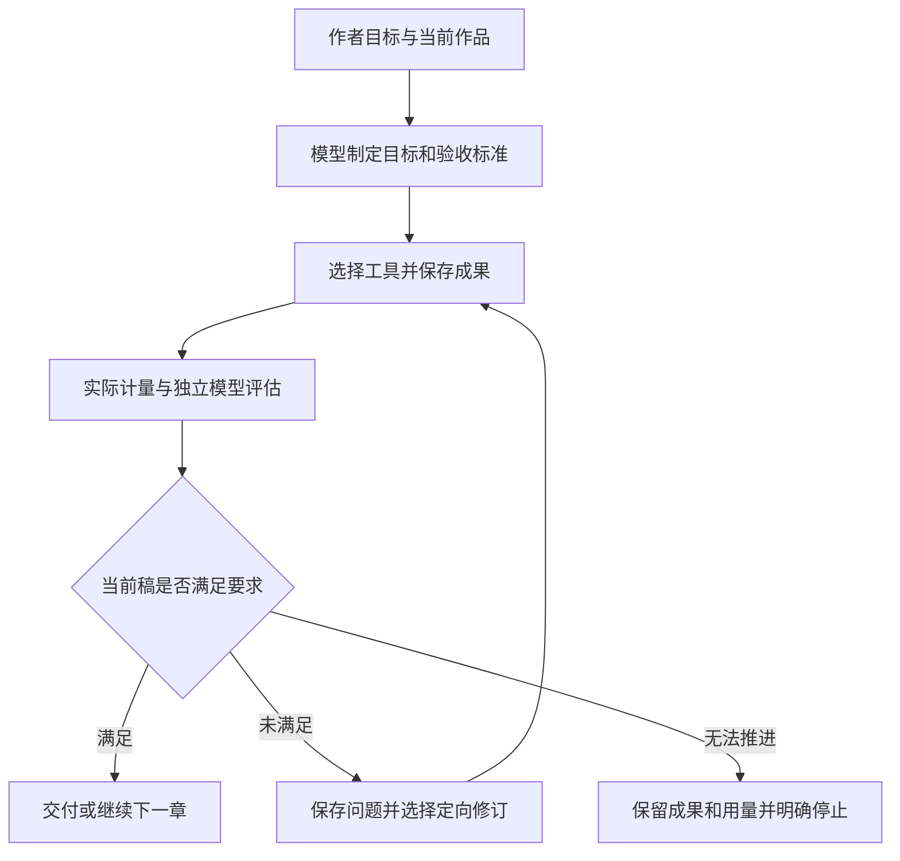

# 对话驱动自主创作：方案与实施验收

更新日期：2026-10-07。本文落实作者要求：由应用自己理解目标，组织生成、分析、检查、建议和修改；外部验证者不承担每轮故事纠错与人工调度。

当前 3.0 的生产实施与验收以 [3.0 实施记录](AUTONOMOUS_V3_IMPLEMENTATION_REVIEW.md) 为准。下方旧验收矩阵和实机轮次保留为各自时点的历史证据，不代表 3.0 已全部通过。

后续实施以 [开放工作区与可靠执行架构3.0](SIMPLE_REQUEST_AUTONOMOUS_CREATION_DESIGN.md) 为依据：作者约束与模型计划分开，能力按需组合，子任务可在受限隔离区写作，质量判断分层，长篇资料按问题取证。本文图示、机制和各项状态属于对应实施快照；其中顺序不定义永久创作流水线，也不替代新方案的实机验收。新章及解决阻断问题的正文修订仍需适用的最小独立核验，额外专家评审按需选择；详见统一方案第9节。

## 目标和职责

作者使用同一对话提出长篇目标、调整方向或暂停。协调模型根据当前要求、作品和任务记录选择下一步；写作任务保存成果；独立评估任务在独立上下文中读取标准和实际成果，逐项给出满足、未满足或证据不足。Runtime 负责真实版本、范围、权限、预算、幂等、数量和状态转换。Host 只执行已登记决定，不从自由文本推导动作。Renderer 展示进展、保存结果、未解决问题和控制入口。

模型负责自然语言理解和文学判断。工程不匹配“继续”等作者关键词，也不为《万城灯火》、第7章、六十三文或三千字增加特判。数量范围由模型从作者要求解释并在起草前登记，实际值由保存文本计算。

## 自主执行循环

简单问答不建立写作流程。内容改动的必要检查来自作者目标和模型登记的标准，不要求每次运行全部知识提取、伏笔、规划或读者工具。新章及需要验收的改稿必须对当前保存稿完成独立评估；保存和报告存在都不能代替通过。

## 持久验收合同

作者原要求与授权独立保存。模型的近期计划、拆解、方法和依赖可合并、撤销、替换并回读历史，不要求每次行动先建计划；已登记的真实产物义务不因方法退役消失。章节验收解释可依实际读回的作者原文、原因与影响纠正，但不能降低篇幅门槛让旧失败稿通过。作者真正调整要求时建立可追溯的新版本，世界状态变化不授予修改要求的权限。

章节写作及修订使用同一份绑定 Work、章节和作者要求的 `chapterAcceptance`：全部内容标准和明确 nullable 的篇幅边界。首次登记冻结，修订复用；独立评估逐项覆盖这份合同。已有场景修改还须维持真实 sceneGroups、锁定范围及前后稿绑定。

## 独立评估与推进门禁

复用现有 critic/效果评估能力，评估绑定真实 writer task 与最新完整保存稿。评估器获得冻结标准、实际当前稿及必要原稿/前文，不继承写作者或协调者的自我认证。每项结论保存证据和理由；未满足和证据不足留下待解决事项。正文或所需来源改变后，旧评估不能通过新稿验收。

Runtime 同时核对实际字数、合同覆盖、当前稿身份、报告归属和实际判定。未通过时不能 `fulfilled`、`finishChapter` 或交接原连续任务。报告已保存只证明执行过评估，不证明内容通过。模型仍须读回结果并决定局部修订、补读或真实受阻；不能用口头承诺跳过。

大纲、简报和近章规划沿用同一目标/证据/交付约束；模型按结构、前文边界及作者要求选择适用的评估工具，不把未来安排当已发生正文。章节独立评估作为最小实机闭环，其他资料交付不得仅凭“保存成功”宣称额外检查通过。

## 问题与修订收敛

问题关联稳定标准、当前稿版本和证据。修订默认选择问题涉及的范围；整章重写要说明必要性。修订后复查问题和影响到的内容；保留未变且有效的证据。重复失败须改变方法并记录改变，不能反复相同查询或把篇幅延期后继续。

执行受原预算、权限和未知写入门禁约束。不产生实质进展时停止或向模型返回明确恢复要求，保留成果和费用，不自动新建根任务、不增加预算。文学判断有误差，独立评估降低错误传播风险，不能宣称自动保证文学质量。

## 记忆、分页与提示

目标、标准、问题、结论、当前稿和已返回原文范围持久保存。上下文压缩后模型读回记录，补读尚缺资料。阅读返回范围与模型理解声明分开：分页完整不是理解完整，标题/目录不是已读正文证据。

应用内部规则和任务绑定不再反复混入真实作者消息。保持作者原文完整、总输入安全预算和 Engine 身份；通过当前引擎支持的上下文/指令通道注入本轮工作约束。任务/来源变更时旧 cursor 和 sourceId 失效，当前返回范围不可伪造或跨任务使用。

## 控制与界面

模型理解暂停、恢复及方向调整，选择真实控制能力；执行回执才允许说“已暂停/已恢复”。作者保留可直接选择原持久任务的暂停入口，离线/重开后的 running 任务同样可控，范围和版本必须重新核对。

主对话显示成果、实质发现、修订进展和下一步。技术参数、重试与核验日志放详情。来源读取标签反映实际返回的章节或内容，不能把目录范围显示成实际全文阅读范围。进展可写“检查发现缴款与前章不一致，正在修改相关段落”，不展示角色、内部 ID 或 JSON。

## 实施范围与验收矩阵

| 工作项 | 验收要求 | 当前状态 |
| --- | --- | --- |
| 模型执行目标冻结 | 同 ID 降验收、改类型、删前置、降模式原子拒绝；方法更新和规划转执行有效 | 已实现，Core 219 项及计划 13 项通过 |
| 普通修订与新章统一标准 | 起草前解释并冻结，后续修订不降标，客观字数绑定实际保存稿 | 已实现，所有写作入口共用合同及独立评估 |
| 独立评估与判定门禁 | 未满足、证据不足、旧稿报告不允许完成或接续 | 已实现，HTTP、MCP 及真实 Host 旅程通过 |
| 应用自主修订 | 一次目标输入后，模型读报告、选择修订、再评估直到通过或实际停止 | 工程旅程通过；DeepSeek 实机验收进行中 |
| 压缩与持久阅读 | 原文返回范围可恢复，结论保存，内部工作说明不重复充当作者输入 | 已实现，真实 Core 压缩及分页并发回归通过 |
| 持久任务控制 | 明确选目标暂停，版本/归属/并发可靠，回执显示真实状态 | 已实现，离线 UI、CAS、派发竞态测试及原任务实机暂停通过 |
| 清晰过程表达 | 实际章节读取范围、简洁进展、保存与验收区别清楚 | 已实现，来源与检查 UI 回归通过 |
| 脚本端到端 | 有意坏稿→评估拒绝→模型修订→当前报告通过；另验证接续下一章及中断/未知写入 | 两条真实 Host/Core/MCP/Native 旅程通过，provider 使用脚本 |
| 真实应用 | 使用已授权 DeepSeek，外部只一次提出任务并核对结果，不逐项追加故事纠错 | 已重验证连接并通过原对话发送一次目标，结果待核对 |

各项完成后写入代码位置、测试日志和实机结果。脚本 provider 不能冒充 DeepSeek 实际质量验收；100章未完成不得描述为长篇完成。第1—6章和既有规划保护要求持续有效。

## 实施前五视角评审

下表为五个审查视角，不是五名独立人员。具体实施者仍须对负责部分复核和记录条件。

| 视角 | 结论 | 实施条件 |
| --- | --- | --- |
| 架构 | APPROVE WITH CONDITIONS | 单一 Work 调度与账本；独立评估可复用既有能力，不能增设 Host 故事规划器；所有入口同一完成约束。 |
| 技术 A | APPROVE WITH CONDITIONS | 当前稿和来源绑定、CAS、预算、权限、未知写入保护、任务与独立会话隔离必须测试。 |
| 技术 B | APPROVE WITH CONDITIONS | 生产、类型、MCP、fixture、测试一次更新；否定报告和旧稿失效必须端到端验证。 |
| 产品 | APPROVE WITH CONDITIONS | 外部不逐条纠错才算自主闭环；停止如实说明问题，作者只处理真实创作选择。 |
| UI/UX | APPROVE WITH CONDITIONS | 控制入口简洁可达；状态来自回执；不新增技术表单、重复指令或默认展开日志。 |

零兼容门禁 PASS：当前 schema/interfaces 一次切换，不增加迁移、回填、fallback、双读双写或历史版本分支。保护实际作者正文与用量，测试在独立当前 schema 数据库进行。没有兼容例外。

## 实施后证据

### 已落实的代码

| 责任 | 主要代码 | 实际行为 |
| --- | --- | --- |
| 冻结目标与标准 | `native/story-core/src/model_work_plan.rs`、`chapter_delivery_review.rs`、`work_decision_actions.rs` | 执行目标不可降标；新章、整章及场景修订在起草前绑定同一章节合同，保存稿计算实际 Unicode 正文字符数。 |
| 独立检查与正式报告 | `native/story-core/src/revision_outcome.rs`、`work_decision_status.rs`、`work_delivery.rs`；`native/story-mcp/src/task_source_tools.rs` | critic 使用独立会话和一个批准来源包；报告目录必须继续分页读取。负评、缺证据、正文或必要前文变化不能通过交付及连续任务接续。 |
| 来源返回与恢复 | Native 的 parsed/raw 来源返回记录；`electron/context-reading-contract.mjs`、`advisory-prompt.mjs`、`codex-runtime.mjs` | 持久记录实际返回范围；目录不算正文阅读；短 IMMEDIATE 元数据事务解决读取进度与并发写入的快照升级冲突。真正作者输入与内部上下文分离，压缩后读回目标及报告。 |
| 执行和控制 | `native/story-core/src/generation_model_control.rs`；`electron/main.mjs`、`committed-generation-control.mjs` | 模型选择暂停工具；直接 UI 控制使用 Work 的版本和归属原子校验。只中断真实提交回执所属的当前执行，不误停其它 Work，派发间隙暂停也阻止首次推理。 |
| 作者界面 | `src/WorkChapterAcceptance.tsx`、`RevisionOutcomeDetails.tsx`、`conversation-value.ts`、`task-operation-presentation.ts` | 区分正文已保存与检查通过；问题与结果用中文表达，逐项检查折叠查看；任务菜单明确选择暂停目标，来源标签反映实际返回内容。 |

状态摘要保持 6500B 上限：每页 1 项 requirement、2 项 action、2 项 receipt，覆盖信息和 cursor 保留，完整检查理由及引用仍在正式报告中；不截断标准或伪装完整读取。最大 3498B 合法冻结合同及 12 条中文检查理由的边界测试通过。

### 回归记录

- Native：Core 219 项、计划 13 项，Runtime 定向及关联 97 项，MCP 67 项通过。详见 `design-reviews/2026-10-07-native-autonomous-acceptance.md`；日志 `/tmp/autonomous-core-plan-final-2.log`、`/tmp/autonomous-http-16.log`、`/tmp/autonomous-http-adjacent-2.log`、`/tmp/autonomous-http-scoped-final.log`、`/tmp/autonomous-mcp-final-4.log`。
- Host：一次作者目标的坏稿、独立负评、分页读回正式证据、定向修复、独立正评和交付旅程通过。日志 `/tmp/host-engine-final-native-current-v7.log`；修订、建模、交接及下一章独立验收旅程 `/tmp/host-scoped-final-current-native-v8.log` 通过。
- 扩展回归：Creative 86 项、Agent 437 项完成验收。首轮日志分别为 85/86 和 435/437；剩余流程断言同步后定向通过，并发耗时项在原 2 秒门槛下单独 4/4 通过。具体说明见 Host 评审，不将首轮说成单次全绿。
- UI：任务暂停和来源展示 6 项、修订检查详情 4 项通过；TS/Vite 构建通过。多批测试有重叠，不累加为唯一用例数。
- 新增统一入口 `npm run test:autonomous-creation`，运行当前运行时、MCP、Host 自主旅程和关键 UI；本轮正在核对该入口的最终执行日志。

### 真实应用记录

当前数据来自原小说作者 profile；操作仅通过应用 UI，数据库核对使用只读连接。第7章验收开始前基准为 5188 正文字符；原连续 run 版本87、running、下一章8，尚无第8章正文。

应用在模型未就绪时，仍能从“对话操作 → 暂停创作任务”明确选择原前100章任务并成功暂停。原 run 版本87→88、状态 paused，原 Work 版本116、状态 paused；不改变章数、范围或原预算。重启后的最终 Native 构建仍读到此真实状态。

DeepSeek 连接由应用 UI 重新验证为“模型连接已就绪”。18:10 在原对话发送一次通用目标：完成已有第7章要求，由应用独立检查、修订、复评，通过后接回原前100章任务；保护第1—6章和规划、原预算、不采用不发布。没有追加新的逐条故事纠错。该真实执行结果仍待核对；脚本工程证据不代替文学效果验收。

当前结论：核心代码及自动化机制已落实；真实 DeepSeek 自主创作验收进行中，前100章创作尚未完成。
