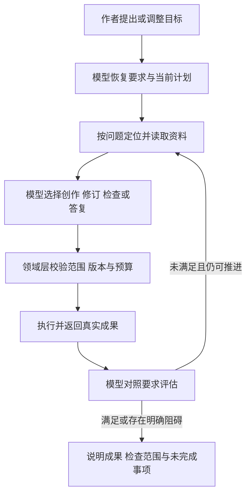

# 对话驱动长篇创作架构与实施方案

更新日期：2026年10月7日

最新统一目标见 [对话驱动自主创作：开放工作区与可靠执行架构](SIMPLE_REQUEST_AUTONOMOUS_CREATION_DESIGN.md)（3.0）。该文结合本地 Codex 与 Cursor 官方工程资料，重新划分作者约束、模型可变计划、作品工作区、能力创造、动态协作、质量判断及长篇恢复；设计完成不表示下文历史实施记录已全部通过最新验收。

作者通过一个持续对话提出创作目标、调整方向和审阅成果。模型理解要求、选择资料、规划、创作与修订；工程提供可信作品事实、可靠执行和清晰界面。长篇任务跨多个执行回合持续推进，保存成功、章节验收、执行结束和整部目标完成分别核对。

本文保留对话创作闭环的既有机制与历史实施记录；后续目标以统一架构3.0为准。整体产品背景见 [理想架构](IDEAL_ARCHITECTURE.md)，详细变更评审和历史验证见 [长篇可靠性记录](LONG_CREATION_RELIABILITY_DESIGN.md)。已记录状态见文末增补和 `repair-verification-2026-10-07.json`；各轮测试不累加为独立用例数。

当前工程已实现模型计划、来源取证、持久交接和已结算零写入失败的同任务恢复。本轮新增统一章节合同、独立评估门禁、正式报告分页读回、持久阅读、内部上下文分离与真实暂停控制，工程及脚本旅程已通过。实机通过任务菜单暂停了原前100章任务（run88 paused），然后在原对话发送一次通用目标；DeepSeek 自行保存第7章新候选2139字符，应用已识别低于冻结下限2700并启动独立复评，第8章尚无正文。真实自主修复及接续仍待核对，最新回执以 `repair-verification-2026-10-07.json` 为准。此前5188、5703字符稿及余额不足均为对应历史快照。完整方案和逐项验收见 [自主创作实施方案](AUTONOMOUS_CREATION_IMPLEMENTATION.md)。架构或脚本测试通过，不能代替作品完成和文学质量验收。

## 持续对话与创作目标

对话是作者入口，创作目标是跨回合持续的要求，执行回合是本次模型工作。内部执行继承原要求，但不会生成新的用户消息。作者说“先修订第七章，再接着写”，模型应在同一对话里完成修订、核验和原任务接续。

长期目标保存作品范围、原文保护要求、作者调整、验收条件、计划依赖、实际成果与剩余预算。模型根据发现调整方法和步骤，原要求持续可读。只有作者真实调整要求才改变对应的完成标准；执行结束或预算耗尽不表示目标已经完成。

## 职责与数据权威

| 层 | 职责 | 依据 |
| --- | --- | --- |
| 作者对话 | 表达创意、约束、修订与停止意图 | 实际发送并持久登记的作者消息 |
| 模型 | 理解组合意图、制定计划、取证、创作、评估与选择下一步 | 当前作者要求、授权资料和真实工具结果 |
| Codex App Server | 管理对话回合、模型工具循环、进度事件和上下文压缩 | 引擎执行状态 |
| 小说领域 Runtime | 保存作品版本，核对归属、来源、权限、预算与幂等写入 | 当前数据库及操作账本 |
| Electron Host | 执行已登记决定、连接引擎与领域工具、处理生命周期 | 结构化决定和领域回执 |
| 对话界面 | 呈现真实输入、模型公开说明、执行状态与成果入口 | 作者记录、公开事件和保存回执 |

模型决定创作行为，领域层检查是否可以执行。没有按“继续”等词语选择业务动作的路由。Host 不通过模型自由文本推导保存成功，也不额外建设创作规划器。采用、发布和范围扩张遵守作者授权。

## 模型与执行循环

简单问答无需建立计划。复杂创作使用既有 Work 计划保存目标、验收条件、依赖、阅读问题、检查范围、方法和判断。计划本身不授予执行权限；完成判断必须关联当前成果。模型按需调用正文、规划、知识和质量工具，不强制每章运行全部分析任务。

当前计划显式区分 `planningOnly` 与 `executeGoals`。作者只要求保存未来计划时，可以保存未执行的目标并正常答复；作者要求执行目标时，登记行动会在同一事务中留下最终交付核验义务。工作者完成、保存成功或进程退出，都不能消除这个义务。已经登记执行后不能把计划降为只规划来绕过核验。

“修订后继续原任务”记录为接续目标，绑定原 run 身份。待执行时 proposal 为空；满足时必须引用本 Work 已实际登记的原任务交接回执。未登记的接续不能通过“下一轮继续”的答复关闭任务。模型发现具体阻碍时应把目标标为 blocked 并解释原因，不能以模糊承诺代替执行。

模型选择的辅助分析是方法，失败后不自动变成作者的新交付要求。已结算且确认零输出的辅助失败保留在记录中，由模型选择重试或说明未覆盖范围。作者明确登记的成果、修订结果评估和当前有效计划目标仍须核对；未知写入不能按可选分析跳过。

## 上下文与可恢复记忆

原文是内容依据，检索摘要和聊天总结只帮助定位。冻结资料索引提供真实章节身份、来源修订和直接读取位置。模型根据问题选择章节和范围，正文分页保持来源一致；目录元数据不代表已读正文。

关键发现随计划保存判断与来源。压缩后先读回目标、判断和实际成果，再补读必要原文。资料变化后，关联的完成证据标记过期并重新评估。历史计划可用于理解前情，不能自动继承执行许可或作为当前验收证明。

检查目标的 `sourceChecks` 记录实际授权资料、修订、内容哈希和正文引文，重复引文须带精确 Unicode 位置。领域层验证引文确实存在于可读正文及当前选定版本，不接受仅引标题、目录信息或未授权正文。正文与简报、大纲各自使用当前权威选择，资料改变后证据失效。这里验证的是证据身份与真实性；时间线与文学判断仍由模型负责。

例如第六章的期限被作者修改，模型应重新核对第七章的时间线；不需要为此重新生成前六章，也不能继续沿用过期的衔接结论。

## 起草前标准与保存后验收

连续创作的模型决策在起草前提交 `chapterAcceptance`：列出本章作者要求，并解释篇幅范围。明确数量要求使用可检查的范围；“约3000字”由模型结合作者意图解释容许范围；没有篇幅要求时边界为 null。工程不通过正则提取作者数字，也没有固定3000阈值。

第一次起草决定冻结本章、本次作者要求下的标准。后续修订复用同一标准，模型不能为使短稿通过而减少要求、降低范围。作者调整要求后，在新的作者意图下重新解释标准。

任何阶段都允许保存稿件。模型选择 `finishChapter` 时必须提交绑定当前修订的 `chapterReview`，按原标准逐项评估。领域层核对：

- 当前稿件、章节和修订身份一致，正文已完整保存。
- 每项原要求均有评估，不能删除要求或用未解决状态定稿。
- 每项评估至少引用当前保存稿的正文证据；跨章核对所需的其他引文由模型按问题选取。
- 验收沿用起草前冻结的篇幅范围；实际正文字符数由当前保存文本计算，不含空白、含标点。
- 没有尚未结算的写入或并行执行冲突。

不满足时继续保存与修订，不能计入已完成章节。时间线、因果、人物和叙事效果由模型结合原文判断；结构校验不能证明文学质量或证明模型完整理解作者意图。最后一章另需整体交付评审，覆盖所有当前有效成果和未完成事项。

## 暂停恢复与失败处理

恢复先核对实际保存、当前来源、未完成目标与预算。写入结果未知时查询操作账本，确认前不重新生成。相同写入或行动请求采用幂等键；参数或评审改变时不能复用原键。

修订结束后，模型显式选择同作品同对话的原连续任务。普通发送与任务恢复复用同一交接校验；先结束当前 Work 生命周期，再执行原任务，避免同时持有两项工作。没有当前章节时恢复原规划位置；存在已暂停且执行结果已结算的当前章节时，沿 `currentChapter` 检查点重新协调。

自动接续使用不接收创作指令的 `rebind` 接口刷新来源，保留原作者意图版本及冻结验收标准；作者真实修改要求使用 `replan`。同一步重试绑定当前 Attempt 和原候选，完成判定使用当前真实成果，历史失败不遮蔽成功重试。原章节、范围、累计尝试和费用上限保留。运行中的动作、未知写入、过期版本或耗尽预算不因恢复而放行。

模型交接的来源刷新、原 run 恢复、proposal 消费及执行回执在 Native 同一事务完成。Host 从持久回执恢复，不依赖进程内的最后一次模型决定。重复提交复用原回执；作者之后主动暂停或取消时不能借重放恢复执行。前置 Work 必须真实 fulfilled、所有操作与用量已结算，partial 或待作者决定的交付不会自动续写。符合条件而尚未执行的交接，在任务中只显示“接回原任务”一个操作。

写作任务保存后收到明确回执，应立即交还执行。该任务的冻结输入仍是修改前快照，不代表保存失败；后续核验由新的模型决策读取当前保存稿完成。同一章节存在待执行修订时拒绝再次登记，幂等重试仍返回原行动，防止等待中的重复改稿。

模型启动前先绑定引擎用量账本。若在绑定前中断，只有当前引擎库确认没有该账本，且 Native 确认任务已失败或取消、没有回合、产物和操作记录时，才按未启动任务以零用量结算。损坏、活动、不可读或已发生用量的账本不能按零处理；原额度与累计用量保持不变。

失败后的模型决定记录原因、方法变化和验证方式。相同失败不无限重试，恢复不能重置预算。作者只在作品方向、超出范围或其他需要其决定的问题上作选择，内部字段错误由模型依照工具反馈纠正。

工具校验反馈提供具体记录位置和缺失字段，适用于所有声明的工具参数。位置只经过已声明属性和真实数组索引，未知字段与输入值不回显；模型自行修正，工具不代填参数。机器错误码与公开中文说明分开保存，界面措辞变化不改变领域层的恢复判断。

## 对话界面

主线按时间显示真实作者输入、模型公开说明和轻量工具摘要。模型说明目的、实质发现、方法调整与结果；同一段说明不会被多个内部回合复制为用户输入。连续操作可以合并折叠，但失败、等待和取消状态仍可见。

作者通过一个自然语言输入框提问、比较、合并建议、调整方向或要求执行，不先选择讨论/执行模式。模型依据本轮原话及对话变化理解目标、暂缓要求和后续修改要求的时效；前端不做关键词路由，不持久化语义模式。工程只校验操作对象、真实来源、版本、范围、预算和保存回执。未保存引用只能讨论是来源能力限制，不是对作者语言的判断。

通用模型交流指引覆盖所有工作回合：直接给有价值答复，真实分支才列少量选项，实质歧义才追问；选择题始终有自由回答，选项可用作起点再补充。只有真实模型提问请求产生待回答状态，普通建议不会把对话变为必答表单。正式采用、发布和伏笔确认仍需真实作者决定，模型文字不冒充回执。

成果以章节或规划名称直接打开。技术记录保留参数、原始回执与重试证据，默认折叠。界面不合成模型解释，不展示私有推理，不用执行结束替代作品完成。工作计划和验收协议不增加常驻表单。

需要作者处理的提取建议跟在产生它的任务回复之后，卡片固定 project/workTask/step/attempt/report/chapter/source 身份。历史报告与当前成果导航使用不同投影：superseded 仍可读取原报告，但不能据此确认或导航到替代版本。Runtime 支持精确报告修订读取，区分 `reportCurrent` 与 `sourceCurrent`；缺失或归属不符返回空结果，不回退到当前报告。多章建议带各自章号，原文依据按需展开，阅读位置沿用对话恢复机制。

建议卡以讨论入口为主，原文依据、单条引用、手动调整与正式确认收进同一个展开入口；历史、过期与已确认状态保持可见。成果引用只附精确原文并聚焦输入，不覆盖草稿、不预填问题、不自动发送。整份报告超预算时可以引用单条，仍过长则明确拒绝，不截断。报告状态与确认状态是捕获时的数据，不是写入授权；模型比较历史与当前内容后，修改前仍重新读取当前真实对象。异步附引用按请求、项目、对话、导航代次、输入版本和执行状态隔离，包括离开又回到同一对话。

选择使用真实作者确认链，重新取证、CAS、幂等请求和未知写入恢复仍是写入边界。建立独立候选不等于确认，只有确认状态与保存回执一致才显示已确认。跨卡操作先同步占用交互锁；切换对话卸载旧卡，停止其后续作者写入。“调整后再决定”只建立或读取原建议候选，进入同一个受保护编辑器，保存不自动确认。章节伏笔管理只在作者主动打开时展示，不再追加在整段对话底部。可选建议不伪造成必答问题或 waiting 状态。

动作名称由 `task-operation-presentation.ts` 按当前操作与结构化目标统一生成，步骤、候选修改、范围确认和保存记录共用词汇。名称保留实际章范围、规划起章、场景边界和审阅角色；排队的 `writeNextChapter` 也是当前步骤，使用具体写作名称。协调步骤由 `work-step-presentation.ts` 核对同任务/同决策尝试的已登记动作与准确来源，不从模型回答推断后续或保存成功。保存记录只从同项目、同对话、同操作的唯一当前尝试借用具体名称，未加载或归属不明时显示已知操作类别。搜索包括完整动作名称，定位沿用原有两层展开；长标题最多两行，保留完整可访问名称。

参考阅读顺序：

> 我先核对第六章与第七章的衔接。
>
> ▸ 已读取两个章节和近章规划
>
> 第七章的罚银金额和期限与前文不一致，我会修正这两处，并补足人物行动。
>
> ▸ 已保存第七章修订稿
>
> 第七章已保存，篇幅与前文衔接已核对。接下来写第八章。

这些说明必须由模型依据实际结果生成。工具状态和保存成果由工程提供，未发生的结果不由界面补写。

## 实施位置与验证

| 能力 | 主要实现 | 验证方式 |
| --- | --- | --- |
| 真实作者消息与内部输入分离 | `thread_author_messages.rs` | 相同文本两次真实发送、自动回合、分支与重启 |
| 版本化目标与历史承接 | `model_work_plan.rs` | CAS、依赖、过期证据、跨对话隔离 |
| 来源索引与定向阅读 | `task_sources.rs` | 后部章节、Unicode、冻结来源、游标隔离 |
| 起草前标准与章节验收 | `chapter_delivery_review.rs`、`work_decision_actions.rs` | 缺失/过期/短稿/未解决/标准变化拒绝，修订后通过，幂等 |
| 修订后接回原任务 | `generation_handoff.rs`、`semantic-work-continuation.mjs` | 原范围预算、暂停检查点、未知写入和并发拒绝 |
| 整体交付 | `work_delivery_review.rs`、`generation_delivery.rs` | 当前成果覆盖、未完成目标、不可伪造推进 |
| 公开进展与清晰展示 | `ConversationTimeline.tsx`、`conversation-value.ts` | 时序、折叠、窄栏、失败、真实消息与成果入口 |

实施顺序是目标与事实、验收与恢复、对话呈现、真实模型验证。已有模块直接复用。当前 schema、接口、工具、提示、fixture 和测试同步调整，无历史兼容层。

每项结果区分自动化验证、脚本供应商的真实引擎集成和真实 DeepSeek 应用体验。最终验证应覆盖组合指令、保存后断线、重复提交、重启、修改后旧证据失效、上下文压缩和最后一章交付。稳定性指标包括错误推进、重复写入、恢复成功率和作者干预次数。100章作品完成及文学质量不能由架构测试代替。

## 历次验证记录

本轮已实现起草前冻结标准、保存后逐项验收、未达标章节原位修订、暂停当前章节接续，以及普通修订重试的作者来源校验、当前成果绑定和未启动用量结算。检查点刷新与作者修改要求分开，普通发送与恢复入口共享保存后的模型交接。计划、来源索引、作者消息分离和公开进展复用工程已有实现。

| 检查 | 结果与范围 |
| --- | --- |
| 章节验收 HTTP 场景 | 通过：短稿、旧稿、未解决问题和降低标准不能推进；修订后真实回执及幂等通过 |
| 连续恢复 | 14 项通过：暂停、重启、保护当前章、保留范围预算、未知写入拒绝、刷新不改变作者标准 |
| 领域动作决策 | 6 项通过：原授权内起草、场景修订、恢复与定稿；同一步成功重试清除原候选待办 |
| MCP 契约 | 61 项通过，包含显式篇幅边界、评审 schema、数组记录位置与缺失字段定位 |
| Host 与提示 | 50 项提示/预算/接续检查；32 项预算与来源绑定检查通过，存在重叠，不累加为独立用例数 |
| Codex 完整集成 | 真实 App Server、MCP、Runtime 配合脚本供应商的有限章节改稿和续写场景通过 |
| 阅读界面 | 2 项 Electron 测试通过；前端构建通过 |
| 章节标准 Core | 2 项通过：标准不可放宽、必填边界、当前保存正文和 Unicode 字符核对 |
| 未启动用量结算 | 17 项预算授权测试通过；新场景覆盖未启动零用量、非终态、已有回合/产物/操作、活动或损坏账本，以及保留真实用量 |
| 检查点来源刷新 | 2 项 HTTP 测试通过；不接受创作指令、保留作者版本和原额度，重复刷新拒绝 |
| 共享交接与恢复边界 | 19 项 Host 测试通过，包含持久决定、同对话来源、未启动恢复、无交接不调度、失败保留成果和保存后的交接 |
| 工具纠错完整集成 | 8 项通过：真实 Codex、桥接及MCP，脚本供应商与接收端；覆盖两种协议、具体字段纠正、单回合保存与三次上限 |
| 辅助方法与失败记录 | 2 项 Core 来源分类、25 项 Host 错误码/纠错/接续边界通过；作者明确成果不降级，公开解释保留中文 |
| 实际应用 | CUA 操作原对话、真实 DeepSeek 完成第7章多轮保存；本轮最终候选4541字符，第1章原文哈希保持不变。原任务仍暂停在第8章，版本86；本轮没有实际交接，不能称自动接续已验证 |

核心工程改动已落地，长任务的真实模型端到端验收尚未通过。此前4707字符稿混淆“昨日/当晚”并含金额改错残句。经作者明确授权后，准确修订要求已通过应用发送给配置的 DeepSeek，两个写作行动实际执行，最终保存4541字符稿：跨日问题和金额残句已去除，但仍把售卖放到灯吏上门之前，并称售卖后“天还没黑透”，与第6章实际时间链冲突。不能据模型自评计为核验通过。

这次实机还暴露保存回执后反复读取冻结旧稿、等待 Host 执行时重复登记写作，以及工作者结清后前置 Work 没有最终模型核验义务而先显示完成的问题。本轮分别加入明确保存与交还回执、待执行同章修订门禁、同事务最终核验义务；模型计划记录实际接续目标，交接执行使用持久事务回执。公开说明仍出现英文和内部术语，需要继续真实模型验证。上述自动化结果不能代表100章完成或证明文学质量，实际保存和模型自评必须分别判断。

进一步实机验收需使用本轮编译后的 Native 和 Host：先通过同一对话校正第7章的明确先后顺序，读回完整当前稿；再取得实际原任务交接与执行回执，核对原范围、作者版本、预算和累计尝试保持原身份，确认从第8章接续。完整证据记录见 `repair-verification-2026-10-07.json`；本轮设计与五角色复核见 `design-reviews/2026-10-07-durable-continuation-and-source-checks.md`。

## 参考架构

Codex 官方说明将应用界面与业务数据、通用执行框架及应用工具区分，适合作为本工程的职责边界参考。Cursor 官方说明会针对支持的模型调整指令与工具；因此接入同一执行框架后，仍需评估 DeepSeek 在工具使用、上下文恢复和长期创作中的表现。

- [Codex 执行框架与应用集成](https://developers.openai.com/blog/codex-as-a-platform)
- [Codex App Server 协议](https://learn.chatgpt.com/docs/app-server)
- [Cursor Agent 说明](https://cursor.com/docs/agent/overview)

以上来源支持公开的集成原则，未公开的 Cursor 内部实现不作为本方案依据。

### 持久交接与来源证据的最终工程验证（2026-10-07）

当前协议复验：Core 模型计划4项、交付评审5项、公开计划8项、行动绑定14项；Runtime 原任务交接11项、规划深审4项、工作决策6项；MCP完整契约62项全部通过。MCP最初沙盒执行的29项失败均发生在本机端口绑定；获得许可复跑同一编译二进制后62项通过。测试分别覆盖只规划、不降执行模式、真实交接证据、登记后核验义务、重复行动、过期/越权来源与不可用未来承诺收尾。此前表格为各轮已完成验证记录，不能累加为本轮独立用例数。

启动服务在任何后端等待前显示窗口，90秒进入较慢状态并保留同一进程。首次 online 自动打开作品，之后断线不卸载编辑器。Host启动12项、Electron启动2项通过，类型和生产构建通过。真实应用已显示简短启动状态并自动恢复原作品/对话；作者明确授权的精确时间线修订与原100章接续要求已通过CUA发送给配置的DeepSeek，当前模型处理中。两项合成引擎集成暴露当前fixture遗漏，修复复验进行中；这与真实DeepSeek工作分开记录。

新协议的第一轮实机已取得4826字符保存稿与真实接续proposal，但最终deliveryReview为partial，承认没有通读新稿，因此Native正确拒绝执行原任务。新的模型决策没有read_context就用了旧任务sourceId/cursor；不是模型没有正文能力。新稿仍重演第6章已发生的售卖，并把第四日存稿改成第五日下午。已通过应用发送进一步定向修订、完整读回与接续目标，继续处理；不能把词语检索零命中算作质量通过。

据此补强：所有模型执行行动前要求executeGoals计划和可执行目标；任何待执行目标不得用partial关闭，真实障碍先blocked；任务来源未准备或跨任务引用返回具体恢复提示。完整目标与语义关系仍由模型理解，不按输入词路由，Native不能证明其理解正确。本轮最终结果以实际读回与执行回执为准。

第二轮实机先建立“修订 → 完整核对 → 原任务接续”三目标计划，再执行修订。Writer只保存1470字符，遗漏缴罚、票根与家灯等后续情节；同Work决策实际读回全文后发现这些缺口，未将其宣称通过。定向再修订登记因未允许字段被本地schema拒绝，现反馈只提供根位置而不指出字段，模型猜测纠错至三次上限。本轮补精确而不含值的字段定位；权限校验仍严格。正式验收仍待完整第7章与第8章真实保存。第1、6章只读哈希确认未变，原连续任务仍版本86、暂停、目标100。

恢复日志还发现无关历史与turn聚合超过4 MiB也会污染flush，可能打断完成/接续。本轮仅在Host恢复观察边界投影有恢复意义的事件：turn保留身份，MCP保留完整原参数与结果，忽略不参与恢复的历史/消息正文；真正超大写入观察继续阻断，并只以Native操作账本核对，不截断参数、不伪造回执。5项新观察器和3项既有报告测试通过，生产调用接线与Native对账分别验证。

### 输出超限与恢复增补（2026-10-07，历史轮次）

上述交付表为历史轮次证据，不是当前正文状态。最新仍在同一修订Work：精确字段诊断让模型完成了合法修订登记，但新writer以`provider_output_limit`失败，没有正文、最终回复或写入账本；实际当前第7章仍为1470字符候选。已结算21次请求、809301 token，unknown为0、未超总额度；单次路由输出容量8192 token与作者累计预算是两个边界。不能将这个失败解释为作者预算耗尽，也不能把公开长分析当成作品交付。

本轮新增：Host向绑定任务转述当前可信路由的单次容量，缺失或非法值不猜测；提示计入原38kB/9k文本token消息上限。Native只在真实零写入且已结算的精确失败码上提供同Work恢复，输出上限首次恢复就要求模型解释改变方法和核验方式。作者继续保留失败Attempt，由模型决定恢复动作，工程不原样重排writer；未知写入、部分产物、未知计费和原额度停止继续拒绝。没有增加预算、重建Work或直接改小说。

当前Host与提示定向53项通过，MCP完整66项通过，来源HTTP4项通过；RecoveryJournal实际Runtime/MCP对账11项通过，脚本供应商的同章有限修订完整集成通过。重新绑定的业务链已经运行至建模和近章规划完成，当前随机稿件ID导致的范围预览快照差异仍在验证。最新Native生产构建通过，新的输出上限恢复定向回归正在执行。失败回合未交付内容的统一折叠正在实现；仅依据任务终态和真实保存凭证，不按模型用语猜测。所有自动化结果与真实DeepSeek文学验收分开记录。

真实验收仍须完整修订第7章、核读所有必要情节和第6章时间链、实际消费原任务交接回执并保存第8章。原任务仍版本86、暂停、目标100，未执行交接；第1、6章保持保护。不能称100章或端到端闭环完成。

## 对话界面：单一过程与输入框控制（2026-10-07）

任务对话按公开回合顺序呈现进展、操作、答复和作者问题。相邻工具操作继续使用原地展开，公开进展不随成果说明一起折叠。删除任务尾部的执行详情清单，不新增完整记录入口；Work 的步骤、尝试、来源和保存回执仍由后台持久保存。失败或停止回合按实际状态展示，不能因为后来存在另一个步骤而移进日志清单。重开对话时，已绑定任务的公开回合也加入同一时间线，按线程和回合身份去重。

修订结果判断属于成果，位于对应成果卡片内；尚无成果卡片的已结束修订尝试仍可就近核对判断。需要作者决定的事项、保存未确认、来源变化与未完成目标保留可读说明。

任务卡片删除暂停、继续、取消和核验按钮。输入框保留停止与重试图标。只有明确可恢复对象时直接重试；存在歧义时，点击图标后明确选择当前对话中的原任务，不默认选择最新任务或其他对话。重试复用原 Work 的执行与来源校验，不重发原始提示、不消费输入草稿；仅恢复已保存结果时允许不调用模型。重试在 Native 原任务开始前也可停止，迟到回执不会覆盖其他作品。

继续、修改目标等自然语言完整送模型判断。展示层不新增关键词意图路由。恢复图标、模型请求和后台数据状态分工明确，结构化恢复动作由显式点击触发。

恢复入口补充前的历史快照：已结算零写入恢复Core8项、Work决策HTTP8项、规划席位HTTP6项、完整MCP66项通过，全部Native生产bin构建通过；失败/取消内容展示10项定向UI测试通过，tsc与Vite构建通过。旧稿与原任务仍保持原状态。v10实际应用成功恢复原作品与同一对话，但多个可恢复任务导致Composer重试入口消失，WorkPanel又没有替代选择入口；尚未发送新模型请求。本轮再补显式原任务选择：单个无歧义任务沿用重试，多个任务提供轻量选择，不按词或默认最新任务推断作者目标，不通过重发原要求新建重复任务；真实原任务选择与新稿核验仍待实机。

### 恢复入口验证时的方案状态（2026-10-07，历史快照）

模型计划与来源、起草前标准与保存后验收、持久原任务交接、已结算零写入恢复及本轮对话展示增补已实现。多任务恢复选择的最后6项定向回归、类型检查和生产构建通过，测试入口已加入 `test:ui`；同实例切换对话的迟到读取、过期版本、Native阻断和重复点击均有覆盖。该结果是定向工程验证，不等于全仓测试或完整长篇验收。

实机通过输入框恢复选择明确选中了原第7章修订Work，Work从blocked版本22进入running版本26，新建的是同Work核验决策而非重复创作根任务。界面已显示模型准备读取本轮上下文；本次核对尚未取得新正文保存或原连续任务交接回执。当前第7章仍1470字符，第8章无正文，目标100仍未完成。因真实DeepSeek“修订 → 全文核验 → 原任务接续 → 保存下一章”的端到端验收尚未通过，本文不能标为全部闭环。

### 成果后续交流入口（2026-10-07）

普通成果卡片保留保存状态与准确的查看入口，删除常驻“继续讨论”，不添加“引用到输入框”替代按钮或菜单。当前对话可直接输入后续问题；需要指定文本时打开文档并使用已有选区引用。模型依据对话与可读取的作品材料理解对象，工程不按“这个／继续”等关键词自动绑定最近成果，也不自动把整份成果附到下一条消息。特定提案的来源引用与作者决定仍使用其原有能力。

伏笔建议同样删除常驻“讨论这些建议”，每条建议的精确引用保留在原地折叠详情内。默认追问沿用所选线程历史与完整作者原话，无引用附件也可发送。模型优先结合本线程前文及作者明确目标判断指代；导航页面只在作者指向页面时提供辅助，不覆盖前文话题。需要核实内容或保存事实时自行读取授权的真实来源；指定旧版本无法读取时说明缺口，不以最新稿替代。任意历史版本自动取回不是当前能力，必要时使用既有选区引用。没有新增持久模式、自动附件、关键词判断或写入权限。

### 失败与停止后的阅读规则（2026-10-07）

公开 commentary 已经属于对话正文，当前回合、历史回合与回看页面均保持原位可读，不因回合失败或停止收进“查看未完成的过程说明”。相邻操作维持轻量摘要与原地展开，公开说明始终是操作分组的时间边界。

未完成 answer 与公开进展分开处理。至多 600 个 Unicode 字符的 answer 标明未完成与保存状态后直显，更长内容按需展开；长度只决定阅读密度，不判断意图、内容性质或交付。任务凭证证明的 recorded/truncated final 正常显示，其残留 stream 不论长度仍单独折叠，避免与已保存答复重复。读取未知不声明未交付，只有 absent 才能说明没有最终交付回复。

可读失败原因位于主阅读区，原始诊断按需展开。当前 transcript 已有错误说明时不再由 Timeline 重复显示；独立或历史 Timeline 仍直接呈现其已保留的真实错误。未保留原因时不猜测原因。上述规则取代此前将失败回合所有过程文字一律折叠的呈现策略，不改变事件、任务、保存回执或执行权限。

### 实机恢复后的验收结果（2026-10-07，5703稿历史快照）

本轮通过实际应用选择原第7章修订任务，真实DeepSeek完成同Work恢复决策与writer，原失败Attempt保留，新行动携带绑定失败任务的方法调整计划，保存当前候选5703字符。原Work现版本37、blocked；第1、6章保护哈希未变。原连续任务仍版本86、paused、目标100、作者意图4、累计尝试24/重试2；本Work整体交付评审为空，交接执行回执0，第8章没有正文。此前1470及4826等状态均为历史，不是当前稿。

正文验收不通过：63+7被写成72，柜上63枚钱又被数成70，主角交掉自有7文，违反“缴63余7”；14个长段落逐字重演第6章，共758非空白字符；仍有“今日存过的稿”与昨日存稿的冲突；孩子靛蓝包半票、旧灯市空摊、冬月十六划字、收据月钩和家灯残字等必要情节未完整保留。Writer回复声称约3400字，真实正文5703，保存摘要不能作为数量证明。

后续检查以HTTP402 Insufficient Balance停止，已要求作者自行处理服务商账户；观察到该错误后未继续发送模型请求。已结算检查任务记录58次累计模型请求、2589125 tokens，其中unknownTokens781044；58不是58次余额错误重试，总token含缓存输入，结算不等于未知token为零，也不能将未知token直接等同未知写入。原用量与门禁保持。

工程诊断确认：检查决策34次解析源读取只涉及第6、7章与目录。4次自动压缩后丢失原工具结果，旧/上一/当前内部提示仍作为用户消息大量保留，压缩后约7.1万字符；相同第7章页重复4次。第6章记录范围118—157，实际只读到138，摘要却错误宣称全文已读；Runtime冻结来源与游标均正确。当前的“已读取相关正文（第1—7章）”工具摘要引用的是来源目录范围，不能代表实际全文覆盖，展示语义也待校正。

因此验收继续为未完成。后续工程须分离真实作者输入与内部任务上下文、为解析源建立持久且精确的分页检查点、让模型及时保存核验判断与原句依据；这些事实记录不能冒充理解或文学认证。不得仅提高压缩阈值、增加作者额度或伪造读完来赶进度。服务商恢复后仍需先修订并完整核验第7章，再取得真实原任务交接和第8章保存回执。

余额/计费错误的通用中文说明已落地，只从错误通道明确的框架HTTP402状态生成说明，不扫描作者自然语言，不改变任务、恢复或费用授权。相关Node31项、UI1项、类型与构建通过，属于有重叠的定向回归。CUA实机确认主失败说明和编辑器通知显示清晰中文，正文显示5703字符且已保存，原始错误详情保留。该展示修复不消除外部账户阻断，也不代表稿件或长篇验收通过。

## 应用自主创作闭环实施（2026-10-07，本轮）

本轮以 [自主创作方案与实施验收](AUTONOMOUS_CREATION_IMPLEMENTATION.md) 为当前实施清单。模型负责理解、标准解释、独立判断和修订选择；Runtime 统一约束新章与普通修订的冻结标准、真实篇幅、当前报告、预算和操作回执。保存后必须由独立任务逐项评估，未满足、依据不足和过期报告不能放行交付、完成章节或原任务接续。

真实作者原文放在 input，内部任务背景放在当前引擎支持的 additionalContext.untrusted；固定产品规则走 application/持久 developer policy。保持原协调线程、Work 和账本，不通过新建根任务避开压缩或预算。实际返回的 parsed entry/字符范围持久记录，目录和模型阅读声明都不能冒充已读正文。

对话菜单提供按目标选择的持久任务暂停，模型也有 author/task/conversation/CAS 绑定的通用暂停工具；状态以真实回执为准。检查进展直接显示保存、待检查、未通过、修订或通过，完整标准、理由和技术细节按需展开。

本轮开始时只读基线确认：当前第7章是5188字符稿，修订 Work 已 cancelled，原连续 run87 为 running 且无活动 task，第8章无正文；第1—6章及简报/大纲/近章规划保存了保护指纹。此前余额不足不作为当前阻断。代码、集成和真实应用验收分别记录；全部100章和文学质量未完成不得标为完成。

## 章节页的对应操作（2026-10-07）

章节正文不再提供「手动工具」总入口。每个场景旁的操作菜单只提供保护、移动和删除；添加场景在正文末尾。保护仍约束正文和位置：移动不得跨越相邻保护段，删除不得改变后续保护段序号。菜单复用现有视口定位和键盘导航；切换章节或任务开始时关闭，编辑动作结束后聚焦对应正文，最后一段删除后聚焦添加入口。

页头章节设置只容纳章纲关联、重绑与真实回执。保存、发布、已发布版本与修改对照保持明确位置。伏笔资料通过目录或任务结果访问；分析、假设与讨论通过自然语言请求，由模型选择工具。删除未使用的作者侧预览读取、生成记录复本、专用场景讨论按钮及技术事实表单，不另建高级工具聚合。

技术事实表单的八个输入状态、浏览器快照字段、保存格式校验和手工 proposal 拼装一并删除。模型事实建议、事实依赖、保护冲突、发布前作者确认和所有来源/CAS/批次校验保留。无模型时作者仍可明确确认仅发布正文；对话中的同意不冒充正式发布回执。后端分析、假设、事实建议与场景引用能力保持当前契约。
