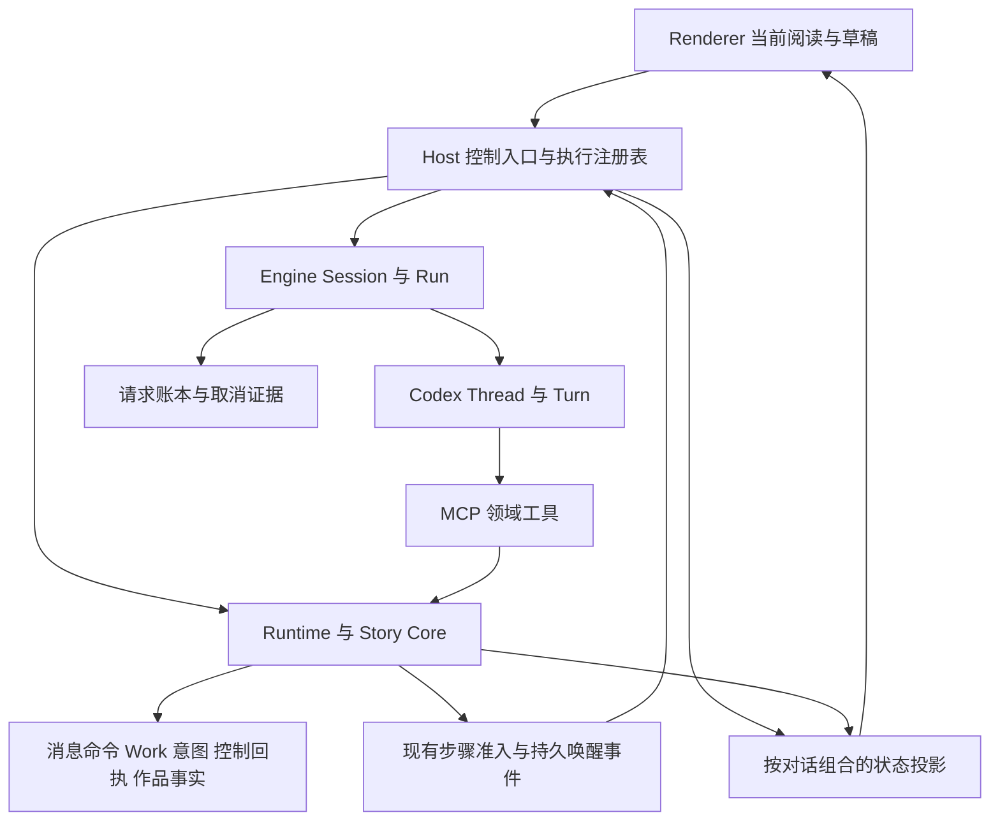
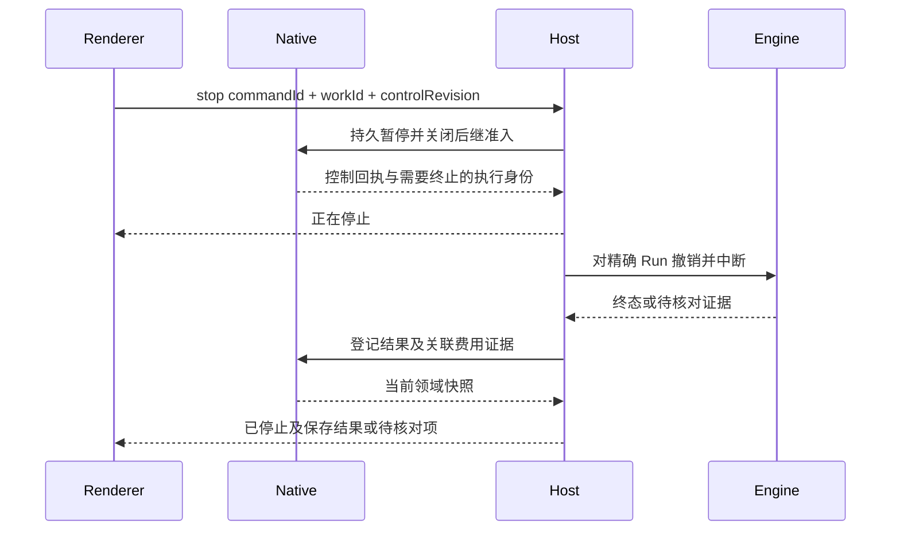

# 对话任务启动停止与临时切换设计

实施进度与验证见[实施记录](CONVERSATION_TASK_CONTROL_IMPLEMENTATION.md)。当前已接通可靠启停、独立控制修订、持久 Work 控制回执、本步结束后暂停、隔离执行域、同 Work 插问与返回、媒体持久消息、追加指令回执投影、快照游标合并及后台队列并行；完整 P0–P4 尚未全部验收。

日期：2026-10-09。状态：目标方案；部分实施，完成范围以实施记录为准。面向 Novel Codex 的小说、漫画与动画创作对话。

采用**持久任务控制、按对话独立执行、按资源校验并发、在原任务内接续**的架构。作者可以启动、补充、停止、插问和继续任务，也可以在任务运行时操作其他对话。当前界面只决定看什么，不决定后台任务是否运行。创作组织仍由模型决定，执行与保存必须服从真实身份、授权、版本和回执。

本方案复用现有 WorkTask、WorkStep、WorkAttempt、GenerationRun、作者消息、执行租约、Engine 账本和持久唤醒事件。主要调整 Host 的全局执行绑定、Renderer 的全局 busy 状态、消息交付以及控制合同。各里程碑是同一目标架构的完整切片，按当前版本一次性同步接口及调用方，不保留过渡双轨。

适用顺序为 [架构规则 B01–B10](../ARCHITECTURE_RULES.md)、[测试阶段工程策略](TEST_STAGE_ENGINEERING_POLICY.md)、本方案及相关专项合同。本文细化 [任务管理目标架构](TASK_MANAGEMENT_ARCHITECTURE.md) 的交互与执行控制，并将 [多对话方案](MULTI_CONVERSATION_DESIGN.md) 中保留全局执行锁的阶段边界推进到按对话执行；既有实施记录及验收结论不因此改变。

## 1 目标与交付边界

完整体验应支持以下连续操作：作者在 A 对话启动写作，切到 B 提问，回到 A 补充要求，临时插问后继续写作，主动停止，再于原对话恢复。过程中已保存成果、草稿、消息来源、任务身份及累计费用持续可查。

必须满足：

1. 发送立即得到可见反馈，持久接收与实际启动分别显示；启动过程中也能停止。
2. 停止不丢已保存成果，不自动放弃目标，不被排队消息或后台唤醒绕过。
3. 补充要求、下一条排队、临时插问和另开对话具有明确语义。
4. 切换对话不取消、不暂停、不转移原任务；不同对话可以独立执行。
5. 继续沿用原 Work 与有效成果，创建新的执行尝试，保留失败和费用。
6. 连接中断、停止失败、结果待核对、领域阻塞分别显示，提供真实可用动作。

本次不建设云端常驻执行、多人实时协作、分布式队列或另一套 Agent 循环。关闭某个对话视图不影响任务；退出桌面进程、系统休眠后的执行遵循第 11 节，不承诺应用退出后继续工作。Cursor/Codex 是交互目标，本方案不推断其内部实现，也不以界面相似证明能力相同。

## 2 当前工程基线

基线为 2026-10-09 工作区源码，Git HEAD 为 `d46bf6f40`，含已有未提交变更；以下是静态实现观察，不是本方案的运行验收。

| 已有基础 | 当前限制 | 本方案处理 |
| --- | --- | --- |
| [App.tsx](src/App.tsx) 已分开选中对话与执行归属，保留对话草稿 | `agentRun`、`executionBusy` 仍主导全局发送、新建、模型切换等入口 | 改为按对话订阅执行投影，局部控制各自准入 |
| [main.mjs](electron/main.mjs) 已贯通停止、Work 控制与恢复 | `activeAgentExecution`、`activeWorkFlow`、`activeRuntimeTask` 等共享可变状态限制第二个执行 | 以显式执行绑定和注册表管理，不再从全局变量推导目标 |
| `agent:interrupt` 已发出中断并取消关联任务 | 无目标参数，停止普通轮次可能同时取消整个 Work | 控制带身份与版本；停止、暂停和取消分别定义 |
| [codex-adapter.mjs](electron/codex-adapter.mjs) 已调用 `turn/steer` 和 `turn/interrupt` | 单实例持有一个 `threadId`、`turnId`、`turnWaiter` 与执行能力 | 每个活动执行域独立 adapter/运行绑定；不共享可变任务能力 |
| [task_intents.rs](native/story-core/src/task_intents.rs) 已保存追加指令及交付状态 | 限制 advisory，存在运行中动作时拒绝，交付与意图变更耦合 | 拆清消息交付与生效要求，补齐跨步骤的 Work 意图合同 |
| [useConversationOutbox.ts](src/useConversationOutbox.ts) 已保存待发送消息 | `localStorage` 与内存自动发送集合共同控制；切换会清除自动发送资格 | 本机草稿保留；已提交队列进入 Native 持久合同 |
| [work-execution-events.mjs](electron/work-execution-events.mjs) 与 [work_execution_events.rs](native/story-core/src/work_execution_events.rs) 已有租约、事件领取和接续 | 可用性仍依赖全局执行空闲、Renderer 存在和当前工作区 dirty | 按目标 Work、资源和宿主健康判断，脱离当前阅读界面 |
| [AgentEngineHost](../agent-engine/src/host/engine-host.mjs) 已按 session/run 保存绑定 | 产品嵌入仍可能共用 adapter、Bridge 和配置上下文 | 复用 Engine 多绑定能力，补齐产品端隔离与合同验证 |

Codex App Server 提供线程创建/恢复、`turn/start`、`turn/steer` 和 `turn/interrupt`。追加要求必须指定预期 Turn，不能借 steer 改变本轮模型；中断请求应与最终轮次状态分别处理。依据：[官方 App Server 文档](https://learn.chatgpt.com/docs/app-server)、[当前 Turn 协议](../../codex-rs/app-server-protocol/src/protocol/v2/turn.rs)。

当前源码还提供带 `client_user_message_id` 的输入及实验性线程队列：[Thread 协议](../../codex-rs/app-server-protocol/src/protocol/v2/thread.rs)。这些字段不能直接证明跨服务恰好执行一次，原生队列也不掌握作品许可与 Work 预算。本方案选择 Native 作为产品队列唯一权威，Host 在准入后调用 Turn API，不同时启用 Core 队列的自主派发。

## 3 作者操作的确定语义

| 操作 | 用户可见结果 | 持久语义 |
| --- | --- | --- |
| 空闲时发送 | 消息进入主线，显示正在启动或排队原因 | 接收一次作者输入，绑定对话；按意图关联已有 Work 或建立新目标 |
| 运行时发送 | 默认显示为补充当前任务；可看到已接收、已送达、已处理 | 向精确当前执行交付；改变要求须形成可追溯的 Work 意图修订 |
| 排队发送 | 在输入框上方显示待发送项，可编辑、删除、排序 | 保留消息与触发条件，不提前注入当前 Turn |
| 停止 | 先显示正在停止，随后已停止，可继续 | 作者暂停原 Work，关闭自动接续，撤销本次执行并核对结果 |
| 完成本步后暂停 | 显示将在本步后暂停；可再点立即停止 | 立即禁止领取后继步骤，只允许已授权的当前步骤按原合同收尾 |
| 取消任务 | 目标结束，已保存成果保留 | Work 进入 cancelled；不重新打开旧 Work/Attempt，后续新目标保留来源关联 |
| 继续 | 在原任务卡片继续推进 | 重新核对准入，创建新 Attempt，不改写旧终态 |
| 调整后继续 | 新要求与保留成果明确可见 | 保存新要求，重算相关依赖，冻结新输入后执行 |
| 临时插问 | 显示原任务暂挂，问题在同一主线回答；默认手动返回 | 建立返回关系；明确选择或要求问完继续才允许自动返回原 Work |
| 切换或新建对话 | 进入独立对话，可编辑与发送 | 只改变当前阅读/输入归属；原任务按自己的状态运行 |
| 临时换模型 | 标明仅下一轮、该对话默认或立即换模型继续 | 下一次执行解析新 SessionPlan；现有执行配置不被全局改写 |

主按钮“停止”采用立即停止语义。“完成本步后暂停”和“取消任务”放在任务菜单，避免三个近似按钮并列。取消不执行撤销、删除或回滚；采用、发布、撤销仍走各自领域合同。

正在停止时默认禁用重复执行操作，但允许写草稿、浏览和查看已保存成果。重复停止请求幂等返回原控制回执，不产生第二次取消或新任务。停止成功与成果全部交付是不同事实。

## 4 身份关系与事实权威

### 4.1 保持现有领域对象

| 对象 | 含义及唯一权威 | 关键约束 |
| --- | --- | --- |
| Conversation | Native 管理作品归属及元数据；Core 保存引擎对话历史 | 不是 Work；切换不授予权限 |
| AuthorMessage | Native 保存不可变作者原话、附件/引用与来源 | 消息可先排队再绑定 Work；模型解释不能改写原话 |
| WorkTask | Native 管理持续目标、要求、控制与交付投影 | 跨 Turn、重试及模型切换仍保留身份与累计费用 |
| WorkStep / WorkAttempt / TaskRecord | Native 管理领域步骤及每次尝试 | 沿用已有映射，不再创造平行 Run 账本；终态不重开 |
| GenerationRun | Native 管理长篇专属授权与检查点 | Work 控制转交其现有领域用例，在事务内保持一致，不复制其状态机 |
| Engine Session / Run | Engine 管理模型路由、租约、请求、取消及用量 | 不决定作品完成，不读取产品私有实现 |
| Codex Thread / Turn | Core 管理模型上下文与行动循环 | 一个 Thread 同时至多一个活动 Turn；不同 Thread 可并行 |
| ExecutionBinding | Host 持有可重建的进程与对象句柄映射 | 不是领域权威；失去租约即不能继续派发 |

对外使用 `conversationId` 表示产品对话，当前登记根线程可直接使用现有 ID，不额外复制一套对话库。`executionThreadId` 表示实际 Core 线程，允许是该 Work 的 writer/分析子线程。根对话、子线程、Turn 和 Attempt 的映射必须由受信绑定给出，不能仅因 `threadId` 相同就合并消息或结果。



### 4.2 每层负责的改造

- **Story Core / Runtime**：作者消息接收、命令幂等、Work 要求修订、控制版本、临时插问关系、步骤领取与提交有效性。修改当前建库定义及契约，不提供历史格式迁移。
- **Host**：验证 IPC 来源，解析精确目标，管理隔离运行实例、资源名额、事件订阅和恢复检查；只派发 Native 已准入的动作。
- **Engine**：提供按 Run 追加/取消和按 Session 隔离的公共合同；请求预留、用量及取消覆盖所有协议。产品不绕过 Engine 直接控制一个可变全局 adapter。
- **Renderer**：按对话显示正文、任务和控制；保存未提交草稿；不自动发送已提交队列、不猜测任务可恢复性。
- **模型**：理解自由文本，决定提问、创作、调整与恢复后的下一步；不得自行扩权或批准采用。Host 不按“继续”“改成”等关键词选择文学动作。

## 5 状态与控制模型

### 5.1 分开显示领域状态和执行阶段

沿用 `WorkTask.status` 的 `running / paused / blocked / completed / cancelled`。正在启动、停止、重连等属于执行投影，不塞进同一个 Work 状态字段。

| 状态轴 | 数据来源 | 示例 |
| --- | --- | --- |
| 目标控制 | Native Work/GenerationRun 及控制回执 | running、作者暂停、取消 |
| 派发条件 | Native 当前准入、临时插问关系；Host 资源名额 | 可领取、等插问、等资源、等相关编辑保存 |
| 执行阶段 | Engine/Host 对原执行的观察 | starting、running、waitingInput、stopping、reconciling、ended |
| 消息交付 | Native 消息命令与 Engine 交付证据 | queued、dispatching、delivered、deliveryUnknown |
| 产物交付 | Native 现有 deliveryReport | 已保存、部分交付、待核对、待作者采用 |
| 连接健康 | Host 实际连接及调度记录 | ready、reconnecting、offline |

Work 已暂停但当前执行仍在停止，是合法组合，界面显示“正在停止，已禁止继续执行”。只有运行实例已结束或隔离失效、后继派发已关闭且已知副作用已登记，才显示“已停止”；仍有未知结果时附加“部分结果待核对”，不虚构已回滚或零费用。

### 5.2 控制优先级与边界

1. 作者停止/取消提交成功后，先建立 Native 的执行限制，再向 Engine 发送取消。即使网络取消失败，旧执行也不能领取新步骤或提交未经许可的新结果。
2. 用户暂停、取消、权限撤销、失效执行代次优先于队列、临时返回、自动重试和持久唤醒。
3. 取消是目标终态；停止是保留目标的作者暂停。继续必须是新控制命令，验证当前版本，不复活旧 Attempt。恢复前必须让原 Attempt 的能力/执行代次永久失效，并核对原运行已结束或被隔离；不能仅把 Work 改回 running，使旧执行重新获得写入资格。
4. 自动接续不要求用户重复批准原许可范围。真实扩大范围或冲突仍经现有授权合同处理，不把设计评审变成额外确认。
5. 所有控制与保存按 Native 事务先后决定结果：先提交的有效成果保留；停止先生效则拒绝后到的领域提交。外部服务已产生但未提交的产物作为待核对证据保存，不直接采用。
6. Engine/Core 的 `completed` 只表达执行结束；Work 的 `completed` 仍须满足其领域完成合同，UI 展示交付时读取真实 deliveryReport。最终回复、领域产物完成和作者满意分别保留。

当前 `validate_active_task` 已按持久 Work 状态拒绝暂停等状态下的写入，见 [tasks.rs](native/story-core/src/tasks.rs)。实施应复用并验证所有受影响写路径经过该屏障，再补齐不可复活的 Attempt 撤销与执行代次检查，不能把现状描述为完全没有暂停保护。

“完成本步后暂停”在控制事务内冻结可收尾的 Step/Attempt 集合及其代次，Work 暂保持 running；仅该集合可按冻结权限收尾，禁止新步骤、替代尝试及自动重试领取。集合终态后转为 paused；集合为空则立即 paused。失败或未知进入核对，不启动后继；若当前步骤必须创建新动作才能完成，则保留未完成事实并收束暂停，不为兑现暂停前完成的文案扩权。立即停止直接 paused 并撤销当前执行，两者不能共用一个含混的 paused 布尔值。若任务已在控制事务前合法完成，停止返回已结束及实际交付状态，不把 completed 改成 paused，也不伪造停止失败。

## 6 应用命令与回执合同

以下为目标接口命名，实施时与 Runtime、preload、类型及测试一次性同步。可共用命令封装，但各命令使用独立的判别类型，不接受任意字段包。

```ts
type CommandIdentity = {
  commandId: string;             // 一次作者操作，网络重试保持不变
  projectId: string;
  conversationId: string;
};

type ExecutionTarget = {
  workId: string;
  attemptId: string;
  engineRunId: string;
  executionThreadId: string;
  turnId: string | null;         // 启动前可为空，不能据此省略执行身份检查
};

type WorkControl = CommandIdentity & {
  workId: string;
  expectedControlRevision: number;
  action: "stop" | "pauseAfterStep" | "cancel" | "resume";
};

type ReturnFromInterlude = CommandIdentity & {
  workId: string;
  interludeId: string;
  expectedControlRevision: number;
  expectedInterludeRevision: number;
};

type SubmitMessage = CommandIdentity & {
  mode: "send" | "steer" | "enqueue" | "interlude";
  targetWorkId: string | null;
  expectedTurnId: string | null;
  expectedControlRevision: number | null;
  message: AuthorInput;         // 原话、冻结引用、素材及只读属性
  modelChoice: ModelChoice | null;
};
```

`AuthorInput` 与 `ModelChoice` 为现有输入、引用及连接契约的组合概念，不能将这里的示意当成已实现类型。不同 mode 的必填字段由判别类型和真实 schema 收紧：steer 必须匹配活动执行；enqueue 必须明确触发条件；新对话发送不携带不存在的 Work 版本。

`controlRevision` 只随停止、取消、继续等影响整个 Work 的作者控制变化，和作品内容版本、意图修订、用量事件分别比较。消息处理阻挡与临时返回记录有各自修订，领取和返回同时核对这些条件；正常嵌套插问不会仅因局部记录变化使父层授权莫名失效。停止 Work 时不能因为普通进展更新而持续 CAS 失败；同时不能在任务从暂停变为运行后，用旧停止回执覆盖新执行。控制目标为原 Work 下当前合法执行集合，停止整个 Work 的子任务；精确停止某个子任务属于另一个显式操作。

回执至少包含：

- `commandId`、真实目标身份、持久接收结果、当前控制修订和快照版本。
- `accepted / alreadyApplied / rejected`；跨服务派发另有 `notSent / sent / deliveryUnknown`，不混用布尔 `success`。
- 结构化原因、产生边界、已知副作用、当前允许动作。版本冲突附新快照，供用户操作刷新，不静默换目标。
- `accepted` 仅证明本地命令已持久化；`delivered` 证明指定输入已进入引擎；`processed` 须有对应处理回执。不能把模型一句“收到”当作授权生效。

Native 对 `(authorIdentity, commandId)` 做唯一约束，规范化请求摘要相同则返回已有回执，摘要不同则拒绝。Author 身份来自受信会话，不信任 Renderer 或模型自报。所有目标还须校验作品、Edition/scope、对话归属、归档、执行代次及权限。

## 7 消息队列与作者要求

### 7.1 单一交付权威

将已提交消息的接收、排队、领取及交付统一到 Native 的消息命令记录。AuthorMessage 保留不可变原话；Work 意图记录保留解释、要求修订及生效关系；消息命令拥有唯一交付状态。现有 TaskIntent 的 `pending/delivered` 交付职责一并收敛，不另留一套独立的交付状态机。

排队前的草稿继续属于 Renderer。用户提交后，Native 保存输入与冻结来源；UI 得到持久回执才清空相应草稿版本，提交等待期间新写的草稿不被清除。入队失败保留原输入。队列项的编辑创建新内容修订，领取后不允许偷偷改写；取消或更新与领取在事务中竞争。

每条队列项绑定对话、发送模式、触发条件、作者控制版本及模型选择。默认 `afterWork`，绑定输入框当前目标，显示“当前任务结束后发送”，要求该 Work 正常 completed。另提供显式 `afterTurn`，绑定当前对话精确 Thread/Turn，显示“本轮结束后发送”；没有可绑定的对话 Turn 时不提供该选项。不得在执行阶段变化时静默切换触发方式，也不能把内部 writer 结束误认为整个任务完成。

触发对象与新消息的执行目标分别保存。等待 A 完成不意味着把随后所有消息写入已完成的 A；新的独立目标建立关联来源明确的新 Work，已完成 Work 不重开。仍属原未完成目标的后继消息，按当前意图与控制准入关联原 Work。

队列仅在其绑定条件正常满足后可派发；失败、暂停、取消、待核对结果会使相关队列进入 held，并显示原因。触发检查还要求前一执行已结束/隔离、对应线程无其他 Turn 占用，并与既有自动接续在同一准入处竞争；用户消息优先于尚未领取的内部接续，不靠两个消费者分别抢跑。用户选择继续时明确包含哪些待发送项，不能恢复整条会话里未经检查的所有工作。

切换界面不改变队列策略。Renderer 重载可重新读取并继续观察；Host 重启后先核对在途状态，尚未派发的付费队列默认等待作者继续，不能因打开应用突然发出新请求。需要跨进程重启自动接续的未来产品设置须另有明确授权，不默认引入。

### 7.2 补充消息不等于授权修订

普通运行中发送默认作用于当前可交互工作，UI 在发送按钮旁标明目标。读取进度、解释和简单补充可使用 steer，但不因此自动授予新增写权限。

模型消费原消息及上下文后，通过公开领域合同提出 `answer / amendWork / interlude / replaceGoal` 等解释。Native 记录解释与作者来源、验证其权限效果。纯提问不推进创作要求代次；实质调整保存新的 Work 意图，失效相关步骤与写入能力，仍保留独立有效产物。

尚未判明是否改变要求的新消息，给目标 Work 的后续创作变更设置“待处理作者输入”准入条件，允许只读理解、既有回执核对及绑定该 messageId/修订的解释处理合同。处理事务以 CAS 核对消息、控制修订和解释来源，原子登记结果、更新要求、撤销受影响旧能力并解除或替换本消息建立的阻挡；不是让模型拥有通用解除控制权。该条件不扩展到其他 Work；若模型未能处理，显示具体阻塞及重试/撤回输入动作，不让旧要求下的新写入悄悄继续。已经开始的外部操作按原执行记录结算和核对，提交时仍检查最新准入。

现有独立审阅、冻结材料核验等任务不一律开放 steer。其输入冻结不变量保留：作者要求变化时结束该尝试，准备新的合法输入，并在原 Work 下启动后继尝试。新增机制不能仅删除 advisory 限制或绕过运行中动作守卫。

## 8 Host 与 Engine 的执行隔离

### 8.1 执行注册表

把 `activeAgentExecution`、`activeWorkFlow`、`activeRuntimeTask`、`activeAgentProjectId`、`activeGenerationRunId` 等改为显式执行上下文，并逐一传入当前调用链。同步处理 `codexAdapter`、`modelBridge`、`advisorySteerInFlight`、`modelConnectionGate`、`recoveryRefreshPromise` 与单个 `turnWaiter` 的共享状态，不能只替换一个 active 变量。拟设 `ExecutionRegistry`，按 `engineRunId` 保存句柄，按作品/对话/Work 建索引；每个回调捕获不可变 owner，而非读取最新选中对象。

注册表持有 adapter、Bridge、取消句柄、问题/审批请求、事件订阅、租约及执行完成 Promise。领域结果、Work 状态和费用仍回读原权威。已有 `WorkExecutionOwners` 继续续租；失效回调从注册表定位对应 Work，不中断其他运行。

现有 `WorkExecutionEventConsumer` 继续作为唯一后台事件派发入口，改为按目标准入和资源名额领取。新的调度逻辑只做公平排队、容量与已准入动作派发，不选择文学步骤，不增加另一个周期性创作规划器。

### 8.2 运行实例与进程

目标采用按活动安全上下文隔离的 runtime 实例池。每个并发执行域独立持有 SessionPlan、任务能力、Bridge 请求集合、MCP 执行身份和 adapter。现有进程级环境携带任务能力，不能简单让两个 Run 共用同一进程的可变环境或 `turnWaiter`。

最初按活动执行域隔离 App Server/Bridge 进程，复用符合身份与配置条件的空闲实例；复用前解除旧能力并核对无在途请求，不能把 A 的授权带入 B。实例的保留与并发容量由资源压测配置，不以任意轮次或总时长上限替代任务完成。不得为每条消息无限创建常驻进程。

同一个 Core Thread 只有一个有效运行所有者，恢复线程先取得持久领取权。不同对话可分配独立实例；并行 writer 仍受各自执行身份与资源准入约束。共享进程多线程复用只有在租约、工具配置、取消树和断连影响均能隔离并通过合同验证后才可替换实例实现，不能成为首版前提。

Engine 公共 API 补齐按 Run 的 `steerRun`，内部核对 Session、Turn、执行代次与输入回执，再调用 Core。取消沿用 `cancelRun`，覆盖在途模型请求、工具/子执行及重试派发。无法取消的外部服务明确标记待核对，先阻断其领域提交；不能仅停止文本流就显示任务已结束。

模型配置采用“全局默认 → 对话默认 → 本次发送选择”的明确优先级，在领取时冻结连接修订与 SessionPlan。更改 B 的模型不修改 A 的 adapter、环境、预算或证据。立即换模型是停止原尝试、核对、副作用处理及同 Work 新尝试；不自动切到未经准入的供应商。

## 9 核心操作时序

### 9.1 启动与启动期间停止

1. Renderer 生成稳定 commandId，冻结对话和提交内容，显示正在发送；不根据后续选中对话改变目标。
2. Native 持久化消息命令及接收回执；每个模型执行在派发前归入合法持久 Work，免费或本地模型也遵守身份与控制合同。普通问题沿用现有 conversation Work 表达讨论目标，拥有停止、租约、恢复和计量身份，但不因此具有作品写权限；排队尚未执行时可暂不创建 Work。
3. Host 获取当前消息版本、执行控制、线程所有权及资源准入，再领取步骤/Attempt；能力与模型路由按本次请求解析。
4. Engine 建立 Run 和租约，Host 在真正发送前再次检查领取权，记录派发身份，调用 `turn/start`。
5. Start 回执和 Turn 绑定持久化后，通过事件更新对话投影。晚到回执仍归属原 commandId/Attempt。
6. 在任意启动阶段收到停止，都先持久化控制意图。若尚未发送，关闭领取不调用模型；若发送状态不确定，进入核对，不因缺 turnId 假装未启动。

停止和创建还须有同一 Native 事务中的排序依据。启动尚无 Work 时可按 commandId 取消待启动命令；Work 一经绑定，控制跟随绑定，不能留下“消息已启动但停止只取消了队列”的窗口。

### 9.2 立即停止



在 Native 不可达时，Host 仍可对已知精确执行发出紧急取消并冻结本机派发，但显示“停止执行已请求，任务暂停状态待确认”。Host 在本地持久控制传输日志记录待确认命令；重启和重连必须先核对此日志，才能开启相关派发。该日志只记录命令及未确认传输，不成为 Work 状态权威。日志本身保存失败也必须可见，不能宣称暂停已可靠保存；其他宿主的停止结果只有 Native 或真实运行证据能够确认。

子 Agent、媒体生成、MCP 调用和供应商重试均绑定取消域。对无法回收的外部请求持续核对原请求回执；已结算费用不退回，不因取消丢掉仍可取得的用量证据。终止进程只能影响本运行域，不能为停 A 而杀掉 B。

### 9.3 补充要求与 Turn 结束竞态

Native 先保存消息，然后 Host 针对预期 Turn 调用 steer。若 Turn 已明确结束且消息确定未送达，则按当前作者控制和原 mode 转为同一消息的后继轮次；新尝试仍归原目标，不制造第二条作者消息。

若 steer 已发出但回执丢失，状态为 deliveryUnknown。优先使用原 commandId/客户端消息 ID 与 Core 历史证据核对；没有足够证据时停止相关派发并展示核对状态。不得以“接口返回错误”推断未消费，也不得盲目重发。客户端消息 ID 的实际去重及历史可检索性必须由当前构建验证，协议有字段不等于有跨服务事务。

实质要求变更在 Native 事务内使相关写入许可/执行代次失效。已冻结旧输入的 writer 或审阅尝试不能直接获得新范围；必要时中断并建立原 Work 的后继尝试。被替换的旧结果保留来源，可查看但不冒充新要求下成果。

### 9.4 临时插问与返回

持久返回记录至少包含：原 Work、插问消息、插问 Step/Attempt 身份、直接父返回记录、原控制修订、返回条件、来源修订、已保存成果引用、原要求修订、暂停前执行引用、以及自动返回授权来源。它不复制正文、预算或模型私有推理；后续恢复从原权威回读。

插问固定为原 Work 内的显式 interlude Step/Attempt，继承原预算及来源限制，不另开账户。原 Work 保持 `running`，`interlude` 关系只阻挡原创作分支及其普通后继，允许经 Native 准入并与该返回记录精确绑定的插问执行，不能仅凭客户端 mode 绕过阻挡。UI 显示“暂挂，正在回答问题”。它与作者 `paused` 明确区分；后台持久唤醒必须检查这个阻挡，不能趁原尝试结束就继续创作。

默认在同一产品对话按时间呈现：原执行安全让出、回答插问，随后保持暂挂并显示返回原任务；有已记录的问完继续授权时才自动接续。同一个 Core Thread 不同时运行两个 Turn；需要独立执行线程时使用显式绑定和最小合法上下文，不复制原 Work 写权限。插问只要求解释时，只提供只读能力。若需要讨论产生候选，按原有领域授权准入。

只有以下条件同时满足才自动返回：作者通过“问完继续”明确选择，或原话包含该授权且被记录；插问已完成；原 Work 未被作者暂停/取消；返回记录控制版本仍有效；旧执行已收束；写入、费用、来源与许可允许继续；没有未处理的更新要求、问题或审批。默认普通“临时提问”显示返回按钮，不能凭模型建议擅自自动恢复。

“返回原任务”是独立于 paused→resume 的结构化命令，调用 `ReturnFromInterlude`：安全结束尚未结束的插问，核对旧 Attempt/未知结果，再以 CAS 关闭该返回记录、解除其专属阻挡，并准入原 Work 的新 Attempt。正常回答后的手动返回、插问失败后的返回与自动返回共用该领域用例；自动调用还必须验证授权来源。准入失败保留原阻挡和具体原因，不先让原任务运行再补核。

开始插问也通过持久命令分阶段完成：先在 Native 事务中冻结原分支派发并登记返回关系，再收束原执行；原线程可用后才领取指定插问 Step。收束失败保持“正在暂挂/待核对”，不能同时启动两个 Turn。停止、开始插问及返回在相同控制版本和关联记录上竞争，失败方回读当前状态。

插问期间点停止，原 Work 进入作者暂停，同时停止整条插问链，所有自动返回失效。取消原 Work 同样终止插问链，目标进入 cancelled；已完成回答与成果保留。插问失败或结果未知时保持暂挂并显示“重试问题”“返回原任务”“停止任务”中实际可用动作。多次插问保存无环父子关系，每次只返回直接父层、逐层验证授权；内层完成不能跨过外层的手动返回要求。每次返回仅能解除本记录建立的阻挡，不能解除其他插问、作者输入或授权造成的阻挡。重复或已失效返回事件无副作用。若临时请求成为新长期目标，模型提出有来源的分离方案，不把原任务静默替换。

### 9.5 继续与调整后继续

恢复输入由 Authoring 从原 Work 组成：原要求及最新修订、真实有效产物引用、原文读取入口、未完成步骤、首次失败与当前阻塞、写入核对结果、预算账本引用和执行能力。摘要用于导航，不替代真实来源与完成证据。

Native 先处理未知写入，再分别判断费用、来源及作者控制。只需恢复已保存结果时使用现有 `recoverSavedResult` 路径，不隐式升级为新模型请求；需要模型执行时才创建新 Attempt。来源变化走有依据的调整后继续，不篡改旧尝试输入。

没有用户设置的 token 上限时，已终止且已登记历史未知费用，不因未知费用标签永久锁死原 Work；但同一个未知供应商请求不得重发。存在有限上限时，未知预留必须参与准入。未结算在途请求、历史未知费用和未知写入分别展示，沿用 B05/B06。

## 10 跨对话并发与作品编辑

| 并发情况 | 处理 |
| --- | --- |
| A 写作，B 读取已保存版本 | 可并行；B 明确读取版本，不混入 A 尚未提交的内容 |
| A 和 B 属于不同作品或独立 Edition | 根据资源容量独立执行，费用及能力分别绑定 |
| A 和 B 写不同对象且依赖不冲突 | 允许并行生成；各自使用冻结来源及提交 CAS |
| A 和 B 为同一正文生成独立候选 | 可隔离生成；各自保存到独立候选，不能互相覆盖 |
| 两个执行推进同一当前候选头或正式版本 | 对具体提交对象事务串行，冲突方重读并由模型判断，不静默覆盖 |
| B 改动了 A 确实依赖的设定/正文 | A 后续相关提交需核验依赖，必要时调整后继续；无关变化不全局阻塞 |
| 作者有未保存编辑 | 草稿不变；引用未保存内容仍只读；只阻止与该编辑对象冲突的自动写入 |
| A 等待用户回答，B 可运行 | 不占用 B 的交互入口；A 的问题持久归属原执行 |

长模型请求不持有 SQLite 写事务或全作品锁。作品对象的版本比较在提交时完成，必要短锁仅覆盖实际争用对象。线程单活跃 Turn 约束属于上下文正确性；作品级全局 busy 不再作为通用安全机制。

当前部分写入路径仍依赖项目级 input revision。不同章节或对象可并行写的前提，是所有受影响路径已经明确真实读取依赖、提交 CAS 与失效范围，并有相应回归证据。完成之前只开放跨作品独立执行、同作品并行读取及已证明安全的候选路径，其余冲突写入排队；不能用章节锁代替现有来源有效性或授权校验，也不能提前宣称同作品任意并行写已支持。

Host 对各对话公平轮转，以等待时间避免长期饥饿；停止与回答已有问题优先处理，不排在长模型请求之后。并发名额来自实测的进程内存、供应商限流、模型上下文容量及显式预算。没有名额时保留队列并显示“等待执行资源”，不抹成“模型不可用”，也不终止作者目标。

## 11 事件投影与恢复

### 11.1 事件只更新它所属的执行

Host 发出的受信事件包含项目、对话、Work/Attempt、Run/Thread/Turn、运行代次及事件来源；源协议没有的字段由绑定查得，不能从模型输出中猜测。用户输入请求和审批还绑定 requestId 与原进程代次，旧问题不能提交给新 Turn。

Renderer 使用按对话的外部 store/订阅，替换单个 `agentRun` 驱动整页。正文和公开工具进展按 itemId 聚合；不保存、展示模型私有推理。切换只改变订阅选择，后台消息仍归原对话。非活动对话收到完成、失败或提问时更新状态与未读标记，不抢焦点。

采用“权威快照 + 快照之后事件”的订阅合同。Native 控制/领域事件有自己的持久序号；Engine 流事件使用原运行序列与 item 标识，不能假设不同来源共享一个递增时钟。组合快照返回各源游标，注册订阅时缓冲窗口内事件并按来源去重。遇到缺口回读快照/历史，不靠增加旧快照覆盖新状态。

Core 继续保存对话历史，Native 保存作者来源、任务及必要控制证据；不另建完整 transcript 真相。UI 可有可丢弃缓存与阅读锚点。确实没有持久化的流式尾部标为历史不完整，不承诺逐 token 恢复。

### 11.2 不同故障的恢复动作

| 故障或生命周期 | 自动处理 | 需要保留的事实 |
| --- | --- | --- |
| 切换/卸载对话组件 | 只换订阅，不影响执行 | 草稿、阅读位置、Run 归属 |
| Renderer 崩溃后重载，Host 仍存活 | 读取各对话快照并重连；已授权执行继续 | 相同 Run/Turn，不重发作者消息 |
| App Server/Bridge 退出 | 撤销失效执行，核对历史、提交及请求 | 原 Attempt、首次错误、已保存成果、未知结果 |
| Host 重启 | 校验旧租约失效与请求状态；先恢复展示和本地核对 | 原命令、控制版本、返回关系、累计用量 |
| 应用退出 | 本地持久记录停止/恢复检查；受控关闭运行实例 | 不承诺退出后运行；重开后显示实际可继续动作 |
| 系统休眠/网络断开 | 恢复后核对租约、Core 运行状态与在途请求 | 不能把断线直接判为失败或未发送 |
| 事件丢失/重复/乱序 | 按来源重放或刷新，幂等处理终态和费用 | 不回退控制修订，不重复派发 |

Host 重新启动不能沿用旧进程的重试承诺。执行健康投影需给出失败阶段、当前是否安排重试、下一次核对及真实可用动作。仅修改日志不构成用户可见恢复。控制传输与 Core 创建/注册之间存在跨服务窗口，应通过持久关联与核对处理；若某一步无法证明是否已执行，保留未知，不宣称跨服务原子性。

## 12 对话界面与可访问性

主线保持“作者消息 → 有意义的进展 → 结果”。每个持续目标有轻量任务条，显示当前状态、已保存成果入口及一个主要动作；执行细节折叠。临时插问显示“原任务暂挂”和“回答后继续/手动返回”，返回后在原任务条说明接续，内部恢复不重复生成用户消息气泡。

| 当前状态 | 输入框与主要动作 |
| --- | --- |
| 空闲 | 发送；模型选择标明下一次执行 |
| 启动或资源排队 | 保留可编辑草稿；可停止待启动命令 |
| 正在执行 | 默认补充当前任务；菜单提供排队和临时提问；独立停止按钮 |
| 需要回答或批准 | 定位当前对话对应问题；允许停止、查看任务和打开其他对话 |
| 正在停止 | 显示真实阶段；禁用重复推进，保留草稿 |
| 作者暂停 | 显示继续、调整后继续；新独立问题不会自动恢复原任务 |
| 暂挂插问 | 显示插问和返回关系；停止会解除自动返回 |
| 执行受阻 | 显示具体原因及真实允许动作，不统一引导重配模型 |

同一对话有多个未完成目标时，输入框显示本次目标；默认选择最近明确交互的目标，而非后台恰好活跃的某个 Run。无法确定的实质写作指令由模型澄清一次，不能随机选择。停止按钮绑定任务条中的目标，任务列表可独立控制其他目标。

对话导航显示运行、等待回答、暂停、完成未读等简洁标志。后台状态条只跳转原对话定位任务，不在 B 对话展示 A 的停止、授权或审批按钮；独立任务列表则显示完整目标身份后控制。草稿、附件、引用、输入模式、模型选择与待提交内容均按作者/作品/对话隔离。重命名、置顶、查看不再因其他对话执行而禁用。归档活动对话需明确停止或等待，不能把有活动任务的对话隐藏为无事发生。

输入遵循现有 Enter/Shift+Enter 约定，输入法组合期间不发送。发送、停止、队列和返回均可键盘操作并有可访问名称；状态使用有限频率的 live region，不逐 token 重播。流输出只在接近底部时跟随，用户上滚后保留锚点并提供回到最新。长历史分页/虚拟化不能破坏选区、复制和引用。

体验验收预算是测量目标：本地发送/停止交互反馈 P95 不高于 100ms，已有缓存对话切换 P95 不高于 200ms；在指定基准设备、固定历史规模与无外部模型等待的条件下测量。它们不是任务超时，也不能通过丢消息、提前宣称停止或缩减作者要求达标。启动、首个进展、取消收敛、重连和资源占用另记录分位数，真实数据形成阈值后再冻结发布指标。

## 13 受影响状态判定表

| 输入事实及权威来源 | 合法结果 | 副作用与账本 | 下一步 | 验收 |
| --- | --- | --- | --- | --- |
| 旧 Turn 已结束，新 Turn 已启动；消息预期旧 Turn | 拒绝错误目标，返回当前快照 | 不向新 Turn 偷送消息 | 只有确定未送达且符合原模式才能接续 | C04 |
| Native 停止先于旧写入提交 | 拒绝旧执行提交 | 已完成外部消耗仍登记；产物待核对 | 保持作者暂停 | C03 |
| 有效保存先于 Native 停止 | 保留已保存成果 | 不回滚、不清零用量 | 停止后继执行 | C03 |
| 停止期间启动回执晚到 | 纳入原控制目标并终止 | 不创建替代 Work | 核对原 Run | C02 |
| 原 Work 作者暂停，旧接续或插问完成事件到达 | 不派发 | 仅更新原事件证据 | 等待作者继续 | C06 |
| 插问正常完成，自动返回来源有效且版本未变 | 领取原 Work 合法后继尝试 | 保留要求、成果与累计费用 | 自动接续 | C05 |
| 有读取许可，无新增写许可 | 可回答，拒绝越权写入 | 拒绝调用零作品写入 | 需要扩大范围时使用现有授权入口 | C08 |
| 本次 schema 未加载但领域允许 | 通过真实发现合同处理 | 不伪装成永久无权，不猜工具别名 | 加载后重新校验调用 | C08 |
| steer 已发送、确认丢失 | deliveryUnknown | 不再派发同一请求 | 按身份核对历史/回执 | C04 |
| 有历史未知费用，无作者设置的上限，原请求已终止且已登记 | 不仅凭历史未知永久阻塞 | 保留未知条目，不重发原请求 | 其余准入通过可接续 | C09 |
| 有有限上限且未知在途预留影响余额 | 暂缓相关执行 | 不忽略预留 | 核对余额与原请求 | C09 |
| 未知写入与未知用量同时存在 | 分别记录，不覆盖首因 | 不盲目重试写入 | 先核对对应权威 | C09 |
| A 执行中，B 有未保存编辑且无依赖交集 | B 草稿保留，A 继续 | 不自动保存 B | 按对象独立控制 | C10 |
| 同一对象版本已被其他对话改变 | 提交 CAS 冲突 | 保留候选，不静默覆盖 | 模型核对真实相关影响 | C10 |
| 非活动对话 A 的审批/错误到达 | 更新 A，标记需要处理 | 不显示为 B 的错误或问题 | 用户进入 A 处理 | C11 |
| 引擎模型结束但必需产物未满足 | 仅执行结束或部分交付 | 保留已有成果和缺口 | 原 Work 决定合法下一步 | C13 |

## 14 实施包与退出条件

| 阶段 | 完整实施范围 | 退出条件 |
| --- | --- | --- |
| P0 控制与消息合同 | Native 消息命令/控制版本；停止与取消分离；启动停止竞态；精确身份贯通 IPC、Runtime、Engine、Renderer | C01–C04、C08、C09、C13 相关合同通过；真实应用可停止并在原 Work 继续 |
| P1 执行隔离与多对话 | Host 注册表；隔离 adapter/Bridge/MCP；按对话 store；元数据操作解锁；模型配置按执行冻结 | A 运行时 B 可以新建、发送、提问；停止 A 不影响 B；C07、C10–C12 通过 |
| P2 运行中调整与临时插问 | Work 意图修订；消息交付核对；临时返回关系；纯问题与实质变更区别；冻结审阅的后继尝试 | C04–C06、C08、C14 通过，作者暂停不可被自动返回绕过 |
| P3 持久队列与恢复体验 | 现有事件消费者接入已提交队列；快照加游标；Renderer/Host 故障恢复；相关编辑保护；后台健康 | C02、C06、C09、C11、C15–C17 通过；重开无隐式重发 |
| P4 产品验收与资源收敛 | 主线交互、历史表现、可访问性、性能、跨平台和真实模型旅程 | C18 通过；有能力矩阵、构建身份和未验收边界，才能宣称完整体验交付 |

P0 建立消息持久接收与精确控制，不开放未实现的高级交互；P3 完成队列编辑、触发与恢复体验。每阶段一次性替换所涉及的旧接口及调用方，未完成能力不挂假入口；分阶段不意味着同一职责保留两套实现。

实施落点：

- `native/story-core`：复用 Work、author_message、task_intents、work_execution_events、任务保存与预算模块，按职责拆出消息命令和临时返回用例；修改建库及真实事务测试。
- `native/story-runtime`、`native/story-mcp`、`native/story-authoring`：同步控制/消息/恢复 DTO、作者来源与工具能力；Author-only 控制不暴露给模型冒充作者。
- `electron/main.mjs`：缩减为组装和 IPC 注册；执行注册、命令交付、快照订阅分别进入职责明确的模块；所有旧全局读取同步移除。
- `electron/codex-adapter.mjs`、`work-execution-events.mjs`、媒体执行器、模型连接门禁：逐一解除错误的全局绑定，保留真实租约、配置和预算检查。
- `agent-engine`：扩充通用 Run 追加与回执、隔离取消及恢复公共合同，不导入产品领域。
- `src/App.tsx`、`useConversationOutbox.ts`、任务控制 hooks、状态与问题组件：按对话订阅与精确命令更新，不保留前端自动派发队列。
- `shared`、preload、生成资源、fixture 与现行文档：同一切片同步，禁止旧字段 fallback。

Codex Core 不作为默认改造点。若当前公共协议不能满足已明确的通用回执/取消能力，先验证当前构建并按 B09 完整同步官方更新，再评估已登记的最小补丁；不能为产品方案直接绕过上游更新及 Fork 门禁。

## 15 验收矩阵与证据

| 编号 | 场景 | 必须观察到的结果 |
| --- | --- | --- |
| C01 | 双击发送/继续、Enter 连发、持久化响应丢失 | 一条逻辑消息、一次领取；相同命令不同正文拒绝；新草稿保留 |
| C02 | 入队、领取、模型连接、Turn 创建各阶段停止，再重载 | 未发送零模型调用；已发送精确终止；身份不明则待核对；无漏停 |
| C03 | 保存/完成与停止的事务顺序、重复终态、停止失败、停止中发送 | 先保存则保留；先停止则拒绝新提交；完成先到保持完成；停止中输入留草稿；恢复不复活旧 Attempt |
| C04 | steer 遇 Turn 结束、确认丢失、重复消息、晚到回执 | 不串 Turn、不重复注入、未知可核对；只有确定未交付才转后继轮次 |
| C05 | 写作中“先解释这个设定，再继续”、手动返回、多层插问 | 精确插问 Step 可执行而原创作分支暂挂；只按直接父层和有效授权返回同 Work；费用连续 |
| C06 | 插问中停止、队列恢复与旧自动唤醒竞争 | 作者暂停优先；重放事件零新执行；继续必须有新的有效作者控制 |
| C07 | A 写作，B 新建/发送/切模型，再停止 A | B 独立完成；环境、工具身份、模型和用量不串；A 停止不杀 B |
| C08 | 纯提问、扩大范围、未保存引用、冻结审阅更新 | 问题不扩写权；范围不足拒绝；只读保护不破；冻结输入不被改写 |
| C09 | 未知写入、未知费用、有限/无限额组合 | 按第 13 节处理；首次错误保留；同未知请求不重发；不清账 |
| C10 | 同正文双候选、同头提交冲突、无关草稿编辑 | 独立候选保留；正式提交 CAS；无关编辑不全局停工 |
| C11 | 切换时审批/提问、重复事件、断线后旧消息到达 | 只更新原对话；问题绑定原请求；过期回答拒绝；无抢焦点 |
| C12 | 同一线程被两个 Host/实例同时恢复，租约过期 | 只有有效所有者派发；旧代次写入及续期拒绝 |
| C13 | 模型结束但产物缺失、局部保存、非必需分析失败 | 执行结束与交付区别；保留有效成果，不降低完成条件 |
| C14 | 修改要求后旧 writer 输出到达，再调整后继续 | 旧输出不冒充新要求；新 Attempt 绑定新依据；目标与预算连续 |
| C15 | Renderer 崩溃，Host/Engine 持续运行 | 重载恢复原执行；不重新发送；草稿及历史按可持久范围恢复 |
| C16 | Host 在领取后、发送后、回执前崩溃 | 逐个窗口有持久证据；恢复先核对；无盲目重复付费 |
| C17 | 队列编辑/删除与领取竞态、多步骤 Work、重启、过期引用 | 只能一个版本生效；普通步骤结束不触发 afterWork；afterTurn 不偷换条件；重启不偷偷派发 |
| C18 | 完整作者旅程、键盘/输入法、长历史、macOS/Windows | A/B 独立、插问返回、停止重开再继续；状态可读、焦点稳定、资源有界 |

测试分四层：纯状态投影测试验证展示；真实 SQLite/Runtime/Engine 合同验证身份、版本和副作用；受控 provider 的 Electron 旅程验证窗口时序与故障注入；真实模型旅程验证理解“补充、插问、换目标”及实际创作接续。前两层不证明真实模型理解，受控模型不证明供应商取消与文学质量。

每个实施包运行 `npm run architecture:check` 和受影响合同测试。共享执行合同变更扩展至 Engine 多协议、取消、终止帧、真实用量存在/缺失和幂等结算；完整产品入口变更需实际应用再验。仅文档变更核对引用、结构及差异，不调用付费模型、不重跑无关全量测试。

真实旅程使用隔离作品与一句简短目标，不由验收者逐步指导模型或手工修稿。保留每次失败及源码/BuildIdentity、供应商、操作时间线、消息/任务/请求关联、产物及费用证据；正文和凭据不进入无关诊断日志。取消耗时、消息延迟、队列等待和实例内存均报告实测值，不用自动测试数量代替体验结论。

## 16 方案取舍

| 选择 | 原因与代价 |
| --- | --- |
| 复用现有 Work 与持久事件 | 保留领域权威和已建立的恢复机制；需要整理现有全局调用链 |
| Native 持久产品队列，Core 执行 Turn | 领取与作品许可可以统一判断；不能同时依赖 Core 自主队列；跨服务交付仍需核对 |
| 按活动执行域隔离进程 | 隔离当前进程级能力与取消影响；内存成本高于共享进程，需实例池及容量实测 |
| 一个 Core Thread 单活跃 Turn | 避免上下文与消息顺序竞争；同对话插问通过安全交接，不承诺原推理原地恢复 |
| 保留独立候选与提交 CAS | 能支持并行创作且不覆盖作者版本；冲突可能需要模型重新核对 |
| 停止默认保留目标 | 适合对话反复调整；取消和撤销需单独说明 |
| 状态快照与必要事件结合 | 界面可重建，避免全量事件溯源工程；未持久的流式尾部不虚构 |

## 17 设计评审与当前交付记录

### 17.1 实施前责任检查

本次变更为方案与索引文档。未来实现涉及 B01–B10，其中 B02 控制模型决策边界，B03/B06 约束单一事实和恢复，B05 约束累计授权及用量，B08 约束按原因展示。领域控制放 Native，是因为必须与领取和保存原子判断；Host 注册表只管执行句柄，Engine 只管通用执行，Renderer 只做投影。

新增消息/返回关系的实际消费者分别是命令交付、Work 准入和对话展示；不要求预先完整故事建模。冻结的原作和素材按真实操作依赖读取；没有语义库仍可合法只读和局部创作，真实必要来源缺失仍阻断相应操作。

公开合同覆盖 Author IPC → Runtime 用例 → Story Core 事务，以及 Host → Engine → Core；结果经事件与快照返回 Renderer。变更必须同步消息、任务控制、生成、审阅、媒体、自动接续、问题回答和模型配置的调用方。易混淆路径及最小验证已列于第 13、15 节。当前未复现新的生产故障，不将静态设计风险登记成已修复故障。

### 17.2 五视角前审

| 视角 | 设计结论 | 条件 |
| --- | --- | --- |
| 架构专家 | APPROVE WITH CONDITIONS | 复用领域 Work、租约与事件；不得把注册表/队列发展为第二套领域规划器；GenerationRun 权威不变 |
| 技术专家 A | APPROVE WITH CONDITIONS | 控制事务先行，启动与停止可排序；未知派发不重发；取消与写入/用量分别核对 |
| 技术专家 B | APPROVE WITH CONDITIONS | 隔离进程能力、按 Run 公共合同、端到端身份；同切片同步所有调用方并删除旧全局路径 |
| 产品经理 | APPROVE WITH CONDITIONS | 停止保留目标、插问返回需要来源、切换独立；不增加例行确认、不承诺退出后运行 |
| UI/UX 设计师 | APPROVE WITH CONDITIONS | 消息接收/送达/处理可区分；默认目标明确；错误按原对话显示；焦点、草稿、键盘和阅读连续 |

前审是方案检查，不是生产上线许可。P0 阻断为停止身份与事务、旧写入准入、跨服务重复派发及费用连续性；P1 阻断为跨对话隔离、插问返回和真实应用验收。未解决的项目不得用界面文案掩盖。

### 17.3 零兼容检查

- 不新增历史接口、schema 或数据格式探测、升级、回填、双读双写与降级路径。
- 作品修订、CAS、当前输入格式、执行代次与幂等校验属于当前正确性，必须保留。
- 各实施包同步生产者、消费者、类型、fixture、生成资源及文档，删除被替代的执行和队列路径。
- 测试使用明确隔离、可丢弃的数据；真实作者资料、候选、费用及失败证据不得因本方案删除。
- 兼容例外：无。

### 17.4 文档交付后复核

本次交付范围为本方案及工程文档入口；程序行为、数据库、运行环境和作者资料未修改。源码核对覆盖全局执行约束、停止/steer、前端 outbox、Engine 绑定、Native 意图及持久事件。目标合同均标为待实施，既有专项文档的历史测试结论未作为本方案验收证据。

文档检查包括本地链接存在、Markdown 结构、阶段与验收编号一致性、差异空白以及职责/权限/状态语义复核。`architecture:check`、构建、受控 provider、真实模型和跨平台运行验收不适用于本次纯文档交付，全部留待对应实施包执行。五视角后审仅评估方案一致性，不宣称任何新能力已经上线。

| 后审视角 | 结论 | 已核对内容 |
| --- | --- | --- |
| 架构专家 | APPROVE | 主代理与独立契约审阅核对单一权威、原 Work 插问归属、Native 准入及 Host/Engine 边界，无剩余文档阻断 |
| 技术专家 A | APPROVE | 独立契约审阅核对控制事务、不可复活的旧 Attempt、交付未知、插问 CAS 与暂停收尾集合 |
| 技术专家 B | APPROVE | 主代理核对当前代码依据、跨层调用方、当前版本一次性替换及实施验收映射 |
| 产品经理 | APPROVE | 独立体验审阅核对停止保留目标、默认 afterWork、手动返回与明确授权自动返回 |
| UI/UX 设计师 | APPROVE | 独立体验审阅核对目标标注、后台导航、草稿隔离、状态回执及嵌套插问操作 |

检查结果：本方案 15 个本地引用目标均存在；C01–C18 定义唯一且引用一致；三个工程文档入口已接入；代码围栏、表格列数、标题间隔及定向差异空白检查通过。零兼容门禁和本次文档职责检查为 PASS。后续程序实施与真实体验验收仍为待完成，不以本次 APPROVE 替代各阶段退出条件。
