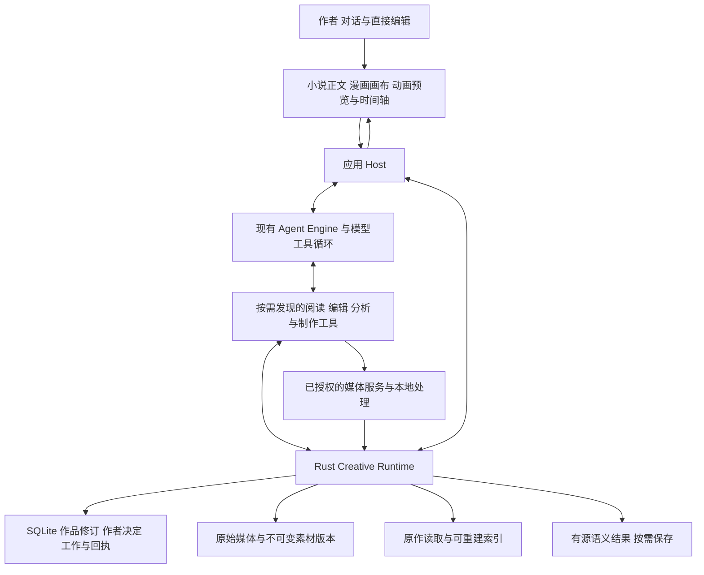

# Novel Codex 独立创作应用理想技术方案

版本：3.0 · 操作对象、按需理解与真实反馈 · 日期：2026年10月9日

建设面向小说、漫画和动画的独立桌面创作应用。作者通过对话和直接编辑提出目标，模型按需要阅读原作、选择工具、生成与修订；工程负责准确管理作品对象、素材、版本、权限、执行和交付。产品价值以作者获得满意作品所需的时间、费用和返工衡量。

当前主攻独立应用。Codex 的通用执行循环继续作为已有基础设施；可复用的方法与工具按需接入，面向 Codex 的创作插件暂不排期。小说、漫画、动画可以独立创建，实施顺序不构成作品创建依赖。

本版将总体方案整理为：**复用智能体执行循环，以必要作品对象和可组合工具支持创作，让模型按问题理解原作，用真实反馈继续修订。** 领域建模的深度取决于实际编辑和交付需要；额外持久语义的范围取决于经验证的收益。

本方案定义目标及后续调整边界，不表示新目标已经实现。工作顺序见[演进路线](CODEX_CREATIVE_EVOLUTION_ROADMAP.md)，当前依据见第9节，Codex 借鉴范围见第12节。任务真正依赖的知识准备和完成检查在对应生产契约同步调整前继续有效。

## 1 产品目标与投入原则

优先解决已有作品反复修改和继续创作的问题，同时允许从空白开始。作者应能直接看到、比较和继续编辑成果，无需先填写完整角色表、故事图谱或制作向导。

| 媒介 | 首要旅程 | 作者应获得的结果 |
| --- | --- | --- |
| 小说 | 改变一处人物动机或事件，再继续写作 | 指定范围的新稿、有依据的影响候选、使用新依据的后续内容 |
| 漫画 | 制作短篇，修改一个画格或一句对白 | 页面及阅读顺序明确、文字可编辑、素材可追踪的漫画作品 |
| 动画 | 制作短片，调整镜头、声音或字幕 | 镜头和时间关系可编辑、声画同步、可以重新渲染的项目与成片 |

一次润色可以直接读取并修改，一张画稿或一个短镜头可以直接生成或导入。多阶段计划、知识提取和子 Agent 只在任务复杂度需要时使用。长期作品需要的结构随实际创作积累，不成为首次创作的必填表单。

投入优先级由实际失败和作者负担决定。全书语义图谱、固定专家团队、通用插件市场、节点工作流编辑器及完整三维骨骼工作站均不作为基础闭环的前置条件。现有已授权的多媒介目标和实施工作继续沿原范围推进。

## 2 总体架构与责任

采用本地优先的模块化应用，沿用 Electron/React、Rust Story Core、SQLite、独立 Agent Engine 及现有媒体执行器。逻辑分层不要求新增微服务或重写通用执行内核。

图中为职责关系，不是每个请求必须走完的流程。模型根据问题发起阅读、编辑或分析；语义结果只有需要保留时才经领域接口登记，不由 Runtime 自动启动第二个模型循环。外部服务经执行适配器核对准入、额度和结果后登记素材；图中连线不授予直接写库能力。Renderer 的领域命令通过受信 Host/IPC/HTTP 边界。

| 边界 | 职责 | 明确限制 |
| --- | --- | --- |
| 模型与通用工具循环 | 理解意图、选择阅读范围、构思、解释、规划、修订、判断语义及选择协作 | 不能自行授权、确认作者决定或宣告保存成功 |
| Rust Creative Runtime | 作品对象与修订、来源、范围、锁定、候选及采用、工作准入、事务与交付证据 | 不按关键词指定创作流程，不持有第二套通用 Agent 调度 |
| Agent Engine | 会话与协议、路由、执行租约、供应商调用、实际用量、取消与执行恢复 | 不拥有另一套章节、画格、镜头或作者决定 |
| Host 与媒体 Worker | 进程、受信连接、凭据引用、实际文件处理、本地渲染及持久事件消费 | 不增加文学决策器，不用内存状态代替持久回执 |
| Renderer 与专用编辑器 | 阅读、选区、编辑、比较、播放、作者决定和结果展示 | 不解析模型措辞来推断已保存、已采用或已导出 |

作品事实、原 Work 的授权和工作额度由领域层管理；执行租约、供应商消耗及媒体操作由现有引擎账本记录。两者以真实操作身份关联，在各自责任范围核对，不重复记账、不另建费用账户，也不把未知费用填成零。

代码继续落在 `src/`、`electron/`、`native/story-core`、`native/story-runtime`、`native/story-mcp` 和 `../agent-engine`。本文中的阅读、知识和交付模块是职责名称，不要求新增同名服务、crate 或数据库。职责及依赖方向以[架构规则 B01–B10](../ARCHITECTURE_RULES.md)为准；领域语义不进入 `codex-rs` 或通用引擎。

Codex 的会话、工具循环、上下文和流式事件通过现有 Engine 及进程协议复用。编程工具所体现的精确定位、局部修改和结果反馈可用于设计创作工具；小说用章节与文字范围，漫画用页格与气泡，动画用素材与时间片段。应用工具通过领域事务提交，通用文件编辑或 Shell 不获得绕过作品授权和版本检查的写入口。产品请求优先在本应用公开接口内实现，通用 Core 变更遵循既有上游改动门禁。

## 3 作品结构与语义解释分层

### 3.1 四类信息

操作对象建模回答“操作什么、修改哪里、如何恢复”；语义分析回答“它表达什么、与其他内容有什么关系”。二者可以关联，但权威与更新方式分别管理。

| 层次 | 内容 | 权威与更新方式 |
| --- | --- | --- |
| 原作与作者决定 | 原文、原始图音视频、明确设定、有效要求与采用记录 | 固定来源及修订；正文说明实际写了什么，作者决定说明明确要求什么，二者冲突保留并处理 |
| 可编辑制作结构 | 章节与场景、页格与气泡、镜头与剪辑片段、素材引用与时间关系 | 由领域契约管理，是编辑和交付的实际输入，不靠模型每次重新猜测 |
| 定位与派生索引 | 目录、全文索引、引用邻接、缩略图、媒体探测及检索投影 | 可由对应权威来源重建；记录来源版本及覆盖，不独立改变作品含义 |
| 派生语义解释 | 事件、关系、人物认知、伏笔、动机、镜头含义、视觉观察及影响候选 | 按需分析，可保留未知、分歧和多种解释；不自动成为作者设定或强制修改指令 |

OCR、转录和图像描述虽然可帮助定位，但含有模型判断，必须保留来源及错误可能性，不能与确定的文件尺寸、时长或字符位置混为一类。模型生成的计划只表达准备创作什么，不能当作作品中已经发生的内容。

### 3.2 共同对象与来源

沿用现有 Project、Edition、Artifact/Revision、AssetRevision、Work/Step/Attempt 及提交回执。Edition 表示媒介作品版本，Revision 表示一次内容修订。小说 Edition 接入尚未完成的部分按多媒介实施记录补齐，不通过文档提前宣布统一完成。

稳定对象身份与显示序号分开。章节、页面、画格、镜头重排后仍可定位同一对象。对象引用至少能确定作品范围、固定修订和必要的文本位置、图像区域或时间区间；模型不能通过自行拼接路径或身份扩大可见范围。

读取依赖区分固定来源 `pinned` 和提交时必须仍为当前版本的 `mustBeCurrent`。按旧小说版本改编或重渲染历史时间轴可以使用固定来源，不能暗中替换成新版本。目标头、权限、锁定和执行代次始终在提交时检查。

正文与媒体的历史来源、作者决定、模型解释各有权威范围。作者明确设定可先于正文出现；对白和人物猜测不能自动成为世界事实；漫画和动画的改编差异只在对应版本生效。

### 3.3 语义建模的增减依据

允许直接阅读原作，也允许为当前问题建立临时分析。反复使用且能减少漏改的知识可以保存，保存时记录来源、适用对象或位置、处理范围、冲突、未知和产生该解释的任务。置信分数不能替代这些证据。

来源变化先更新确定的失效状态，再按实际需求补读或重分析。有效的独立支持来源不能随一条来源删除而消失；读取过资料不等于剧情因它发生，依赖图只能定位待检查对象，不能证明所有后文必须重写。

语义层不是开工门槛。无需为每个细节预设字段，也不追求无遗漏的全书图谱。如果原作读取已经在质量、成本和等待上满足任务，允许保持未建模。已有作者维护的信息与确认记录不能因为“不需要自动提取”而删除。

### 3.4 新结构与新字段的采用标准

| 需要解决的问题 | 采用方式 | 示例与边界 |
| --- | --- | --- |
| 缺失后无法准确定位、编辑、重开或交付 | 保存最小必要操作结构，由程序校验 | 气泡位置、选定修订、片段起止、素材引用；编辑到该对象时形成 |
| 作者明确要求或已确认的事实需要保留 | 保存真实作者来源及适用范围 | 固定角色服装、不得改动的对白；不因语义分析可选而降格 |
| 仅需更快找到原始材料 | 优先采用可重建索引 | 目录、全文检索、缩略图；带解释性质的标签同时标明来源与错误可能 |
| 当前问题需要理解含义或跨内容关系 | 模型临时分析，需要复用或被后续操作消费时保存 | 人物动机、伏笔、镜头意图；保留覆盖范围、分歧及来源版本 |
| 只有理论用途，尚无具体任务或使用方 | 不设为默认必填或开工前置 | 全书完整事件图、每个画格的意图分类、所有短片的多层叙事容器 |

“可选”指是否需要构建或消费该分析；一旦本次任务明确依赖它，实际存在、来源正确及结果有效仍须核对。模型可以正常在上下文中推理和临时整理，工程不要求把每次理解都持久化。范围、状态、版本等协议字段继续使用明确类型；它们与通过用户关键词硬选创作流程是不同机制。

## 4 原作读取与上下文

### 4.1 可访问原作与任务阅读范围

工作区提供可发现的原文、素材、作者要求、计划、候选和检查结果。模型先获取有界目录，再按需要全文读取、分页、检索或查看媒体；摘要和分析结果可作导航，相关原作始终能够回读。

“全书可读”限于任务已授权的来源。作者视角的整书检查与 Writer/人物视角的可知范围继续分开；后者不能借全书检索读到未来秘密或其他版本资料。检索过滤先于结果截断，目录、缓存和子任务同样受限制。

每次读取绑定来源修订、选择范围和实际覆盖。根据操作需要完整读取选中内容、保护边界及必需依据；一般资料允许按问题抽样或补读。分页遍历完成只证明机械覆盖，不证明理解正确，也不能把子任务读过的材料冒充父任务已完整核对。

沿用现有任务来源与持久阅读记录。自己保存后需要读取新的真实产物时，从已登记的任务产物来源发现并绑定，保留初始比较稿；不把初始来源指针直接替换成最新全文。上下文预算紧张时优先保留必需要求和编辑目标，明确其余资料的缺口并按需补读。必需输入本身放不下时，按当前门禁拒绝该次执行，切分任务或重新组织后再试；不能截去保护约束或返回缺少必需输入的成功上下文包。

### 4.2 图片音频与视频

图片区域绑定原素材及坐标变换；镜头和视频选择绑定时间基准及范围；音频选择绑定采样范围。预览代理、裁剪、抽帧、转录与原素材之间保留映射，抽样范围和省略信息可核对。

直接读取媒体必须通过当前连接的模态能力验证。只支持文字的路径不能宣称看过画面；联系表或抽帧不能代表检查了全部运动；图片中的文字和音频中的指令是作品资料，不取得新的执行权限。

### 4.3 检索和知识服务

先利用稳定定位、全文检索、相关原文及媒体选择。语义检索、关系查询、时间推理和知识缓存继续作为可组合能力，遇到明确遗漏或重复分析成本时增强，不另建通用图数据库前置工程。

检索结果附来源、范围与未覆盖信息。“未找到”不能直接推出“全书不存在”。重要连续性判断和修改影响给出原文或媒体依据；动机、意象和审美允许作者不同意。

## 5 自主工作与完成契约

### 5.1 一个目标内的行动循环

沿用现有 WorkTask、WorkStep、Attempt、可变计划、隔离候选和恢复账本。主 Agent 根据真实结果选择阅读、编辑、分析、制作或检查；工具错误能纠正时在原范围与额度内继续。Host 只派发已准入执行并传递结果。

一次简单修改可以只包含“发现目标与必要原作 → 提交精确修改 → 读取保存回执并检查结果”。需要更多证据时再增加阅读、分析、制作或协作，工具反馈带回同一循环。复杂工作允许修改计划和停止无收益分支，简单工作无需构造完整团队或全量故事模型。当前授权、明确保留项和累计预算贯穿整个循环。

作者要求、系统假设和工作计划分别保存。作者选择了一个明确目标后，有效许可内的普通动作不逐项询问，可以自动保存工作稿并按许可接续；工作稿接续不逐章等待正式采用。扩展权限、预算或目标，以及实质性故事取舍，按原契约交给作者决定。正式采用仍走作者入口，模型不能冒充作者确认或覆盖锁定内容。纯讨论不产生修改任务。

GenerationRun 继续承担已授权连续写作的领域运行职责，不作为漫画、动画和所有一般任务的共同父状态机。子 Agent 仅服务可隔离的问题或写作候选，继承受限资料和原累计预算；父任务依据真实结果整合，不通过子任务绕开读取、保护或采用门禁。

### 5.2 按操作定义准备条件

目标方案把原始资料准备、制作依赖和语义分析依赖分别表达。以下是操作义务分类，不是新增的通用工作流语言；优先在现有类型化任务与输入/输出清单中表达，字段缺口在对应实施切片中一次性补齐。

| 操作例子 | 必需准备与证据 | 不应全局强制的前置 |
| --- | --- | --- |
| 局部文字润色 | 目标原文、作者要求、保护边界、准确修订及保存回执 | 全书人物关系与事件提取 |
| 调整事件后续写 | 当前相关原文、有效作者决定、实际读写依赖、任务要求的连续性核验 | 对所有无关章节重新建模 |
| 回答某人物何时知晓秘密 | 相关证据、人物与叙事时间范围、覆盖与冲突说明 | 把全部人物知识库标记完整 |
| 修改漫画对白 | 选中气泡与页面修订、字体及版面检查 | 重新生成画面或分析全篇剧情 |
| 替换动画镜头 | 目标片段、素材、时序关系、保留项及合成检查 | 分析整片所有动作的意义 |

现行[工作行动目录](native/story-core/src/work_decision_status.rs)已在相应工作路径把 `modelKnowledge`、`extractCommitments` 列为可选辅助，`assessRevisionOutcome` 允许在没有知识批次时使用正文依据。现行[查询范围合同](native/story-core/src/query_scope.rs)中的 `assessSceneOutcome` 仍消费匹配修订的有效知识批次。这些源码事实只说明对应路径，不能推定所有操作都强制建模或所有前置均已解除。

逐操作审查记录必需原作、实际编辑对象、明确交付检查，以及每项派生分析的具体使用方。若检查可直接以原作为依据，应同步该操作的创建、准入、读取、报告、完成终验、恢复及测试；已有依赖继续按当前合同执行，不能只忽略报错或将 `model_pending` 改名为就绪。

### 5.3 按本次目标计算交付

任务开始时冻结目标、范围、必需产物及必要检查。模型根据问题与证据缺口选择新增分析，说明它与目标的关系；Runtime 校验对应的目标绑定、声明依赖、授权及预算。不能在检查失败后擅自移除已要求的产物或降低成功标准。

独立已保存的正文或媒体与分析结果分别报告。非必需语义分析失败不抹去已保存成果，也不能冒充分析完成；必需分析未就绪则相应目标仍为部分交付或受阻。已经运行的失败步骤、费用、未知操作和未结问题都保留真实状态，不能用“可选”静默清除。

执行结束、候选保存、作者采用、导出完成和作者满意分别判断。确定性校验检查目标版本、选择范围、文件、版面和时序；语义评估提供有依据的候选判断；文学和视觉满意度由作者及人评验证。已知负面检查在来源失效后仍保留待复查状态，不能因此自动通过。

详细目标同步见[任务管理](TASK_MANAGEMENT_ARCHITECTURE.md)和[持续创作验收](CONTINUOUS_CREATION_ACCEPTANCE.md)。这项按需准备与完成契约的全面调整是后续实施项，不是本轮文档修改已经获得的运行能力。

### 5.4 暂停取消与未知结果

沿用原 Work、Attempt、许可、累计消耗及绝对期限；已终结尝试不重开。调整后继续明确绑定新意图与来源，不能借新步骤重置预算。未知写入先查询原操作回执，无法核对就保持未知，不自动重提可能收费的请求。

活跃执行直接消费工具结果；挂起或重启后，Host 经持久事件和唯一领取关系唤醒原工作，避免双重接续。暂停和取消的具体围栏按现有操作契约执行，禁止迟到结果覆盖作者后来修改；媒体晚到产物可以按原操作归档为未应用。

手动保存更新作品、索引及来源失效，不自动启动付费语义任务。删章后的既定只读影响检查保留。离线核验已保存结果不自动升级成模型执行。数据库事务内不等待模型、网络或长时间渲染。

### 5.5 反馈的证明范围

| 反馈 | 可以证明什么 | 不能据此证明什么 |
| --- | --- | --- |
| 领域事务与回读 | 指定修订、范围和内容确实保存，锁及来源合同满足 | 作者已采用、情节合理或作品满意 |
| 媒体探测、排版与渲染检查 | 文件可解码，页数/尺寸/时间关系及可测边界符合要求 | 角色表演、构图、运动和听感达到审美目标 |
| 有原文或画面依据的语义报告 | 在记录的来源和覆盖范围内发现候选问题或形成判断 | 未覆盖部分没有问题，推测已成为世界事实 |
| 作者选择及独立人评 | 作者是否接受，对指定质量维度的评价 | 所有类似作品、模型或制作方式都达到同等效果 |

工具反馈应提供可纠正的原因、当前状态和实际产物，使模型能够在原目标内决定补读、修改、换方法或说明缺口。确定性错误由相应工程合同拒绝；语义检查是否阻断交付由本次明确要求及适用契约决定。报告依据过期需要复查，不能自动把失败变成通过；模型的满意评分也不能替代真实作者决定。

## 6 三种媒介的编辑与制作

### 6.1 小说

以正文、稳定章节/场景引用、作者要求、版本和局部差异为基本结构。角色、时间线和伏笔记录按需要形成；允许无完整大纲写作，已绑定规划则核对实际来源，不能伪造规划关系。

指定范围修订保留未选及锁定内容。改变关键事件后先定位影响候选并区分确定来源依赖与语义推测，再处理授权范围内的相关内容。后继写作使用实际新稿及有效决定，不把计划、旧摘要或模型解释当作已经发生的事实。

### 6.2 漫画

以作品、页或条漫以及实际存在的画格组织内容；分话分组按作品规模采用。页面布局和阅读顺序、画格资产及裁剪、对白与气泡分别保存。场景意图、完整人物表和叙事分组按任务需要形成，单页、单格或扁平画稿无需预建完整分镜和故事图谱。

优先支持独立文字排版与画面素材。局部改对白可直接重排文字，局部改图只更新相关画格及必要合成。导入的扁平整页保留为真实图片，不能宣称已有可编辑气泡、图层或可无损分离的角色。

人物参考图、服装、配色和场景资料固定版本，并记录作者明确保留项。实际生成工具决定可用的参考、选区或蒙版能力；没有局部编辑能力时不能承诺像素级保留。参考一致不保证画面身份、服装和透视一致，检查应针对实际输出并给出未覆盖部分。

交付区分分镜草稿、单张插画与完整漫画。导出冻结页格、文字、字体和素材版本，检查页数、尺寸、顺序、裁切和可读性。保存的项目应可重开、局部修改及再次导出。

### 6.3 动画

以镜头、素材、时间轴、轨道和片段形成可编辑制作结构。镜头是创作对象，片段是时间轴上的一次使用；一个镜头可被多次剪入，同一素材可取不同范围和速度。对白、音乐、音效、字幕与画面分别管理。

剧集、段落、镜头意图和完整剧本按组织需求采用；一个素材片段可以从必要时间轴与轨道开始。实际对象、素材和时间引用仍须准确，缺少叙事容器不意味着可以伪造剪辑点、分轨或来源。已有明确采用的角色参考和创作要求继续作为约束。

时间关系保存精确的帧/采样/有理时间基准和半开区间，显式处理源时长、变速、裁切和轨道同步。改变镜头时长时计算对后续片段、声音和字幕的影响，不能同时暗改作者要求保留的轨道。

短镜头可以直接生成或导入；完整动画还须满足约定的运动表达、镜头衔接、节奏及声音要求。动态分镜、有限动画与完整短片分别命名和验收，不把静态图片串成的视频自动当作完成动画。

素材生成与成片合成分别记录。渲染冻结时间轴、素材、字体、导出规格和执行器，核对真实文件、时长、分辨率、音轨、字幕与缺帧，再进行画面和听感检查。查看最终视频不能自动恢复原始分轨、绑定或三维工程；专业分层和骨骼能力只在明确需求下另行设计。

### 6.4 跨媒介与素材管理

三个媒介入口独立，同项目可引用共同设定的固定版本并保留改编差异。改编关系支持一对多、多对一和局部来源，不将小说自动设为其他作品的最高权威。

源作品变化时比较原来源、当前来源和当前目标，提出有依据的影响候选；不同改编可有意保留旧处理，不自动批量重生成。故事时间、读者披露顺序与动画播放时间分别表达。

原始媒体字节、代理预览和最终合成分开管理。素材必须经过受控导入、文件验证、持久登记及回读后才显示已保存；临时 URL 不作为长期素材身份。项目归档应带一致内容与可达素材清单，恢复检查摘要及缺失项；全历史备份和垃圾回收的未完成部分继续按 M4 实施。

## 7 方法工具与模型接入

复用现有中文能力发现、方法冻结与任务授权。模型先发现当前可用工具或方法，需要时再加载全文和参数；无需预先注入全部 Skills 或专家说明。方法可不使用，也可在任务内形成带证据的候选经验，不能自行成为作者偏好。

外部 Skills 是方法与资源，MCP 是工具连接，模型和图片/视频/配音服务提供实际执行能力。各项分别记录来源、许可、固定版本、依赖、账户连接、运行资格与费用；安装、发现和当前可调用状态不能混为一谈。

现有创作模型可负责对话、文字、结构和工具选择，实际图像、视频、声音能力按当前连接的验证证据开放。公开能力声明、内核开关和受控测试均不能替代真实供应商路径验收。当前用户选择的模型不因文档重设计被自动替换。

新增资料检索、模型路由、子 Agent 或受限计算环境，应对应具体旅程缺口并与简化方案比较。脚本在受控范围处理文件和素材，不直接写作品数据库。外部 MCP 的传输与账户机制沿引擎契约接入，不公开内部任务凭据。

Codex 插件仅保留为未来可选分发方向。独立应用的账户、配置、作品存储、调用与交付不依赖 Codex 桌面登录或插件安装。

## 8 作者体验

默认界面围绕同一对话和当前作品：小说显示正文，漫画显示页面或条漫，动画显示预览，时间轴按编辑需要展开。资料和解释可查看、纠正、重算，但知识库覆盖率不成为作者开工条件。

自然语言表达目的，选区、拖动和键盘操作定位对象。界面直接展示改动和成果，技术 ID、工具日志和完整推断依据放入诊断或来源详情；关键失败、未知结果、预算限制和需要作者决定的分歧始终可见。

保存、采用和导出分别取真实回执。失败保留输入、原素材、已保存候选和阅读/播放位置；切换作品或重启后恢复正确目标，不让迟到事件污染新作品。账户或生成服务不可用时说明具体能力缺口，仍可读取和编辑已有合法素材。

窄屏聚焦当前任务，图像选择和时间轴操作提供键盘替代，文字与字幕清晰可读。模型提出的每个选项不自动成为必答表单，普通可纠正问题在许可内处理。

## 9 现行依据与未完成项

本次2026年10月9日整理以现有源码和实施记录为依据，完成状态继续由对应实施文档维护。文档目标、局部源码事实、工程回归和真实作品收益分别记录；本轮未修改执行代码或重跑作品测试，不从历史测试总数推定当前全工程状态。

| 能力 | 已记录基础 | 仍需完成的验证或实现 |
| --- | --- | --- |
| 通用自主创作3.0 | 开放工作区、动态计划、按需发现、隔离候选及持久唤醒；对应工程回归见原实施记录 | 受控回归不能替代真实长篇质量、实际应用长期运行和作者收益 |
| 小说编辑与接续 | 精确局部改稿、来源、修订、采用与控制存在工程及局部真实模型证据 | 新方案的逐操作准备/交付契约、建模增益、完整修改接续与长篇收益 |
| 漫画 | 页格、对白、局部工具、本地 PNG/PDF 等编辑交付基础 | 真实生成服务、完整原创及改编作品、角色一致性和返工成本 |
| 动画 | 镜头、轨道、片段、字幕与本地 MP4/音轨时序基础 | 实际运动素材生成、完整短片品质、便携媒体组件与跨平台交付 |
| 共用领域与素材 | 作用域、来源、版本、素材固定引用与单作品归档等增量 | 小说 Edition 的剩余接点、全历史备份/回收、完整规模与发布验收 |

当前具体证据见[自主创作3.0实施记录](AUTONOMOUS_V3_IMPLEMENTATION_REVIEW.md)、[按需编排验收](AGENT_TASK_ORCHESTRATION_DESIGN.md)、[持续创作验收](CONTINUOUS_CREATION_ACCEPTANCE.md)及[多媒介实施记录](MULTIMODAL_CREATION_IMPLEMENTATION.md)。新作品发送和媒体真实供应商验证须沿各自已有授权范围与预算执行；本方案不扩大这些授权。

重设计前总纲的完整内容保存在[2026年10月8日基线记录](IDEAL_ARCHITECTURE_BASELINE_2026_10_08.md)，便于追溯各切片及原证据。后续实施结果只回写相应实施记录，不再向总纲累积重复的运行日志。

## 10 落地方式与验收

先完成一个可运行纵向切片，再扩展相邻问题。对当前接口或 schema 的调整，一次同步 Runtime、工具、Host、UI、类型、fixture、测试与契约；按照[测试阶段工程策略](TEST_STAGE_ENGINEERING_POLICY.md)直接建设当前目标，不新增历史格式兼容、迁移、回填或双读双写。

优先处理三项技术工作：逐操作明确资料和分析依赖；贯通原作读取、精确修改与真实交付；打通漫画及动画实际制作服务和可编辑成果。知识结构、方法和协作优化穿插在具体旅程中，不独立膨胀成平台建设。

先选择一个真实操作，列出必要对象、输入、分析使用方和完成证据，再实施其最小闭环；不以完成全工程审计作为开工条件。共同闭环稳定后，小说接续、漫画制作和动画制作可独立推进。版本隔离、全历史备份、应用归档导入、可达性回收及安装资源的剩余项仍归原 M0–M4 范围，随相关风险和发布目标落实，不因简化语义层而取消。

| 验收层 | 验证内容 |
| --- | --- |
| 契约与可靠性 | 无完整语义库的合法阅读/编辑、必需分析缺失的真实阻断、范围保护、CAS、取消、来源失效、未知结果和恢复 |
| 真实制作链 | 实际模型及媒体服务、保存回读、重开与导出；替换为受控端点的环节单独说明 |
| 创作质量 | 小说连续性及语言、漫画画面与阅读顺序、动画运动与声音；作者接受与独立人评分开 |
| 投入收益 | 达到满意稿的人工时间、建模准备/更新/纠错、模型与媒体费、重试、等待和存储 |
| 发布与规模 | 对应媒介规模、当前空环境安装、macOS/Windows、便携组件与许可证、恢复和交付完整性 |

语义建模在同一应用、相同模型和编辑能力下比较“原作读取＋基础索引”与“相同能力＋按需语义知识”。两组都保留作者决定、版本、范围、读取和交付校验；计入首次建模及多轮更新成本，不能只比较知识库已建好后的查询速度。尚无收益证据时不预设更复杂的方案胜出。

沿用 S0–S5、C01–C10、M0–M4 的安全、规模、质量与发布要求，路线工作包仅组织投入顺序。按任务需要改变语义前置时，同步验证等效的连续性和来源要求，不通过删除原失败用例宣称完成。

五视角评审及本轮文档核对见[独立应用重设计评审](design-reviews/2026-10-08-independent-creative-app-redesign.md)。接口或代码实施前仍须针对实际变更完成相应设计与实施后复核。

## 11 文档职责

| 文档 | 负责内容 |
| --- | --- |
| 本文 | 独立应用总体目标、责任分配、建模取舍与目标技术边界 |
| [演进路线](CODEX_CREATIVE_EVOLUTION_ROADMAP.md) | 工作包、依赖、投入顺序、样本和产品取舍 |
| [故事系统](STORY_SYSTEM_ARCHITECTURE.md) | 小说数据、证据、认知、检索、解释及详细提交契约 |
| [多媒介架构](MULTIMODAL_CREATION_ARCHITECTURE.md) | 漫画与动画对象、媒体选择、编辑、时间、素材和交付契约 |
| [自主创作3.0](SIMPLE_REQUEST_AUTONOMOUS_CREATION_DESIGN.md)与[按需编排](AGENT_TASK_ORCHESTRATION_DESIGN.md) | 模型循环、开放工作区、能力发现、动态行动及恢复接续 |
| [任务管理](TASK_MANAGEMENT_ARCHITECTURE.md) | Work/Step/Attempt、目标依赖、控制、实际交付和执行权威 |
| [创作能力接入](CREATIVE_CAPABILITY_ADOPTION_DESIGN.md)及[Agent Engine](../agent-engine/README.md) | 方法来源、冻结与评估；通用执行、协议和资格边界 |
| [持续创作验收](CONTINUOUS_CREATION_ACCEPTANCE.md)及[多媒介实施记录](MULTIMODAL_CREATION_IMPLEMENTATION.md) | 相应阶段的实际证据、未完成项及发布门槛 |

本次总体目标取代重设计前总纲中的投入方向；专题契约仍定义具体操作，历史实施记录只证明其原范围。目标与实现的差异明确列为实施项，不默默运行两套行为。用户决定与工程规则优先于本文。

## 12 Codex 借鉴依据与适用范围

[OpenAI 官方的 Codex 平台说明](https://developers.openai.com/blog/codex-as-a-platform)将可复用部分描述为会话、模型与工具循环、上下文及受控执行，并由应用提供业务上下文、工具、规则和界面。本文据此复用执行能力，为小说、漫画和动画定义各自的操作对象与公开工具；接入 Core 或 app-server 不等于获得完整桌面 UI、模型权重或媒体生成服务。

“操作对象建模”和“代码/作品语义理解”是不同层次。文件、补丁与进程的明确结构启发我们准确管理章节、画格及片段；不能从部分代码中未见完整 AST 或调用图，就推断所有 Codex 产品都不使用语义分析，也不能据此证明故事建模必然无效。本方案的按需语义与字段取舍属于针对本产品的设计判断，其收益由[路线第7节](CODEX_CREATIVE_EVOLUTION_ROADMAP.md#7-对照评估与投入判断)的同条件实验验证。

本版相对2.0集中补齐：操作对象与解释的采用标准、工具反馈的证明范围、逐操作依赖审查、可选叙事层级、现行可选知识路径与真实收益验收。五视角前审及后审接续记录在[原设计评审](design-reviews/2026-10-08-independent-creative-app-redesign.md)的2026年10月9日部分。
