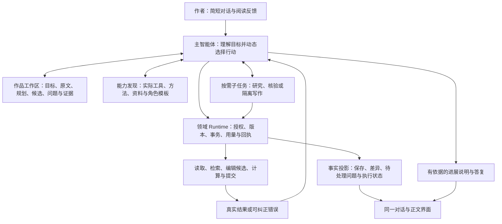

# 对话驱动自主创作：开放工作区与可靠执行架构

版本：3.0 · 日期：2026-10-07\
设计交付时状态：整体重设计与实施蓝图；设计阶段只交付文档，没有用蓝图宣称架构已经实现或通过实机验收。当前落地与验收状态见下方实施追踪。

2026-10-07 实施追踪：本文保留设计时点的证据边界。当前生产改动、分包评审、自动化与实际应用验收统一记录在 [3.0 实施验收](AUTONOMOUS_V3_IMPLEMENTATION_REVIEW.md)，不以本蓝图代替完成证明。

本文取代同文件 v2.1 的目标方案。重新审视的范围包括产品入口、模型自主性、能力体系、协作、长篇记忆、质量判断、执行恢复及验收，不能只靠扩大 EternalLight 方法目录解决问题。既有实施记录仍是对应时点的证据，不能自动算作本方案完成。

## 1. 结论与产品目标

应用应成为模型能够实际工作的小说创作环境：作者表达目标，智能体读取作品、组织工作、使用或创造方法、处理反馈，最终交付可阅读的成果。工程保证操作真实、范围受控、过程可恢复；文学判断保留依据与不确定性。

作者可以只说“生成第7章”“把这一卷的大纲理顺”“这一段人物太被动”“接着写”。应用结合当前选中作品、已有稿、有效要求和对话理解含义。作者不需要指定内部工具、角色、流程、报告格式，也不需要在外部逐轮检查后再指挥应用重写。

创作主线可灵活变化，产品始终要回答四件事：正在做什么、已经保存什么、还存在什么问题、是否需要作者决定。运行结束、正文保存、检查完成、作者采用和长期目标完成分别记录。

理想方案不是没有结构。应保留少量稳定的执行边界，让模型在边界内拥有足够大的行动空间；避免固定流水线，也避免把全部约束塞进提示词后任由模型自行保证。

## 2. 旧方案的结构性局限

v2.1 已提出动态方法和协作，但仍有以下风险。表中的代码观察来自当前工作区，只支持所述局部结论。

| 局限 | 本案暴露的问题或代码证据 | v3.0 决策 |
| --- | --- | --- |
| 作者要求与模型计划混合冻结 | 现有计划最多12项目标，旧目标不能删除，执行后类型、验收文本和依赖受到冻结；错误拆解也可能永久保留。见 [model_work_plan.rs](native/story-core/src/model_work_plan.rs) | 作者约束独立保存；模型计划允许撤销、合并、替换和滚动展开，保留修改历史 |
| 每个动作都承担过重协议 | 行动准入依赖已存计划；目标包含多个阅读、方法和评估字段。见 [work_decision_actions.rs](native/story-core/src/work_decision_actions.rs)、[model_work_plan_tool.rs](native/story-mcp/src/model_work_plan_tool.rs) | 简单行动直接执行并由工程留痕；复杂目标才展开模型计划；工程派生已有身份 |
| 能力开放仍受业务类型限制 | 工具随 operation 暴露；策略枚举、实验方法、角色模板分别管理。见 [main.rs](native/story-mcp/src/main.rs)、[creative_methods.rs](native/story-core/src/creative_methods.rs) | 以目标与权限暴露可组合能力；业务类型描述产物，不承担自然语言路由或永久方法限制 |
| 长篇分页不等于有界上下文 | 当前评估资料构造会收集已捕获的全部前章正文，再交付分页。见 [revision_outcome_context.rs](native/story-core/src/revision_outcome_context.rs) | 保存版本引用并按问题取证；构造、传输和模型工作窗口都要有界 |
| 只读协作形成单点瓶颈 | 子角色返回文本，主任务负责再组织提交；长稿容易重复搬运。见 [novel-agent-roles.mjs](electron/novel-agent-roles.mjs) | 保留只读研究，并增加受限、隔离的候选写作能力；主任务接收产物引用 |
| 质量被过度压缩为通过/失败 | 客观条件、语义判断与审美建议容易进入同一种门禁；多份报告重复表达判断 | 分开检查证据与审美建议；合并相同判断，保留必要的独立核验 |
| “自创能力”只停留在提示词 | 模型可以临时设计方法，但缺少适合保存、计算、比较及复用的工作空间 | 先支持任务内方法与已有工具组合；必要时增加受限计算空间，不能假装已拥有新工具 |
| 恢复变成重发要求、重读全书或重做任务 | 模型会话、领域行动和 UI 回合若各自拥有任务状态，会产生重复与歧义 | 一个逻辑作者输入、一个持久目标归属、版本化产物及可去重的执行事件 |
| 能力体系越建越大，单章闭环反而更重 | 方法卡、专家、计划和检查都可能成为每轮必填项 | 先证明最小自主闭环；任何新增机制都要证明收益，允许不用 |

第7章的篇幅自述与实际保存值不符、报告字段反复提交错误，分别涉及模型判断、工具契约和错误反馈。增加角色或换更强模型可能改善部分表现，却不能替代正确契约与可靠回执。反过来，修好契约也不保证模型一定写得好。

## 3. Codex 与 Cursor：借鉴原理和证据边界

参考范围是当前本地 Codex 源码、官方文档及 Cursor 公开工程文章，不推测未公开的产品内核。以下小说方案属于本工程的设计推导。

| 已核对的公开或源码事实 | 借鉴方式 | 不直接照搬的部分 |
| --- | --- | --- |
| 本地 Codex 的工具结果回到模型循环，由模型及待处理输入决定是否继续；普通可纠正工具错误可以作为结果返回。见 [turn.rs](../../codex-rs/core/src/session/turn.rs)、[parallel.rs](../../codex-rs/core/src/tools/parallel.rs) | 一个通用行动反馈循环，减少 Host 的业务决策 | 模型最终答复不能证明小说已保存或完成 |
| 本地 Codex 的工具声明与可执行路由对应，支持延迟发现。见 [router.rs](../../codex-rs/core/src/tools/router.rs)、[tool_search.rs](../../codex-rs/core/src/tools/handlers/tool_search.rs) | 按需发现真实可用能力，展示未开放原因 | 当前本地搜索使用英文分词设置；中文检索必须另做适配与验证 |
| Codex Skills 先呈现名称和说明，需要时读取完整指令。[官方技能说明](https://learn.chatgpt.com/docs/build-skills) | 多来源创作方法渐进加载 | 技能名称、加载次数不能证明创作收益 |
| Cursor 将长工具输出和历史做成可再次检索的资料，减少预先塞入全部内容。[Dynamic context discovery](https://cursor.com/blog/dynamic-context-discovery) | 长篇原文、报告与历史具备稳定位置，可检索、分页和回读 | 不要求把小说数据库搬到普通文件；具体实现和收益必须本地验证 |
| Cursor 的通用 harness 会为不同模型调整工具形态与提示，并用评测定位混淆。[Continually improving our agent harness](https://cursor.com/blog/continually-improving-agent-harness) | 领域契约稳定，模型接入配置通过实际创作评测调整 | 更换模型不能改变作品权限、事实计量或交付定义 |
| Codex 与 Cursor 均说明子任务可隔离上下文，但增加启动、token 或协调成本。[Codex 子智能体](https://learn.chatgpt.com/docs/agent-configuration/subagents)、[Cursor 子智能体](https://cursor.com/docs/subagents) | 按独立问题委派，验证资料范围和收益 | 不把“专家越多”当成质量越好；不能只改角色名称便称为盲审 |
| Cursor 的大规模研究记录了平级协作失效、明确职责带来的改善，也记录了过多结构和集成角色的成本。[Scaling long-running autonomous coding](https://cursor.com/blog/scaling-agents) | 保留负责人、产物边界和资源限制，同时减少无收益层级 | 该文是研究实验，不能说成所有 Cursor 对话都采用固定规划—写作—评审流水线 |

本地 Codex 还把应用规则、真实用户输入与非可信资料区分处理，并持久保存会话事件。对应本工程，创作原文不能成为运行指令，压缩摘要不能替代作品事实库。参考 [additional_context.rs](../../codex-rs/core/src/state/additional_context.rs)、[compact.rs](../../codex-rs/core/src/compact.rs)、[recorder.rs](../../codex-rs/rollout/src/recorder.rs)。

## 4. 方案选择与整体架构

### 4.1 三种方向的取舍

| 方向 | 优点 | 局限 | 决策 |
| --- | --- | --- | --- |
| 扩大预设流程与专家菜单 | 容易演示、局部路径可控 | 组合爆炸；新问题要改路由；用户仍替工程补缺口 | 不采用为主架构 |
| 一个全权限模型配大提示词 | 初期简单、动作自由 | 易混淆事实、越界写入、恢复不可靠、长篇漂移 | 不采用 |
| 开放作品工作区 + 通用模型循环 + 领域执行边界 | 能组合已有能力，允许临时方法，版本和结果可核对 | 需要清晰工具与真实模型评测，无法承诺绝不失误 | 采用 |

### 4.2 目标结构

Engine 包含主模型和子任务的执行循环；图中的箭头是职责和反馈关系，不是必须依次经过的阶段。模型可以直接答复，也可以读、写、检查、并行研究或调整方案。长任务计划只展开当前有价值的部分。

### 4.3 责任归属

- **模型**：理解意图、提出并修正解释、决定阅读和行动、选择或创造方法、组织协作、判断语义、处理分歧、说明成果与局限。
- **Engine**：模型会话、工具循环、上下文管理、模型协议、子任务及取消；不拥有另一套正文和章节完成事实。
- **Host**：连接 UI、Engine 和 Runtime，执行生命周期与持久唤醒；不再增加独立的文学规划器、关键词路由器或阶段调度器。
- **领域 Runtime**：授权、真实版本、候选隔离、事务、幂等、确定性检查、用量和完成条件；不按固定套路评价作品。
- **Renderer**：对话、阅读、比较、控制和事实投影；不解析模型自然语言来决定“已保存”“已采用”。

目前独立 `agent-engine` 与小说领域存储继续承担各自职责。本地 `codex-rs` 是参考实现，不因参考 Codex 就另造一套引擎或直接改变应用的数据权威。

## 5. 作者约束、模型解释和工作计划分离

### 5.1 三层内容

| 层次 | 示例 | 可变规则 |
| --- | --- | --- |
| 作者要求与有效授权 | 前100章、约3000字、不动第1章、不自动采用、不发布 | 保留原文、来源、作用域和版本；只由真实作者调整或有效既有授权更新 |
| 模型对要求的解释 | 当前在第7章；这一稿需要衔接某个线索；某篇幅范围适用 | 标记为解释并关联来源；可纠错，但不能用新解释掩盖旧稿未达标 |
| 工作计划与方法 | 先查时间线、改为局部修订、取消重复评审、并行研究人物 | 模型可自由重排、撤销和替换，实际行动与理由留痕 |

固定的是需要保护的要求和已发生事实，不是模型第一次写下的全部计划。冻结一个错误解释不能补齐遗漏要求。完成核对必须重新查看适用的原要求与实际成果，而非只对模型自建清单打勾。

“不得少于3000字”可建立明确硬界限；“约3000字”的数值范围属于有依据的解释，应与原话同时保留。解释修订需说明原因、影响和适用作者来源证据，对相关稿重新核对。工程不能仅因修正后现稿符合范围就否决修正，也不能因此自动宣布通过；模型仍须核对全部适用原要求，已有报告不被改写为新标准下的通过证据。遇到实质性作者意图冲突才询问，不为每个普通推断增加确认框。

具体约束分层、阅读与修改范围分离、核验方法选择及分阶段实施状态见 [模型决策与工程约束优化记录](design-reviews/2026-10-09-model-decision-boundaries.md)。方案中尚未实施的合同不能作为现有能力对外声明。

### 5.2 轻量开始，按复杂度展开

普通问答、读取和小改动不要求模型先填写完整计划。Runtime 自动记录真实输入、对象、动作和结果；复杂执行再由模型建立可调整的计划。计划缺省不表示权限缺省。

“继续”等文字不对应固定业务分支。应用提供真实上下文，模型判断是接续原任务、处理未完成修改、解释当前状态还是需要澄清。明确的暂停按钮可以直接发出确定性控制命令；自由文本由模型理解。

### 5.3 长篇目标与有界工作范围

长期 Work 保存总目标、范围、预算和累计成果；按需展开卷、阶段或章节的局部工作。复用现有领域记录表达层级，不创建第二套项目任务系统。

模型一次只展开近期必要工作。完成章退出活跃计划，保留版本和未兑现事项；全书方向与卷内安排可逐步调整。1000章不能变成一个永久追加的千项清单，也不能让子工作各自重新获得整份预算。

继承作者约束向下约束子工作，真实成果向上汇总；第7章完成不等于前100章完成。多章创作有语义依赖，不能只为提高并发把尚未稳定的连续章节一起生成。

## 6. 作品工作区与长篇记忆

### 6.1 工作区是统一访问视图

向模型提供可定位、可检索、可比较的作品对象：有效要求、简报、大纲、近章安排、正文、候选版本、人物与承诺、证据、报告及当前问题。它是领域存储的视图，不是新的事实数据库。

提供少量清晰操作：列出对象、按问题检索、读取原文范围、查看差异、编辑或保存候选、提交结果。工具具体 schema 在实现时与现有契约统一；不设计一个接受任意命令的万能工具来绕过权限。

常用操作直接可用，专用分析按需发现。对象引用应短而稳定，包含可核验的版本身份；Runtime 派生任务、授权及已绑定身份，模型无需反复复制大量 ID。需要选择的目标仍要显式表达并校验。

### 6.2 分层记忆及其可靠性

| 材料 | 用途 | 约束 |
| --- | --- | --- |
| 作者要求与确认设定 | 决定任务和保护边界 | 原消息及确认身份可回读 |
| 正文与真实版本 | 核对已经写出的内容 | 保存状态与作者采用状态分开 |
| 事件、人物、知情范围与承诺索引 | 定位跨章关系和影响 | 带来源、有效范围及不确定性；索引不代替原文 |
| 全书、卷和近期摘要 | 快速建立方向与邻近状态 | 可重建，标记覆盖范围与更新时间 |
| 规划、推断和假设 | 探索可能发展 | 不作为已发生事实；保留分歧 |
| 当前问题与阅读记录 | 恢复工作和定向补读 | 记录实际返回范围；“已理解”只是模型声明 |

小说需要区分故事发生时间、叙述揭示顺序、人物知情范围以及不可靠叙述。一个带引文的“人物说过某事”不能自动升级为世界事实；互相矛盾的叙述可有意并存，模型应结合作者意图判断。

模型记忆更新是有来源的提案。保存正文不会自动批准所有抽取出的设定、正式承诺或作者偏好。现有作者确认边界保持明确。

### 6.3 上下文按问题读取

每次只提供当前目标、近期必要状态、未解决问题、相关产物引用和剩余资源。长原文与长报告保留稳定读取位置，通过目录、检索和分页补读。相关性提示不应永久藏起其他资料；没有找到证据不等于全书不存在。

来源快照冻结引用与版本，避免在创建评估任务时复制全部前章正文。读取记录面向“本次问题与对象”，不能用全局第一个未读位置强迫遍历所有资料。

记录实际依赖范围：无关后续章节变化不应让所有报告失效；相关前文、作者要求或正文发生变化则重新检查受影响结论。依赖不明时按不确定处理，不能假定变更无影响。长篇性能同时测资料构造量、检索召回、首读延迟和模型 token，不能只看分页大小。

压缩和重启后从领域事实恢复。摘要提供导航，不恢复权限，不清零预算，也不单独证明原文已经核对。

## 7. 能力发现、组合与创造

### 7.1 范围与信任分开

能力来源包含当前工程、模型通用能力、EternalLight、其他合法方法资料、作者提供的方法以及任务内新方法。来源不决定优先级，适用性由模型结合问题判断。

| 对象 | 可做什么 | 不能混淆的边界 |
| --- | --- | --- |
| 领域工具 | 实际读取、检索、比较、计算、保存候选和提交报告 | 必须已实现且获授权 |
| 创作方法 | 提供阅读、构思、写作或检查办法 | 是可选参考，不成为系统指令或作品事实 |
| 角色模板 | 提供职责和权限基线 | 不是永久组织，也不授予额外权限 |
| 模型通用能力 | 推理、写作、比较、归纳和临时设计方法 | 不能编造已经调用的工具或已保存成果 |
| 产品执行契约 | 规定真实行为、权限和交付规则 | 与外部方法资料分开，不按文学偏好临时替换 |

目录只登记真实资源及状态：当前可用、需要既有许可、暂不可用、仅有设计。方法、工具和角色可以统一发现，但保留各自类型、来源和信任边界。

能力清单必须包括现有正文和规划、证据与关系、影响分析、假设探索、长篇承诺、质量记录、结构及修订评估、版本与任务控制；不能用7项策略代表全部工程能力。`analyze_story_impact` 的显式依赖分析不等于穷尽语义后果，`simulate_story_hypothesis` 的记录不改写正式事实，作者侧采用/删除/发布等操作不因“已有接口”就全部授予模型。

当前 operation 权限是可靠性基础，但目标态应把“可以接触哪些资料和写哪些候选”与“当前采用什么文学方法”拆开。从实际权限和产物范围计算可调用能力，保留正式报告提交等职责隔离；不能简单取消白名单开放所有接口。

### 7.2 发现与选择

初始只给简洁能力入口与必要规则。按问题检索后查看适用性、所需资料、费用或限制，实际使用时再加载正文和 schema。支持中文语义、关键词及目录浏览，零命中时仍可浏览；标签只辅助发现，不做题材或输入词的硬路由。

中文目标的语义理解、检索词组织和最终适用性判断由主模型负责；当前 Native 目录服务提供已安装元数据的字面匹配及完整分页浏览。字面未命中不证明缺少能力，字符匹配也不是语义召回证明。不为发现另加隐藏模型规划器、同义词硬路由或每轮必经检索步骤。

模型可以直接处理、选零个专用方法、组合工具、换方法或创建临时办法。无需先完成一次“方法选择任务”，也不必解释整个目录为什么没选。复杂方法采用时保留简短目的、版本及产物关联；普通思考不要求登记方法卡。

### 7.3 模型创造能力的四个层次

| 层次 | 自主空间 | 实现与限制 |
| --- | --- | --- |
| 临时方法 | 自行设计并试用，如核对“实际身份—记忆—对外称谓” | 可以立即用现有阅读与分析能力完成；无需开发者先注册 |
| 能力组合与临时分工 | 组合现有工具、比较候选、创建明确问题的子任务 | 每次实际执行仍受版本、权限和预算约束 |
| 受限计算与方法草案 | 对获准快照做统计、对照或小程序验证；保存可复用草案 | 需要实际提供的隔离计算工具和任务文件空间；当前未实现时如实报缺口 |
| 新工具或产品能力 | 提出接口、测试及实现建议 | 创作任务不自动授权修改应用源码、安装插件、读取凭据或发布全局配置 |

受限计算空间是后续可选增强：只读授权资料快照、写入任务临时目录，禁止直接写数据库，资源有上限，网络默认不开放；计算输出经既有领域接口保存为候选或证据。它使模型能设计新的检查程序，但不产生绕开领域校验的后门。是否建设取决于真实能力缺口，不能作为第一章创作的前置依赖。

临时方法可在任务内自由试验；持久复用先成为带适用条件、失败案例和成本记录的方法草案。进入稳定方法库需独立维护与效果验证，不因一次成功自动全局启用。跨作品不带入私有原文或未经确认的偏好；方法积累不等于模型权重自行学习。

### 7.4 EternalLight 的整合方式

按“解决的问题”吸收人物心理、信息控制、连续性、场景表达、主题张力、长篇兑现、定向修订等经验，并结合当前工程已有的来源、关系、影响分析及候选工具。保留来源、许可要求、适用与不适用情况；减少固定反转次数、必选专家数和无条件套路。

源工程不成为运行时依赖，不引入它的调度器、凭据或作品库。方法正文只维护一份权威来源，执行时记录用到的版本。现有实验方法许可在完成明确的产品策略变更前继续有效；统一发现不能暗中把实验方法升级为默认规则。

## 8. 动态子智能体与产物协作

### 8.1 创建的是任务实例

主智能体根据独立性、资料规模、视角价值和成本决定是否委派。可以用通用角色临时定义问题、复用实例或结束无价值分支；不要求每章创建固定团队，不按角色覆盖率验收。

每个子任务绑定目标、父工作、适用要求、资料范围、工具权限、预算和结束条件。提供必要源材料及读取能力，避免继承整段无关历史；检查目录指向的原文工具确实可调用，不能只在提示词中说“可以读取”。

### 8.2 两种协作模式

- **只读研究或核验**：返回结论、来源、覆盖范围、不确定性和分歧。主任务决定如何使用，不把子报告自动变成正文事实。
- **隔离候选写作**：在获准的独立候选空间起草或修订，返回产物引用和变更摘要。主任务无需复制整篇稿，但必须核对输入版本、保护范围和结果，再决定关联为工作候选。

所有写作仍走领域接口，子任务不能直接写共同主稿、改变作者采用指针或扩大范围。同一对象的竞争候选并存，合并依赖真实版本与必要检查；并发提交使用当前版本条件校验，冲突返回模型重新判断。

最初由父任务负责整合决定，数据库负责事务提交。父任务不是全文转抄器。规模扩大后可以在同一权限机制中授予明确的局部整合职责，无需增加永久“总编—责编—写手—审稿”层级。

### 8.3 调度与失效

Engine 提供 spawn、通信、等待、取消和资源限制；模型选择任务内容与组织方式。领域记录保存真实父子归属与产物关联，不再建另一份业务任务真相库。

作者改方向、暂停或取消时，阻止不再有效的后续派发；在途调用的结果按真实状态结算。迟到结果保留为历史产物，仅在范围与版本仍适用时才能使用。达到并发上限排队或复用，不能重复创建。

主任务只等待真正影响下一步的结果。无关研究失败不能无条件阻断交付，必需核验缺失则必须如实处理。多人一致不是事实证明；实际资料隔离不足时不得称为独立盲评。

## 9. 检查、修订与交付的重新定义

### 9.1 三类判断

| 类别 | 示例 | 判定与后果 |
| --- | --- | --- |
| 可确定验证的事实 | 版本、保存成功、明确字数边界、保护文本、授权和用量 | 程序校验；不满足时不能声明相应目标完成 |
| 有来源的语义判断 | 时间线、人物是否提前知情、作者要求的事件是否实现 | 模型读取证据给出支持/不支持/证据不足；保留判断范围和争议，不能称确定性证明 |
| 审美与探索建议 | 节奏偏好、语言力度、是否更有感染力、候选风格 | 允许分歧；默认不作为无限重写门禁，尊重作者反馈 |

作者明确要求的文学效果属于需要评估的任务要求，不能仅因“主观”而忽略；但应披露评价依据和局限。工程核对报告是否真实、范围是否覆盖、版本是否适用，不宣称能自动验证审美正确。

### 9.2 交付条件不是固定创作顺序

新章与正文修订都需要基于实际稿和适用原要求的语义核验，检查既覆盖目标清单，也关注首次解释的遗漏。模型在 chapterAcceptance.verification 中选择 direct 或 independent 并说明理由；明确要求独立审阅时选择 independent，未选择时采用独立核验的保守合同。额外专家评审、方法比较和全书审计按问题选用。

直接核验由当前主决策任务完整读取作者原要求与当前稿后，经 verifyChapter 提交带原文依据的报告；独立核验由实际检查任务提交报告。两者共同遵守版本、证据、问题记录与交付校验，直接核验不能代替已选择的独立合同。报告拒收向模型返回可纠正原因；报告未通过保留问题，由模型决定修订、补充证据或说明阻碍，不能以保存成功宣称完成。已有当前有效证据可以复用，不固定 writer→critic→rewriter 流水线。

简单问答、读取和未影响相关判断的轻量编辑不自动扩大为全书审查。适用条件与保护要求来自当前有效策略及作者范围，不能仅靠模型说“这是小改动”跳过必需检查。

### 9.3 问题与报告

一个实际问题使用稳定身份，记录涉及要求、正文位置、版本、证据与处理状态。相同问题不在 `chapterReview`、`revisionOutcome` 和交付自评中各维护一套独立结论；保留必要角色视角，通过引用合并事实。

负面评估是合法成果，应能成功保存。格式错误是工具错误，两者不能都显示成权限失败。修订之后重新检查受影响结论；“改过了”不等于问题消失。不同评审结论冲突时，模型补读、核对范围或说明争议，不以多数票自动解决。

### 9.4 保存、阅读与采用

中间稿及时保存，作者可随时阅读。未通过必要检查的稿仍是已保存成果，但界面同时说明未解决问题，不能假称最终完成。

交付陈述至少能追溯到产物版本、实际计量、适用要求、已检查范围和未解决项。作者采用、撤销、删除及发布保持原授权边界。不能因为模型保存了候选就自动移动作者确认指针。

### 9.5 有限改进与收敛

围绕同一问题累计请求、tokens、费用、时间、修订及子任务消耗；换措辞、换方法、换子任务或做无关修改都不重置账本。需要评估的任务应预留合理核验预算。

工程执行授权资源上限和重复错误边界；模型判断是否有值得继续的修订方向。判断有无文学改善并非确定性函数，不能用“版本号变了”证明进步。资源耗尽或持续无有效进展时，保留当前稿、可比较的候选和未解决项，如实停止；不能自动降低作者要求。

## 10. 工具契约、模型适配与可靠执行

### 10.1 一份当前契约

工具说明、JSON schema、Runtime 校验、类型和 fixture 同步维护；完整声明结构化字段、枚举、可空条件及结果状态。减少模型可见的冗余身份字段，但保留实际选择所需信息。

正常结果包含真实产物或引用、确定性计量、适用版本及必要下一步信息。长结果可读取，不静默丢弃。写入状态至少区分未执行、已提交和结果待核对；不能从错误文本猜测是否保存。

| 结果 | 后续机制 |
| --- | --- |
| 参数在写入前被拒绝 | 返回安全字段路径、约束及未写入状态，模型修正原调用 |
| 权限或范围不符 | 返回真实边界与可用能力，不能伪装成格式错误 |
| 来源或目标版本变化 | 给出当前身份，模型重新读取并判断 |
| 确认未写入的暂时传输故障 | 原预算内有限机械重试 |
| 写入结果未知 | 查幂等账本和真实产物，确认前不重复生成或保存 |
| 报告不支持目标完成 | 报告成功落库，模型决定补证、修订或说明阻碍 |

错误回显不包含凭据、任意未知字段或无关私有正文。格式修正使用当前 schema，不增加旧协议 fallback。

### 10.2 模型接入配置

保持一个领域契约和权限体系，对已配置模型评测并调整工具描述、输出格式、上下文预算和调用方式。先修可理解性与 schema，再评估提示和模型能力；不能靠添加“请严格遵守”代替契约修复。

工具形态差异如需模型侧转换，必须是明确、受测的当前协议编码，最终落到同一领域语义；不能在解析失败后偷偷猜字段或尝试旧协议。模型/供应商切换不携带额外权限，内容目的地仍受有效授权约束。

不要求更换 DeepSeek 才能实现架构，也不保证现有模型完成全部复杂任务。通过同一代表性任务集衡量真实短板，再决定是否有必要换模型或分配不同职责。

### 10.3 持久执行与唤醒

沿用现有 Work、Action/Attempt、领域事务及事件记录。模型调用、工具结果、候选提交、核验结果和用户控制具有可去重身份，关联到同一目标与累计预算。

活动 Engine turn 内的工具结果与子任务通信由现有执行循环接收，Host 不为每个完成事件另开一个 turn。模型已挂起或进程重启后的待处理领域事件，才由 Host 恢复执行归属并唤醒一次，交回模型决定下一步。

持久事件不构成第二套工具循环。同一事件在活动 turn 与恢复之间只有一个消费归属，按事件 ID、目标、Attempt 和会话核对、去重；已取消目标不能唤醒，恢复不创建新的 Work 或预算。无新证据时不靠定时重发整段要求维持工作，内部继续不生成作者消息。

暂停阻止新派发并显示真实在途状态，取消使后续结果不能重启旧目标；不能承诺远端已执行的调用会自动撤销。明确暂停/停止入口在模型不可用时也应有效。

## 11. 对话与 UI

作者面对同一对话、正文阅读区和必要成果入口。工具密度、复杂方法和团队规模不决定页面密度。

主线以自然语言说明实质进展，例如“找到一处人物提前知情的问题，正在修改相关段落”；内容来自模型对实际结果的理解。字数、保存、采用、等待和失败等事实状态由工程投影，不让模型凭表达覆盖事实。

- **输入只出现一次**：按真实消息 ID 关联，不把内部任务包、重试或恢复伪装成用户输入；作者确实重复发送的消息仍各自保留。
- **过程简短可展开**：把同一目的下的工具活动聚合为一行，展开先显示动作、发现和产物；技术 ID、原始 JSON 与诊断放到更深的技术入口。
- **成果可直接读**：正文、规划、差异和未解决问题直接可达，不藏在多个“查看已保存的最终回复”折叠项中。
- **状态诚实**：已保存与仍待核验可以同时显示；“子任务结束”不能替代“检查通过”。
- **控制可靠**：阅读位置稳定、键盘可操作、有可访问状态说明；暂停和停止不依赖再问模型。

运行中需要作者决定时，保留已有成果，只问影响继续工作的关键问题。普通方法选择、参数纠正及当前授权内的候选保存不增加确认对话框。

不要求额外模型总结每条工具事件。短事实标签可由工程生成，复杂进展由主模型说明；摘要不可用时仍能显示可信状态，避免为了 UI 增加一套昂贵的摘要流水线。

## 12. 同一句短输入如何产生不同路径

以下是设计推演，不能编码成关键词分支或必经步骤。

| 用户与当前状态 | 模型可以组织的工作 | 验收关注 |
| --- | --- | --- |
| “生成第7章”，只有前6章和有效大纲 | 读必要衔接、补本章安排、起草、取得适用核验证据 | 实际稿符合范围，问题由应用自主处理 |
| 相同输入，但已有未达标候选 | 先判断用户是否在延续当前工作，读问题及稿件，选择定向修改 | 不无故丢弃已有工作，也不把旧稿冒充新生成 |
| 相同输入，已有有效完成稿 | 结合对话判断要展示、重新生成候选还是澄清真实歧义 | 不硬编码为“永远不重写”或“总是重写” |
| “让她更主动”，问题跨多章 | 查关键选择与前文约束，必要时委派人物分析，提出或执行已授权修改 | 改动范围有依据，保护无关内容 |
| “设计身份交换后的知情检查” | 临时创造方法，组合原文检索和对照，不必加载现成技能 | 目录外方法合法，来源与结论可核对 |
| “只分析，不修改” | 使用阅读、分析、假设和建议能力 | 没有未经授权的稿件写入 |
| “接着写”，资料发生重要冲突 | 找出冲突，保留当前稿，必要时请作者做一个关键选择 | 真实歧义可见，不编造设定或反复重试 |

## 13. 可落地的实施范围与删减清单

### 13.1 最小可用架构

第一阶段只需要：一个主模型循环、一个持久目标归属、可信作品访问、当前契约的候选写入、适用核验、真实回执、预算和简洁对话。能力目录、动态团队、方法发布和计算空间不能成为这条路径运行的前置依赖。

复用已有 Engine、Native 领域存储和 UI。既有工具能满足目标时优先清理契约与调用负担，不为“统一”全部重写。

### 13.2 应移除或合并的复杂度

1. 删除作者词语到业务流程的硬映射，以及 Host 按固定阶段无条件追加专家的分支。
2. 拆开作者交付约束与模型方法计划，移除方法层的永久追加、不可撤销依赖；替代约束机制完成后再移除旧止血门禁，不留下长期双轨。
3. 合并重复验收文本与同一问题的多份状态，不合并必要独立评价的身份与证据。
4. 去掉每次行动都完整登记方法卡、枚举全部未选方法和手工复制工程身份的要求。
5. 去掉评估资料中全部前文正文的重复搬运，以及 UI 中按内部步骤重复显示作者要求的入口。
6. 不新增第二个作品库、方法调度器、专家状态库或质量总分平台；不把能力商城和多模型路由作为当前前置工程。

### 13.3 实施包与退出门槛

| 包 | 主要落点 | 完成证据 |
| --- | --- | --- |
| A 最短自主闭环 | `story-mcp` schema、Runtime 错误与写入状态、现有模型循环、结果投影 | 一次短输入，应用自取证、自修正可纠正错误、自保存及核验；负评正常回流，无外部剧情指挥 |
| B 目标与开放工作区 | `model_work_plan.rs`、`work_decision_actions.rs`、`task_sources.rs`、`revision_outcome_context.rs`、`work_delivery.rs` | 作者约束可靠、模型计划可撤销；同输入不同状态走合理路径；长篇资料构造与读取有界 |
| C 能力与协作 | 领域工具声明、`creative_methods.rs`、`creative_strategy.rs`、Host 角色/协作策略、Engine session | 目录外临时方法可用；研究子任务和隔离候选真实回流；简单任务不需组队 |
| D 长篇与产品验收 | 上下文恢复、依赖失效、事件唤醒、预算、对话与正文组件 | 跨章、重启、压缩、作者改向、未知写入和取消均可恢复或诚实停止；界面无重复输入 |
| E 有证据后增强 | 可复用方法维护、受限计算、模型接入优化 | 相对基线证明价值和成本，不影响单章路径，不扩大授权 |

这些是工程交付包，不是每次创作的流程。A 与 B 优先；C、D 中边界清晰的工作可并行推进。E 按实际能力缺口决定，不要求为了完成架构清单提前建设。

Rust 文件除另行注明外位于 `native/story-core/src/`，工具声明位于 `native/story-mcp/src/`。Engine 位于相邻 `../agent-engine/`，Host 位于 `electron/`。接口改造必须一次性同步当前调用方、类型、fixture、测试与现行说明。

## 14. 验收：证明应用独立工作

### 14.1 测什么

| 维度 | 必须有的场景与证据 |
| --- | --- |
| 自主性 | 一次作者输入后，应用自行发现问题、获取证据、修订并交付；外部验证者只读观察 |
| 灵活性 | 同输入在无稿、待修稿、完成稿及资料不足状态下作合理不同决策；不要求固定调用序列 |
| 约束 | 原文保护、明确范围、只分析要求、预算和不自动采用均被保留；错误计划可调整 |
| 质量边界 | 首次清单遗漏可被发现；负评能保存；争议保留；审美建议不引发无限重写 |
| 能力 | 恰当选用已有工具、零技能可完成、目录外临时方法可用；缺工具时如实说明 |
| 协作 | 真实 spawn、资料读取、独立性、候选隔离、父任务接收、冲突及取消均可追溯 |
| 长篇 | 远章相关线索、人物知情和未兑现承诺经压缩/重启/前文修订仍可定位；无关变更不全量重查 |
| 可靠性 | 字段错误自行纠正、未知写入先查账、重启不重复保存、不清零成本、迟到结果不重启取消任务 |
| 体验 | 无伪造重复输入、正文和差异可达、状态与回执一致、展开信息可理解、稳定滚动与可访问控制 |

### 14.2 如何评测

领域与契约测试证明确定性边界；真实 Engine/Host/Runtime 配脚本 provider 证明机制；实际应用和已授权真实模型证明理解、选择与创作。三种证据分别报告，不能互相替代。

使用代表性作品状态与有意设置的缺陷，覆盖成功和失败路径。模型可能偶然成功，不能一次演示就判为稳定；测试规模、重复次数和验收阈值在运行前根据成本与基线明确，不事后挑选成功样本。

记录构建与模型、真实输入及发起身份、当前要求、行动和委派、产物版本、问题与报告、消耗、停止原因、受保护内容对比。若外部追加剧情纠错或代替模型安排具体步骤，该轮不计为单次输入自主成功。

质量对比在相近输入、模型和预算下比较直接处理与方法/协作增强，保留失败、退化和无改善样本。关注作者修改负担、连续性、人物行动、信息控制、阅读体验与成本；不以调用技能数、子任务数、报告数或自评高分证明质量。

每项实现状态只能使用有证据的标签：已有基础、已修改、自动化通过、实机通过、未通过。第7章、前100章和300万字整部作品分别验收；本方案不能据单章成功承诺长篇全程质量。

### 14.3 新方案仍有的局限

- 模型可能写得平庸、误解要求或作出相似的评审错误；隔离上下文能够减少部分相互影响，不能保证判断正确。
- 检索与记忆提取可能漏掉远章证据；来源可回读帮助纠错，不能证明已经穷尽全书。需要跨章样本和实际作者反馈。
- 频繁改设定会使依赖和检查成本增长；精确记录影响范围可以减少重复，但不能消除必要返工。
- 增加方法、协作和检查有实际成本；架构只提供选择空间，是否值得使用仍需测量，不能预承诺固定质量提升或成本下降比例。
- 作者的独特审美、模糊意图和重要创作取舍仍可能需要人判断。简短输入依赖已有背景充分，不能要求模型凭空补齐所有偏好。

因此目标是提高自主完成率、降低作者纠错负担，并使失败可诊断、可恢复。全自动保证长篇文学质量不属于可验证承诺。

## 15. 五视角设计评审与当前交付边界

本次结合三项并行只读审阅，覆盖本地 Codex 工程、当前方案的结构性局限和作者体验/验收。下表是五个评审视角，不表示五名独立评审者，也不表示代码已经完成。

| 视角 | 方案结论 | 落地前后必须证明 |
| --- | --- | --- |
| 架构 | APPROVE WITH CONDITIONS | 一个领域事实权威与一个通用执行循环；作者约束和可变计划分开；不建平行调度系统 |
| 技术 A | APPROVE WITH CONDITIONS | 权限、版本、幂等、预算、候选隔离、并发与取消具有实际测试；资料构造有界 |
| 技术 B | APPROVE WITH CONDITIONS | 一份当前契约、可纠正错误、事件恢复、中文发现；模型接入差异有评测而非猜字段 |
| 产品 | APPROVE WITH CONDITIONS | 先证明简单输入的自主交付；文学建议与必要问题分开；额外方法和协作证明收益 |
| UI/UX | APPROVE WITH CONDITIONS | 真实输入不重复、进展有意义、产物可达、保存/检查/采用分开，操作可访问 |

零兼容设计门禁：PASS。遵循 [测试阶段工程策略](TEST_STAGE_ENGINEERING_POLICY.md) 与 [设计评审模板](DESIGN_REVIEW_TEMPLATE.md)：不新增旧格式 fallback、双读双写、迁移、回填、版本探测或 deprecated 路径。作品版本校验、当前模型协议配置及故障恢复属于当前正确性，不是历史兼容。

P0 阻断项：契约不可理解、写入状态不明、权限或预算失真、错误交付。P1 阻断项：外部逐轮纠错才能完成、计划无法纠错、全部前文反复装载、候选交叉覆盖、界面重复输入。

设计交付阶段的实际变更为方案文档及相关文档入口；当时未启动真实模型创作、未更改应用生产代码。后续实施及当前验收记录在 [3.0 实施验收](AUTONOMOUS_V3_IMPLEMENTATION_REVIEW.md)，按五视角复核实际变化、偏差、测试、零兼容门禁和剩余项，不能用本节设计批准代替运行验收。

文档完成后已进行两项独立只读复核：结构性边界未发现阻断矛盾；执行循环复核要求明确活动 turn 与 Host 恢复的单一事件消费归属，已在第10.3节补充。已核对本地引用存在、关联文档入口和 Markdown 基本结构；文档检查不代表功能测试。

## 16. 关联文档与适用顺序

- [3.0 实施验收](AUTONOMOUS_V3_IMPLEMENTATION_REVIEW.md)：当前生产改动、实际测试、完成边界与剩余项。
- [对话驱动长篇创作架构](CONVERSATION_CREATION_ARCHITECTURE.md)：产品背景与历史实现快照。
- [自主创作实施与验收](AUTONOMOUS_CREATION_IMPLEMENTATION.md)：已做改动及对应时点的验证。
- [EternalLight 创作能力吸收方案](CREATIVE_CAPABILITY_ADOPTION_DESIGN.md)：来源清单与早期设计。
- [创作方法注册与冻结绑定](CREATIVE_METHOD_BINDING_DESIGN.md)：当前绑定实现及实验方法边界。
- [故事系统架构](STORY_SYSTEM_ARCHITECTURE.md)：领域事实、版本与作者权限。

工程规则优先；本文定义后续统一目标。旧文档中的固定阶段、永久任务计划、方法数量和角色安排不转化为永久创作规则。目标设计未实施的部分与现行代码明确区分；作者授权、真实作品保护和现行权限不会因为文档改名而自动改变。

### 2026-10-09：读写范围与核验选择合同

写入范围与阅读范围分开：scope 只约束修改，readScope 显式约束阅读。selectedScenes 可以带 bodyRanges（每个选定场景一段 Unicode 半开区间），绑定 sourceRevisionId；Native 对区间外正文逐字校验，包括标点。修订后仅在证明原范围外文本与结构完全未变时重绑定区间，旧坐标不能直接用于新版本。明确的阅读隔离仍约束上下文、查询和报告；不可安全投影的报告不泄漏自由文本。

模型从作者自然语言定位修改位置、解释要求和选择核验方法；作者无需填写范围坐标或报告参数。来源有效的解释纠正不再被现稿长度否决，纠正后仍必须针对原要求检查。具体实施与实际验收证据见[模型决策边界评审](design-reviews/2026-10-09-model-decision-boundaries.md)。
