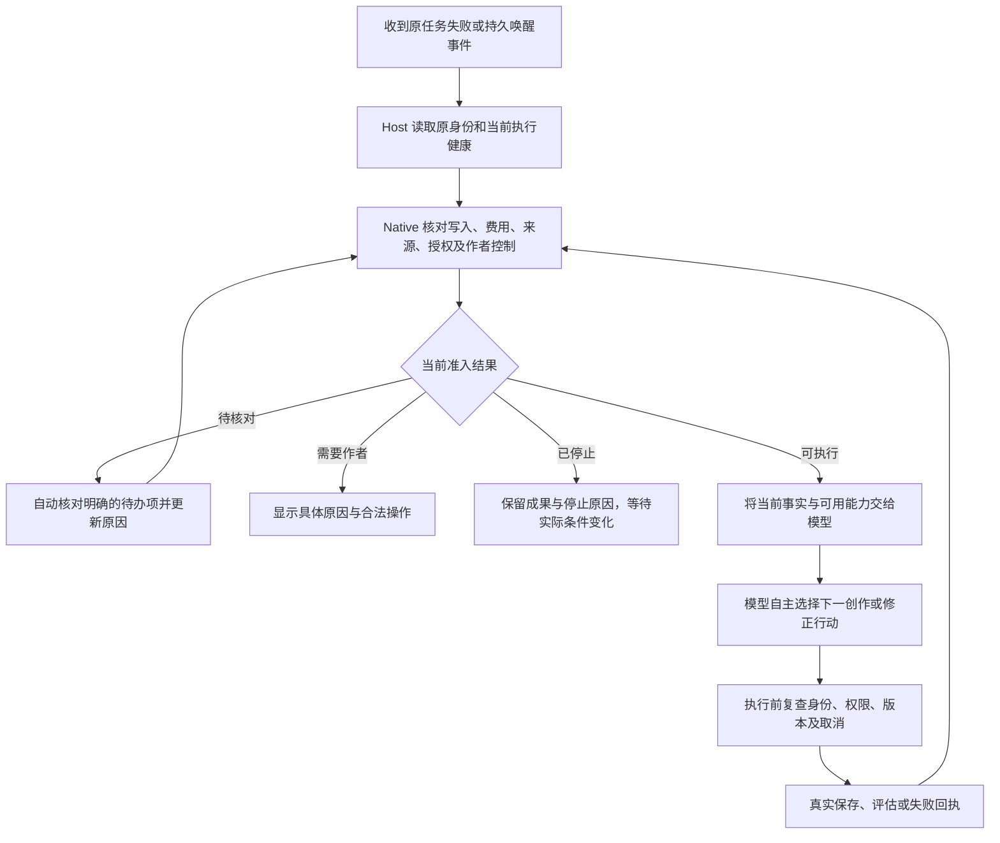

# 自主创作可靠性：状态边界与自动恢复优化方案

日期：2026-10-09。状态：**S01–S09 已实施并完成针对性代码验证；P4 应用验收进行中，总体尚未闭环**。实现、限制及证据见[实施记录](design-reviews/2026-10-09-state-boundary-implementation.md)。

依据：[状态边界审计](design-reviews/2026-10-09-state-boundary-audit.md)、[强制架构规则 B01–B10](../ARCHITECTURE_RULES.md)、[开放工作区与可靠执行架构 3.0](SIMPLE_REQUEST_AUTONOMOUS_CREATION_DESIGN.md)、[权威恢复账本](RECOVERY_LEDGER_DESIGN.md)、[测试阶段工程策略](TEST_STAGE_ENGINEERING_POLICY.md)。

本文是现有架构的专项修复方案，不替代架构规则或另建创作调度器。审计确认的 9 项问题、3 项待验证风险、4 项已有代码修正分别追踪。文档不代表这些修复已经实现，也不把此前 95 项测试通过当作本方案验收通过。

## 1. 目标：作者说一句，应用负责推进和解释

作者可以只说“生成第7章”或“继续创作第3—22章，每章约3000字”。应用读取已有要求和成果，模型组织创作、检查和修改；运行中遇到问题，应用自动核对并在原任务内恢复。确实不能继续时，明确说明发生了什么、已保存什么、是否会自动再试，以及作者可以采取的具体动作。

本次需要同时解决三件事：

1. **事实不丢失。** 首个观察到的失败、当前阻塞、写入结果和费用记录分别保留。
2. **恢复有依据。** 工程证明哪些动作目前可以执行，模型决定如何继续创作；条件变化能重新评估，重复事件不能重复写入。
3. **用户能理解。** 所有界面使用同一事实投影，正文和有意义的进展在主线，技术诊断按需展开。

不追加新的创作功能，不推倒现有架构，不增加必经的规划—写作—审稿流水线，不要求作者填写请求数、token 上限或有效期。能力、方法和子智能体仍由模型按需选择。正常创作默认仅计量，已有明确授权和显式限制继续有效。

## 2. 根本修复方向

目前的问题不是缺少更多错误文案，而是不同事实被压缩成同一个布尔值、字符串或错误码。后续层只好猜测，进而给出错误的恢复动作。

| 当前混淆 | 目标区分 |
| --- | --- |
| 模型请求失败 = 没有保存 | 请求终止与领域写入分别核对 |
| 费用未知 = 额度耗尽 | 未结算、已登记但有未知费用、确实耗尽分别表达 |
| 读取任务失败 = 等待结算 | 读取不可用只说明尚未取得事实 |
| 工具未加载 = 作者没授权 | 当前请求可见性与领域权限分别证明 |
| 两次历史失败 = 同条件原地重试 | 障碍、执行条件、已尝试修正与实际进展分别记录 |
| 后台失败 = 控制台一行日志 | 明确等待、退避、可纠正、需作者动作或工程阻塞 |
| 供应商文本含本地错误名 = 本地状态错误 | 错误类型由受信边界赋予，自由文本仅用于诊断 |

优先补齐现有合同中真正缺少的信息，不建立一套涵盖所有业务的巨大状态机。只有会改变执行、恢复或展示结果的事实进入契约。

## 3. 模块职责与事实权威

| 模块 | 本次职责 | 不能代替谁 |
| --- | --- | --- |
| 主模型 | 理解作者目标；读取准确诊断；选择工具、方法、子任务、修订或结束；解释文学判断 | 不授予权限，不证明费用或保存，不更改作者要求来消除失败 |
| Codex Core | 复用现有模型行动循环、工具反馈、会话与压缩能力 | 不承担小说领域恢复规则；本方案默认不修改官方代码 |
| Agent Engine | 记录请求、协议、本轮工具可见性和供应商失败；关联原执行的失败证据与用量账本 | 不认定作品已保存或目标已完成，不推断作者缺权限 |
| Story Core / Native | 领域授权、版本、回执、Work 预算、待核对项与恢复准入；持久化领域决定 | 不判断下一章怎么写，不选择固定创作流程 |
| Runtime / MCP | 验证调用身份、完整传递结构化结果与可纠正错误 | 不把多个领域原因压成通用错误，不另建权限政策 |
| Electron Host | 连接和进程生命周期、事件消费、核对派发、退避、执行健康投影 | 不按文本关键词恢复，不建立另一份作品或费用事实 |
| Renderer | 将真实状态映射成统一文案、进展和合法按钮 | 不从错误消息、模型答复或按钮点击推断成功与权限 |

Engine 的通用契约由 Engine 对外导出。产品的跨层传输类型放在产品 Shared；Native 领域判定仍由 Rust 实现。跨语言契约用生成或真实序列化合同测试对齐，不由 Renderer 维护另一份业务枚举。

## 4. 三项最小契约改进

以下是目标语义，实施时优先扩展现有公开类型和记录。字段名可随同一改动一次性确定；不得同时保留两套独立判断路径。

### 4.1 失败事实：保留来源、阶段与关联

每条可影响恢复的失败事实包含：

| 字段语义 | 产生方与用途 |
| --- | --- |
| 失败身份、观察顺序 | 由原执行边界生成；区分一次失败与重复通知 |
| 受信产生方、稳定原因码、失败阶段 | 在 Engine、Native 或 Host 边界赋值，不采信供应商自称的来源 |
| 原 task/attempt/request/call 关联 | 使用现有真实身份，避免把其他任务的错误拿来恢复 |
| 首次失败引用、相关失败引用 | 保留首次观察，不被后续保护错误覆盖；未证明因果时仅记关联 |
| 证据引用及有界细节 | 工具名、参数路径、HTTP 状态、原回执引用等；不记录凭据和无关正文 |

**首次观察到的失败不自动等于根本原因。** 工程记录证据；模型或开发诊断可以提出根因解释，但解释不能覆盖原始事实。

例如：响应流中断是第一条失败；随后请求因用量未知被拒绝是第二条保护记录。两者关联到原执行，作者既能知道最初发生了什么，也能看到当前为什么尚不能重发。

如果官方 Core 的某条通道只能传递错误文本，使用 Engine 已有执行记录及公开查询补齐受信事实，由 Host 核对原执行身份。不得从那段自由文本反向制造本地权限或账务结论。需要持久的失败关联进入现有执行记录；有界调试 trace 不能成为唯一恢复依据。

### 4.2 Native 恢复准入：状态与待核对项分开

复用现有 Work 决策和恢复接口，返回明确的准入结果：

| 结果 | 含义 |
| --- | --- |
| 可执行 | 当前领域身份、范围、来源、写入和预算满足条件；返回合法执行模式 |
| 待核对 | 指出具体待核对项和证据来源；可能同时有写入与费用 |
| 等待作者 | 确实缺少领域授权或存在需要作者选择的冲突；绑定动作、对象和范围 |
| 已停止 | 作者暂停/取消、目标完成或无进展保护；各自保留独立原因与重评条件 |

待核对项至少区分“写入结果未知”和“本次费用登记未结束”。已完成登记、但保留历史未知费用，是另一项账务事实：默认无 token 上限时不因此永久阻断后续 attempt；有明确有限上限时按原账本准入。

准入结果带来源版本和证据引用，是当前事实的投影。真正派发前仍需在 Native 原事务/租约/CAS 边界复查，不能把稍早的 UI 状态当作永久许可。`resumeMode` 的执行含义可保留，但不能再与另一套独立 `resumeBlockReason` 判断互相矛盾。

### 4.3 Host 执行健康：知道事实与能否取得事实分开

Host 维护自身观察到的读取、连接、核对、事件认领和派发状态，包含原 Work/事件关联、阶段、观察时间、失败引用、是否安排重试与下次检查时间。

这项状态只描述 Host 的能力，例如“暂时读不到任务状态”，不能改写 Native 的“已保存”“未结算”或“缺少授权”。界面同时消费 Native 领域状态和 Host 执行健康，使用纯展示函数组合；组合结果不成为新的执行权威。

运行健康使用快照加事件更新：重开窗口可以重新获取当前状态；连接中断时保留最后一次已知成果并标明状态尚未刷新。Host 重启后的健康重新检查，不将上一次进程的“正在重试”当作本次仍在运行。持续故障只在状态变化时更新对话，避免每次轮询刷一条消息。

## 5. 自动恢复：确定性核对与模型决策协作



这张图只规定运行可靠性边界。模型可以读取、生成、修订、补规划、查询方法、委派或报告部分结果，不要求每次都经过相同文学步骤。已有适用的独立核验和交付要求仍须满足。

### 5.1 按失败性质选择恢复责任

| 情况 | 自动行为 | 模型或作者的角色 |
| --- | --- | --- |
| 任务状态读取失败 | Host 对同一安全读取退避重试；不调用写作模型猜状态 | 恢复读取前不显示费用或写入结论 |
| 写入已提交但回执丢失 | 按原操作身份核对 Native 账本，找回原回执 | 模型读取实际成果后决定剩余工作；不重复保存 |
| 写入仍未知 | 保留未知；只做允许的核对，不重放候选写入 | 暂时不可判定时说明待核对对象，不能要求作者“当作失败重写” |
| 工具本轮未加载 | 交付准确工具诊断和当前合法发现入口 | 模型自行发现或更换行动；不让作者重复授权 |
| 参数或引用被拒绝 | 返回准确字段位置、原因和来源定位，保持零写入 | 模型修正提交；原目标不变 |
| 必需质量目标未满足 | 保留有效评估和已保存正文，将未满足事项交给模型 | 模型选择修订方法；未达标报告不等于技术失败 |
| 已终止、费用已登记且无上限，仍有历史未知费用 | 保留原账目；其余条件满足后原 Work 可以产生新 attempt | 不让作者管理 token 或清零费用 |
| 实际凭据/服务商访问失败 | 停止相关模型派发，显示具体配置入口 | 作者处理真实外部条件；验证成功后重新核对原任务 |
| 作者暂停或取消 | 阻止后续派发和迟到写入；核对已发生费用和结果 | 只有作者明确恢复才能解除相应控制 |

恢复优先在健康的原会话中处理。确需新 attempt 时继续属于原 Work、原作者目标和累计账本；不重复插入作者消息，不创建新根任务来绕过失败。

### 5.2 修正“无进展”判断

将当前只依赖作品 revision/source digest 的历史失败计数，改为基于原 Work 的恢复片段判断。一个恢复片段关联受阻目标、具体障碍、相关来源、受信执行条件、已尝试修正和最后有效进展证据。

判定顺序：

1. 先检查作者控制、未知写入、原范围及费用准入；这些保护不能通过换模型或重试次数变化绕过。
2. 明确当前障碍。不同错误保持各自诊断，不把它们都称为“同一个错误”；更换错误码也不能自动重置无进展保护。
3. 有真实相关条件变化时重新评估，例如模型连接重新验证成功、合法工具 schema 已加载、原保存回执找回、作者调整了确实冲突的要求。
4. 成功进展必须引用 Native 已提交的相关成果或已解除的实际障碍。最终答复、换一段措辞、创建空步骤和单纯重复读取不算完成进展。
5. 保留现有防空转保险，但改为当前恢复片段内的连续无进展判断，不再累计作品同一 revision 下所有历史失败。初始沿用现有两次的保险值，先用受控场景验证作用域；该值是技术保护，不是章节数、创作总步骤或作者目标上限。
6. 真实条件变化提供重新准入的机会；保留已尝试的条件与行动记录，避免在 A/B 模型、两种错误或两个无效动作之间切换就无限刷新机会。作者或模型仅声明“条件已修复”不能解除拦截。

由 Native 判断领域准入与有效进展；Engine/Host 提供验证过的执行条件引用，不能由模型填写可信指纹。细化指纹只加入影响该障碍的条件，不使用每次变化的时间戳、随机 ID 或无关全项目版本来制造“新条件”。

达到无进展保护后，应明确标为“自动处理仍未推进，已停止重复尝试”。只有确实存在连接失败证据时才建议检查或更换模型；不能对所有工程错误都给出这个建议。

### 5.3 后台等待、退避和重复事件

复用 `WorkExecutionEventConsumer`、Native claim 和现有执行租约。安全读取和连接探测可退避重试；模型派发必须取得实际准入，不能被定时器直接触发。优先服从服务端明确的等待时间；本地退避使用已有运行策略和抖动，不成为作者任务期限。

暂时不可用时保留原事件，准确显示“等待自动恢复”。作者介入条件未解决时停止无价值的模型调用。处理完成后凭真实 successor attempt 或完成证明消费事件；异常、进程退出和不确定结果不得伪造消费成功。

条件恢复、窗口重开、重复通知与进程重启都先重读事实。派发前的最新暂停/取消和租约失效拥有否决权；旧唤醒不能覆盖作者新操作。

## 6. 9 项问题的具体实施映射

| 问题 | 必须修改的责任点 | 删除或替换的判断 | 修复验收 |
| --- | --- | --- | --- |
| S01 首因被覆盖 | Engine `bridge_failure`/`bridge_exchange`、公开执行结果、Host 任务失败提交、Native 失败事实消费 | 只用最后一条 message 代表完整失败 | 流中断后再遇用量保护，两个原因和各自请求身份均保留；原费用不变 |
| S02 引用错误无位置 | Native `revision_outcome_validation`/`source_evidence`、Runtime 输出错误、MCP 传输 | 循环内直接传播缺定位的通用字符串 | 返回准确 outcome/evidence 路径，拒绝后零保存，模型能重读正确来源 |
| S03 停止指纹过粗 | Native `work_decision`/`work_decision_generation`，执行条件证据消费 | 按同一作品来源累计所有失败 advisory | 重复无进展停止；真实条件变化可重新准入；换措辞和错误循环不刷新机会 |
| S04 展示内部码 | `WorkTaskPanel`、`CreativeWorkspaceView`、`App`，Shared 展示输入 | 多套分支直接插入 blockedReason | 同一事实在各入口含义一致，技术码仅详情显示 |
| S05 读取失败称待核账 | Host `listGenerationRunsWithUsage` 及调用者 | 包含 GET/POST 的 catch 统一赋 usageUnsettled | 读取失败、执行中、结算失败、已结算分别投影 |
| S06 预算与身份共用错误 | Native `task_provider_budget`、Runtime `repository_error`、Host 错误契约 | BudgetExhausted/待结算/到期 → TaskBindingInvalid | 各原因有独立受信码和恢复含义，拒绝仍零派发 |
| S07 费用与写入混合 | Native 待核对项、`work-step-continuation`、`semantic-work-continuation`、任务 UI | 单个 pendingRecovery 被消费者解释成未知写入 | 仅费用、仅写入、同时存在和均已核对四种状态准确 |
| S08 后台失败仅日志 | Host Consumer 失败回调、运行健康快照/事件、Renderer 订阅 | console.warn 作为唯一反馈 | 断连时原因可见，恢复后同事件接续，重复/重启不多执行 |
| S09 文本关键词判状态 | 受信错误适配、IPC 类型、`agent-error-description`及全部受影响调用者 | 对整段自由文本匹配本地权限/版本错误名 | 同样文字来自供应商正文与本地码时含义不同，未知错误不猜事实 |

S01/S06/S09 共用来源明确的错误契约；S03/S05/S07/S08 共用原任务事实和恢复投影；S02/S04分别补足模型纠正信息和用户理解。可以按这些边界分包，但每个包内必须同时更新生产者、传输、消费者和测试，不能先加新字段后继续走旧逻辑。

### 引用错误的目标示例

以下是 Native 生成的示意，不是模型可自行声明的诊断身份：

```json
{
  "code": "invalid_output_payload",
  "details": {
    "reason": "evidence_quote_not_found",
    "instancePath": "/outcomes/1/evidence/0/quote",
    "sourceRef": "已验证的场景与修订引用"
  }
}
```

未找到、重复引文导致歧义、锚点不符、对象不匹配分别可判定。引用字段来自服务端已验证对象；报错不回显整章或任意输入。模型通过合法读取补证据，不能把“引用必须存在”的标准删掉。

## 7. 接口、存储与信任边界

### 7.1 错误必须完整穿过调用链

Runtime 和 MCP 传递领域结构化错误；Host 的 `nativeRuntimeError` 保留允许的类型、原因、路径和关联信息，不只保留 message。Renderer 接收经 Host 核实的产品错误，而非任意 Error 对象。

检查 Electron IPC 的异常序列化：若直接 throw 会丢失自定义字段，受影响接口改用明确的成功/失败结果封装，并同步调用者，不能把 JSON 塞入 message 后继续正则猜测。错误来源由边界根据真实请求关联赋值；供应商返回的 `origin`、`code` 或正文不能自行升级成本地 Native 事实。

`retryable` 仅表示某失败技术上可能重试，不等于当前任务已获准重试。实际执行同时满足 Native 准入和 Host/Engine 就绪条件。HTTP 状态用于协议，稳定业务码用于原因，二者都不能替代实际保存回执。

### 7.2 复用账本，最小持久化

复用现有 Task/Attempt、Engine 请求账本、Native 工具操作及回执、Work 执行事件。失败关联附着原执行记录；恢复判断引用已有证据，不复制正文、费用总数或第二份 Work 状态。

恢复必须跨进程保持的停止依据、已尝试条件和进展引用由其事实所有者持久化。Host 的进程健康和退避时钟是观察与调度信息，不能持久化后冒充领域许可。纯 UI 文案由受信投影派生，不写回领域事实。

只为实际消费方缺少的信息增加字段。若需要调整 schema，直接更新当前建库逻辑及隔离 fixture，同步所有调用者；不建立旧格式探测、回填、升级或双轨逻辑。真实作者资料、原失败和账目保持原样。无法由原始证据证明的历史事实保持未知，不编造结构化成功记录。

### 7.3 官方代码与发布边界

本次实现优先使用公开 Engine/Runtime 接口，不预设修改官方 Codex Core。遇到经复现确认的官方依赖缺陷，按 B09 拉取并完整合入目标分支更新、重新构建和复验，再判断是否需要最小本地补丁。拉取成功或单元通过不能代替该故障复验。

代码、构建产物、运行中的应用分别记录身份。需要重启加载新构建时先核对活动请求与未知写入，遵守现有暂停和恢复合同，不直接终止未核对的保存。没有重载和实际应用证据的修复，只记为代码验证通过。

## 8. 作者体验

对话主线保持三类内容：模型的简短进展、有意义的结果、需要作者处理的明确问题。后台状态在一处更新，连续工具动作折叠成简洁摘要，不复制原始作者输入，不显示 `planner`、task ID、版本术语和重复回复入口。

| 真实情况 | 主线示例 | 可用动作 |
| --- | --- | --- |
| 暂时读不到状态且已安排重试 | “暂时无法读取进度，正在重新连接。已保存内容仍保留。” | 查看已知成果；仅安全地重新检查状态 |
| 正在核对可能已保存的结果 | “正在核对刚才的保存结果，避免重复生成。” | 查看保存详情；不提供绕过核对的重写按钮 |
| 模型正在修正已明确拒绝的引用 | “检查中发现一处引用不匹配，正在修正。” | 查看检查进展 |
| 真实凭据验证失败 | “当前模型连接验证失败，已保存内容仍保留。” | 打开模型设置；验证后重新评估原任务 |
| 真正缺少某项授权 | “修改这章的范围尚未获准。” | 查看具体范围并授权；已有授权则不重复出现 |
| 无进展保护停止 | “自动处理仍未能推进，已停止重复尝试。” | 原因详情、已有成果；只显示实际支持的恢复动作 |

示例只在事实成立时使用。“正在修正”需要实际运行证据；“将自动重试”需要真实已安排的调度。无法读取事实时明确说明尚不能确认，不能提前宣称内容丢失、费用耗尽或权限不足。

界面统一展示函数只负责措辞与布局，不决定能否执行。每个按钮绑定受信动作描述并在执行时重新核对；详情可展示技术码、失败链、原任务和核对证据。工程故障若没有作者可完成的动作，明确告知已停止并可查看诊断，不要求作者反复输入“继续”。

## 9. 状态组合与回归矩阵

| ID | 输入事实及来源 | 预期行为 | 必须保持的证据 |
| --- | --- | --- | --- |
| T01 | Engine 响应流中断，后续请求遇用量保护 | 首次失败与当前保护分别显示；不重放未知请求 | 同一执行身份、累计已知/未知费用 |
| T02 | Native 已提交正文，Host 未收到成功 | 自动核对原回执，继续剩余任务 | 原正文、修订与幂等身份不变 |
| T03 | Native 操作 accepted，暂无结果证明 | 写入保持未知，不重写 | 原操作仍未决，不伪造 rejected |
| T04 | 仅费用未登记，无工具写入 | 等待结算，不称“未知写入” | 写入数量仍为零 |
| T05 | 费用已登记但有未知值，无上限 | 其余条件满足后可在原 Work 继续 | 未知费用不清零、不伪装实际收费 |
| T06 | 同样未知费用，但有明确有限上限 | 按原预算拒绝不安全派发 | 不新建预算，不忽略未知占用 |
| T07 | Host 读取任务失败 | 显示读取不可用，安全退避 | 未产生结算成功或写入未知结论 |
| T08 | 供应商 message 包含 TaskBindingInvalid 等名称 | 仍是供应商诊断，不变成本地状态错误 | 来源由受信边界确定 |
| T09 | 领域允许，但 schema 本轮未加载 | 合法发现或由模型换方案 | 拒绝调用零执行，不新增权限 |
| T10 | 相同障碍和条件重复失败 | 防空转停止，给出实际阻塞原因 | 费用与已尝试记录保留 |
| T11 | 模型/工具条件已真实修复，作品来源未变 | 重新评估原 Work，不被旧累计失败锁死 | 原范围、目标和累计账本 |
| T12 | 只换提示词、随机 ID 或轮流报不同错误 | 不据此清零无进展保护 | 不伪造有效进展 |
| T13 | 待唤醒期间作者暂停/取消 | 后台不派发，迟到写入按合同拒绝 | 作者控制优先 |
| T14 | 同事件重复、窗口重开或进程重启 | 核对原 claim/lease，最多一个实际接续 | 未完成交接不记 consumed |
| T15 | 多条引用中一条不匹配 | 返回准确路径；模型修正后重新校验 | 无效报告未保存，原文校验不放宽 |
| T16 | active 只读任务无写权限；终止 task 的旧凭证 | 前者可合法读但不可写；后者按生命周期拒绝 | 作者仍可经合法历史入口查看成果 |
| T17 | 读取合法但后续写入因版本变化被拒 | 展示真实版本冲突，不称整体模型不可用 | 原冻结来源不被悄悄更新 |
| T18 | 稿件保存但必需评估尚未满足 | 展示部分成果，模型选择修订/后续行动 | 不把保存等同最终交付 |

测试使用真实生产序列化、Native API、MCP/Engine 转换器及当前持久记录。局部函数测试证明分类，跨层合同证明传递，进程测试证明重启，真实应用证明用户路径。不能仅检查某段文案或源码包含一个字段。

受影响协议按故障扩展到 JSON/流式、存在/缺失用量、取消/超时、拒绝零执行与幂等结算。不机械重跑无关全库或付费模型；新的跨层合同完成后执行完整相关回归和既有门禁。

## 10. 三项待验证风险如何处理

| 风险 | 先做的判定 | 实施条件 |
| --- | --- | --- |
| R01 候选鉴权错误过于宽泛 | 补 T16/T17 的真实读取/写入、终止/撤销/到期组合；区分鉴权保密策略与错误阻断 | 仅在合法读取被错误拒绝或反馈误导获证时调整；不放宽失效凭证 |
| R02 Host 丢弃结构化 details | 跟踪所有受影响 IPC/Runtime 消费者，并验证字段经过完整链路 | 随错误契约同步保留实际需要的安全字段；不声称 MCP 也丢失同样信息 |
| R03 能力/角色多处定义漂移 | 用真实目录验证发现→当前模型输入→Native 操作准入及跨线程隔离 | 证明漂移则统一生成来源；没有漂移则补合同测试，不再手写一份目录 |

风险关闭须写明“确认缺陷并修复”或“相应场景未复现且合同通过”，不能因为增加测试就把未知风险写成已修复。

## 11. 分阶段落地与退出条件

| 阶段 | 工作包 | 进入下一阶段的条件 |
| --- | --- | --- |
| P0 固化反例 | 将审计探针转成对应真实边界回归，确认正在运行的构建身份；收敛 R01–R03 | 每个 S 编号有失败证据和预期修复断言，不放宽现有保护 |
| P1 事实与错误合同 | S01/S05/S06/S07/S09；同步 Engine、Native、Runtime、MCP、Host、IPC 与类型的受影响部分 | 首因/当前阻塞、费用/写入、读取未知、错误来源在消费端均可区分 |
| P2 自主恢复 | S03/S08；修正恢复片段、可信条件变化、后台健康与退避 | 同条件停止、真条件变化恢复、暂停取消和重复事件合同全部通过 |
| P3 自纠与清晰交付 | S02/S04；精确引用错误及统一主线/详情/按钮 | 模型能定位拒绝项；各界面状态一致；无非法恢复按钮 |
| P4 实际应用验收 | 重载当前构建，复核 F01–F04；单章、续写、修改、中断恢复，再验证原 20 章任务 | 应用自行核对、创作、修订和交付，成果可以实际打开 |

阶段是开发顺序，不是用户创作流水线。每个阶段内采用可独立验证的改动包；契约生产者与所有当前消费者一起切换，不留下过渡分支。共享工作区有并行修改时记录受影响文件和构建身份，避免拿另一版测试替当前代码背书。

F01–F04 的既有代码不重写：分别复核默认计量恢复、未加载工具诊断、Run→Work 停止投影、对话重试模式。此前只完成代码验证的项必须补重载后应用证据。

## 12. 实际应用验收

先用当前 schema 的隔离作品，包含正常书名、故事前提和角色。单章输入保持简短，例如“生成第1章，约800字”；观察应用自行组织并保存，再验证续写、局部修改与中断恢复。评审者不补内部工具名，不替应用指出每处引文错误，不逐轮要求重写。

受控 provider 用于稳定注入断连、错误参数和回执缺失；真实已配置模型用于验证自然理解、创作、自纠和交付。两种证据分别记录，不能互相冒充。连接验证遵守现有凭据和作者授权，不由测试伪造可用结果。

随后恢复《潮汐邮局》原“第3—22章，共20章，每章约3000字”目标：

- 保留第1—2章与已有后续成果，应用先读取原 Work 的当前保存、评估、未满足要求和账目。
- 第6章等未闭环内容由应用根据真实状态选择补写或修订，不从新建空章节开始，不把已保存算成已达标。
- 章数和篇幅遵守原有效要求及验收合同，不为了通过测试下调范围、改宽容差或自动采用/发布。
- 修复后满足恢复条件时，由原事件/原对话自行接续。若必须作者处理外部条件，界面说明原因；验证者仅执行明确必要的作者动作，不扮演创作调度器。

每个场景记录源码/构建身份、原 Work/attempt、作者实际操作、真实保存回执、评估状态、恢复前后状态及界面证据。不导出凭据或把全文复制进诊断日志。当前 20 章仍未完成；本方案不更改这一事实。

## 13. 完成标准与防复发

一项问题只有同时满足以下条件才记为闭环：原故障有记录；责任和合同已修正；对应正反例通过；所有受影响入口使用新合同；需要的应用复验完成；实际结果与账目保留。

总体完成还要求：S01–S09 全部关闭，R01–R03 得到有证据的结论，F01–F04 未回退；用户能用简短输入获得可打开的正文；故障时应用能够自行恢复，或准确解释停止与下一步；原长篇目标以真实成果验收，不能用完成模块数或测试数量替代。

开发规则不再复制一份。落实既有 B04/B06/B08/B10：每次状态或权限改动提供最小判定表，覆盖最容易混淆的相邻状态；真实故障必须补对应合同回归。静态架构门禁继续检查依赖方向；它不能证明运行语义。新增限制需说明保护对象和恢复方式，不把保守工程阈值变成作者任务目标。

## 14. 五视角设计评审与文档交付状态

本表由同一实施者按五个视角检查，不声称已完成独立专家评审或代码验收。

| 视角 | 结论与实施约束 |
| --- | --- |
| 架构 | APPROVE WITH CONDITIONS：复用原循环与账本；新增事实有明确所有者和消费方；不新增文学调度器 |
| 技术 A | APPROVE WITH CONDITIONS：来源可信、重复事件、取消、未知写入、累计费用与原身份必须经真实合同验证 |
| 技术 B | APPROVE WITH CONDITIONS：生产者/消费者一次同步；IPC 不丢结构化字段；无兼容分支；记录运行构建身份 |
| 产品 | APPROVE WITH CONDITIONS：作者无需内部参数和重复指令；长篇以可打开成果与原目标验收 |
| UI/UX | APPROVE WITH CONDITIONS：统一解释，进展有事实支撑；必要作者动作清楚，技术细节折叠 |

零兼容检查：方案不包含升级、回填、双读双写或旧接口保留；隔离测试数据与真实作者资料严格区分；当前版本的来源、CAS、安全和恢复继续保证。无需新增兼容例外。

设计交付之后，已实施 Engine、Native、Runtime、Host、IPC、Shared 和 Renderer 的对应修正并重载真实应用。模型连接重新验证后，原 Work 自行恢复并保存第6章新稿及独立评估；没有补发创作指令。该证据证明原任务能够恢复，不代表全部应用场景或原20章目标通过。实现细节、真实测试范围与尚未关闭项统一记录在[实施记录](design-reviews/2026-10-09-state-boundary-implementation.md)，不以方案文字覆盖实际验收状态。
