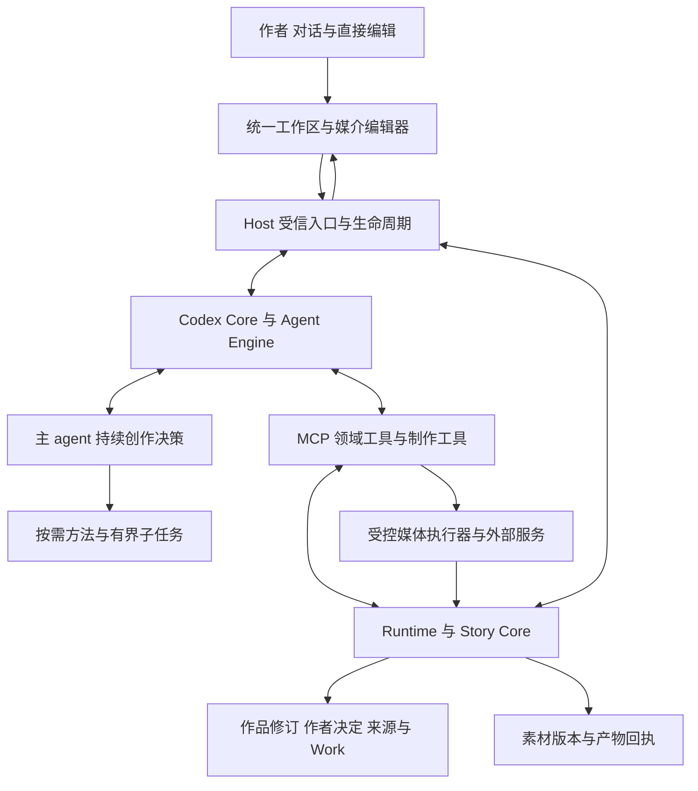
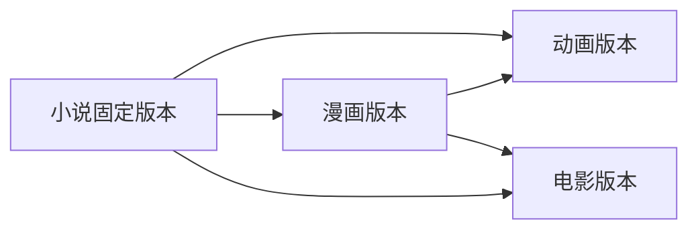

# 统一创作 Agent 与跨媒介改编理想方案

日期：2026 年 10 月 12 日。状态：统一目标设计，部分实施中；实际改动和验证见[实施记录](2026-10-12-creation-implementation.md)。本文整合并替代本文件此前分次补充的方案；目标描述本身不改变代码、权限或作者作品。

建设一个能够与作者共同确定方向、持续组织创作，并将作品改编为其他媒介的创作系统。作者可以从一句想法开始，也可以基于已有小说、漫画或视听素材继续工作。主 agent 判断需要了解什么、规划到什么程度、下一步做什么；工程保证作品、来源、决定、执行和交付可追溯。

总体设计是：**一个持续负责整体目标的主 agent，配合按需加载的媒介方法与制作工具，共用版本化作品和可靠执行基础。** 支持小说、漫画、动画和电影的独立创作，支持小说到漫画再到动画，也支持小说直接改编为动画或电影。各版本保留自己的表达选择，依赖关系不自动授予写入、采用或发布权限。

本文是对[现有理想架构](../IDEAL_ARCHITECTURE.md)中主 agent、创作准备和跨媒介改编的统一细化；[架构规则 B01 至 B10](../../ARCHITECTURE_RULES.md)仍是强制边界的唯一正文。目标设计、当前源码基础和已验证行为分别说明，不能把本文视为功能已经实现。

## 一 产品目标与成功标准

作者不需要知道工具名、任务标识或内部制作流程。系统应从作者目标和已有材料出发，选择适用的工作深度，并提供可阅读、可编辑、可继续制作的真实成果。

| 作者目标 | 理想行为 | 交付判断 |
| --- | --- | --- |
| 从模糊想法创作长篇 | 读取已有信息，消除关键未知，形成适用的全书框架，再展开正文 | 方向有依据，规划被实际使用，正文达到约定效果 |
| 明确委托自主创作 | 在已有授权内选择方法、补全普通细节、检查和修订 | 不反复追问已委托事项，也不降低作者要求 |
| 局部修改或有界试写 | 读取必要材料，直接完成对应范围 | 不引入无关的全书建模与审批 |
| 按已有大纲续写 | 复用有效方向，核对相关前文，准备近期内容 | 使用当前适用版本，保留既有约束和强项 |
| 小说改编漫画 | 理解原作和改编目标，组织视觉叙事，生成可编辑页面与素材 | 既符合改编要求，也适合漫画阅读 |
| 小说或漫画改编动画与电影 | 选择来源与制作路径，完成适用剧本、分镜、素材、剪辑和检查 | 明确区分剧本、预演与完整成片 |
| 上游作品变化后继续改编 | 找出影响候选，比较改编差异，更新获准且确实受影响的部分 | 不盲目覆盖下游，也不遗漏关键依赖 |

产品效果以作者满意度、返工量、达到目标所需时间与实际费用衡量。提问次数、计划长度、工具调用次数和首章生成速度不能单独代表进步。

## 二 核心设计原则

1. **模型负责创作判断。**理解意图、选择阅读范围、组织结构、判断改编与质量。Host 不按关键词选择小说流程，Native 不硬编码文学套路。
2. **先消除关键未知。**能从作品和历史决定中查到的先查；重要偏好需要协商；低影响细节在授权内合理补全。
3. **准备足够就推进。**复杂任务需要全局依据，短小明确任务保持轻量。允许探索、试写和远期开放问题，不追求动笔前确定全部细节。
4. **计划持续更新。**全局方向、近期安排、执行任务分别管理，计划必须进入创作与核验的实际输入。
5. **声明与事实分开。**作者原话、模型假设、候选方案、已保存作品、采用和发布各有来源，不相互替代。
6. **各媒介版本独立且有关联。**共享明确采用的设定和素材，同时保留改编差异；小说不会自动成为所有版本永远最高的权威。
7. **工程保证可靠执行。**来源、权限、版本、事务、幂等、用量和恢复有明确权威；失败不抹去成果，未知不伪装成功。
8. **能力与方法按需加载。**不默认启用固定专家团队，不要求完整知识图谱，也不把全部创作方法塞入常驻提示。

## 三 总体架构与责任

图表示逻辑职责，主 agent 运行在已有 Core 行动循环中，不是新增服务或第二个执行循环。工具通过公开接口访问领域，媒体执行器经准入并提交真实回执；连线不授予直接写数据库的能力。

| 责任模块 | 必须承担 | 不承担 |
| --- | --- | --- |
| 主 agent | 目标理解、准备判断、全局设计、改编选择、行动组织、证据整合与质量判断 | 自行批准权限、编造保存或发布、替作者作未授权的重要决定 |
| Codex Core | 通用会话、行动循环、上下文管理、压缩及协作协议 | 小说、漫画和影视专属业务规则 |
| Agent Engine | 模型与工具协议、能力准入、执行身份、供应商请求及真实用量 | 作品事实、文学评价与另一个规划器 |
| Host | 受信 IPC、配置和凭据隔离、生命周期、事件消费与已准入动作派发 | 从自然语言硬选创作流程或以内存认定交付 |
| Story Core | 作品和修订、作者要求与决定、来源、领域授权、Work 及依赖、事务与完成事实 | 调模型绕过校验或用字段完整率认证文学质量 |
| Story Authoring | 从领域事实构造任务、冻结输入与适用上下文 | 独立维护另一份作者意图或作品状态 |
| Runtime 与 MCP | 公开领域用例、真实 schema、身份绑定和可纠正结果 | 越过 Story Core 写事实或隐藏失败原因 |
| 制作执行器 | 在授权与额度内生成、导入、处理、合成和导出素材 | 自动扩范围、无界重试或自行决定故事内容 |
| Renderer | 对话、方案编辑、正文或画面预览、时间线、差异和作者动作 | 从模型措辞推断已保存、已采用或已完成 |

新增媒介主要扩展领域对象、创作方法、制作工具、编辑器和验收合同。通用主 agent 的职责与底层执行循环保持稳定。

## 四 主 Agent 的持续决策

### 统一行动机制

主 agent 持续回答三个问题：当前目标与依据是什么，哪项未知或缺口最影响下一步，采取什么行动最有价值。阅读、提问、提出方向、规划、试写、正式创作和核验都是可选择的行动，可以交织进行。

一次阅读可能足以直接改稿；一次试写可能暴露需要重规划的问题；一次作者反馈可能只影响一个镜头。不能把这些行动固定成每次都走完的阶段流水线。

“一个主 agent”指整体责任连续，不要求始终保留同一进程或无限增长的聊天上下文。新执行会话通过持久事实恢复目标、重要选择、未决问题和真实成果。只保存影响后续工作或需要恢复的决定，不保存每次内部推理，也不为每个工具调用建立准备报告。

### 常驻指令与按需能力

常驻指令只承载整体责任、决策边界、准备深度、证据意识和作者沟通约定。长篇结构、漫画分镜、影视改编等方法按需读取；工具参数和错误说明由真实 schema 与指南提供。

主 agent 直接负责作者交流和最终整合。子任务适合独立资料调查、具体因果检查、视觉连续性检查或隔离候选制作。委派需明确目标、来源范围、限制与交付证据。子任务返回的建议由主 agent 核查，不通过平均意见决定作品方向。

没有必要时不委派。关键依赖尚不稳定时不盲目并行制作下游；上下文隔离也不自动证明盲审。已有明确独立核验要求继续生效。

## 五 需求澄清与作者决定

### 先判断未知的性质

| 情况 | 主 agent 的行动 |
| --- | --- |
| 已有信息能回答 | 读取并复用，避免重复问作者 |
| 低影响且容易调整 | 在授权内补全；对后续重要的假设保留身份 |
| 重要方向未定且未委托 | 给出有实质差异的选项，说明影响并询问 |
| 作者不知道如何选择 | 用具体故事前提、方案对比或已获准的有界试写帮助判断 |
| 重要方向已明确委托 | 自主选择并说明必要取舍，不反复索取同一决定 |
| 作者要求存在实质冲突 | 指出具体冲突及影响，等待必要选择 |
| 必需来源缺失或无法读取 | 先查找和核对，确实无法取得再说明缺口 |
| 执行范围或权限不足 | 指明实际动作、对象和范围，走相应领域作者契约 |

每个问题都应明显改变下一步方案、消除重要假设或解决真实冲突。通常一次只问少量关键问题，允许自由回答、暂无偏好、明确委托或暂不决定；这不是问题数量的硬阈值，也不是完整创作问卷。

### 区分三种交互

- **澄清意图：**获得缺失的目标、偏好和约束。
- **选择方向：**围绕可审阅方案决定重要取舍。需要确认时，先给具体内容和影响，不能只问“是否先规划”。
- **批准执行或正式采用：**按领域合同决定动作及范围。选择方案不自动等于授权发布、跨版本覆盖或扩大制作费用。

已有明确授权继续有效。信息充分且方向已委托时，主 agent 可以完成适用规划后自主推进。真正需要等待的决定未回答时，不能将超时、关闭问题或默认选项当作同意。可选偏好没有回答时，可在已有授权内保留假设继续。

### 问答必须跨任务保持真实来源

受信入口将问题和回答绑定到原 Work、目标版本、会话及意图代次，保留问题含义、原始回答与适用范围。模型解释另存；后续 Writer、审阅和恢复任务能从领域作者来源读取回答。

领域保存与 Core 回传是两个可独立失败的步骤。采用稳定身份与幂等回执，区分已持久化、已交付和待核对；回传丢失后核对并继续原交付，不重复追加作者要求，不向过期或无关会话发送。

提问工具必须符合真实模式合同。若当前模式仅允许可选问题，阻塞性作者决定使用领域等待与对应 UI，或可持久续接的对话路径；不能用提示词把可选问题工具变成权限批准工具。实现须核对最终模式指令、模型可见工具、回答入口与等待恢复整条链路。

## 六 分层规划与准备结束条件

### 三类计划分别承担责任

| 层次 | 核心内容 | 实际使用方 |
| --- | --- | --- |
| 故事与改编设计 | 核心体验、主线、人物选择、阶段结构、重要承诺、终局或探索边界、改编取舍 | 主 agent 与跨阶段创作 |
| 媒介表达与近期制作安排 | 近期章节与场景、漫画页格、影视场景与镜头、必要素材和节奏 | Writer、制作工具、编辑器与核验 |
| 工作执行计划 | 当前待解决问题、下一项行动、实际制作依赖和完成证据 | 同一 Work 的执行与恢复 |

通用待办清单不能替代全书结构。全书框架也不等于预先列出所有章名；它应说明主要变化为何发生、人物选择如何推动后果、主支线怎样汇合及重要承诺如何兑现。

优先复用作者要求、brief、outline、plan、承诺和媒介文档。只为真实编辑、生成、查询或核验需求增加字段，不建立另一份故事正文或完整知识库作为默认前置。

### 准备到足以支持下一段工作

| 下一步 | 必要准备的语义依据 | 可继续开放的内容 |
| --- | --- | --- |
| 概念讨论 | 探索目标和明确排除项 | 人物细节、完整终局 |
| 有界试写 | 试写目的、范围、约束和适用许可 | 全书精确结构 |
| 新长篇正式开篇 | 核心体验、主线或阶段推进机制、重要约束、终局方向或探索策略、当前章节作用 | 远期场景与未影响当前工作的细节 |
| 按规划续写 | 有效规划、相关前文、最新作者要求和当前章依赖 | 无关卷纲细节 |
| 局部修改 | 精确目标、必要来源、保留项和预期效果 | 全书重构方案 |
| 漫画或影视改编 | 来源基线、目标形态与覆盖、关键保留项、适用表达方案及当前制作输入 | 不影响本次交付的后续版本与远期制作细节 |

这是模型判断参照，不是 Native 的全局必填表。没有仍会实质改变当前行动的未决问题、适用来源可读取、实际依赖就绪且行动已获准时，就应推进。艺术上的开放空间不等于准备不足。

### 让规划真正影响产物

任务绑定实际依赖的规划和来源修订，提供相关摘要及可读原文入口。创作消费这些依据，检查核对当前作品是否承担了约定作用；不能先写正文再补一份规划冒充依据。

保留可恢复的设计视图：作者确定了什么、模型作了哪些受委托选择、当前方案引用哪些修订、最近的重要变化为何发生、哪些问题仍开放、下一步要验证什么。视图从既有事实与引用构建，不成为新的事实权威。

当作者改变核心方向、关键因果无法成立、重要承诺无法兑现、试写暴露表达问题或阶段结束时，主 agent 判断是否重规划。先处理最小受影响范围，不固定每几章全书重审。合理偏离可以保留，但需说明依据；涉及受保护方向或超范围修改时走适用作者决定。

## 七 作品 版本与来源的领域基础

| 对象或事实 | 唯一权威与用途 |
| --- | --- |
| 作者原始要求及决定 | Native 记录真实来源、适用范围与代次；模型解释不能改写原话 |
| 作品项目与媒介版本 Edition | 项目组织相关作品；每个 Edition 有独立媒介、作用域、分支及创作目标 |
| 原文 文档及素材修订 | 不可变来源与可编辑对象，保存、候选、采用及发布分别记录 |
| 共同设定 | 可选的明确采用快照，各 Edition 固定引用；不自动追随最新版本 |
| 模型假设与重要改编选择 | 保留来源、理由、影响对象和作者或模型身份；不自动成为正式设定 |
| 来源关联与映射 | 精确版本、选区、用途及目标引用，支持局部、多对一与一对多关系 |
| Work Step Attempt 与回执 | 持久目标、衍生行动、执行尝试及真实完成证据；复用现有任务体系 |
| 检索与语义分析 | 可回读、有来源和覆盖的派生资料；按需生成，不取代原文和授权 |

区分三个视图：故事关系描述人物、事件和承诺；改编来源描述作品之间的依据；制作依赖描述行动所需的实际输入。它们可以关联，但不合并成一个万能知识图谱或新的调度器。

保留故事发生时间、读者获知顺序与视听播放时间的区别。影视中的镜头是创作对象，时间线片段是其一次使用；同一镜头可重复剪入，不能混用身份。精确时间、选区和编辑锚点由领域管理。

## 八 各媒介的能力与交付合同

| 目标形态 | 主要表达对象 | 需要核验的内容 |
| --- | --- | --- |
| 小说 | 章节、场景、段落、叙述视角 | 人物动机、因果、语言、信息释放、篇幅和阅读效果 |
| 漫画 | 页面或条漫、画格、气泡、造型及素材 | 阅读顺序、视觉叙事、对白负担、外观与空间连续性 |
| 动画 | 场景、镜头、运动素材、声音、轨道与片段 | 动作表现、镜头衔接、节奏、声画同步和完整观看效果 |
| 电影 | 适用剧本与场景、镜头、表演素材、声音及剪辑结构 | 目标时长中的叙事组织、视听连续性和成片效果 |

电影与动画不是完全互斥的类别。目标合同按实际需要区分叙事形态、表现方式和交付阶段，例如电影或剧集、二维动画或实拍素材、剧本或完整成片；不只通过增加一个 Film 枚举宣称支持电影。

同一通用主 agent 按目标加载相应方法、工具和检查能力。复杂生成可以复用已稳定的造型、场景或声音资产；实际需要什么，由目标表达与工具输入决定。只写剧本不要求先做全套视觉资产，单个镜头也不要求完整影视工程。

交付必须分别标明方案、剧本、分镜、预演、部分素材、完整成片及可编辑工程。保存结构化文档不等于生成图片，生成素材不等于完成剪辑，静态图片串联不自动等于完整动画。

主 agent 或适用检查工具必须实际观察所核验内容。图片元数据不证明看过画面，少量抽帧不证明全片动作和音频正确；检查报告保留版本、覆盖和未核验部分。缺少必要服务或感知能力时保留成果与剩余目标，不静默降级交付。

## 九 跨媒介改编与依赖生成

### 支持可组合的路径

箭头表示可选择的改编关系。各媒介仍可独立创作；动画无需先生成整部漫画。直接改编路径中的必要剧本、分镜或制作素材按实际需求建立。

一次目标可包含多个媒介版本，一个版本也可使用多个来源。例如动画以小说某修订为剧情依据，以漫画某修订为人物视觉参考。来源用途须清楚：剧情、造型、对白、音频、风格参考和实际生成输入不能混同。

### 每个目标保留最小改编依据

- **来源基线：**确切作品、版本、范围和引用，不在运行中暗换成最新来源。
- **目标交付：**媒介表达、覆盖范围、篇幅或时长以及需要完成的阶段。
- **保留与改动空间：**必须保持的事件、关系和约束，以及获准压缩、重排或新增的部分。
- **来源用途与冲突依据：**各来源承担什么作用，冲突按哪些作者要求或已采用选择处理。
- **关键映射与决定：**来源如何进入目标，哪些被合并、省略或新增，重要取舍的依据是什么。

这是业务信息要求，具体落点优先复用已有来源和任务合同，不要求所有请求另填一套完整文档。无法从上下文解决的关键冲突才交作者决定。

### 改编是有依据的表达转换

主 agent 判断内心活动怎样转成画面、行动或声音，长篇情节怎样适应页数和时长，人物与事件怎样合并而不破坏核心体验。忠实于原意不要求逐字复制，也不允许擅自改变作者要求保留的关键内容。

映射支持多对多：多个章节可形成一个影视场景，一段事件也可展开为多个画格。可以直接关联精确原文选区；仅在实际查询和核验需要时增加事件等语义分析，不先强制完整结构化全书。

未映射内容区分尚未处理、明确省略、合并表达和需要补充。只有对照约定覆盖才能认定遗漏。漫画合并人物不自动要求动画也合并；下游新设定也不自动反写小说或共同设定。

### 制作依赖只约束真实前置

主 agent 决定适用步骤与实际依赖，Native 校验当前引用、准入和产物，Host 执行获准行动。上游只排入队列或声称完成时，下游不能预猜结果。

具体生成依赖绑定不可变修订，避免循环等待。下游发现问题可以产生上游的新候选修订，新修订不反写历史；普通参考关系不自动成为阻塞生成的依赖边。

不同 Edition 的读取和写入分别授权。来源关系不能让原本只获准写小说的任务直接改漫画，也不能让同一次端到端请求的衍生任务重新获得整份预算。

## 十 上游变化与局部更新

来源更新首先产生影响候选。基于旧来源生成的作品仍是有效历史成果，不能统一标成失败或自动覆盖。

1. **定位变化和相关目标。**沿明确来源与映射找出直接及间接候选，记录实际覆盖；结构或文本变化不等于语义必须修改。
2. **比较原来源 新来源 当前目标。**结合已记录的改编取舍，判断变化是否被有意省略、只影响措辞，还是改变核心因果或视觉一致性。
3. **决定更新策略。**保留原基线、在授权内采用新基线并局部更新，或形成独立改编分支；重要冲突和范围变化按适用作者契约处理。
4. **重做最小受影响范围。**例如只修改气泡、台词或依赖某造型的镜头，保留无关素材与核验。定位不足时补读或保留未知，不默认全量重做。
5. **核验并传播真实新结果。**下游使用已保存的新修订；更新计划、提交作业或自称修复不能成为新输入。

如果动画仅依赖漫画，而漫画明确保留旧处理，小说更新只形成间接影响提示。若动画同时直接使用小说剧情，则独立检查该依赖，不能因漫画未更新就忽略。

允许作者指定持续同步范围和策略。关注上游变化不等于授权全量下游重生成；自动更新仍遵守版本、保护、预算和暂停状态。跨范围影响可以提出建议，不自动修改。

## 十一 执行 费用与恢复

确定性校验只保护真实合同：必需输入存在且有效、许可范围正确、源与目标版本匹配、额度与生命周期允许。计划删项、修改方法模式或模型自称准备完成，不能解除已生效的作者要求和领域义务。

| 情况 | 必须保留的行为 |
| --- | --- |
| 必需输入未完成 | 等待依赖；允许其他独立且获准的工作继续 |
| 来源有新版本 | 按固定来源或必须当前的合同判断；不隐式替换冻结输入 |
| 外部调用结果未知 | 核对原调用、写入和实际费用，之后再决定下一步；不盲目重复付费生成 |
| 结果返回时目标已改变 | 保留可核对产物与费用，拒绝过期覆盖，由主 agent 判断复用或重做 |
| 作者回答已保存但未回传 | 核对原问题并幂等继续交付，不重复追加或伪造新要求 |
| 暂停或取消 | 阻止新的执行，说明并核对在途操作，保留已保存成果 |
| 恢复或上下文压缩 | 回读原 Work、来源、决定、规划和回执；摘要不恢复授权或证明原文已读 |
| 可选分析失败 | 保留独立有效成果，说明未覆盖；必需核验失败则相应目标仍未完成 |
| 上下游并发编辑 | 核对双方版本和选择，提出有依据的合并，不采用简单最后写入覆盖 |

复用现有 Work、Step、Attempt、媒体操作与 Engine 账本。作者预算由 Native 管理，实际供应商消耗由 Engine 计量，按真实调用身份关联；重试、子任务、换模型和恢复不清零累计消耗。已确认、在途和未知用量分开显示。

未设置额度不意味着不计量，也不要求作者填写内部 token 或请求参数。预算不足、无进展或能力不可用要说明具体原因；部分成功不能伪装全部完成，也不能因后续失败删除已有有效作品。

## 十二 作者工作区与交互

产品以对话驱动创作，遵循 [B08 最少必要 UI](../../ARCHITECTURE_RULES.md#b08-ui按原因显示状态保持阅读清楚)。默认工作区围绕对话与当前作品组织；澄清、整体规划、进度说明及修改要求优先在对话完成，不为每种 agent 能力增加常驻入口、面板或表单。小说正文、漫画画布、视听预览和时间线仅在阅读、直接编辑或空间/时间操作需要时使用；主 agent 和编辑器消费同一领域事实。

需要方向选择时，提供可编辑的方案及关键取舍；作者可以直接修改、补充、委托选择或要求试写。保存方案修改保留作者身份与新修订，不自动将整份内容认定为正式采用。

版本来源、完成阶段和待处理影响优先在相关对话与作品上下文按需呈现。作者能从“小说一处变化”定位相关漫画内容或镜头，比较差异并选择处理；只有复杂关系确实无法清楚表达时才展开关系视图，不默认建设独立常驻依赖管理页面。

界面区分正在研究、设计方案、等待回答、制作、核验、部分交付和恢复等真实原因。这些是状态投影，不是驱动创作的第二套流程。工具日志和内部 ID 按需查看；关键限制、未完成目标与真实作者动作始终可见。

“只讨论”“先试写”“按计划继续”等语义由模型结合上下文理解，明确范围由领域合同执行，不能仅依靠按钮名称或自然语言提示保证只读。已授权的普通选择不增加重复确认。

## 十三 当前基础与主要缺口

本节依据本次讨论中已检查的工作区源码，未重新运行真实模型或媒体制作。工作区存在未提交改动，旧 Git 提交号不能代表当前文件内容；实施前须重新核对受影响合同。

| 现有基础或发现 | 依据 | 目标差距 |
| --- | --- | --- |
| 自主创作与质量责任已有提示 | [creative-mission.mjs](../electron/creative-mission.mjs)、[advisory-prompt.mjs](../electron/advisory-prompt.mjs) | 缺少稳定的准备充分性、结束条件与跨阶段主责表达 |
| 简报 大纲 近章计划与可选规划动作 | [planning_schema.rs](../native/story-mcp/src/planning_schema.rs)、[work_decision_generation.rs](../native/story-core/src/work_decision_generation.rs) | 允许直接写下一章；需要适用规划的生产、绑定、消费和变化处理，不能全局强制固定步骤 |
| 通用近期工作计划 | [model_work_plan.rs](../native/story-core/src/model_work_plan.rs) | 方法清单不能代替故事结构或领域作者义务 |
| 问答界面与适配存在 | [codex-adapter.mjs](../electron/codex-adapter.mjs)、[main.mjs](../electron/main.mjs) | 所检查回答回调未将回答同步为 Native 作者要求；不能据此否认 Core 会话历史保存 |
| 默认提问配置与模式存在边界 | [Engine config.rs](../../agent-engine/native/engine-core/src/config.rs)、[Core features](../../../codex-rs/features/src/lib.rs)、[Default 模板](../../../codex-rs/collaboration-mode-templates/templates/default.md) | 当前生成配置未开启默认模式提问开关，Core 默认关闭；需连同最终模式合同实测，不只检查 UI 能否接收事件 |
| 新章节范围确认 | [ConversationGenerationHandoff.tsx](../src/ConversationGenerationHandoff.tsx) | 执行范围确认未保证作者已看到并选择具体故事方向 |
| Edition 精确来源 关联及读取依赖 | [multimedia_types.rs](../native/story-core/src/multimedia_types.rs)、[multimedia_sources.rs](../native/story-core/src/multimedia_sources.rs) | 可复用 Novel、Comic、Animation 基础；多来源用途、完整依赖生成与电影交付仍需细化及验证 |
| 共同设定快照与来源变化检查 | [multimedia_canon.rs](../native/story-core/src/multimedia_canon.rs)、[multimedia_impact.rs](../native/story-core/src/multimedia_impact.rs) | 选区变化比较不证明完整多层语义影响或自动修复 |
| 媒体操作与部分编辑导出基础 | [multimedia_operations.rs](../native/story-core/src/multimedia_operations.rs)、[媒体交付](../MEDIA_DELIVERY.md) | 需要真实服务、观察能力和端到端作品验收，不能从结构与渲染合同推定完整影视能力 |

原问题属于设计缺口与实现风险并存：工具和规划对象已经存在，但没有形成稳定的创作准备与后续消费机制。模式准入、回答沉淀和多媒介依赖也不能靠增加一句提示解决。具体用户回合的根因仍需运行轨迹验证。

## 十四 实施顺序与验收

### 按完整用户旅程交付

| 阶段 | 工作重点 | 退出条件 |
| --- | --- | --- |
| 一 主 agent 与问答链路 | 核对模式和工具，贯通回答来源、等待及恢复，统一准备判断与结束条件 | 模糊需求能恰当协商，明确委托不过度提问，回答可靠进入后继任务 |
| 二 小说全局设计与持续创作 | 复用规划对象，绑定写作和检查，建立重要选择与恢复视图 | 一个有界多章作品体现主线、人物与承诺，恢复后沿原方向继续，局部修改仍轻量 |
| 三 小说到漫画的改编 | 固定原作，表达改编目标与映射，制作真实可编辑漫画 | 有界选段改编完成，页面可阅读和修改，来源与关键取舍可追溯 |
| 四 动画与依赖更新 | 验证小说直接到动画及经漫画到动画，多来源、真实素材、声音和时间线 | 有界动画片段完成并核验，上游局部变化只处理相关范围，未知作业可恢复 |
| 五 电影与规模扩展 | 细化电影目标、剧本场景、制作与成片合同，再扩大时长和规模 | 所承诺层次真实交付，长任务成本和质量有对应样本，不以短片成功宣称长片成熟 |

每阶段都交付可使用的纵向能力，不先建设没有消费方的大量 schema、角色和流程。既有授权范围内的漫画、动画独立创作可以继续推进，实施顺序不是产品创建依赖。

接口调整一次性同步生产者、消费者、类型、schema、工具指南、fixture、测试与现行说明，删除被替代路径。遵守[测试阶段策略](../TEST_STAGE_ENGINEERING_POLICY.md)，不引入未经授权的兼容、迁移或双轨实现；真实作者资料仍受保护。

### 必须覆盖的用户场景

| 场景 | 应观察到的结果 |
| --- | --- |
| 空白项目加一句模糊长篇请求 | 先消除关键方向未知，不直接批量正文，也不抛完整问卷 |
| 信息充分且明确委托 | 形成适用规划后自主推进，不重复询问已委托内容 |
| 作者不知道如何回答 | 提供有差异的具体方案或获准试写，帮助形成判断 |
| 准备足够但远期细节开放 | 开始下一段获准工作，避免无限规划 |
| 局部润色 试写或只讨论 | 保持对应范围，不强制全书规划，不暗中登记正文创作 |
| 续写与跨会话恢复 | 读到真实作者回答、有效规划和重要选择，避免重新猜测 |
| 小说到漫画再到动画以及直接路径 | 来源与产物真实，实际依赖就绪，中间媒介不被强制创建 |
| 小说剧情与漫画造型共同输入 | 来源用途清楚，冲突按意图与版本约束解决 |
| 多章合并 省略与新增 | 映射有界可追溯，是否遗漏按目标覆盖判断 |
| 上游对白或核心事件变化 | 区分局部文字影响与故事因果影响，保留有意的旧基线 |
| 问答和制作中断 迟到结果及并发修改 | 不丢决定、不重复付费、不越过暂停、不覆盖新目标 |
| 只完成剧本或预演 | 如实报告层次，完整成片要求仍保留未完成 |

### 验证证据与评价方式

确定性合同验证覆盖真实生产配置和工具目录，以及 IPC、HTTP、MCP、持久化、版本与身份边界。受控应用验证覆盖真实入口、等待、取消、恢复与显示；受控 provider 只证明链路。真实模型与制作服务验证观察自主决策、作品、改编和实际用量，并保留失败、未完成及未知样本。

文学与视听质量核验同时检查作者要求、语义效果和媒介表达。机械检查、模型判断与作者满意分开记录；没有固定文学总分可以替代实际作品审阅。

记录构建和模型配置、来源版本、原始输入、实际行动、产物与用量，比较“该问未问”和“无谓重复问”、准备耗时、规划使用、偏离处理、返工范围与最终满意度。先建立可比基线再确定阈值，不以提示字符串测试或工具调用数量代替行为验收。

## 十五 借鉴依据与方案取舍

以下是此前查阅并用于本方案的公开资料，查阅日期为 2026 年 10 月 12 日。Cursor 与 Claude Code 的完整内部实现不作推断；小说与跨媒介部分是本工程的设计推导。

| 依据 | 采用的原则 | 适用限制 |
| --- | --- | --- |
| [Cursor Plan Mode](https://cursor.com/blog/plan-mode) | 先调查、再围绕可编辑方案协商，计划可用于后续执行 | 不据此要求每次创作进入独立规划模式 |
| [本地 Codex Plan 模板](../../../codex-rs/collaboration-mode-templates/templates/plan.md)与[Default 模板](../../../codex-rs/collaboration-mode-templates/templates/default.md) | 可查事实与偏好分开，模式影响行为与提问语义 | 本仓库模板不代表所有线上版本；不照搬全部决定预先完备的工程计划要求 |
| [Codex 长期规划示例](https://developers.openai.com/cookbook/articles/codex_exec_plans) | 保存进度、发现和重要决定，支持持续接续 | 已归档的可定制方法，不是当前内置强制流程 |
| [Claude Code 工作原理](https://code.claude.com/docs/en/how-claude-code-works)与[最佳实践](https://code.claude.com/docs/en/best-practices) | 根据反馈交织阅读、行动和验证，明确小任务减少规划开销 | 编译测试不能替代文学与视听判断 |
| [Claude Code 子代理](https://code.claude.com/docs/en/sub-agents) | 隔离有界探索，主任务负责整合 | 不默认多代理，不把独立上下文等同盲审 |
| [OpenAI 提示与技能建议](https://developers.openai.com/blog/rethinking-skills-and-prompts-for-gpt-6-astra) | 精简常驻指令，按需加载方法，避免过细固定步骤 | 有模型适用背景，须在本产品实际模型上验证 |

## 十六 文档评审与实施边界

方案重写阶段按[评审模板](../DESIGN_REVIEW_TEMPLATE.md)进行同一执行者五视角自审。前审目标是统一前述方案、减少重复并保留事实与授权边界；后审对象为本文，不是已实现系统。

| 视角 | 方案结论与实施条件 |
| --- | --- |
| 架构 | APPROVE：复用主循环、Edition、来源与 Work，模型决策和领域权威分离 |
| 技术A | APPROVE WITH CONDITIONS：实现需验证问答幂等交付、来源冻结、多层影响与过期结果恢复 |
| 技术B | APPROVE WITH CONDITIONS：真实模式装配、全入口合同和应用路径必须验收，不能用 fixture 冒充实际模型行为 |
| 产品 | APPROVE：同时覆盖开放创作、明确委托、轻量操作及多路径改编，交付层次清楚 |
| UI与交互 | APPROVE WITH CONDITIONS：方案编辑、作者选择、版本关系及恢复状态须在实际界面验证 |

方案重写阶段的文档验证：已检查本地引用，所有目标文件存在；章节无重复，代码围栏配对，无行尾空白，并复核目标设计、当前基础与实施条件的区分。该阶段仅更新本文，未运行代码测试、真实模型或媒体制作，不据本文宣称故障已修复或跨媒介生成已完成。实施前须重新检查受影响源码，完成适用的 B01 至 B10 评审及对应验证；不得以更新方案为由跳过现行生产校验。
