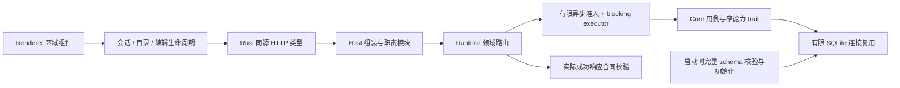

# 工程优化收口验收

本记录汇总用户第二次要求“全部优化完”的范围，不把上一轮部分覆盖作为全部完成。保持 `eternallight/` 自研边界；既有 codex-rs 补丁和其他工作区修改不属于本次重构。各模块的五视角前后审、事实权威和状态边界在下列记录中。

## 落地后的职责边界

正式资料、版本和执行事实由 Core 持有；Renderer 只保存编辑及展示状态，Host 只协调进程与可信接口。请求取消不冒充事务取消，保存成功而读回失败继续使用原回执核对。类型生成、结构检查和实际响应验证互相补足，不以单纯的方法名比对作为载荷合同。

| 原问题 | 目标与当前状态 | 设计/证据 |
|---|---|---|
| 请求重复初始化SQLite并阻塞async | 已完成：启动统一schema、有限连接复用、异步准入后阻塞执行；取消不伪造回滚 | [存储](2026-10-12-storage-and-domain-boundaries.md) |
| 模块schema漏校验 | 已完成：全部DDL同源，检查表/约束/索引/触发器及SQLite名称大小写；不匹配先拒绝、不迁移真实资料 | 同上 |
| Repository公开全能力 | 308业务方法迁入116用例能力trait，调用方显式依赖，已有6个借用式store保留；最终 Native workspace 全套通过 | [能力边界](2026-10-12-repository-capability-contracts.md) |
| Runtime路由/领域用例混合 | 已完成：server517行，按领域路由；候选保存/审阅等领域身份及envelope由Core拥有 | [存储](2026-10-12-storage-and-domain-boundaries.md)、[Core域](2026-10-12-core-domain-boundaries.md) |
| 前端God组件与重依赖 | 已完成执行、阅读、编辑、目录、规划及媒体生命周期拆分；App1199行、CreativeWorkspaceView1036行；按需加载保留原引用预算，最终完整UI117/117通过 | [前端生命周期](2026-10-12-frontend-cohesive-lifecycles.md) |
| Host单体及缺类型检查 | 已完成：main394行，13职责模块；124生产文件类型覆盖；真实桌面生命周期已验证 | [Host组装](2026-10-12-host-composition-root.md) |
| TS/Rust独立载荷副本 | 按Renderer真实HTTP方法逐项覆盖Rust DTO、实际响应校验、同源TS和遗漏门禁；966个Rust生成类型、100个HTTP响应根、109个Renderer方法盘点及遗漏负例均完成；真实HTTP校准通过 | [响应合同](2026-10-12-renderer-http-contracts.md) |
| 文档、评估产物、验证分级 | 已完成：20有证据历史归档、125专题整理、145链接检查；忽略评估产物；PR影响范围与完整nightly分离 | [合同与工程](2026-10-12-contracts-and-verification.md) |

## 验证原则及本轮进度

- 连接与能力：Core lib 502/502，能力AST门禁3/3，全部Native目标编译通过；最终 Native workspace 全套通过；随后 MCP schema 的新增定向门禁与真实集成也已通过。
- Host：218回归、4真实Native/MCP、2实际IPC、3类型负例、5production desktop生命周期通过。
- Engine：先前完整405/405；后续真实测试发现同一未知请求重复派发，已补可信逻辑请求围栏，Core50/50、预算27/27、真实Codex5/5通过。最终完整Engine复测405/405通过，调度夹具按不同合法turn区分独立请求，重复请求围栏不变。[预算测试评审](2026-10-12-engine-metering-fixtures.md)、[请求围栏](2026-10-13-engine-logical-request-fence.md)
- 委派协议2/2、发布门禁27/27通过。测试使用受控本地服务；不冒充真实供应商认证。
- 最终 Native、生成零漂移、构建、架构已通过，任务控制完整138/138通过；前端全套 UI117/117、Agent496/496、真实桌面5/5已通过；其余完整验证阶段及失败后的对应整组复测均通过，结果见下表。

保持共同数据库事务不代表保留全能力的固有业务API；模块目录与trait拆分不等于crate级独立编译。动态作者内容允许JSON，稳定身份、来源、状态和回执不能以unknown取代合同。优化不新增作者确认、不改变模型创作自主权、不放宽当前安全及交付标准。

## 完整验证中发现并关闭的问题

- 原 9 个 Native 失败目标已定向35/35通过，新增真实空作品/保存后 getState 1/1、知识历史快照与选择器4/4。真实时间戳、nullable字段及遗漏的草稿封套均按 Native 实际契约同步，不降低验证。
- 范围确认接入原执行请求 envelope 与 Native 可信 Work/thread 域；同域互斥、独立域并行、确认写入与停止竞态及不发后继均验证，7文件57/57。[执行域评审](2026-10-13-scope-execution-domain.md)
- 草稿工具 schema 原5152字节超过 Core5000字节门槛。只精简说明前言至4922字节，完整结构、互斥分支、补丁约束不变。3项 MCP 定向、3项真实纠错/读者集成、54项工具生成零漂移通过。
- 读者测试跟随独立执行域监听真实 adapter；即使提供匹配的活动执行身份，后续 steering 仍返回 notSent 且零投递。5/5通过。[读者契约](2026-10-13-quality-reader-fixture-contract.md)
- 设置页测试等待实际 lazy 组件挂载；Work step fixture 补齐现行必填 outputRefs。旧固定时序或旧字段错误不通过放宽生产边界解决。

主 JS 从4699.72kB降至1185.29kB（gzip362.29kB）；精确编码表按需加载，主包仍有体积提示。生命周期封装不是全树渲染隔离：执行投影仍可触发 App 渲染，不声称已测得交互帧率收益。

### 本次构建产物身份

部分旧集成夹具曾硬编码 native/target/debug。本次显式使用 CARGO_TARGET_DIR=/tmp/eternallight-boundaries-target；已统一共享 nativeTestBinary，优先 NOVEL_CODEX_NATIVE_DIR，再 CARGO_TARGET_DIR/debug，再未配置时的默认构建目录。实际桌面 Runtime 链接和 MCP wrapper 均按本次产物解析，并验证 realpath；桌面5/5、目录选择2/2、MCP真实schema1/1，条件/重绑定/范围探测3/3已重新通过，不引用旧二进制结果。新增目录选择测试已接入test:agent常规门禁。

## 最终验收（2026-10-13）

全部优化项已落地，五视角前后审条件关闭。验证采用完整链执行加失败阶段修复后的整组复测；原 `npm run verify` 曾在 Engine 失败退出，后续逐阶段继续并复测，**不将该原始单次命令记为退出0**。最终所有规定阶段均有通过证据，没有跳过失败项。没有重复执行已经通过且未再修改的全部 Native 测试；其后 MCP 改动另有定向及真实集成验证。

| 验证范围 | 最终结果 |
|---|---|
| 架构 / upstream登记边界 / 54工具生成 / 966类型生成及HTTP盘点 | 通过；最后架构扫描1404文件、7crate，无诊断 |
| 验证门禁负例、文档及构建 | 通过；Host124文件纳入类型检查，preload无缺失/多余；架构检查器16/16 |
| Native workspace | 全套通过；包含Core、Runtime、MCP及各集成目标；类型导出测试不混称业务测试 |
| Engine | 完整405/405；真实未知费用围栏5/5及Core50/50、预算27/27 |
| 委派 / 发布门禁 / live-probe测试 | 2/2、27/27、31/31；本地受控服务，不冒充供应商线上认证 |
| Agent | 整组复测496/496；新纳入常规命令的binary选择测试另2/2 |
| 任务控制 / 创作旅程 | 138/138、整组复测96/96 |
| production桌面 | 当前Runtime/MCP产物整组5/5，包含31秒延迟与失效认证缓存 |
| 条件检查 / 重绑定 | 4/4、5/5；换成统一当前产物解析后，连同范围探测的3项真实集成再次通过 |
| Renderer UI | 完整117/117，包含编辑器迟到回执、ABA与写锁归属 |
| 作者许可 / 执行范围 / 修改验收 | 55/55、12/12、38/38 |
| 创作质量 / 隔离读者 | JS20/20及对应Core/Runtime/MCP目标通过；真实读者1/1 |
| 多媒体 | 52/52；不声称已运行额外需显式配置的真实FFmpeg发布认证 |
| 差异检查 | 自研范围与CI配置 `git diff --check` 通过 |

最终证据：`/tmp/optimization-final-verify.log`（原始Native与前置门禁）、`/tmp/engine-complete-logical-fence.log`、`/tmp/optimization-agent-final-pass.log`、`/tmp/optimization-creative-final-pass.log`、`/tmp/desktop-current-build.log`、`/tmp/optimization-final-stage-*.log`、`/tmp/current-native-three-integration.log`。保留原失败日志，不将其覆盖成成功或修改原测试计数。

最终五视角：架构APPROVE（权威与事务归属明确）；技术A APPROVE（取消、未知写入、能力/载荷门禁）；技术B APPROVE（所有规定验证阶段及修复后整组复测）；产品APPROVE（原创作能力与权限不降低）；UI/UX APPROVE（未保存内容、恢复、等待和迟到回执真实呈现）。本轮未修改 codex-rs 补丁，不提交或覆盖工作区原有修改。
