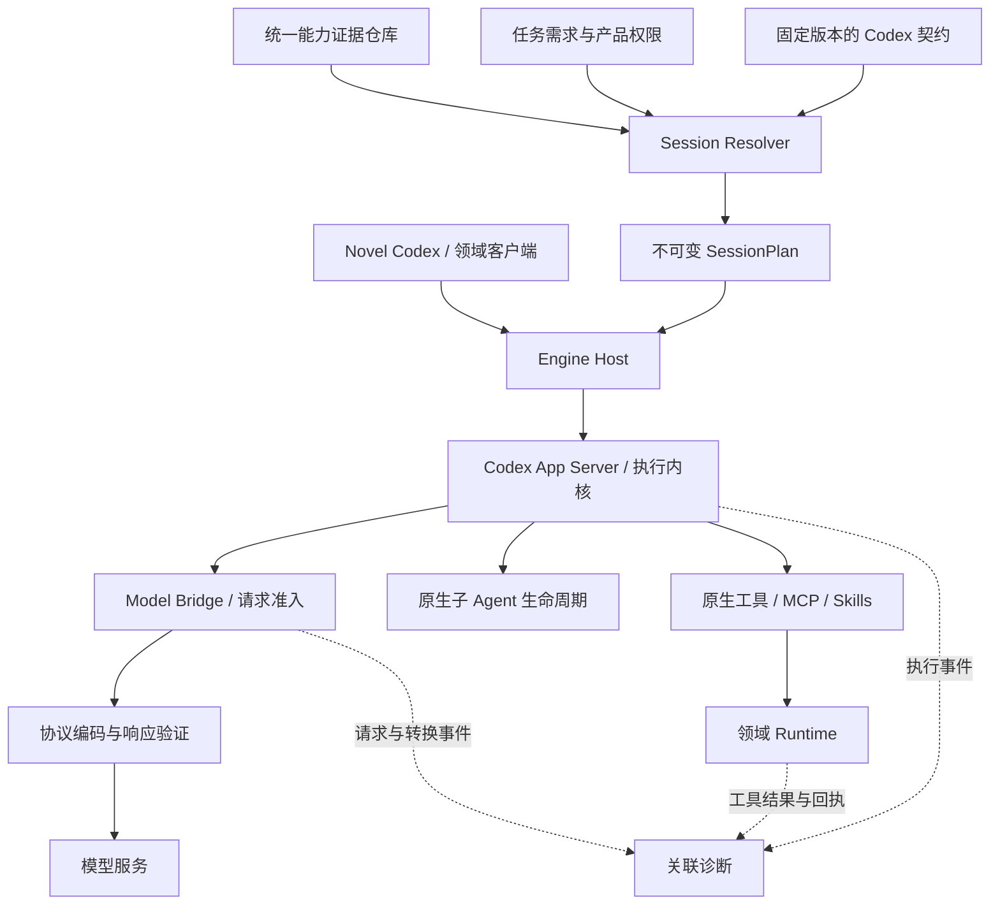

# 多模型充分复用 Codex 内核：能力对齐设计

> 2026-09-20 复核修订：任务准入、能力认证、行为评测及持续合入策略以 [多模型准入与 Codex 上游持续合入重构方案](MODEL_ADMISSION_AND_UPSTREAM_REFACTOR_PLAN.md) 为准。下文 v1.1 的实施状态保留为历史记录；其中“规划评审依赖自主委派”和“35 次通用准入门槛”不再作为目标要求。

版本：1.1 · 日期：2026-09-20 · 状态：核心架构已实施，真实模型正式认证与跨平台发布验证待执行。

本文同时记录架构方向与当前实施边界，不代表任何供应商已经通过正式发布认证。本任务沿用引擎任务免除多角色评审的决定，不声称经过专家批准。

## 1. 目标与文档关系

目标：使用同一个 Codex 执行内核，使不同供应商模型能够自主使用其已验证支持的工具、上下文、Skills 和多 Agent 能力，减少协议转换造成的能力损失，持续同步上游代码。

“与原生模型一样”拆分为三个可验证目标：

1. 能力可达：同一内核能力可以经该连接调用，执行结果、权限和生命周期语义正确。
2. 语义保真：转换不悄悄丢失必要的历史、调用关联、推理状态、错误或终态。
3. 行为表现：模型能在自主任务中正确选择工具、委派、等待并利用结果；用重复评测衡量，不承诺所有模型具有相同智能。

完整能力是相对于固定的 Codex 构建和能力清单而言，不能用一次 MCP 成功或一个 multiAgent 布尔值代表。

本文补充 [理想架构 v4.6](MODEL_AGNOSTIC_CODEX_ENGINE_DESIGN.md) 的 G1–G10，保留 [重构方案 v3](ENGINE_REFACTOR_PLAN_V3.md) 的执行隔离、预算、恢复与构建要求。模型语义保真、诊断、认证分类和自主性方面的后续设计以本文为准；其余工作包继续遵循 v3。[模型接入与发布认证](../../MODEL_ONBOARDING_AND_CERTIFICATION.md) 描述现行机制，实施后须同步更新。

测试阶段不建设旧接口、旧配置或旧测试数据兼容层；本设计不授权删除真实作品数据。

## 2. 当前证据与待验证假设

当前工程已有 Agent Engine、四类协议 Codec、CapabilityEvidence、能力画像、SessionPlan、Bridge worker、关联诊断、三类认证结果、认证 CLI 和真实 Codex 集成测试。

DeepSeek 的现有记录表明：namespace 展开后观察过 spawn/send/wait，也在部分运行中完成子 Agent MCP 回环；发布认证文件仍为空。自动化测试通过能证明对应测试场景的实现行为，不能代替真实模型稳定性评测。

尚未充分证明随机失败的根因。可能涉及工具选择、子线程工具可见性、历史转换、消息时序、工具结果交付或认证收尾。成功样本不能排除其他路径上的协议或运行时缺陷。

原有 runner 的以下局限已经在本轮实现中修复：

- Bridge 现在记录 run/request/thread/parent/turn/rootTurn/session/call/connection 关联，观测器失败不影响执行。
- 工具意图、MCP 执行、工具结果进入后续请求及父 Agent 最终消费分别判定。
- 协议、根 Codex 集成和真实模型自主行为保存为三类独立 suite result。
- follow-up 不再放入初始子任务。子 Agent 先调用无副作用 gate；父 Agent 在子任务仍活跃时使用 `send_message` 排队随机 follow-up，子 Agent 必须在后续 MCP 调用中回传它。
- conformance turn 必须自然完成，父 Agent 最终回复必须包含服务端私有 receipt；不再以观察到 proof 后主动中断作为通过条件。

仍待外部证据确认的是：DeepSeek 在固定 35 次正式样本中的稳定性、第二个真实供应商连接、macOS/Windows 发布包以及上游升级后的失效重验。

因此不将“DeepSeek 模型决策不稳定”当作已经排除其他原因后的结论。

## 3. 架构与状态归属

这些是职责，不要求新增远程服务或每层一个进程；继续采用独立桌面产品的本地运行方式。

| 组件 | 所有权 | 不承担的职责 |
| --- | --- | --- |
| Codex | Agent 循环、工具执行、线程树、消息投递、压缩和会话 | 供应商差异的产品分支 |
| Engine Host | 进程、授权、冻结配置、预算、取消和恢复协调 | 第二套规划或委派循环 |
| Protocol Adapter | 请求/响应转换、工具身份映射、供应商状态续传 | 替模型补造决策或执行 |
| Evidence Store / Resolver | 证据归并与能力准入的唯一事实源 | 根据模型名字推测支持情况 |
| Trace | 有界事件与故障归因 | 以日志推测或覆盖业务提交事实 |
| Novel Runtime | 作品数据、事务、领域工具和写入回执 | 通用模型调度 |

内核扩展优先使用已有公开接口；确需修改时形成最小、通用、可独立测试的上游补丁。不能为了零内核修改而在外围复制调度器。

## 4. 版本化能力契约

从固定 Codex 构建的协议、工具定义及行为测试维护能力清单。源码和 schema 提供结构，人工检查及集成测试补充行为语义；不假设自动扫描即可完整提取契约。

| 能力组 | 必须覆盖的行为 |
| --- | --- |
| 输出与工具 | 文本、结构化调用、namespace、并行调用、参数约束、call_id 关联、工具错误 |
| 流与终态 | 文本/参数增量、提交点、正常/不完整/错误结束、取消后结果 |
| 上下文 | 多轮续传、工具结果顺序、必要推理状态、恢复、压缩后的后续调用 |
| 多 Agent | 创建、通信、等待、结果消费、子失败、取消、恢复及当前版本其他生命周期操作 |
| 执行工具 | MCP、文件/命令、自定义工具、动态工具发现、Skills 使用路径 |
| 可选模态 | 当前内核及产品实际需要的图像等输入和输出 |
| 控制边界 | 授权、父子身份、路由、预算、超时、撤销和副作用恢复 |

每项定义 capabilityId、依赖、输入/输出语义、适用内核版本、所需测试和不支持时的行为。以上为拟定契约结构，不是当前已实现字段。

区分三个维度：

- 协议支持方式：native、lossless-adapted、unsupported、unknown。
- 测试结果：passed、failed、not-run，绑定明确场景和环境。
- 行为指标：完成率、有效工具选择率、恢复率、耗时、费用及样本量。

不把行为成绩塞进协议支持方式；不把所有功能压成一个模型等级。会话资格继续由现有证据解析机制生成，不增加第二套独立资格库。

有效授权 = 内核支持 ∩ 适配器可表达 ∩ 对应证据满足要求 ∩ 产品权限允许。

## 5. 适配管线与模型原生能力

请求管线：冻结计划 → 校验当前授权 → 解析有界上下文 → 编码与语义检查 → 最终输入计量 → 预算预留 → 派发前复验 → 请求供应商。

响应管线：解析供应商事件 → 恢复身份/关联 → 校验 schema 与终态 → 按该协议提交规则交给 Codex → 核对执行与 usage。

要求：

1. namespace 映射可逆、抗碰撞，定义、历史、tool choice 和响应使用同一映射规则；多轮续传测试验证身份稳定。
2. 内部保留结构化语义，不把工具调用或多模态内容压成文本。不执行文本里的 DSML 或伪工具标记。
3. 原生路径保留必要的供应商状态。跨协议转换无法表达 opaque/encrypted 状态时明确拒绝相应操作，不能静默删除。
4. 供应商特有状态使用有版本、大小上限和会话归属的封装，只返回对应供应商；禁止跨模型误传。是否需要独立状态映射，以真实端点需求和 Codex 可用接口验证为准。
5. 切换连接必须重新解析能力及历史可转换性。不能将一次进行中的模型请求无声改投另一模型。
6. 保留协议已有的逐项提交语义；尚未提交的工具候选不可执行，已经执行的工具不能因断流被自动重放。
7. 统一契约允许可验证的原生扩展，不削减所有模型到最低公共能力。配置描述协议差异，禁止按模型名称增加工作流分支。

任何额外模型可见提示都须有依据、固定版本、有大小上限、计入请求预算和认证摘要。转换层提示仅解释必要的 wire 表达，不重写 Codex 的任务策略。

## 6. 自主性、工具约束与错误恢复

普通任务由模型自主决定是否委派、使用哪些授权工具及如何汇总。工具范围由真实权限和任务角色确定，不能为了提高通过率隐藏一切可能被选错的工具。

named tool choice 可用于用户明确要求的动作、结构化输出步骤和协议测试。强制调用的测试必须标为受控测试，不能计入自主调度成绩。模型自主规划的任务不由适配器强制固定 spawn/send/wait 顺序。

可确定的工具参数错误应由执行边界返回有界结构化反馈，保持 call_id；让现有 Codex 循环处理修正。若错误发生在尚未被内核识别为工具调用之前，返回协议错误，不能伪造一条成功工具结果来继续。

纠偏有请求次数、token 和时间上限，沿用任务预算。未知副作用不重试；执行结果以原有回执机制核对。网络重试遵循请求和工具的幂等边界，不能将“模型没选择工具”当网络故障重发直至成功。

## 7. 父子 Agent 关联诊断

由可信执行边界产生 runId、threadId、parentThreadId、turnId、requestId、callId 和 connectionId；模型参数不可作为权限身份。连接标识不含密钥。

最低事件集合：请求准备/派发、工具候选解析/校验、内核执行开始/完成、MCP 接收/返回、结果进入后续请求、子状态变化、消息投递、取消及终态。

每条事件包含来源、版本、单调序号或来源内顺序、时间、状态和关联 ID。跨进程通过关联关系建立因果顺序，不用墙钟排序冒充完整执行顺序。无法观察的节点标记 unknown，不推断成功。

默认只保存工具标识、schema/内容摘要、字节数、状态和错误类别。正文、密钥、推理内容不进入常规诊断；完整合成测试输入可按固定策略保存。事件数量、字段大小和保留时间必须有上限；截断时记录 droppedCount 和证据不完整状态。

| 故障类别 | 判定证据 |
| --- | --- |
| tool-not-exposed | 子请求工具清单中没有目标工具 |
| tool-not-selected | 目标工具可见，但模型在限定任务内未调用；保留限制条件 |
| conversion-error | 调用候选存在，转换或 schema 验证失败 |
| execution-error | Codex 接收调用，但执行返回错误 |
| identity-rejected | MCP 收到请求并明确拒绝身份 |
| argument-rejected | MCP 拒绝测试参数 |
| transport-result-missing | 服务已返回，但可观测的后续模型输入未包含结果 |
| lifecycle-error | 父子收尾、等待、取消或恢复出现错误 |
| budget-or-timeout | 达到预先声明的预算或时间；保留先前进度 |
| inconclusive | 证据缺失，无法排除其他解释 |

工具名出现在模型响应只证明调用意图。工具执行成功必须依赖执行事件；子结果被利用需要后续行为证据，不能仅凭 MCP 服务端落盘。

## 8. 三类独立认证与评测

### 8.1 协议一致性

使用确定性请求、响应回放、分片流及故障注入，覆盖全部声明语义。验证转换可逆、关联完整、异常结束无伪成功、非法工具不执行、必要状态不丢失。

### 8.2 内核集成

真实 Codex + 可控供应商响应 + 真实测试 MCP，覆盖主循环、并行工具、子 Agent、取消和恢复。可控响应可以要求特定工具，用于证明执行路径，不用于证明真实模型自主性。

消息测试使用运行中队列握手：子 Agent 的初始任务不包含随机 follow-up，先调用无副作用 gate；父 Agent 在子任务仍活跃时通过 `send_message` 排队 follow-up，子 Agent 必须消费消息并将其带到后续工具调用。`send_message` 本身不会唤醒已 idle 的子 Agent；需要恢复 idle 子任务的场景应单独测试 `followup_task`，不能混为一种语义。

将“子 Agent 调用 MCP”“子模型消费结果”“父模型收到并利用子结果”拆成独立断言。服务端私有随机 receipt 不能预先暴露给父模型；父结果利用以语义或结构化断言验证，不依赖无关的措辞一致。

### 8.3 真实模型自主行为

在正常工具和指令环境中运行合成任务，不固定工具调用顺序。覆盖明确要求委派的能力任务，以及由模型自行判断是否委派的开放任务；后者不以委派次数多作为成功标准。

按相同任务集、权限、上下文、预算和成功判定进行前后对比。原生 OpenAI 路径可作为有条件的参考基线，不默认其零失败，也不凭它通过推定其他连接通过。

记录首次成功率、允许纠偏后的成功率、调用错误、结果正确性、父子路由、请求数、token、耗时和已知费用。usage 缺失时费用为 unknown；未完成及基础设施故障单独列出，不从统计中静默删除。

## 9. 发布门槛与证据生命周期

发布标准按能力 profile 制定，例如基础工具执行、自主委派、异构委派。profile 是能力需求集合，不产生独立授权事实源。

协议与内核确定性套件全部通过；权限绕过、错误工具执行、重复副作用或伪成功属于阻断项。真实模型行为采用预先固定的样本计划，禁止反复尝试直到一次成功就签发。

建议首版自主委派试点：至少 10 个不同任务变体，每个 3 次，共 30 次。30 次只用于初步稳定性评估；当前正式认证器固定要求至少 35 次，成功率的 95% Wilson 置信区间下界达到 90%，且无阻断项。样本数、阈值和耗费上限在运行前固定，若证据不足则保持实验状态。该阈值是初始产品决策，不是已证明的通用行业标准。

认证绑定连接定义、模型标识/可获取的模型版本、协议选项、Codec、Codex 构建、基础指令、工具契约、测试套件、评测配置及有效期。供应商未暴露模型版本时明确记录不可固定这一限制，使用有效期和后续抽检约束漂移。

协议、内核或行为证据失效只影响相关能力及有向路由。A→B 的证据不能授予 B→A，也不能由 A→A、B→B 推导 A→B。密钥轮换触发账号范围的访问检查，供应商明确的认证错误撤销对应凭据域，普通 403 不无差别归类为认证失败。

基础能力通过而自主委派未通过时，可以发布基础 profile。若用户任务明确需要未通过能力，必须说明缺失并阻止宣称完整完成；不能无声替换任务语义。

## 10. 实施顺序与验收

| 阶段 | 主要位置 | 交付与退出条件 |
| --- | --- | --- |
| P0 诊断 | Bridge、adapter、conformance runner、MCP | 父子调用关联完整；能区分未暴露、未选择、拒绝和未交付；失败报告持久化且脱敏 |
| P1 契约与测试拆分 | contracts、capabilities、认证脚本和测试 | 三类结果独立；执行成功由执行证据证明；真实消息投递和自然完成有独立测试 |
| P2 语义保真 | codecs、工具注册表、当前 Rust 消费者测试 | 依 P0 证据修复根因；多轮、并行、opaque 状态及流终态测试通过 |
| P3 自主评测与发布 | evidence、certification、Session Resolver | 固定样本计划及报告；能力 profile 准入；无手工成功记录；DeepSeek 结论可复核 |
| P4 多模型与同步 | 第二真实协议/模型、有向路由、上游更新流程 | 第二连接复用公共设计；跨模型边单独通过；完成上游升级及失效重验演练 |

当前实施状态：

| 阶段 | 状态 | 已落地 / 尚缺 |
| --- | --- | --- |
| P0 | 已落地 | 有界关联 trace、MCP 诊断、故障分类、脱敏持久报告；真实供应商失败样本仍需累积 |
| P1 | 已落地 | 版本化 manifest/profile、三类 suite、根 Codex 回环、运行中消息队列握手、自然完成断言 |
| P2 | 已落地（当前协议范围） | namespace 可逆、call_id、多轮历史、opaque fail-closed、流终态、限额与工具 schema 测试 |
| P3 | 机制已落地 | schema v2、35 次 Wilson 门槛、操作画像准入、证据失效；DeepSeek 正式 35 次尚未签发证书 |
| P4 | 部分落地 | 四类通用 Codec、确定性第二协议测试、有向异构路由和上游边界检查已有；第二真实供应商与双平台发布验证待完成 |

优先复用 `eternallight/agent-engine/src/{contracts,capabilities,codecs,bridge,session}`，以及 `electron/codex-conformance-runner.mjs`、`electron/conformance-mcp.mjs`、`scripts/certify-model.mjs`。只有出现明确职责冲突才拆新模块，不新建第二个 Engine。

每阶段控制为可独立审查的改动，必要时进一步拆分，不将整个设计作为一次大提交。修改代码时按仓库规定执行相应测试与格式检查；本文文档交付只验证内容、链接和差异。

## 11. 风险与最终验收

- 限制过多工具可能提高测试成绩却降低自主性：受控和自主评测必须分离。
- 仅凭命名映射无法解决状态丢失：使用多轮真实消费者测试验证。
- 诊断自身可能改变时序：必须有界，关键执行凭据与普通观测分离，测试观测失败和背压。
- 真实模型评测成本及随机性较高：先运行确定性套件，再按固定预算执行真实样本。
- 同协议端点仍可能有差异：差异以可复用语义描述并测试，避免供应商名称分支。
- 稳定协议不能保证模型理解复杂任务：如实呈现行为指标，不用认证替代质量评测。

只有在固定 Codex 版本的目标能力清单全部有对应证据、三类测试各自达到门槛、真实失败可归因、强模型扩展没有被通用转换删除，并完成目标平台和上游同步验证后，才可称该版本达到完整能力对齐。

本次交付已将设计落到能力契约、运行时准入、诊断、三类认证和测试。当前不能声称“全部供应商完整对齐”：DeepSeek 正式自主评测证书、第二真实连接、macOS/Windows 发布包和上游升级重验仍是发布门槛。
