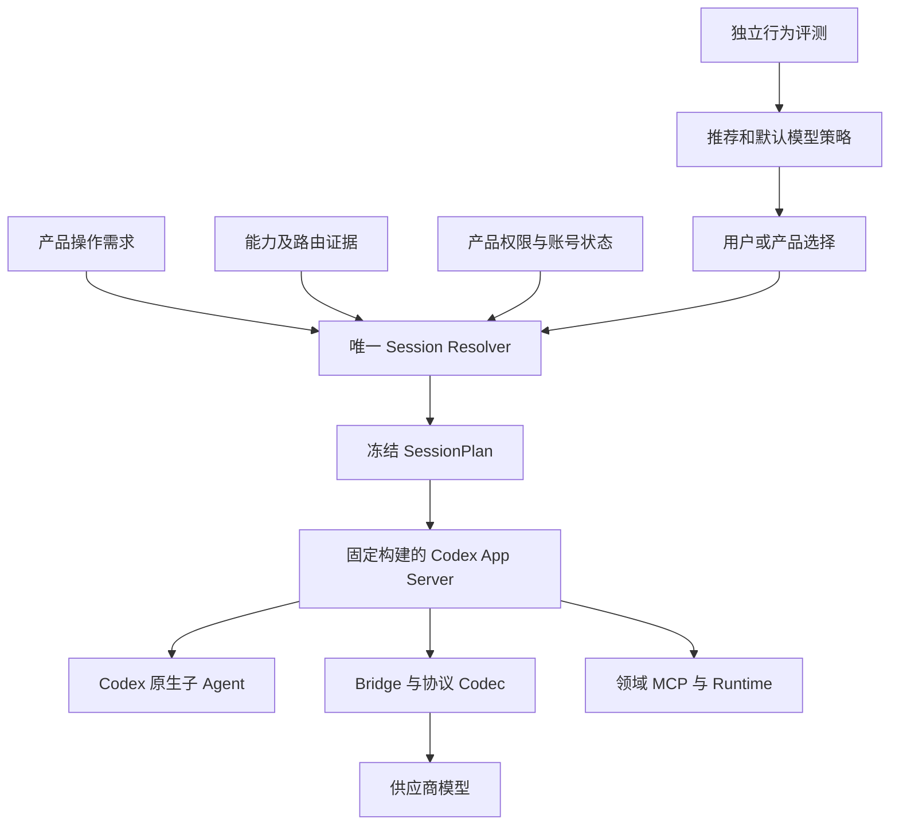

# 多模型准入与 Codex 上游持续合入重构方案

版本：1.1 · 日期：2026-09-20 · 状态：实施中。

最新技术基线：[多模型 Codex 引擎基础层技术方案](../../../agent-engine/ENGINE_FOUNDATION_TECHNICAL_DESIGN.md)。按最新范围要求，优先建设通用引擎，明确区分模型原语、引擎执行与产品功能；实施顺序以新方案 P0–P6 为准。本文保留问题证据和上游同步约束。

本文依据当前源码复核形成，交付范围为设计文档，不表示重构或新一轮模型认证已经完成。沿用本引擎任务免多角色评审的授权，不声称经过专家批准。

## 1. 目标与决策

让接口可访问、协议可表达的模型接入同一个 Codex 内核；让有工具调用能力的模型使用其已验证的执行能力；让模型自主协作质量作为独立评测结果。同时持续直接合入官方 `openai/codex` 的 `main`，保持产品自己的配置、凭据、进程、数据与发布渠道。

四项决策：

1. 连接可用性、协议兼容、内核执行、任务质量分别记录。任务质量分数不直接充当工具授权。
2. 产品操作按实际依赖准入。应用组织多个独立评审席，不要求模型自主创建子 Agent。
3. Codex 保持 Agent 循环和原生子 Agent 调度的所有权；适配层不实现第二套通用调度器。
4. 保持完整 Git Fork，以 merge 为日常上游同步方式；发布绑定经过验证的确定提交和平台构建。

文本模型可以接入文本路径，但不能因此被授予工具执行或自主委派能力。无法无损表达的加密状态、模态和工具语义必须明确标记；本方案不承诺所有模型拥有相同智能或支持全部功能。

## 2. 文档优先级

本文覆盖 [能力对齐设计 v1.1](CODEX_MODEL_CAPABILITY_PARITY_DESIGN.md) 和 [模型接入说明](../../MODEL_ONBOARDING_AND_CERTIFICATION.md) 中的任务准入、认证发布、行为评测及上游演进策略。协议保真、执行隔离、预算、可信身份、恢复回执等原则继续保留。

旧文档中“规划评审必须先通过自主委派认证”“35 次是多 Agent 能力开放的通用门槛”“相关认证机制已完整落地”的表述不再作为验收依据。实施时同步改写旧文档正文，避免长期保留互相矛盾的说明。

测试阶段直接替换旧接口、旧配置和测试 fixture，不建设历史兼容层。真实作品数据不属于删除范围。使用上一个验证通过的发布产物作为升级失败后的可用版本，不等于要求新代码兼容旧 schema。

## 3. 当前实现问题与证据

| 问题 | 当前源码证据 | 影响与处理 |
| --- | --- | --- |
| 规划评审要求过高 | `electron/main.mjs` 的 `runPlanningReview` 按角色顺序创建独立任务；`model-catalog.json` 却要求 `autonomous-delegation-v1` | 取消这一不必要依赖，验证每席工具回环、隔离及报告提交 |
| 受控任务被称为自主评测 | `codex-conformance-runner.mjs` 指定 spawn/send/wait 和禁用工具；`certify-model.mjs` 重复该流程后生成 autonomous-behavior 结果 | 保留为定向能力测试，另建开放行为任务集 |
| 结果交付和结果利用混淆 | Runner 将父回复不含 receipt 判为 result-not-delivered | 按工具返回、后续输入、行为利用分别断言 |
| 单证书覆盖多类结果 | `model-certification.mjs` 按 connectionId 唯一；认证脚本失败时不发布本次已通过的基础能力 | 改为能力与适用范围独立证据，部分通过可以形成准确的发布清单 |
| 发布和本地准入标准不一致 | 发布脚本要求统计评测；resolver 的 multiAgent 判断仅检查单次 conformance 样本和摘要 | 统一执行能力标准；质量推荐单独读取评测结果 |
| 有向边套件判断不一致 | `verifyDirectedEdge` 输出 directed-edge suiteId；`isQualifiedEvidence` 固定匹配 multi-agent suiteId | 按版本化证据契约及有向边验证，避免字符串特判遗漏合法证据 |
| 同步检查不充分 | `verify-fork-boundary.mjs` 对两个 Rust 文件整文件放行；上游 ref 不存在时返回空差异 | 改为必需 ref、补丁登记与差异检查，缺失基线必须报错 |
| 同步流程尚未固定候选身份 | `sync-upstream.mjs` 从当前分支创建同步分支并合并移动的远程 ref | 显式记录产品基线和本次 fetch 的上游 SHA，在隔离候选工作树验证 |

这些问题足以说明不能把“DeepSeek 尚未签发证书”解释为模型本身不能复用 Codex。具体随机失败仍需带关联证据定位；本次没有新增真实端点评测结果。

## 4. 目标结构与所有权

### 4.1 三层能力必须分开

后续设计、代码、证据和 UI 不再笼统使用“模型能力”指代全部功能：

| 层级 | 定义 | 示例 | 证据所有者 |
| --- | --- | --- | --- |
| Model Capability | 模型端点及协议适配器可以无损表达和稳定返回的原语 | 文本、结构化工具调用、流式终态、usage、图像输入 | Codec/Provider probe |
| Engine Capability | Codex 内核基于模型原语能够稳定完成的执行语义 | 工具结果回送、子任务创建、运行中消息、等待、取消树、恢复、有向路由 | 固定 Codex BuildIdentity 下的执行测试 |
| Product Capability | Novel Codex 将引擎能力、领域 Runtime、权限与 UI 组合成的用户功能 | 生成大纲、章节草稿、固定多席评审、Story Tests | 产品集成测试 |

Model Capability 通过不等于 Engine Capability 通过；Engine Capability 通过也不直接等于某项 Product Capability 可用。产品能力不得写回模型目录或伪装成底层证据。`agent-engine` 只定义前两类事实和解析规则；产品操作需求保留在 Novel Codex。

当前阶段优先建设 Engine Capability：固定内核契约、生命周期状态机、可信身份、结果关联、取消恢复、路由和可诊断性。产品层只完成最小消费接口与回归验证，不以新增业务功能扩大本轮范围。



- `codex-rs`：Agent 循环、工具执行、线程和子任务、消息投递、等待、取消、会话和上下文语义。
- `eternallight/agent-engine`：通用协议适配、执行准入、预算、隔离、证据与诊断。
- `eternallight/novel-codex`：作品和评审流程、任务依赖、UI、领域工具和报告。
- 评测层：消费同一执行接口，记录质量；不反向生成虚假的执行成功证据。

应用层已有的固定角色评审属于业务流程，可以继续依次启动隔离的 Codex 会话；这不替代用户需要的“模型自主创建和调度子 Agent”。后者继续通过 Codex 原生工具执行，并独立验收。

## 5. 能力模型与准入

### 5.1 四类事实

| 类别 | 事实内容 | 作用 |
| --- | --- | --- |
| ConnectionStatus | 凭据是否有效、端点是否可访问、协议是否可识别 | 连接与诊断；瞬时不可达不抹除历史兼容证据 |
| CapabilityEvidence | 具体请求、状态、工具与终态语义是否通过 | 对应能力准入 |
| ExecutionEvidence | 当前内核构建下的根工具回环、子任务及有向路由是否正确 | 内核能力与路由准入 |
| BehaviorEvaluation | 模型在任务集上的完成质量、修正能力、延迟和费用 | 推荐、默认选择、特定产品质量承诺 |

沿用现有证据存储和 resolver，不建设第二套资格数据库。连接和质量记录可以独立存储，但只有能力/执行证据及明确权限参与执行授权。

### 5.2 能力拆分

代码层使用显式的 `MODEL_CAPABILITIES` 与 `ENGINE_CAPABILITIES` 命名空间；每条 Evidence 带派生且不可伪造的 domain。组合 profile 可以同时声明模型前置原语和引擎执行能力，但 resolver 必须逐项找到对应域的有效证据，不能用模型声明替代引擎执行证明。

拆除承担过多含义的 `multiAgent` 原子开关，至少分别表达：结构化工具、多轮结果回送、子任务创建、运行中消息、空闲子任务继续执行、等待、子失败、树取消、恢复、有向模型路由。可以提供组合 profile，但 profile 仅展开成具体依赖。

工具名称和事件映射从当前固定 Codex 契约验证，不能假设名称永远不变。`send_message` 与 `followup_task` 的当前语义分别测试，不把消息入队当作已执行，也不把空闲任务的恢复当成普通消息投递。

协议支持方式继续使用 native、lossless-adapted、unsupported、unknown。声明支持不等于获得授权；未声明/未测与明确不支持必须可区分。SessionPlan 对外暴露的可用能力、UI 可用操作和实际 Bridge 准入必须来自同一个解析结果。

### 5.3 产品需求从模型目录移出

新增产品侧 `electron/operation-requirements.mjs`，集中定义操作依赖；模型目录只描述连接和协议特征。避免每接入一个模型都复制、修改一遍小说业务规则。

| 操作 | 必需能力 | 不应成为前置条件 |
| --- | --- | --- |
| 普通文本问答 | 文本响应；如果要求作品事实，增加上下文工具能力 | 自主委派、精确 usage |
| 当前作品咨询 | 根工具调用、读取上下文、多轮回送 | 创建子 Agent |
| Brief/大纲/近章规划/章节生成 | 领域工具回环、结构化提交、任务权限和完成回执 | 通用自主委派成绩 |
| 固定多席规划评审 | 每席根工具回环、上下文隔离、结构化报告、失败/取消处理 | 模型自主 spawn/send/wait |
| 用户要求自主协作 | 所需子任务能力和精确有向路由证据 | 与任务无关的固定 35 次高质量门槛 |

流式输出可以是体验偏好；只有操作确实依赖它时才成为硬需求。供应商缺少 usage 时必须使用保守预算结算并标记 unknown，不显示精确费用；无法可靠约束预算的路径仍应阻止执行。

任务开始前根据新证据检查冻结计划。要求能力已在现有计划内时复用计划；需要增加路由或能力时在任务开始前重新创建配置与计划，不在进行中的请求里暗中切换。

## 6. 接入与评测分离

### 6.1 接入流程

录入连接 → 检查访问 → 验证协议 → 验证适用内核执行路径 → 按能力形成可用操作 → 单独执行质量评测。

基础能力通过而子任务能力未知时，仍开放基础操作；子任务路径失败只限制相关路径。权限绕过、错误工具执行、未知副作用重放等执行完整性问题必须阻断受影响路径，不能用平均成功率抵消。

当前 CLI 重构为能力检查和行为评测两个独立入口。拟定接口为 `qualify:model` 与 `evaluate:model`，名称属于待实现设计。每次结束均保存结果，包括部分通过、失败、未运行和证据不足。

### 6.2 三种测试的边界

1. 协议测试：确定性 fixtures、流分片及错误注入，验证数据转换和终态。
2. 内核执行测试：真实 Codex、可控模型响应、真实测试工具，验证执行链路。真实端点再做小规模针对性 smoke；不得因为 fixture 通过就推断供应商端点支持全部语义。
3. 行为评测：固定版本的多任务集，允许合法工具选择与不同解法，不指定统一 spawn/send/wait 顺序。明确要求委派与自行判断是否委派是不同任务组。

受控测试中的精确随机 receipt 可以证明结果回传，但不能作为所有开放任务的答案判定。开放任务根据事实、约束及输出要求评分；未复述 token 不自动判为传输失败。

35 次和 Wilson 下界只保留为可选质量发布策略。运行前固定任务、重复次数、预算和阈值；不同任务组分别报告，避免将相关重复当作覆盖广泛的独立样本。不得反复补跑至通过，也不得把未完成样本静默剔除。

### 6.3 证据结构与生命周期

新版证据至少包含：capabilityId、scope、suiteId/version、测试条件、状态、观测断言、依赖摘要、有效期、报告引用和明确替代关系。scope 包含协议、工具形式、方向明确的父子连接及适用构建。

发布清单容纳同一连接的多项能力、多个有向路由和独立质量报告；删除 connectionId 唯一证书覆盖全部能力的设计。保留历史失败及显式 supersedes 规则，避免旧成功覆盖新失败。

摘要证明完整性，不等于发布者身份认证；分发仍由受控发布流程、产物签名和来源校验保护。不同平台二进制摘要不相同：协议证据绑定语义依赖，执行证据绑定精确平台 BuildIdentity，质量证据绑定模型、指令及评测配置，不让 macOS 的二进制证书直接授权 Windows。

## 7. 诊断与随机失败处理

每次失败先定位：工具是否提供 → 模型是否生成合法调用 → Codex 是否接受 → 工具是否执行 → 结果是否进入后续模型请求 → 模型是否利用 → 任务是否正常结束。

区分以下结果：

- `transport-result-missing`：已有返回证据，后续请求确实未包含结果。
- `result-consumption-failed`：结果已送达，但模型未正确利用。
- `invalid-tool-arguments`：结构化参数不满足要求，记录内核是否提供可修正反馈。
- `lifecycle-failed`：明确的状态机或取消/等待故障。
- `inconclusive`：关联字段缺失、trace 截断或无法观察。

不能根据“模型说做了”确认工具执行，也不能根据“模型没说出来”确认结果未送达。所有断言关联 run/thread/parent/turn/request/call/connection；没有可信 callId 时不得伪造关联。

当前 gate 仅记录就绪，不保证父消息在子任务结束前到达。受控测试应通过可控供应商或宿主观察实现真正的状态屏障，验证消息消费顺序；不得靠 sleep 或修改产品调度器制造稳定性。开放任务允许使用内核提供的合法恢复路径。

可恢复参数错误通过 Codex 原有工具错误反馈修正；网络重试遵循请求和副作用幂等边界；未知写入结果走回执核对。失败不触发无限重试。诊断采用字段白名单、有界存储、脱敏与保留期，trace 不承担业务提交事实源职责。

## 8. 持续合入官方 Codex main

### 8.1 仓库方式

保留完整 Fork 单仓库，维护两个远程：

```text
origin   https://github.com/hilbert-dc/EternalLight_k.git
upstream https://github.com/openai/codex.git
```

这是本次本地核对到的配置。产品日常改动留在 `eternallight/**` 和产品专用 workflow；上游目录保留原始结构与历史，不复制另一个 Codex 源码树。

产品 main 采用 merge 同步上游，保留共同祖先和产品历史。rebase 只用于尚未共享的短期开发分支。持续合入表示可重复地吸收、验证和晋升上游提交；运行中的产品仍使用固定构建，不随远端 main 自动换内核。

### 8.2 最小补丁登记

允许必要的通用内核补丁，但每个补丁必须独立成提交并登记：ID、动机、上游基线、涉及符号与路径、差异摘要、关联测试、所依赖语义、状态、上游跟进链接（如有）和删除条件。

首个登记对象是现有 MCP 可信父子身份补丁，涉及 `codex-rs/core/src/mcp_tool_call.rs` 及其测试。它属于共享引擎能力，不能掺入 DeepSeek 名称、小说业务判断或模型评测阈值。

新增 `codex-runtime/upstream-patches.json` 作为计划中的补丁登记表。边界检查同时核对登记、当前差异和测试；不再把整个 Rust 文件视为可以任意修改的区域。上游出现等价能力后，验证调用方并删除本地补丁，不重复维护两套字段。

### 8.3 同步事务

拟升级 `sync-upstream.mjs` 为以下流程：

1. 校验远程、显式产品基线、现有 merge/rebase 状态；保留用户工作区，不自动 stash/reset。
2. fetch 官方 main，立即记录确定的目标 SHA；本次后续步骤都使用该 SHA。
3. 从已记录的产品基线创建 `codex/upstream-sync-<date>-<sha>` 和独立 worktree。当前工作区的未提交变更不作为候选的一部分，并在摘要中说明。
4. merge 固定 SHA。冲突停在候选分支，逐项处理；禁止整片目录使用 ours/theirs 掩盖语义变化。
5. 生成上游影响报告：App Server RPC/schema、模型请求/事件、工具定义、MCP 身份、子 Agent 生命周期、上下文、配置、构建及依赖变化。
6. 重建 CLI/BuildIdentity，运行对应上游测试和产品集成测试，重评受影响证据。
7. 将验证报告绑定到产品基线、上游 SHA、补丁集、候选 source tree 和平台产物。
8. 候选验证完成后再合入产品 main。若产品 main 已前进，重新整合新基线并对实际候选重验；已测试的旧 head 不能替代新 head 的证据。

失败时保留候选分支和诊断，产品 main 继续使用已验证版本。清理临时 worktree 前确认没有未提交修复。此文档不执行 fetch、merge、push 或创建定时任务。

### 8.4 上游契约隔离

App Server v2 和 canonical model 消费边界集中在已有 adapter/contract 模块。上游 schema 或工具生命周期变化时修改这一边界、对应测试及证据依赖，不把字段差异散落进业务 UI、Runtime 和每个供应商 Codec。

新版本直接更新当前支持的契约，删除被替代的实现；不建立跨多个旧 Codex 版本的永久兼容层。预算和历史大小限制继续在边界执行，工具定义增加后的请求开销必须计入。

### 8.5 CI 与发布

当前 CI 已有 Linux 质量检查和手动 macOS/Windows 打包；目标增加同步候选的双平台执行测试，不能只靠能打包就宣布通过。

| 验证层 | 必需检查 |
| --- | --- |
| 来源与边界 | 固定上游 SHA 存在；基线关系成立；Rust 补丁登记匹配；禁止缺 ref 返回空差异 |
| Codex 内核 | 受影响 crate 使用仓库 `just test`；配置/API 变更更新 schema；按仓库规则 fmt/fix |
| 通用适配 | 四类 Codec、流终态、历史、错误、namespace、预算与取消 |
| 原生执行 | 真实 App Server 根工具回环、子 Agent、异构有向边、可信身份、失败恢复 |
| 小说产品 | 固定多席评审、提交与回执、编辑和作品数据、UI |
| macOS/Windows | 对应架构 CLI、进程/MCP 启停、路径和凭据隔离、打包后 smoke |
| 真实供应商 | 在受控环境执行受影响能力 smoke；行为任务集另按既定预算执行 |

普通 PR 使用可控 fixtures，不向不可信 PR 提供供应商密钥。自动候选发现、PR 创建和定时频率属于后续 workflow 实施；本次不创建自动化。远端更新检测可以自动化，合入仍必须通过上述门禁。

### 8.6 更新后的证据

严格绑定每个执行产物的 BuildIdentity；每次内核升级都重跑相关确定性执行测试。协议证据和质量报告记录自己的依赖，只有依赖未变才可复用；无法证明无关时标记需重验。

新增无关模型条目不应使已有全部模型协议证据失效；修改共同 Codec 或工具语义必须使受影响证据失效。认证依赖从当前整目录总摘要逐步拆到可解释的范围。实施前先保持保守失效，不通过手改摘要复活旧授权。

## 9. 实施工作包

| 顺序 | 主要位置 | 交付及验收 |
| --- | --- | --- |
| A 修正任务需求 | operation-requirements（新增）、model-catalog、codex-runtime、main | 固定多席评审在无自主委派证据时完成；缺工具回环时正确拒绝；不同模型共享同一业务需求 |
| B 拆分能力与证据 | contracts、evidence、resolver、model-certification | 能力粒度、部分通过、方向性边；本地验证和发布证据采用相同执行标准；UI 与实际准入一致 |
| C 重构测试与归因 | conformance runner、MCP、core runner、trace | 受控与开放测试分离；确定性消息屏障；结果交付/消费独立；有效调用关联 |
| D 重构接入 CLI | certify-model 拆分、behavior-evaluation、报告存储 | 能力检查与行为评测独立；失败保留报告；质量不覆盖授权；脱敏、限额及依赖摘要 |
| E 固定上游边界 | sync-upstream、verify-fork-boundary、补丁表、build-provenance、CI | 固定 SHA、worktree 候选、补丁差异检查、双平台验证、证据失效演练 |
| F 真实模型与同步验收 | DeepSeek、第二连接、同步候选 | 可复核的真实能力结果；第二协议复用通用适配；实际 merge/构建/测试报告 |

每包进一步拆为可审查提交，优先控制复杂逻辑变更在 500 行内、普通非机械变更在 800 行内。内核补丁与产品重构分开提交。同步上游需要干净、已提交的候选来源，不能将未整理的工作树伪装成发布基线。

## 10. 必须覆盖的验收场景

1. 工具能力通过、开放协作成绩欠佳的模型仍能执行作品咨询和固定多席评审；不会被标为高质量自主协作推荐。
2. 明确要求子 Agent 的任务使用已验证的原生执行路径；缺少必要能力时说明具体缺项，不悄悄替换成单模型自述评审。
3. A→B 通过只授予 A→B；B→A 不自动开放。合法的 directed-edge 证据能够被 resolver 消费。
4. 工具结果已经进入后续请求但模型回答错误，记录消费/质量失败；不会误撤销传输能力。
5. 子 Agent 在消息前结束、消息在执行中到达、恢复 idle 子任务分别验证，避免时序概率决定接入资格。
6. 接入报告部分通过可保留；新失败不会被旧成功或手工字段覆盖；不支持的 opaque 状态明确拒绝。
7. 凭据变更、平台变更、Codec/工具契约变更各自触发正确范围的重验；无关目录变化不全局撤销连接。
8. 上游同步在无冲突、有冲突、工具改名、生命周期变化、缺 ref、未登记补丁、产品 main 前进时均有确定结果。
9. 从固定候选源码构建并运行 macOS/Windows 产物，保持与 Codex 桌面版及系统 CLI 环境隔离。

最终验收需要能力报告、行为报告、平台构建报告和上游同步报告分别提供证据。文档或本地测试数量都不能替代这些结果。

## 11. 建议实施起点

先完成 A、B、C，纠正规划评审误拦截和认证误判，再重新测量 DeepSeek。并行整理上游补丁登记，随后实现固定 SHA 候选流程。保留现有 Codex 内核与四类 Codec，重构证据和准入职责；只有诊断证明需要时才增加通用内核补丁。
