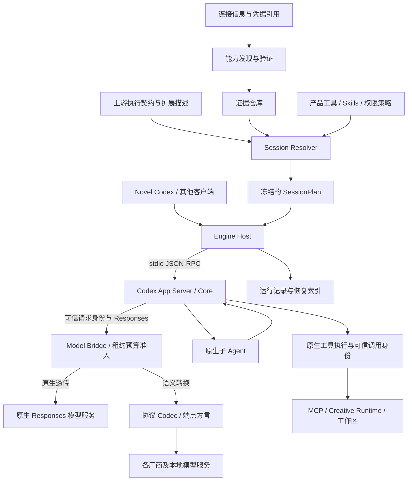

# 多模型复用 Codex 引擎：理想技术方案

> 2026-09-20 审查后更正：G1–G10 仍是目标，但本文件中“本地目标架构已落地”等整体完成描述已被后续审查否定。当前开放问题与实施门禁以 [优化与重构方案 v3](ENGINE_REFACTOR_PLAN_V3.md) 为准；不能将以下历史测试记录视为全部达标。

版本：4.6 · 2026-09-20 · 状态：本地目标架构已按纵向闭环落地；签名双平台与真实供应商终验待目标环境。F01–F44 台账、M0–M4 交付门禁及 W0–W10 工作包见 [修复与局部重构实施方案 v2.2](ENGINE_REMEDIATION_PLAN.md)，当前证据边界见第 15.3、18 节。

本文件是当前任务的目标设计，v4 在 v3 的 G1–G10 目标上明确参考实现、规则来源、协议边界和交付门禁。按项目负责人要求，本任务不启动多角色评审。当前工作区已有通用 Engine、四类 Codec、多 Agent 接入、MCP 身份、恢复/预算及打包模块，但存在阻断缺陷；模块存在与局部自动测试通过不等于能力完整，更不替代真实供应商、签名安装包和双平台实机验收。

## 1. 目标架构决策

建设一个独立于 Codex 桌面产品、持续复用上游 Codex 内核的通用 Agent 引擎。不同模型共享同一套任务执行、工具使用、Skills、上下文和原生多 Agent 语义，通过协议适配接入。Novel Codex 是该引擎的领域客户端之一。

**最终架构：Codex 原生执行内核 + 统一契约 + 自动能力验证与会话配置 + 可组合协议适配 + 可信身份与权限 + 可恢复运行。**

自动发现、证据缓存、异构子 Agent、恢复和权限不是暂时删除的功能，也不是“有空再做”的愿景。它们均有明确职责与最终验收条件。实施顺序只表示依赖关系，不降低终态标准。

理想态不等于无条件承诺任意模型拥有相同智能：工具、状态、权限与生命周期由工程保障；模型是否能合理规划、调度和遵循指令，由同一套评测如实度量。协议不能补造模型没有的能力。

### 1.1 最终结果

| 编号 | 必须达到的目标 | 完成证据 |
| --- | --- | --- |
| G1 | 模型共享 Codex 的执行契约与原生调度 | 原生及桥接路径通过同一内核行为套件 |
| G2 | 同协议新模型无需专属代码或提示词 | 未登记模型只新增连接信息/必要规格，即可通过接入测试 |
| G3 | Responses、Chat Completions、Messages、GenerateContent 四类协议具有接入实现 | 每类有契约测试、真实参考端点和能力记录；模型能力不足如实标记 |
| G4 | 能力自动收集、验证、失效与配置生成 | 元数据缺失、端点变更、认证失败及证据冲突测试通过 |
| G5 | 同模型及异构模型的原生多 Agent 可运行 | spawn、通信、等待、汇总、子失败、取消、恢复闭环 |
| G6 | 父子权限有可信执行边界 | 根可写子只读、伪造身份、撤销和跨任务调用测试通过 |
| G7 | 任务可诊断、可取消、可恢复 | 故障注入后无假成功、无未经确认的副作用重放 |
| G8 | 强模型保留已认证的高级能力 | 原生指令与扩展不被通用适配统一削弱 |
| G9 | 独立产品可在 macOS/Windows 安装运行 | 不依赖全局 CLI、Codex 桌面登录态或用户安装的 Node |
| G10 | 持续合入上游、维护有界差异 | 完成一次上游更新演练、契约差异处理及完整回归 |

G1–G10 全部满足，才可称目标架构完成。仅 DeepSeek 成功、一个工具调用成功或打开多 Agent 开关，都不满足终态。

### 1.2 v4 确定的设计决策

1. Codex 是唯一 Agent 执行内核。Host 嵌入 App Server；不引入第二个 Agent 框架承接规划、工具循环或子任务调度。
2. 统一规则继承固定版本的上游指令、工具契约和状态语义。领域约束通过 Skills/MCP/产品策略加入；同协议新模型不需要专属 Agent 流程。
3. 分开客户端协议与模型协议：App Server JSON-RPC 连接产品和内核；Responses/Chat Completions/Messages/GenerateContent 连接内核和模型。ACP 只作为未来外部客户端入口的可选项。
4. 以实际 Codex Responses 契约作为内核边界，保留有证据的原生高级路径；协议转换采用有类型的内容和事件，不压平成纯文本。
5. 模型目录提供连接及规格声明；能力探测提供限定范围的观测；认证套件提供可追溯报告。三者分开存储，Resolver 按能力所需证据等级放行。
6. 优先复用成熟协议 SDK 的传输与编解码能力。每项依赖经语义保真测试后采用；没有通过的能力不因为 SDK 宣称支持就放行。
7. 交付先完成一条真实 Codex 工具及子 Agent 闭环，再扩大协议覆盖。最终范围仍为 G1–G10，不将阶段性交付标为整体完成。
8. 同一事实只保留一个可写权威，其他缓存与 UI 状态均为可重建投影。先校验请求再执行，跨进程执行端仍复验授权；不复制会分歧的业务规则。
9. 先用一个协议贯穿资格、预算、真实权限和恢复，再用第二协议验证公共抽象。没有具体消费者的插件接口暂不建设；共同门禁不要求抹平原生和转换协议的内部语义。

### 1.3 参考项目与采用边界

以下为官方公开资料能够支持的事实及本项目的设计选择；没有推定参考项目已完成本方案全部验收项。

| 参考 | 公开事实 | 本项目采用的原则 | 不由该资料推导的结论 |
| --- | --- | --- | --- |
| [GitHub Copilot SDK](https://github.com/github/copilot-sdk) / [BYOK](https://docs.github.com/en/copilot/how-tos/copilot-sdk/auth/byok) | SDK 经 JSON-RPC 连接 CLI Server，可用自带供应商凭据 | 独立产品嵌入成熟内核，Host 管理进程和会话 | 其 BYOK 已覆盖任意异构子 Agent、权限和恢复场景 |
| [OpenCode Providers](https://opencode.ai/docs/providers) / [Agents](https://opencode.ai/docs/agents) | 使用 AI SDK、Models.dev 接入供应商，Agent 可配置模型和权限 | 复用协议生态，模型规格数据化，任务授权显式化 | 引入它的调度器；将模型目录当实测认证 |
| [Zed Codex ACP](https://github.com/agentclientprotocol/codex-acp/) | 启动 Codex App Server，转换客户端请求和 Codex 事件 | 客户端与内核分离，复用真实执行事件 | ACP 能解决 Codex 到其他模型 API 的转换 |
| [Goose](https://block.github.io/goose/) | 提供桌面端、CLI、API、多供应商、MCP 和子 Agent | 通用引擎与领域扩展分离 | 其执行内核与 Codex 相同或能直接替换 |
| [Cursor 模型目录](https://cursor.com/docs/sdk/typescript) | 对外提供可用模型及模型参数信息 | 从目录生成选择界面与参数校验 | 闭源内部调度、认证和协议实现与本方案相同 |

模型与 SDK 支持范围会变化；落地采用时固定依赖版本与测试组合。这些参考支持架构可行性，不构成“优于 Cursor”的性能或质量证据。

## 2. 约束、事实与非目标

当前源码表明：`WireApi` 仅支持 Responses；App Server 管理线程/轮次/事件；Codex 内核已有原生子 Agent 调度；模型目录会影响 direct/Code Mode、Responses Lite 等行为。因此客户端协议、模型协议和工具执行属于不同边界。

v3 设计时产品存在 DeepSeek 硬编码、未经逐项证实的模型目录能力和小说领域指令。当前工作区已新增通用包和数据驱动配置，但仍有未完成的替代和验证，见第 18 节。先前试点只观察到委派与等待，未完成子结果、取消和权限验收，不能作为完整成功证据。

角色配置投影没有应用任意角色字段，尤其不能因为写入 `mcp_servers`、`sandbox_mode` 或 `model_provider`，就认定子 Agent 权限收窄或 provider 切换已生效。源码证据见第 17 节。

约束：

- 保留完整 Codex Fork 与上游历史；产品和通用适配代码以 `eternallight/**` 为归属。
- 通过 App Server 复用内核，不将 `codex-core` 当成稳定的跨语言 SDK。
- 可以为必要的通用扩展增加隔离、可贡献上游的补丁；不以“零内核改动”牺牲权限或正确性。
- 测试阶段不承担旧代码、旧配置、旧 IPC 或旧数据库兼容责任。
- 模型间协议适配是当前核心需求，不属于历史兼容层。

非目标：另造 Agent 调度器；复制 Codex 内核；把模型输出文本解释为可执行 DSML；绕过模型供应商认证/配额；建设与本产品无关的云网关平台；保证弱模型达到强模型的任务质量。

## 3. 架构总览与部署边界



这是模块划分，不要求每个方框成为服务。Resolver、Verifier、配置编译和诊断在一个通用引擎包中，当前采用 .mjs 与运行时契约校验，不要求语言迁移；Codex 是独立进程；Bridge 是独立受控子进程。Creative Runtime 保持领域数据权威。

| 模块 | 唯一责任 | 不应承担 |
| --- | --- | --- |
| Codex 内核 | 推理循环、工具执行、上下文、原生子任务、线程状态 | 厂商 HTTP 差异、小说业务规则 |
| Engine Host | App Server 连接、进程监督、取消、会话绑定、恢复入口 | 代替模型规划或外置调度子 Agent |
| Contract Catalog | 当前内核契约、扩展依赖、生成 schema、共用验收规格 | 逐模型行为模板 |
| Capability Verifier | 元数据、受限探测、行为认证、证据有效性 | 通过模型自我声明认定能力 |
| Session Resolver | 将要求、证据和授权解析为冻结执行方案 | 在线试错并悄悄降低任务要求 |
| Model Bridge / Codec | 模型协议转换、认证、推理请求限流与取消 | 执行工具、压缩业务历史、保存作品 |
| Domain Runtime | 领域权限、业务事务、幂等回执、正式数据 | 模型传输与通用 Agent 状态 |
| Recovery Store | Host 记录、转换映射及与内核状态的关联 | 第二份对话历史或第二个调度器 |

原生透传和协议转换统一经过 Bridge 的资格、可信路由和预算准入，不保留绕过这些门禁的直连路径。原生 Responses 使用保留已认证字段与逐项语义的直通 Codec，不压平为最低公共格式；高级传输入口也须实现相同门禁与保真测试。

### 3.1 三条独立的协议边界

```text
Novel UI → Engine Host → App Server JSON-RPC → Codex Core
                                                ├─ Responses → Model Bridge → 模型 API
                                                └─ MCP / 原生工具 → 工具执行端
```

客户端适配器处理会话、轮次、审批与 UI 事件；模型适配器处理推理消息、工具定义与流式返回；MCP 接入领域工具。模型只需输出目标 API 支持的工具调用，执行端负责实际动作。引入 ACP 不替代模型 Codec，MCP 也不承担模型 API 转换。

Bridge 独立进程是部署要求，用于故障和凭据隔离。当前实现由 Electron Host 通过 IPC 管理独立 Node 子进程，使用实例认证令牌、最小环境和受控生命周期；进程分离只是隔离基础，仍必须通过预算、取消、恢复和安装包验收共同证明。

## 4. 一套通用执行契约

统一的是执行语义，不是强迫所有模型接受一段逐字相同的提示词。

| 规则 | 载体与执行者 |
| --- | --- |
| 如何理解任务、选择工具和合理委派 | 上游 Codex 指令、工具描述、Skills；以行为测试衡量遵循程度 |
| 工具名称、参数、call ID、结果关联 | Codex 工具契约；Codec 做可逆表达转换 |
| 身份、文件/MCP 权限、业务版本与幂等性 | 内核执行端及领域服务端强制校验 |
| 线程、轮次、父子状态、取消与完成 | Codex 状态机；Host 投影真实状态 |
| 正式写入是否完成 | 工具/事务回执，而非模型声称 |

规则来源固定为：上游基础行为和工具契约、领域 Skills/指令、任务授权。协议适配不加入模型人格、另一个规划提示或隐形重试模型。对不存在的 notes/history/new_context 等工具，不生成使用指令。

直接工具模式使用 Codex 的结构化函数调用，不额外发明万能 `execute(tool, args)` 或文本 DSML 协议。上游原生 Code Mode、自定义工具属于独立扩展，经完整认证后保留，不能因直接工具模式的约束被全局关闭。格式约束不等于业务正确；工具端仍需校验。[官方函数调用说明](https://developers.openai.com/api/docs/guides/function-calling)区分了模型提出调用、应用执行和回传结果。

共同基础之上采用可组合扩展：原生多 Agent、Skills、命令/文件编辑、视觉、Code Mode、工具搜索、原生压缩等。每项有依赖、转换方式、权限和测试。一个模型不能使用某扩展，不影响其他模型继续使用。

协议只返回单个工具调用，也可能通过多轮 spawn 使用原生并发子 Agent；供应商不需要实现专门的多 Agent API。模型能否合理委派仍要独立验证。

### 4.1 统一规则的构建与保真

规则编译输入为：固定上游指令与工具资源、经验证的能力集合、产品授权和领域 Skills。输出记录来源与摘要；更新上游资源时重新运行契约测试。不得用几句自写的“遵守 Codex 规则”覆盖完整上游指令后宣称等价。

| 规则类别 | 负责层 | 验收方式 |
| --- | --- | --- |
| 拆分任务、选择工具、何时委派和汇总 | 上游行为指令与模型 | 固定任务族的行为评测，记录失败样本 |
| 工具名称、参数、调用/结果对应及消息信任级别 | Codex 契约与 Codec | 请求、响应、完整历史往返测试 |
| 权限、身份、限额和正式提交条件 | 内核、Host 和 Domain Runtime | 确定性拒绝测试，不依赖模型遵守提示 |

同协议同能力模型使用相同构建规则。端点要求的参数或角色表达可以不同，但不能把用户/工具文本提升为系统指令；不能按模型名称暗中更换规划流程。每个例外必须有失败 fixture、适用范围与移除条件。

## 5. 接入数据、能力证据与执行方案

以下是目标类型草案；字段不是当前产品已实现的 API。完整 BuildIdentity、Report、Lease、PreparedRequest 和 Receipt 契约见实施方案 v2 第 4 节。

```typescript
type ConnectionSpec = {
  id: string;
  endpoint: string;
  model: string;
  credentialRef: string;
  protocol: 'auto' | 'responses' | 'chat-completions' | 'messages' | 'generate-content';
  declaredLimits?: { contextTokens?: number; outputTokens?: number };
};

type CapabilityScope = {
  protocol: Exclude<ConnectionSpec['protocol'], 'auto'>;
  dialect: string;
  streamingMode: string;
  toolTypes: string[];
  parameterSet: string[];
  stateCapabilities: string[];
  extensions: string[];
  routeEdges: Array<{ parentRoute: string; childRoute: string }>;
};

type CapabilityEvidence = {
  capability: string;           // 实现时采用有限枚举
  status: 'declared' | 'verified' | 'failed' | 'unknown';
  scope: CapabilityScope;       // 结构化覆盖判定，不做字符串相等或 capability 名称放行
  source: 'metadata' | 'probe' | 'conformance-suite';
  environmentDigest: string;   // 完整 QualificationContext，包括实际构建/指令/凭据代次
  evidenceRef: string;
  reportDigest: string;
  reportResultPath: string;    // 状态、样本及期限从报告对应结果派生
  qualificationEpoch: number;
  supersedes: string[];
  checkedAt: string;
  expiresAt: string;
};

type SessionPlan = {
  id: string;
  engineContractHash: string;
  evidenceDigest: string;
  policyDigest: string;
  buildIdentityDigest: string;
  qualificationEpoch: number;
  expiresAt: string;
  routes: Array<{
    logicalModel: string;
    connectionId: string;
    providerModel: string;
    transport: 'native-passthrough' | 'protocol-conversion'; // 都经过受控 Bridge
    codecId: string;
    enabledExtensions: string[];
    inputBudget: number;
    outputBudget: number;
  }>;
  rootRoute: string;
  allowedChildEdges: Array<{ parentRoute: string; childRoute: string }>;
  maxActiveChildren: number;
  budgetPolicyRef: string;
  compiledConfigDigest: string;
};
```

人工维护连接信息和确实无法发现的规格，不维护每个模型的规则副本。能力记录和 Codex 模型目录由系统生成。模型事实、行为质量和权限是三个维度，不能混成 `supportsTools=true`。

证据有效性绑定端点、模型/可得修订、协议、Codec、内核契约、测试套件和凭据权限范围。只保存凭据引用/非秘密范围标识；同名模型换了网关不自动继承认证结果。证据同时保留成功和失败样本，不能用新的成功样本覆盖全部失败记录。

行为认证记录样本、成功率、置信范围和失败类型；小样本成功只表示该测试范围通过，不表示永久保证。工程不变量通过确定性测试验证，不用概率分数替代。

### 5.1 证据等级与运行资格

| 等级 | 可证明的内容 | 不足以证明的内容 |
| --- | --- | --- |
| 规格声明 | 文档或目录标注的窗口、参数和功能 | 当前端点实际可用、行为正确 |
| 协议探测 | 某次合成请求的结构、认证与工具调用返回 | 工具结果续轮、多 Agent、恢复、未测试的流式 |
| 内核认证 | 固定 Codex 二进制完成指定行为套件 | 未测协议扩展或其他模型质量 |
| 产品验收 | 实际客户端、任务授权及领域事务形成闭环 | 其他平台和其他发布组合自动通过 |

`verified` 必须连同 scope、测试套件、报告摘要及运行组合使用；Resolver 不得只读取一个布尔值。静态 `certifiedCapabilities`、手工填日期或本地 mock 成功不能生成真实端点行为认证。发布内置证据必须随可校验报告分发；没有报告时按声明处理。

对已声明支持结构化调用的端点，可在隔离的合成认证会话中执行内核测试，不要求先拥有多 Agent 认证才能启动认证本身。该会话不接入作品写工具，具有独立预算；通过后再开放相应生产能力，避免认证前置条件循环依赖。

认证失败需区分能力失败与暂时不可用：401/403 阻止当前凭据继续调用；429/网络故障记录可用性，不据此认定模型永久缺少文本或工具能力。明确的协议语义失败阻断相应 scope。新认证须显式关联被替代的失败报告，保留审计记录；仅更晚的成功时间戳不能覆盖失败。证据聚合必须与记录顺序无关。

## 6. 自动发现与能力协商

发现流程为：读取有效缓存 → 获取可信元数据 → 受限协议探测 → 共用行为测试 → 形成证据 → Resolver 生成方案。

- 不假设所有服务都提供统一发现 API；模型列表不必包含上下文、工具和推理能力。
- `auto` 只针对已配置端点的已知协议尝试。认证、网络、限流错误与“不支持能力”分开记录。
- 轻量探测使用合成内容和无副作用测试工具，受请求数、token 和时限预算约束；不读取小说或用户文件。
- 完整认证使用共用测试套件，可后台运行、缓存和复用，不要求每次启动重复付费。
- 参数变化、模型已知修订变化、有效期届满及实际协议异常触发相关证据失效。供应商不公开修订时依靠有效期和抽样重验，不能声称能实时发现所有模型漂移。
- 负面证据优先阻止对应能力放行；供应商宣称或手填开关不能覆盖已复现失败。重新认证产生新的证据版本。
- 未知上下文上限时要求可信规格或明确的受限实验预算；不能靠默认大窗口认证长任务。输入预算包含指令、工具目录、历史与输出预留。
- 用户接入过程说明测试成本；认证成本与业务调用成本分别记录，设置总预算，不能无限尝试协议组合。

Resolver 采用确定性的规则与依赖检查，综合内核、Codec、模型证据、任务需求和授权。任务必需多 Agent 时，不能静默改成单 Agent；不满足要求就返回具体缺失项。

会话方案冻结并原子发布。模型或权限变更建立新方案，在明确的轮次边界生效并重新验证历史可表达性。权限撤销立即生效，不等待下一轮；已运行中的协议失败结束当前尝试，不热切到另一供应商偷偷重做。

这些模块是理想架构的正式组成。规则表足以表达当前需求，不需要为“理想态”额外引入通用策略语言或独立控制集群。

## 7. 模型协议与扩展适配

内核侧沿用固定版本实际消费的 Responses 条目、事件与错误契约。目标协议覆盖 Responses、Chat Completions、Messages、GenerateContent；实际字段和服务限制必须按各协议官方规范及参考端点实现验证，本文件不将它们假设成完全等价。

适配组合顺序：通用契约 → 协议 Codec → 端点认证/参数方言 → 有证据的精确缺陷修正。不得按模型名改变 Agent 循环、权限或成功判定。必要例外包含最小失败 fixture、范围、测试与移除条件。

### 7.1 消息和工具语义

- 保持消息顺序、角色信任级别、工具调用与结果关联。目标协议没有 developer 角色时采用验证过的高优先级指令映射，不能提升用户或工具内容的权限。
- namespace 用确定性别名转换，验证名称长度和碰撞；返回时恢复。映射支持会话恢复和历史中已不在当前目录的工具。
- freeform/custom tool 可在通过认证后包装为字符串参数函数，准确还原输入；Bridge 不执行脚本或补丁。
- 动态工具搜索必须覆盖发现、目录更新、调用及恢复的整个契约；不能只过滤未知事件。
- 图像、音频和内容数组逐类型验证。不能把不支持的图片静默替换为文本后认定等价。
- 托管搜索、远端压缩、专有推理不能由本地替代工具冒名顶替；替代实现是有明确能力标识的另一条路径。
- JSON Schema 不支持的关键约束不能无声删除。权限/加密标记与真实密文不得当作普通未知字段剥离。
- 不解析文本形式的工具意图或 DSML。完整调用的业务错误回到 Codex 现有循环；损坏传输或缺失关联属于协议失败。

### 7.2 流式与传输

推理状态为 `created → streaming → completed | failed | incomplete | cancelled`，与一整个 Agent 轮次的完成分开。一轮可有多次推理和工具执行。

SSE 必须处理任意 UTF-8 分片、交错工具、arguments delta、完整 output item、结束原因及 usage；当前消费器所需的 `response.output_item.done` 不能省略。参数完整、工具名已知且传输有效后，才产生可执行完成条目。

截断、过滤和断流不能伪造完成；usage 缺失是未知，不是零。状态机使用有界队列、背压、请求/事件/参数大小限制，取消向下游传播。

HTTP/SSE 是通用传输基线；非流式响应、WS 与增量历史属于明确扩展接口。支持它们时必须实现实际语义和恢复，未认证服务不得被配置为启用。原生高级传输通过受控透传保留，不要求经由通用格式降低能力；未实现必要传输入口时拒绝 required 扩展，不假报支持。

### 7.3 错误与重试

稳定区分认证、授权、配额、限流、网络、上下文超限、无效调用、不支持能力和供应商协议错误。内核重试策略与 Bridge 不叠加成乘法重试。

同一请求一旦输出可能触发工具执行的完成条目，Bridge 不无声重放推理。工具副作用的幂等性由执行端负责；无法确认提交结果时记录“结果待核对”，不默认失败后重做。

缺乏直接取消 API 的供应商只能中止本地接收和后续执行；不能保证远端停止计费。该限制进入能力说明，不能把关闭 socket 等同于远端任务已停止。

### 7.4 Codec 实现契约与依赖选择

目标接口按请求编码、完整响应解码、增量事件解码分开。以下为接口职责草案，具体类型从固定版本内核契约生成或显式映射：

```typescript
interface ModelCodec {
  validate(request: EngineRequest, context: ConversionContext): ValidationResult;
  encodeRequest(request: EngineRequest, context: ConversionContext): ProviderRequest;
  decodeResponse(response: ProviderResponse, context: ConversionContext): EngineResponse;
  decodeStream(
    chunks: AsyncIterable<Uint8Array>,
    context: ConversionContext,
  ): AsyncIterable<EngineEvent>;
}
```

`ConversionContext` 绑定可信会话、冻结方案、名称/调用 ID 映射和受控 provider 状态引用；不接受模型自报权限。能力校验必须检查实际请求中的内容、工具类型、参数和历史，不能只在启动时看目录。

内部有类型表示只规范化可等价表达的语义；有价值的 provider 扩展使用显式类型和受控引用保留。普通文本、媒体、工具调用、工具结果、推理摘要、不可见推理状态分别处理；未知字段依据契约判定是否可忽略，具有执行语义的未知内容必须拒绝。

| 类别 | 必须保留的语义 | 不支持时的行为 |
| --- | --- | --- |
| 消息/指令 | 顺序、角色信任级别、内容块 | 拒绝无法表达的请求，不能全部压成字符串 |
| 工具 | schema、名称别名、并发分组、call ID、结果关联 | 不完整参数不得执行，不删除未知工具后继续 |
| 结束状态 | 完成、工具交接、截断、过滤、失败 | 单次推理结束不等于整个 Agent 任务完成 |
| Usage | 已知字段、缺失字段、计费/推理计数差异 | 缺失显示未知，不填零冒充实际用量 |
| 原生推理状态 | 供应商签名、状态顺序、恢复关联 | 保留原生路径，或拒绝不能保真的切换 |
| 流式 | 任意 UTF-8 分片、事件顺序、工具参数完成、取消 | 不将缓冲后生成 SSE 标为实时流式认证 |

先用 fixture 验证成熟 SDK 能否覆盖上述语义，再决定采用。选型顺序为官方 SDK 或成熟 provider adapter → 窄的语义补充 → 必要的自实现 Codec。AI SDK 是候选依赖，不是已决定引入；LiteLLM 可作为外部网关接入，对本机产品不默认增加一个 Python 网关服务。任意依赖的自动重试均需纳入统一重试策略，不能绕开冻结路由、取消和未知副作用处理。

四类协议各自验收；名称中包含“OpenAI-compatible”仅是连接声明。高级语义相同、工具结果续轮及真实流式都必须测试。

## 8. 原生多 Agent 与异构模型

Codex 是唯一的子 Agent 创建、通信、等待、终止和状态管理者。模型自主选择授权范围内的任务划分，通用层不预设两个小说专家，也不以创建 UI 任务替代原生子线程。

异构模型通过同一受控 provider 路由里的逻辑模型 ID 选择；SessionPlan 为每个可选模型冻结端点、能力、预算和工具表达。子模型选择只在授权集合内进行，不由模型提供任意 URL 或 Key。

选择顺序与权限由既有内核入口实现；必要补丁只增加通用的受控选择/上下文入口，不能另造调度器。父子上下文的隔离、fork 和摘要继续由 Codex 负责。

跨模型传递前验证指令、工具历史、媒体、上下文长度和专有推理状态的可表达性。不能转移的状态采用内核明确支持的摘要交接并记录交接点；任务要求完整保留但做不到时拒绝切换。Bridge 不偷偷删历史或生成摘要。

并发分两层：Codex 限制子任务数量，推理传输层限制供应商请求。父任务在 wait 时不占用推理槽位；只按活跃模型请求计并发，避免父等子、子无槽的死锁。预算按任务树预留和结算，失败/取消释放预留；usage 未知单独记录。

必须支持父子事件关联、子失败返回、超时处理、取消传播及恢复后核对。模型未主动 wait 时，由内核既有生命周期约束处理，不能由 UI 补造汇总。

## 9. 可信身份与权限体系

通用规则必须落实到执行端。只读文件沙箱不等于 MCP 只读；共享根凭据加模型自填 threadId 不能证明调用者身份。当前试点没有证明“根可写子只读”，这是实现缺口。

目标身份是内核执行上下文生成的 `AgentPrincipal(sessionId, threadId, parentThreadId)`。它不能来自模型参数、角色提示、客户端正文或模型可覆盖的 HTTP header。

目标授权链：

```text
Host 建立任务授权与可信会话绑定
  → Codex 创建子 Agent，产生可信父子关系
  → 执行端根据调用者身份派生权限子集
  → MCP/领域服务验证身份、grant、工具、项目、版本与有效期
  → 执行并返回带调用关联的回执
```

Grant 绑定会话、调用者、任务、资源、允许动作、期限和撤销版本；子 Grant 不大于父授权。角色定义表达期望权限，内核与授权服务执行求交，不能因换角色提升权限。

优先复用现有可信调用上下文；若当前版本不能将身份送达 MCP，就增加窄扩展：在 `codex-mcp` 管理边界向受控 MCP 传入不可由模型覆盖的身份断言/能力引用，并验证发行者、受众、期限及父子关系。若现有入口不足，须实现这项扩展，而非永久用父子全部只读代替目标。

领域请求仍可携带 threadId 作关联，但授权使用可信主体，二者不一致就拒绝。只读子任务不可获得根写 token；正式小说采用权继续属于作者通道。

代码产品可以开放 shell/文件工具，小说产品可只开放领域 MCP。模型适配不能删除通用代码能力；工具范围由产品策略决定。可信身份、沙箱、MCP 授权和业务事务各自负责其边界，不能互相替代。

## 10. 状态所有权与故障恢复

| 状态 | 权威持有者 | 恢复原则 |
| --- | --- | --- |
| 对话、轮次、子 Agent 状态、压缩点 | Codex rollout/状态库 | 经内核 API 恢复与核对，Host 不自行修改历史 |
| 连接、证据、SessionPlan、运行关联 | 通用引擎本地存储 | 当前 schema，原子写入，组合摘要一致 |
| Codec 名称/ID 映射、供应商专有状态引用 | 有界 Conversion Store | 会话绑定、加密保存、随恢复点校验，不能只在内存 |
| 作品、候选、正式版本与提交回执 | Creative Runtime | 事务、CAS、幂等键与作者授权 |
| 凭据原文 | 产品秘密存储/受控进程内存 | 不进入 Renderer、提示词、参数、日志或仓库 |

转换存储记录映射和必要的不可见 provider 状态，不记录另一套模型语义历史。状态通过可信 session/request/item 关联；当前传输若缺少稳定关联，补充最小的请求元数据入口，不从模型文本猜测身份。

Host run 控制器独占配置发布/取消与派发顺序；资格仓库独占报告失效与代次；Host 持久预算账本独占 reservation 变更，Bridge 经原子接口申请而非维护第二本账。Codex turn 完成、Host run 终结和 Runtime operation 提交是不同事实，不能相互代写。完整权威表与新增投影约束见实施方案第 3.1 节。

跨请求需要保留的推理签名/专有状态必须原样受控保存；不伪造成 OpenAI 加密内容。恢复时可重建目标请求才认证该模式；不能无损表示的模式明确不支持，不能靠无界缓存掩盖。

请求执行记录区分 `prepared / streaming / tool-dispatched / receipt-observed / terminal / uncertain`，用于诊断和核对，不成为第二个调度状态机。Host 的状态记录不能证明远端副作用发生。

重启顺序：加载本地 Run/计划与线程状态 → 在执行端隔离旧租约并形成恢复水位 → 完整枚举执行记录与事务回执 → 核对并终结；需要继续推理时才验证当前运行资格并通过内核恢复。旧证据过期不阻止本地核对。Host 未观察到工具事件不证明没有写入；外部工具没有可核对回执时不自动重放写操作。事务与隔离细节见实施方案 v2 第 8 节。

压缩由 Codex 触发和记录。通用模型使用经验证的内核压缩路径；原生远端 compact 保留为能力扩展。Bridge 不自行删历史来“修复”超限。协议历史转换保持确定性前缀，保护缓存稳定性。

## 11. 运行隔离、预算与可观察性

独立产品拥有自己的应用 ID、凭据、模型目录、Skills、角色、`CODEX_HOME` 和状态目录。不读取 Codex 桌面或全局 CLI 登录态；模型由产品选择的供应商独立计费。

Host 为可并发、配置不同的会话分配独立运行配置，避免并发重写 config。Bridge 监听随机回环端口并使用实例 token；原生透传与转换路径的真实下游 Key 均留在受控 Bridge，内核只持有受限实例凭据与可信请求身份。子进程环境采用允许列表。

跨平台生命周期实现覆盖 macOS 进程组和 Windows 进程树/Job Object 等合适机制；具体 API 在实现时确认。中断先走内核语义，再执行有期限的进程回收；完成必须确认工具与子进程终止，而不只是父进程退出。

统一观测字段包括 engine/contract/plan/codec 摘要、session/thread/turn/item/request、route、终态、错误类别、时延与实际 usage。父子用量按请求 ID 去重；原生透传与转换路径使用同一汇总接口，没有 usage 就显示未知并保留保守预留。

预算同时限制任务树请求、token 预留、时长和并发。金额依赖实际价格与 usage，只能在这些数据可靠时计算；限额是工程控制，不承诺远端瞬时停止或精确到分的硬封顶。

默认日志不含正文、工具敏感参数或不可见推理。诊断录制使用明确范围、大小限制和保留期限。UI 展示真实 Agent 工作与错误，不展示伪步骤；一般用户只需知道模型、已验证能力和当前状态。

## 12. 扩展策略与工程落点

目标目录如下，均位于产品允许修改的边界中：

```text
eternallight/
├── agent-engine/
│   ├── src/host/              # App Server 客户端与进程监督
│   ├── src/contracts/         # 内核契约、能力依赖与生成资源
│   ├── src/capabilities/      # 自动发现、测试证据、失效
│   ├── src/session/           # Resolver 与配置生成
│   ├── src/bridge/            # HTTP/SSE、请求控制
│   ├── src/codecs/            # 四类协议及端点方言
│   ├── src/authority/         # 可信身份、授权绑定与撤销
│   ├── src/state/             # 恢复索引、转换状态与摘要
│   └── tests/                # 共用契约、内核集成、真实端点评测
└── novel-codex/
    ├── electron/              # 产品接入、窄 IPC 与作者操作
    ├── codex-runtime/         # 小说 Skills 与领域角色
    └── runtime/               # 领域数据、MCP、候选/正式写入
```

通用包使用 TypeScript，复用现有工程工具链；进程启动器通过接口注入，Electron 打包携带运行资源，不依赖系统 Node。Rust 仅用于必要的内核扩展，按职责选择现有 crate 或新建小 crate，避免扩大 codex-core。

同协议新增模型应只有数据变化。新协议才新增 Codec；端点方言修改只影响请求编解码。领域插件通过 Skills/MCP/产品策略接入，不能反向修改通用模型循环。

禁止为了早期方便长期保留：DeepSeek 专属通用逻辑、复制的模型提示模板、共享桌面认证、文本工具解析、模拟子 Agent、多个历史格式同时读取、第二套计划/执行循环。

## 13. 上游同步与发布组合

保留完整 Fork 历史，直接合并上游提交。App Server 生成 schema、模型 Responses 契约、指令/工具资源与权限扩展都属于同步核对范围，仅比较 JSON-RPC schema 不够。

每个发布组合固定：上游/产品 commit、平台二进制 hash、契约 hash、Codec/Resolver 版本、生成配置规则和测试结果。当前运行只使用当前已验证组合，不建设旧版本运行分支。

必要内核差异独立提交、明确职责与测试，优先向上游贡献。当前已识别的候选入口是可信 MCP 调用身份、恢复/请求稳定关联，以及经实测证明缺失的子模型配置入口；只有源码证明确实缺少时才实施，不预先扩散修改。

同步流程：隔离分支合并上游 → 构建与生成契约 → 审查语义差异 → 更新通用适配/扩展 → 使受影响证据失效 → 回归与参考端点认证 → 打包发布。保留原生高级能力是升级测试的一部分。

## 14. 最终验收体系

验收分工程不变量与模型行为两类。工程测试必须全部通过；模型行为按任务族统计，不将行为分数当作权限保障。

| 验收项 | 测试内容 |
| --- | --- |
| 协议与语义 | 分片、乱序工具结果、namespace、custom tool、媒体、错误、截断、取消、usage、私有状态往返 |
| 内核真实执行 | 固定二进制 + mock/真实模型端点 + 临时工作区/MCP，验证实际调用和结果 |
| 自动接入 | 元数据缺失、临时故障、证据过期、缓存污染、同名异端点、协议选择、探测预算 |
| 通用性 | 每类目标协议至少一个真实参考端点；另一个未登记同协议模型无需专属代码/提示接入 |
| 原生 Agent 能力 | 工具循环、纠错、Skills、代码修改、长上下文压缩、根/子线程恢复 |
| 多 Agent | 同模型及异构 spawn/通信/wait/汇总、失败、取消、预算、并发死锁测试 |
| 权限 | 伪造身份、父子权限差异、跨会话、TTL、撤销、旧版本资源写入、工具参数身份冒充 |
| 可靠性 | 断网、进程崩溃、Bridge 重启、提交成功但回执丢失、未知副作用不自动重放 |
| 产品隔离 | 无全局状态依赖、凭据隔离、跨平台安装、进程回收、真实 UI 终态 |
| 上游演练 | 合并一个更新后的上游版本，完成契约与能力回归 |

真实测试使用固定合成工作区，不以模型声称成功为判据。多 Agent 用例要求子任务返回可校验结果，再核对主任务汇总，同时包含无需委派的简单任务。

固定案例之外，必须验证随机流式分片、并发屏障顺序和实际进程崩溃下的不变量。保存可重放 seed、脱敏最小反例和数据库/实际调用断言；取消先于派发时零请求、未确认候选零执行、同操作不重复写入、核对不完整不成功。原生与转换终态分别断言，不把原生已提交项假装回滚。详细测试矩阵见实施方案第 12.2 节。

行为发布阈值按任务风险固定到测试套件，记录样本数、置信区间、人工干预与失败分布；不得反复重试到成功后只留成功数据。同模型两条路径用于衡量适配损失，不同模型分数不能证明转换等价。

性能以同端点基线测量 Bridge 自身增量延迟、首事件、工具循环、内存与 token 开销。资源有硬上限并压测确认；不写未经测量的“零开销”承诺。

**完成判定：G1–G10 对应验收记录齐全、四类 Codec 已交付、自动接入/异构多 Agent/权限/恢复均通过、macOS/Windows 包通过、上游同步演练完成。未支持的供应商专有扩展有明确状态，不能用伪实现满足清单。**

## 15. 从当前工程达到目标的实施依赖

交付顺序统一为第 15.1 节的 M0–M4，替代此前 A–F 按模块铺开的组织方式；W0–W10 仅作为实施方案中的内部工作包。每个 M 都贯穿当前所需的契约、内核、传输、权限与恢复，而不是等各模块完成才集成。目标不缩减，单协议闭环不能外推为其他协议或全部 G 目标通过。

当前代码调整明确归属：将 electron/codex-runtime.mjs 的供应商与配置职责抽至通用包；codex-adapter.mjs 保留产品接入部分并抽取 Host；模型目录变生成产物；小说角色/Skills 留产品层；MCP 改为可信主体授权；事件 UI 保持根/子真实关联。

不为旧实现编写迁移、双读双写或长期分支。改动涉及的当前调用方、类型、配置、测试和文档同批更新；必要的运行数据可以在测试环境重新初始化，具体破坏性操作另按实际请求范围执行。

本文件不使用此前首版人周估计作为整套终态的承诺。每个工作包在契约和缺口明确后估算，尤其是私有推理状态、可信身份入口和跨平台恢复；工作量影响排期，不改变目标结构。

### 15.1 当前工作区的执行顺序与交付门禁

| 门禁 | 必须交付的闭环 | 阻止进入下一门禁的情况 |
| --- | --- | --- |
| M0：可信构建基线 | 当前源码 CLI、strict、真实 MCP/Runtime/SQLite harness、原生参考轨迹与失败反例 | 来源自报、旧二进制、固定成功 fixture |
| M1：单协议完整闭环 | Chat Completions 下真实工具、子/孙 Agent、资格/预算、候选提交、取消和崩溃恢复全链 | 只测成功工具往返；权限或恢复留待所有协议做完后集成 |
| M2：第二协议验证抽象 | Messages 复用 M1 全链，补 block/cache/状态差异；双向异构边分别认证 | 复制另一套 Host/预算/恢复状态机，或靠模型名称特判掩盖抽象缺陷 |
| M3：四协议覆盖 | GenerateContent 与 Responses 受控原生透传接入同一链路；各自语义矩阵和通用接入成立 | 单协议成功外推全体，或统一格式造成原生语义/状态损失 |
| M4：高级能力与独立交付 | 实际高级扩展、真实供应商报告、最终签名 macOS/Windows 产物和上游同步演练 | 全部关闭高级能力冒充保留；mock/staged 程序替代最终安装旅程 |

M1–M3 可控 Provider 测试证明工程语义，内核/MCP/Runtime/数据库使用真实当前实现；真实模型测试衡量端点实际行为，最终报告纳入 M4，二者不能互相替代。当前 M0–M3 本地门禁已经通过，第二协议和四协议回归已纳入 CI；M4 仍要求真实供应商和签名最终产物，不替代第 14 节最终验收。

### 15.2 Review 后的证据结论（2026-09-19）

撤回此前“M0/M1/M2 已通过、M3 合成门禁通过、M4 工程基线完成”的整体判断。代码中已有四协议入口、真实 App Server/MCP fixture、独立 Bridge、恢复索引和打包脚本，但 review 表明这些模块和局部通过记录不足以证明门禁成立。

- 委派参数缺少明文标记，子任务正文可能丢失；固定成功回复的 fixture 不能证明子 Agent 收到了任务。必须断言随机原文、实际工具结果和父汇总。
- Verifier 的单次模拟 spawn 调用不是原生多 Agent 闭环认证；scope 替代、子探测认证错误和旧计划复用也有阻断。
- 权限测试中的不可达 Runtime 只能证明部分前置拒绝，不能证明实际领域读写隔离。孙级和非 spawn 委派身份需重新验证。
- 转换路径仍存在失败终态前提交工具、内容/角色/签名/schema 丢失及上下文超限；四协议入口存在不等于语义保真。
- Host 异步记录无法覆盖全部派发崩溃窗口，回执映射也不完整。先落盘再退出的测试不覆盖日志尚未落盘的故障点。
- 安装版 cwd、必需资源检查、源码与 CLI 来源、CI 触发和发布依赖仍有内部缺陷，不能归类为仅缺外部环境。

| 门禁 | 当前判定 | 重新验收的工作包 |
| --- | --- | --- |
| M0 | 未验收：证据资格与规则来源存在缺口 | S0、S2、S3 |
| M1 | 有基础工具往返证据，完整执行语义未验收 | S0、S1、S2 |
| M2 | 未验收：任务正文、真实权限与生命周期均须补证 | S1、S3、S4、S5 |
| M3 | 未验收：合成协议缺陷和真实端点认证都未关闭 | S2、S3、S7 |
| M4 | 未验收：恢复、预算和独立交付仍有代码阻断 | S5、S6、S7 |

此前记录的 Runtime 120 项、Agent Engine 43 项、Electron/App Server 94 项及 5 项 UI 测试，只代表当时测试覆盖与构建组合，不代表当前源码已经完整验收。本次文档修订不重跑这些测试。完整 Core 套件此前未通过；未逐项重新归因前，不把所有失败统称为环境限制。

本节 R01–R34 与 S 阶段属于上一轮历史基线。当前以 [实施方案 v2 第 11 节](ENGINE_REMEDIATION_PLAN.md#11-44-项问题到修复与验收的映射) 的 F01–F44 为修复台账、W0–W10 为实施批次，以本文件第 14 节的 G1–G10 为最终标准。不得沿用上一轮局部回归推导完整闭环。

### 15.3 最新复审结论与状态校正（2026-09-20）

v4.6 已完成该轮 review 指出的工具校验/终态提交、token 上限、scope/报告绑定、运行中撤销、推理入口、Host 竞态、领域回执和构建来源整改，并保留反例作为回归。签名后的最终 Electron 产物与真实供应商行为仍是独立外部证据，不能由本地通过自动推导。

当前 M0–M3 已针对本轮反例完成本地纵向验收：严格 fork 检查、同源 CLI/BuildIdentity、四协议工具回环、真实权限链、资格租约、取消预算和权威恢复均进入自动测试。M4 的 staging/verify 与双平台 CI 已实现；签名后的最终 Electron 安装旅程和真实供应商报告仍待目标环境。完整 Core 本轮只运行定向身份测试，不将其外推成全仓通过。

实施方案 v2.2 保留 Codex 唯一调度内核、按五个失效边界局部重构；Responses 走受控原生透传入口，所有推理统一租约和预算。目标不变，不将安全拒绝所有高级能力当作 G8 完成，也不把本地 fixture 当成 W10。

## 16. 边界与决策稳定性

- 统一规则：固定为上游 Codex 行为、工具契约和执行端约束，不随接入模型数量复制。
- 协议接入：按协议复用；新端点有差异时提供局部证据与测试，不侵入调度。
- 模型能力：可自动验证但无法凭工程创造；未知不等于支持，探测成功不等于完整认证。
- 高级能力：按扩展保留，不强制降为最低共同功能；不可翻译状态明确拒绝。
- 上游维护：允许必要且隔离的通用补丁，不重写核心。
- 独立产品：源码复用与运行隔离同时成立，不共享桌面认证、订阅额度或审批 UI。
- 理想终态：范围由 G1–G10 决定，分阶段实施不能缩减完成标准。

v4.2/v4.3 是历史设计及阶段判断；v4.4 根据最新复审撤回超出证据的完成声明。真实供应商、签名双平台和上游同步报告仍需验收，且不能掩盖尚未关闭的内部代码问题。

v4.5 保留总体架构与 44 项台账，将唯一状态权威、最小抽象和不变量测试提升为硬约束，按 M0–M4 纵向闭环推进。该调整旨在降低集成风险，不是已经证明 Bug 降低，更不是新增实现完成记录。

v4.6 记录本地目标架构落地：F01–F41/F44 达到 `VERIFIED_LOCAL`，F42/F43 为 `IMPLEMENTED_UNVERIFIED`，W10 继续等待真实供应商、签名安装和上游同步报告。

## 17. 源码与资料

本地源码（相对本文件）：

- [provider 与 WireApi](../../../../codex-rs/model-provider-info/src/lib.rs)：协议、认证和连接边界。
- [通用模型指令/默认元数据](../../../../codex-rs/models-manager/src/model_info.rs)：基础行为可复用，默认规格不构成实证。
- [Responses 请求](../../../../codex-rs/codex-api/src/common.rs)、[SSE 消费器](../../../../codex-rs/codex-api/src/sse/responses.rs)、[条目类型](../../../../codex-rs/protocol/src/models.rs)：模型适配契约。
- [模型客户端](../../../../codex-rs/core/src/client.rs)：标准/Lite、HTTP/WS 与请求状态。
- [多 Agent 工具规格](../../../../codex-rs/core/src/tools/handlers/multi_agents_spec.rs)、[工具包装](../../../../codex-rs/core/src/tools/multi_agent_tool.rs)：原生协作入口与相关标记。
- [角色投影](../../../../codex-rs/core/src/agent/role.rs)、[角色测试](../../../../codex-rs/core/src/agent/role_tests.rs)：角色配置生效边界。
- [工具路由](../../../../codex-rs/core/src/tools/router.rs)、[上下文压缩](../../../../codex-rs/core/src/compact.rs)：执行和历史权威。
- [当前配置](../../electron/codex-runtime.mjs)、[连接声明目录](../../codex-runtime/model-catalog.json)、[上游同步](../../UPSTREAM_SYNC.md)：工程接入点。Codex 模型目录由已验证 SessionPlan 动态生成，并只注入一份与 provider/model 无关的 Engine 基础契约。

已查阅官方资料（2026-09-19；具体语义以固定源码和测试为准）：

- [Codex App Server](https://developers.openai.com/zh-Hans/docs/app-server)：线程、轮次、事件与接口生成。
- [高级配置](https://learn.chatgpt.com/docs/config-file/config-advanced)：provider 配置与认证。
- [子智能体](https://developers.openai.com/zh-Hans/docs/agent-configuration/subagents)：角色和委派用法。
- [函数调用](https://developers.openai.com/api/docs/guides/function-calling)：结构化调用与工具执行分工。

参考产品官方资料见第 1.3 节；协议细节另参考 [Claude 工具调用与回传](https://platform.claude.com/docs/en/agents-and-tools/tool-use/handle-tool-calls) 和 [Gemini 函数调用](https://ai.google.dev/gemini-api/docs/function-calling)。引用用于具体边界，不代表本项目已通过相应供应商认证。

## 18. 当前实现状态与已知差距

当前选择是保留总体分层，局部重构协议提交、资格路由、Host 生命周期、事务恢复和构建交付五个边界，而不是另造调度器或重写 Codex 内核。具体契约、依赖和验收以 [实施方案 v2.2](ENGINE_REMEDIATION_PLAN.md) 为准。

| 边界 / 主要入口 | 当前实现 | 状态 |
| --- | --- | --- |
| [协议转换](../../../agent-engine/src/codecs/canonical-v2.mjs) | 请求独占工具目录、Schema 校验、终态提交、保守上下文/用量；四协议往返 | VERIFIED_LOCAL |
| [能力验证](../../../agent-engine/src/capabilities/verifier.mjs) / [Resolver](../../../agent-engine/src/session/resolver.mjs) | 报告绑定、精确 scope、凭据 realm、QualificationContext、SessionPlan 与逐请求 lease | VERIFIED_LOCAL |
| [内核身份](../../../../codex-rs/core/src/mcp_tool_call.rs) / MCP（历史源码路径 `runtime/mcp_server.py`，现文件已删除） | caller/root/parent/role/depth/turn 可信元数据与 Runtime 授权 | VERIFIED_LOCAL（Core 定向） |
| [Host](../../../agent-engine/src/host/task-execution.mjs) / [预算](../../../agent-engine/src/state/budget.mjs) | 唯一执行入口、配置竞态、取消、清理、任务树预算与 Bridge worker 隔离 | VERIFIED_LOCAL |
| Ledger（历史源码路径 `runtime/creative_workspace/operation_ledger.py`，现文件已删除） / [核对器](../../electron/recovery-reconciliation.mjs) | 同事务精确结果回执、未知写保守核对、崩溃恢复和人工解决 | VERIFIED_LOCAL |
| [发布 staging](../../scripts/stage-release-runtime.mjs) / 产品 CI | BuildIdentity、资源清单、stage/verify、平台身份生成、双平台 package job | IMPLEMENTED_UNVERIFIED（签名最终产物） |

W10 负责补齐真实供应商、高级扩展、签名安装与上游同步最终报告。只有 G1–G10 全部有固定组合报告，才可宣布理想方案达到 `VERIFIED_TARGET`。
