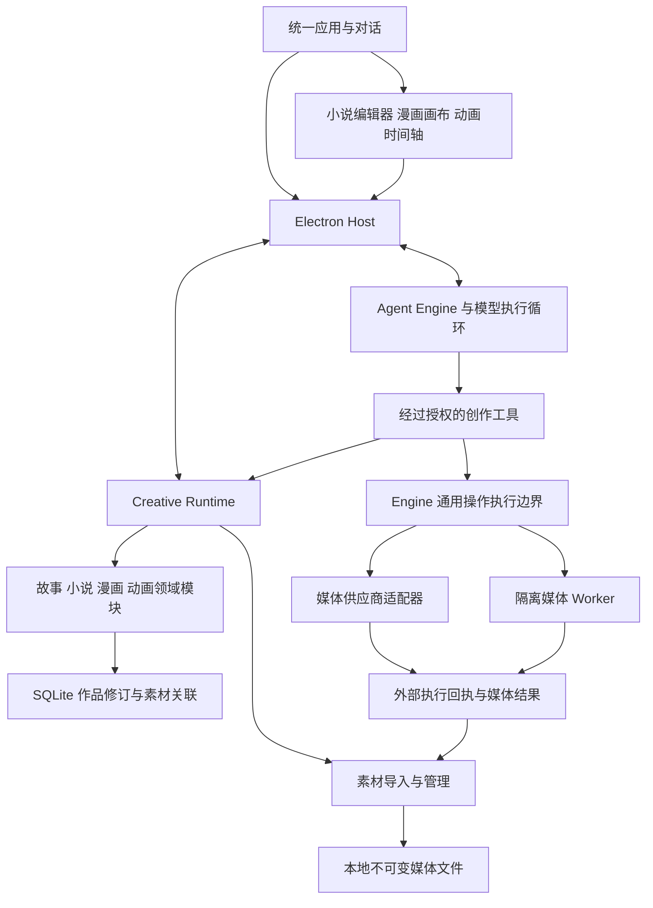
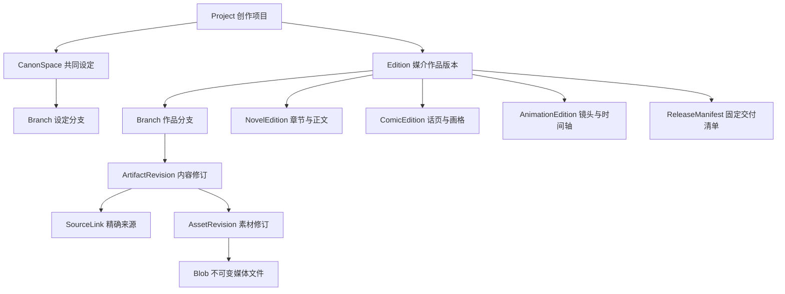
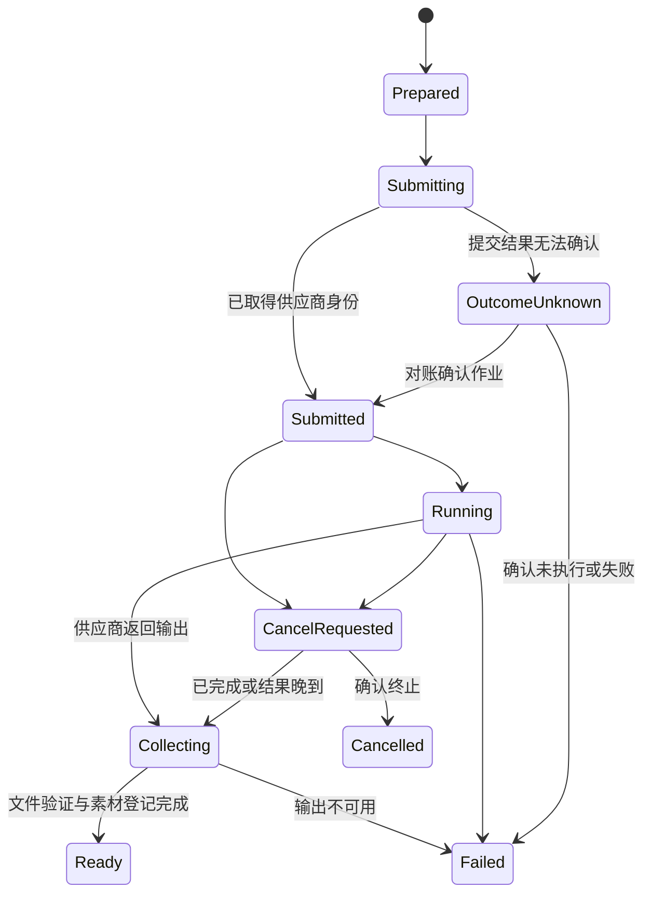

# EternalLight 小说漫画与动画创作理想架构

日期：2026年10月9日

版本：3.0 · 必要制作结构与模型按需理解

状态：目标架构与实施蓝图。工程已按阶段实施；当前完成范围、真实验收与剩余条件以[实施记录](MULTIMODAL_CREATION_IMPLEMENTATION.md)为准，不能把全部目标视为已经交付。

采用同一代码仓库、同一桌面应用和同一 Agent Engine，提供小说、漫画、动画三个平等的创作入口。用户可以独立创建任何一种作品，也可以在同一故事项目中增加其他媒介版本。共享故事、对话、素材和可靠执行能力，各媒介保留自己的内容结构、编辑器与交付标准。

本方案面向产品、架构和工程实施人员，明确模块边界、数据权威、模型职责、独立创作与改编流程，以及逐阶段验收要求。它扩展现有[自主创作架构](SIMPLE_REQUEST_AUTONOMOUS_CREATION_DESIGN.md)的媒介范围，沿用“作者表达目标、模型组织创作、工程保证真实执行”的原则。当前小说能力的实施状态仍以现行代码和对应验收记录为准。

本轮方向由[独立应用理想技术总纲](../../IDEAL_ARCHITECTURE.md)统一，[演进路线](CODEX_CREATIVE_EVOLUTION_ROADMAP.md)安排工作顺序。独立应用是产品主线，Codex 插件不作为本轮主方向或交付前置。作品原文和原始媒体可以在授权与实际能力内直接读取；制作结构与执行记录保持确定性，语义解释按任务需要生成。该调整保留既有 M0–M4 的目标、授权及验收责任，不取消正在实施的多媒介工作，也不把新设计写成已实现能力。

本版明确“操作对象”和“对对象含义的理解”的区别。页格、气泡、镜头、片段和时间引用用于精确编辑及交付；场景意图、人物关系和镜头解释按目标需要生成。借鉴 Codex 工具的精确操作与真实反馈机制，不推定它具有或缺少某套完整语义系统；来源与推论范围见[总纲第12节](../../IDEAL_ARCHITECTURE.md#12-codex-借鉴依据与适用范围)。

## 1 核心决策

| 决策 | 目标状态 | 原因 |
| --- | --- | --- |
| 代码组织 | 单仓库、模块化应用，共用现有引擎 | 会话、任务、版本和素材只维护一套基础机制 |
| 产品入口 | 小说、漫画、动画均可独立创建 | 创作任何媒介都不以存在另一媒介作品为前提 |
| 作品组织 | 一个项目可包含一个或多个媒介版本 | 同一故事可改编，无关故事保持项目隔离 |
| 领域模型 | 共用版本与来源机制，内容采用专属类型 | 章节、画格、镜头及剪辑片段具有不同语义 |
| 建模深度 | 制作与操作结构必需，故事及视听解释按需 | 精确编辑不要求先提取完整故事图谱 |
| 原始材料 | 按授权直接读取原文、图片及实际支持的音视频 | 摘要、OCR、字幕和视觉标签不能代替原始作品 |
| 创作方法 | 模型动态选择资料、方法、工具与分工 | 允许直接创作、局部修改和不同制作顺序 |
| 执行事实 | Runtime 管作品，Engine 管外部执行 | 模型说明、供应商响应和实际保存分别核对 |
| 界面 | 同一对话搭配当前媒介编辑器 | 工具按对象出现，保持阅读与创作主线 |

不为漫画或动画复制一套应用、模型连接、作品数据库和任务系统。也不通过把图片塞进章节正文来模拟漫画，或把若干视频链接当作动画工程。

当前阶段以本地单用户创作为部署基线。分布式协作、插件市场、节点式工作流编辑器、完整三维建模与骨骼动画工作站不作为前置工程。需要外部专业工具时，通过明确的素材导入和项目导出衔接。

## 2 独立作品与跨媒介版本

### 2.1 独立创建

用户可以从“创建小说”“创建漫画”“创建动画”进入，也可以直接描述想法，让模型结合对话确定作品形态。入口只建立必要的作品身份和对应编辑空间，不要求填写完整制作向导。

| 创建方式 | 初始内容 | 不需要的前置对象 |
| --- | --- | --- |
| 独立小说 | 空正文、创意或已有文字 | 漫画、动画、视觉设定图 |
| 独立漫画 | 空白页、故事想法、人物参考或已有画稿 | 小说版本、章节正文、小说章纲 |
| 独立动画 | 空项目、剧本、镜头想法、角色图或已有片段 | 小说版本、漫画页面、改编关系 |

独立漫画和动画都能从空项目完成创作、局部调整、保存、重新打开、导出。剧本、故事简报、角色资料和场景节拍按需要逐步形成；叙事中间结构可帮助关联，但不是强制预处理阶段。用户也可以制作没有对白或传统情节的动画。

### 2.2 同一故事的多种表达

`Project` 表示创作项目；`Edition` 表示小说版、漫画版、动画版等具体作品版本。同一媒介也可以有多个独立版本，例如竖屏漫画版与印刷改编版。保存一次修改产生的 `Revision` 与这种作品版本是不同概念。

每个 Edition 都有自己的内容、工作分支、当前稿、采用记录、任务和交付清单。它可以引用共同设定的明确版本，也可以保留本版改编差异。没有任何 Edition 被默认指定为其他媒介必须服从的源头。

创建改编时才建立来源关系。例如“把小说第七章改成一话漫画”绑定对应正文修订；独立漫画的改编来源可以为空。漫画也可以成为小说或动画的来源。

### 2.3 共享设定与改编差异

共同人物、地点、规则和故事事实放在 `CanonSpace` 中。Edition 固定引用所采用的设定快照，并记录本版差异，如调整人物年龄、合并角色或改变事件顺序。差异包含来源、适用范围及作者要求，避免将两版不同事实混在同一知识投影中。

共同设定或来源作品发生变化后，系统建立影响记录。模型可以解释影响、提出修改或说明有意保留的差异；只有在有效作者要求范围内，才能生成和采用对应更新。打开作品、切换媒介或读取最新资料都不会自动重绘、重配音或覆盖已有改编。

## 3 当前工程基础与缺口

以下列出现有代码入口与[实施记录](MULTIMODAL_CREATION_IMPLEMENTATION.md)中的能力依据，作为定位索引，不另立完成状态。2026年10月9日的文档整理未重新运行这些验收；真实供应商、完整作品质量和发布条件继续按实际源码、构建及原记录逐项核对。

| 范围 | 当前依据与已建基础 | 仍需验证或补齐 |
| --- | --- | --- |
| 通用创作执行 | [3.0实施记录](../../design-reviews/AUTONOMOUS_V3_IMPLEMENTATION_REVIEW.md)：开放工作区、按需工具发现、隔离候选及持久唤醒已有工程证据，完整 Native 与应用链已收齐 | 真实模型自主创作、方法收益与长作品质量仍需独立验证 |
| 作品与版本 | [媒介契约](../../shared/multimedia-types.ts)、[领域实现](../../native/story-core/src/media/multimedia.rs)：Project/Edition、typed 修订、作用域及来源已接通 | 同项目新增小说 Edition 和完整跨版创作旅程尚未完成 |
| 精确编辑与来源 | [原子局部操作](../../native/story-core/src/media/multimedia_patch.rs)、[文本范围](../../native/story-core/src/media/multimedia_text.rs)、[来源影响](../../native/story-core/src/media/multimedia_impact.rs)：稳定对象、锁、CAS、读依赖及字符分页已有证据 | 全部巨型节点、来源图分页及完整语义影响覆盖不能由局部通过推定 |
| 媒体对话 | [媒体对话](../../electron/media-conversation.mjs)、[应用入口](../../src/multimedia/MediaApplication.tsx)：已支持登记图片、仅图片消息、精确引用和历史恢复 | 图片之外的原生音视频理解按实际接入与验证开放，不视为已经支持 |
| 图片与外部执行 | [媒体执行器](../../../agent-engine/src/media/executor.mjs)、[媒体账本](../../../agent-engine/src/media/ledger.mjs)：供应商适配、作业恢复、预算和素材交付路径已建 | 当前图片输入资格与生成服务仍须真实账户验证；受控端点不证明真实画面质量 |
| 漫画编辑与导出 | [漫画编辑器](../../src/multimedia/ComicEditor.tsx)、[渲染入口](../../electron/media-render.mjs)：页格、独立对白、局部修改、实际 PNG/PDF 已有证据 | 完整原创、改编、角色一致性及作者返工收益未验收 |
| 动画编辑与成片 | [动画编辑器](../../src/multimedia/AnimationEditor.tsx)、[字幕合成](../../electron/media-subtitles.mjs)：镜头/轨道/片段、固定字体字幕及开发环境 MP4/音轨已有证据 | 完整动画生成、作品质量与便携安装资源尚待验收 |
| 设定、归档与交付 | [共同设定](../../native/story-core/src/media/multimedia_canon.rs)、[媒体归档](../../electron/media-archive.mjs)：显式采用、固定素材集合和单 Edition 归档验证已有证据 | 全历史一致备份、应用归档导入、可达性 GC、跨平台安装包与可分发组件仍未完成 |

## 4 总体架构与职责



图中关系表示调用和数据归属，不规定每次创作必须依次经过所有模块。

| 边界 | 拥有的权威 | 不承担的决策 |
| --- | --- | --- |
| 模型 | 对作者意图的解释、创作计划、方法选择、语义与审美判断 | 不能自行宣布文件已保存、费用已结算或作者已采用 |
| Agent Engine | 会话、执行租约、可用能力、供应商操作状态、资源准入与用量账本 | 不保存第二套漫画页面或动画当前稿 |
| Creative Runtime | 作品归属、授权范围、修订、素材关联、提交事务和交付状态 | 不以关键词决定创作意图，不硬编码艺术制作顺序 |
| 媒体适配器 | 协议编码、提交、查询、取消、结果获取及原始回执归一化 | 不维护独立创作计划或无限重试循环 |
| 媒体 Worker | 解码、缩略图、转码、排版合成、音视频渲染 | 不获取通用作品写权限，不解释作者意图 |
| Electron Host | 可信 IPC、凭据引用、生命周期、事件投递与恢复唤醒 | 不另建规划器、媒体业务调度器和自然语言路由器 |
| Renderer | 展示、编辑输入、对象选择和真实状态投影 | 不通过模型文字或文件名推断成功 |

对话中的一次创作仍属于现有 Work 和 Action/Attempt。媒体作业是其中的执行操作；漫画、动画模块不各自建立另一套任务中心。需要等待远端生成时，持久保存等待条件；回执沿当前执行循环送回模型，进程重启后按同一归属恢复。

### 4.1 制作结构、执行记录与派生语义

这里的“建模”分为三个责任不同的部分，不能因为模型可以读取作品就全部省去，也不能因为需要精确编辑就强制提取全部画面含义。

| 类别 | 最小必要内容 | 维护原则 |
| --- | --- | --- |
| 作品与制作结构 | 原始正文与素材；稳定对象及修订；漫画页格、独立文字与排版；动画镜头、片段、轨道和精确时间；作者明确设定与采用记录 | 创作和实际编辑时形成，程序校验身份、范围、引用及当前一致性；不要求创作前填写完整故事模型 |
| 操作与依赖记录 | 作者范围、实际读取来源、目标版本、执行归属、原操作、预算、保存与渲染回执 | 来自真实操作；保持确定性、可恢复，不能由模型自述补成成功 |
| 派生语义 | 场景摘要、人物状态、因果、伏笔、镜头意图、情绪、视觉或音频解释 | 按当前问题生成，绑定来源、覆盖范围及不确定性；可复用但不覆盖原作，不自动成为作者设定 |

一张直接生成的漫画图可以作为扁平素材保存和展示；只有实际建立的页格、气泡或图层才能按对应对象编辑。一个直接生成的视频可以作为镜头素材使用；只有实际保存素材、时间轴与组合参数，才具备可重开、可局部修改的工程。最小制作结构随交付目标增长，不强制先建全量事件图、角色关系图、骨骼或三维场景。

结构字段是否必需由具体操作和交付目标确定：修改气泡需要实际文字对象及位置，修剪视频需要素材和精确时间，分析人物动机才可能消费语义解释。场景意图、角色语义标签、叙事分组允许未建立或不适用；已有作者明确要求及采用的参考必须保留。若当前 schema 对某项仍有硬要求，应在对应实施切片同步接口及调用方后改变行为，本文不能作为绕过校验的许可。

### 4.2 原始材料直接读取

在任务授权范围内，模型可以按问题读取原文、固定版本图片以及实际支持的音视频材料，不必先把材料转成故事知识库。简单任务可直接生成画面、修改对白或调整片段；只有当前目标需要的参考、检查与交付步骤才进入执行计划。直接读取同样核对来源修订、对象或时间范围、读写权限、当前连接能力、大小和总预算。

原生图片、音频、视频输入分别验证，不由一种能力推定其他能力。OCR、转录、字幕、抽帧和缩略图是有损派生表示，须保留对应原素材、变换方式、范围与未覆盖信息；可用于定位，但不能声称已经看过未送入模型的帧、听过未处理的音轨或获得原始图层。应用能播放素材，也不等于当前模型连接能够理解该素材。

“可访问全部材料”“已读取指定范围”和“判断正确”分别记录。媒体摘要、标签与角色参考帮助定位及保持要求，不能保证视觉身份、运动、声音或故事理解正确；有争议的结论应返回实际原文、画面或片段检查。

### 4.3 按需分析与依赖准备

目标契约分别表达原始资料准备和当前操作必需的派生分析。前者检查资料存在、可解码、可授权读取、来源版本和制作结构；后者只在具体操作明确消费某项分析时要求该分析有效。未建全书或全片语义模型，不应成为所有创作操作的统一前置条件；已经声明的必要分析缺失或过期，也不能通过“模型可以直接看原作”跳过。

当前部分创作路径已把知识和伏笔提取列为可选辅助，专用知识消费路径仍执行来源、批次就绪和报告有效性门禁，具体事实见[总纲第5节](../../IDEAL_ARCHITECTURE.md#5-自主工作与完成契约)。若将某操作改为以直接原始材料为依据，须单独评审并一次性同步任务创建、输入契约、执行准入、报告依据、交付收尾、恢复和相关测试；不得仅在 Host 忽略错误或把未分析范围标成通过。本节不宣称这种逐操作调整已经全部实现。

实际读取依赖与语义影响分开。来源修改使依赖旧版本的派生判断过期，保留历史证据；`pinned` 历史引用继续固定原版，`mustBeCurrent` 依赖仍按当前版本校验。失效不表示后续作品必须重画或重剪；模型结合原来源、当前来源和当前目标提出影响候选，作者授权范围决定可执行修改。

## 5 工程模块组织

继续使用现有 `eternallight/agent-engine` 与 `eternallight/novel-codex`。后者目录名暂不影响多媒介领域设计，品牌或安装包更名作为单独发布决定处理。以下是目标职责落位，不表示这些目录已经建立。

```text
eternallight/
  agent-engine/
    通用会话 能力与路由 操作账本 预算与资源准入
    媒体供应商适配器与本地执行器接口
  novel-codex/
    src/
      workspace/       作品与媒介版本导航
      conversation/    统一对话 附件 选区 成果展示
      novel/           章节与正文编辑
      comic/           话页 画格 气泡 画布编辑
      animation/       镜头 时间轴 音轨与字幕
      media/           素材预览 导入与引用
    electron/          可信宿主与当前 IPC
    native/
      story-core/      共用仓储与故事领域 各媒介类型和校验
      story-runtime/   统一领域 API
      story-mcp/       类型明确的创作工具
      media-worker/    隔离的媒体处理与导出
    shared/            当前接口 类型定义与生成源
```

按实际模块边界逐步整理源码，不先做全仓库改名。媒体 Worker 是可独立终止的执行进程，仍随同一应用交付；它不是第二个业务服务。初期不引入远程数据库、对象存储集群或微服务网络。

工具契约维护一份当前定义，生成或校验 IPC、Runtime、模型工具、前端类型及测试的一致性。不同模型协议的必要编码由适配器承担，不保留旧接口双轨。

## 6 领域模型与作用域

### 6.1 对象关系



每个 Edition 只拥有其媒介对应的内容根；图中的三条内容边是三种类型。新项目初始化时只建立用户需要的 Edition，不附带空小说、空漫画或空动画。

| 对象 | 必要语义 |
| --- | --- |
| Project | 作品身份、标题、成员 Edition 和共同资料范围 |
| CanonSpace | 有源故事设定与已确认事实；可以从空集合开始 |
| Edition | 媒介类型、交付规格、采用的设定快照、本版差异、可选改编来源 |
| Branch | 归属某个 CanonSpace 或 Edition 的工作分支及对象头 |
| Artifact | 稳定创作对象身份，如章稿、剧本、页面、画格、镜头或时间轴 |
| ArtifactRevision | 不可变的专属类型内容、父修订、摘要、来源与创建操作 |
| AssetRevision | 某个逻辑素材的固定版本、媒体文件与经过检测的元数据 |
| SourceLink | 两个确定修订之间的改编、描绘、参考或派生关系 |
| ReleaseManifest | 导出或发布时冻结的内容、素材、配置与结果文件集合 |

`ArtifactRevision` 使用可校验的类型联合和各媒介约束。共同外壳统一身份、来源与版本，内部载荷分别定义；任意字符串类型加任意 JSON 不能成为全部领域契约。

### 6.2 作用域隔离

对象头、工作基线、知识投影、检索、会话上下文与操作归属统一绑定 `projectId + scopeId + branchId`。`scopeId` 明确指向 Edition 或 CanonSpace，不能只靠 `projectId` 分区。

任务可以获得跨 scope 的精确读取引用，但写入对象和设定确认范围分别校验。章节号、页码、画格序号和镜头序号用于展示；重排后稳定对象 ID 不变。切换作品或媒介版本时，旧请求、草稿、选择、生成结果不能串入新目标。

分支在确实需要试验不同版本时建立。普通单图修改只产生新修订，不要求用户先理解或创建分支。无分支选择的工作空间也有明确的当前分支身份，不依赖隐式读取 main。

### 6.3 提交与并发

修改请求至少绑定目标作用域、期望目标修订、依赖读取集合、作者要求版本、执行代次和幂等身份。宿主从可信上下文派生已有身份，不让模型反复填写可伪造的项目或父任务信息。

事务同时保存内容修订、来源关系、对象头更新及领域回执。同一幂等键配相同内容返回原回执；不同内容使用同一键必须报冲突。

读取依赖显式区分 `pinned` 与 `mustBeCurrent`。前者固定来源修订，来源分支头前移不使该历史版本失效，因此可以按指定旧小说稿改编或按固定时间轴重新渲染；后者要求提交时仍为当前版本，变化时返回过期来源。目标对象头、有效授权和执行代次始终核对。固定来源不授予额外读取权限，也不允许悄悄换成最新修订。

不同漫画页、小说章或镜头可以在各自写集合内并行。全项目版本可用于一致快照与事件序号，但不应成为所有独立编辑必须竞争的唯一写锁。跨对象原子修改需要显式列出写集合，并核对各对象和共同约束的版本。

保存、当前稿选择、作者采用、导出、发布和任务完成分别有回执。模型生成新候选不自动产生正式设定或外部发布。

## 7 素材存储与生成来源

素材身份与文件存储分开：`Asset` 表示可引用的素材，`AssetRevision` 固定某次版本；`Blob` 以内容摘要标识不可变字节。原始文件、缩略图、编辑代理和最终合成都有明确的表示关系，代理图不能冒充原图参与导出。

SQLite 保存元数据、修订和引用；媒体字节进入应用管理的文件存储。聊天记录、数据库内容字段和日志不存整段 Base64 媒体。底层文件去重不产生跨项目读取权限。

导入按以下顺序执行：

1. 先登记导入操作及其文件保留租约，再在受控临时目录接收数据，执行格式、大小、尺寸、时长与解码检查。
2. 计算摘要，把验证后的文件原子归档到不可变存储。
3. 在数据库事务中登记素材版本、归属、来源与操作回执。
4. 返回可由应用重新打开的素材引用，再向用户显示“已保存”。

文件系统与数据库不存在假定的跨系统原子事务。导入租约覆盖临时文件和已归档但尚未提交引用的 Blob；垃圾回收与导入、备份协调，不能在归档到事务提交之间删除文件。崩溃后按导入操作记录恢复，确认无存活执行所有者且租约已过期后，才释放对应临时保留。

垃圾回收以历史修订、导出清单、未完成操作、租约和备份引用的可达性为依据，不能仅凭当前页面未使用就删除。确认不可达的孤立文件可以回收；已引用字节缺失必须显示损坏或不可用。

生成来源记录输入素材修订、提示与参数、使用的连接和模型标识、供应商作业、请求摘要、执行时间和输出摘要。只有供应商实际支持时才记录种子等参数；它们帮助追踪，不保证再次生成像素完全一致。

项目备份包含数据库一致快照、全部可达媒体和清单；恢复核对摘要与缺失项。缩略图等可重建缓存与不可替代原始素材分别管理。

## 8 图文和音视频对话契约

### 8.1 输入与定位

现有 `sendPrompt` 已通过 `mediaInput` 接收图片及引用（见 `electron/preload.cjs` 和 `src/types.ts`）。后续在现有合同基础上扩展经验证的音视频输入，并统一精确来源定位；以下是目标概念，不是当前可调用 API：

```ts
type AuthorContent =
  | { kind: "text"; text: string }
  | { kind: "image"; assetRevisionId: string; region?: ImageRegion }
  | { kind: "audio"; assetRevisionId: string; sampleRange?: SampleRange }
  | { kind: "video"; assetRevisionId: string; range?: RationalTimeRange }
  | { kind: "reference"; source: VersionedSourceRef };
```

用户可以粘贴、拖入或选择图片，发送前看到可移除的预览。单独发送图片也合法；模型结合上下文理解用途，必要时询问。音视频输入在对应能力交付后使用同一消息模型，界面只开放实际可用类型。

选择正文、画格、图片区域、镜头或时间范围时，输入框显示简短对象名、缩略图或范围。发送时冻结真实修订和选择；当前页面只是导航状态，不是后续写入目标的替代身份。失败、排队、重启和切换会话均保留原文字、附件及引用。

### 8.2 精确来源

| 定位类型 | 权威字段与校验 |
| --- | --- |
| 文字范围 | 内容修订、编码明确的范围、引用文本与摘要；前后端明确转换 Unicode 定位 |
| 图片区域 | 素材修订、规范化后的像素坐标系、矩形或蒙版修订；保存旋转与裁剪变换 |
| 漫画画格 | 页面与画格稳定 ID、对应修订；局部选择再带区域 |
| 视频与镜头 | 镜头或素材修订、以有理时间表达的半开区间、时间基准 |
| 音频范围 | 素材修订、采样率、起止采样点 |

从显示代理选择的区域必须能映射回原始素材。修改前重新校验目标与依赖；画格重排不改变目标身份，素材替换则使旧选区需要重新定位。未保存选区可用带摘要的临时快照讨论，应用到持久作品前必须保存或显式完成对账。

### 8.3 上下文与信任

模型按问题选择素材和范围，使用缩略图、联系表、抽帧、片段或全文读取工具。每次转换记录来源、分辨率、抽样范围和省略情况；低分辨率预览或抽帧不能被宣称为完整检查了原图或整个视频。

OCR、图像描述和转录是绑定来源版本的派生资料。图片中的文字、上传剧本和音频指令都属于待分析内容，不取得系统指令或新的执行授权。上传人物图也不等于用户已确认其中所有特征为正式设定。

媒体读取经过可信宿主处理。Renderer 仅访问应用登记的素材引用；不开放任意本地路径或任意远端 URL。导入限制、路径校验、临时下载、解码隔离与凭据保护沿既有 Electron 安全边界实现。

## 9 能力发现与模型路由

能力登记统一管理，但区分来源和执行路径：

| 能力类别 | 示例 | 执行方 |
| --- | --- | --- |
| 推理输入 | 识图、音频理解、视频理解、结构化工具调用 | 对应模型连接及其协议路径 |
| 媒体生成与编辑 | 生图、蒙版编辑、参考图生成视频、配音、转录 | 经验证的媒体服务或本地模型工具 |
| 本地媒体处理 | 裁剪、排版、缩略图、音轨混合、字幕合成、渲染 | 隔离 Worker |
| 领域操作 | 保存画格、重排镜头、更新气泡、固定导出清单 | Creative Runtime |

可用能力取以下条件交集：已验证的能力与参数范围、有效连接、产品已实现链路、当前读写授权以及剩余预算。模型名称、供应商宣传和配置开关不单独证明能力可用。

文字推理模型可以调用独立的生图服务；识图与生图不要求同一个模型完成。需要视觉检查时，必须存在经过授权的视觉读取路径。能力不足时说明缺项并保留已有成果，不能悄悄用文字描述替代用户要求的图片，或以静态图冒充指定的视频。

当前作者选择（2026年10月7日）：沿用工程现有 DeepSeek 连接作为小说、漫画和动画的统一创作模型。它负责理解要求、剧本、分镜、对白、镜头和时间线结构，以及选择已授权工具；现有素材可以导入后由本地工具排版、剪辑、合成和导出。当前默认连接为 `deepseek-flash`，不必为了进入漫画或动画创作先配置其他供应商。

这项选择依照真实能力执行：[DeepSeek 官方模型接口](https://api-docs.deepseek.com/api/list-models/)列出的 Flash 输入包含图像，原生输出为文字。工程内图片输入须通过当前连接及协议路径验证后开放，公开支持声明不替代验证；图片、视频和配音的实际生成需要对应制作工具或已接入服务的真实输出回执。脚本与分镜保存、本地素材制作、实际生成作品分别验收，完整作品交付要求继续有效。

模型在现有授权内选择工具、参数、候选方案及按需子任务。更换提供商、扩展素材可见性或增加成本不能越过既定范围；实质性变更才交给用户决定。创作方法与媒介类型不成为固定工具顺序或必选专家列表。

## 10 媒体长任务与可靠恢复

### 10.1 操作与权威

每个外部生成或本地渲染操作绑定现有 Work、Attempt、作者要求、目标作用域、输入修订、参数摘要和预算预留。领域库记录该操作准备交付给哪个作品对象；Engine 记录它对外提交、取消、费用和执行结果。两者通过唯一操作 ID 与幂等回执关联，各自状态不互相推测。

Runtime 与 Engine 的两份存储不假定跨库原子性。Runtime 先登记目标、输入及授权，再以同一 `operationId` 与 Engine 去重建立执行记录和预算预留；完成可恢复、可对账的交接确认后才能外发。只有持有有效执行租约和当前 fencing 代次的唯一所有者可以派发，旧进程或重放事件不能再次执行。任一侧重启后都核对原操作，不因暂时缺少另一侧回执创建新操作。

供应商适配器提供 `inspect / submit / lookup / poll / cancel / fetch` 等实际支持的操作，能力缺项明确返回，不伪造查询或取消成功。



这是操作状态的简图；取消范围也覆盖等待与获取阶段。`Ready` 表示媒体已持久登记，作品采用和任务交付由独立的领域回执决定。等待素材回传、校验或入库期间，供应商的 succeeded 不能直接显示成“作品已完成”。

### 10.2 未知结果与去重

提交后断网或崩溃时，使用原幂等身份或供应商作业 ID 查询。不能换新键重提，也不能因超时自动切到其他供应商再次生成。服务不支持幂等或查询时保留 `OutcomeUnknown`；必要时向用户说明“可能已经执行，尚未核实”，不承诺端到端恰好执行一次。

轮询、回调、重新连接与重启恢复汇入同一操作对账入口。重复和乱序事件按操作身份去重；活动模型回合与恢复唤醒只有一个事件消费归属。长作业完成不会创造一条假的用户消息或重复启动整个创作任务。

### 10.3 停止与晚到结果

用户停止后立即撤销新增派发资格，并向支持取消的服务发送取消请求。远端可能已经完成或不能取消，真实费用与终态继续核对。取消请求不能被写成已取消或已退款。

在 `Submitting` 阶段停止时，远端可能已经接收请求而作业 ID 尚未返回。必须先持久记录取消意图，继续按原操作取消或对账；中止本地网络请求不代表远端取消成功。收到迟到作业 ID 后继续查询或取消原作业，保留预算和未知结果跟踪。

晚到素材可以保存在原操作下，标明未应用；目标对象头只有在当前授权、执行代次、来源及期望修订仍有效时才能更新。用户停下后编辑的画格或镜头不会被晚到结果覆盖，已取消的目标也不会自动恢复创作。

### 10.4 预算与资源

复用统一租约、预算和资源准入框架，增加 HTTP 请求、远端活跃作业、本地解码与渲染等资源种类。现有 bridge 请求并发器尚不等于跨项目媒体作业队列；扩展后必须覆盖同一账户、多项目和本地资源的共同限制。远端等待不占用整个 HTTP 请求槽位。

媒体预算记录图片数量与尺寸、音视频时长、请求次数及可核验金额上界，金额使用整数最小单位与币种，时间采用精确表示。先预留、再按真实回执结算；未知结果保留必要预留，重试和恢复不重置累计用量。供应商无法提供金额硬上界时，应显示估计及有限请求范围，不能宣称绝对费用保证。

临时下载链接只是获取手段。失效时通过原作业重新获取可用地址；最终成果身份为已保存媒体字节和素材版本。

## 11 漫画领域与编辑能力

漫画以 `ComicEdition → Page 或 Strip → Panel` 表达实际采用的页面和画格；多话作品可增加 Episode 分组。单页或扁平画稿不必先建立“话”和完整分镜，只有需要独立画格编辑时才建立对应对象。页漫和条漫分别定义尺寸、阅读方向、间距、出血或滚动布局。画格 ID 与页面顺序独立，改页码或重排不会改变来源身份。

画格保存稳定身份、实际布局和所用画面资产；裁剪、变换及图层按编辑能力建立。场景意图、角色和环境参考按任务需要保存，缺少语义说明不阻止直接导入、排版或局部修改。对白、旁白、音效文字和气泡在实际建立时成为可编辑对象，保存文本、位置、样式和阅读顺序；说话者及尾指等字段按对象类型适用，不要求旁白伪造说话者。默认将正式文字排版与生成画面分开；用户导入的整页图保留为扁平素材，不能宣称它已经拥有可编辑气泡或图层。

“修改气泡文字”仅作用于实际存在的独立文字对象，保留底图与其他画格。扁平图片中的文字需要图像编辑或明确的重新制作，OCR 结果只是识别候选，不能直接冒充原始文字层。局部选区、重排或重绘均绑定精确修订；程序能够保证提交与对象范围，生成图在选区内是否满足表情、服装或构图要求仍需检查实际输出。图层、气泡样式等更细能力按当前实现逐项标明，本文目标不代表已有任意分层编辑器。

模型可以先画一格、先确定角色、直接做整页或从已有草稿修改。单格重绘复用有效角色与场景参考；整页合成依赖精确画格版本，局部变化只重做受影响内容。图像模型只有扁平输出时，产品保留原图和编辑记录，分层能力按实际支持标注。

角色设定包括外观、服装、比例、配色及选定参考；场景设定包括空间关系与关键道具。参考图是制作依据，无法机械保证身份、服装和透视始终一致。视觉模型评审及作者检查针对真实画面，结论带来源和未覆盖范围。

漫画交付需要页面或条漫范围齐全、顺序明确、画面可读取、文字清晰且无意外裁切，并完成用户要求的角色与剧情检查。生成脚本、分镜缩略图、单张插画和完成一话漫画分别标识。

导出冻结页面、画格、字体及素材版本，生成页图、长图或 PDF 等已实现格式，并核对文件可打开、尺寸正确、页数及阅读顺序一致。对话显示一个有名称的成果入口，打开即可进入对应页面。

## 12 动画领域与编辑能力

动画可以直接从原创要求、脚本、人物图或空工程开始。`AnimationEdition` 管理实际建立的镜头、素材和时间轴，剧本、角色资料及来源漫画或小说均按目标需要采用。

需要组织多段叙事时采用 `Episode → Sequence → Shot`；Episode 和 Sequence 为按需组织层次，不是单镜头、素材剪辑或无叙事动画的开工前置。剪辑结构采用 `Timeline → Track → Clip`。Shot 是实际建立的镜头身份，Clip 是时间轴上的使用实例；片段可以直接引用素材，一个镜头也可以多次剪入，同一素材可使用不同范围和速度。

Clip 固定素材修订、原素材范围、时间轴范围、速度与适用的画面变换。作品实际使用的音轨、声道、配音、音乐、音效、字幕与转场分别保存；无对白或无音乐作品不创建假音轨以满足模板。视频帧、音频采样点和时间戳有明确转换；权威时间使用有理数与半开区间，不用累加浮点秒保存剪辑位置。

镜头内容修改与剪辑实例修改分别表达。例如延长一次 Clip 不应隐式延长该 Shot 的其他使用实例，也不能默认移动或拉伸已锁定的配音；无法在当前素材可用范围内满足要求时，提出明确选择或按授权生成补充素材。只有成片文件时，可以保留为单一素材并建立新的剪辑实例，不能宣称已还原原来的分轨、剪辑点或动画绑定。可重渲染要求原素材、当前时间轴、字体和执行规格可用，并不承诺重新调用生成服务会得到逐像素相同的画面。

字幕预览与导出共用当前固定字体和像素排版规则。以精确有理数计算 `ceil(start × fps)` 至 `ceil(end × fps)` 的半开帧区间；活动字幕组合按稳定轨道顺序堆叠，全部视频画面合成后再叠加透明字幕。正式链路在受限 Electron 内存页面中排版，检查固定字体的真实字形使用和可见边界，输出透明 PNG 后交给 FFmpeg。缺字、超限、排版溢出和取消明确失败并保留文档，不静默借用系统字体、不截断对白；实际成片及字体摘要参与发布验收。

对白、画格说明、镜头说明及字幕的模型读取按固定修订的显式字段分页，字符坐标采用 Unicode scalar，响应按实际 JSON 字节计量。实体目录仅返回文本字段描述，原文由精确字符页读取；局部替换验证全文摘要及每段切片摘要，同批坐标基于原文，非重叠修改原子提交。共同设定声明可以从已冻结作者快照读取，模型不能通过局部工具写入或采用新设定。来源 quote 有明确上限，共同设定原文引用按条分页；全部来源图的大节点分页仍需独立实现。

时间轴和媒体引用分离的设计可参考 [OpenTimelineIO 时间轴结构](https://opentimelineio.readthedocs.io/en/latest/tutorials/otio-timeline-structure.html)及[序列化模型](https://opentimelineio.readthedocs.io/en/latest/tutorials/otio-serialized-schema.html)。当前本地渲染器 `electron/media-render.mjs` 已检查源素材可用时长、按指定有理帧率输出，并探测产物及检查完整时长；更完整的素材与帧率边界、跨平台运行和真实成片质量仍需验收。参考或导出交换格式不等于获得渲染能力，外部格式接入也不能替代内部领域权威。

生成视频只是获得镜头素材。完成动画还需要时序、剪辑、声音和实际合成。首期目标是可编辑的镜头级动画创作与成片交付；生产级分层动画、完整骨骼和复杂三维工程须另行定义能力，不由“支持动画”自动推定。

| 交付类型 | 验收依据 |
| --- | --- |
| 动态分镜预览 | 镜头与节奏可理解，时长及参考音轨符合约定，明确标为预览 |
| 动画成片 | 按用户约定具备实际运动或有限动画表达，镜头连贯，画音同步，要求的音轨与字幕齐全，可播放导出 |
| 可编辑动画项目 | 保存镜头、素材和时间轴，可重新打开、局部修改与再次导出 |
| 专业分层工程 | 只有实际提供对应图层、绑定或专业格式并经过验证时才宣称支持 |

用户可以明确选择动态漫画或有限动画，按其表达目标验收；系统不能把幻灯片或若干独立片段默认算作已完成的动画短片。

导出时建立 `RenderManifest`，冻结时间轴修订、所有素材版本、字体、导出规格和执行器版本。编辑期间的后续变化不会改变已启动渲染的输入。渲染失败可恢复同一操作；成功需检查文件可解码、实际时长、声轨、分辨率和缺失素材，并进行画面及听感评审。

## 13 跨媒介知识与改编追踪

`SourceLink` 连接目标修订与来源修订，关系包含 `adapts`、`depicts`、`usesReference` 和 `derivedFrom`。它允许一对多、多对一及局部关联：一章可以拆成多页，多段剧情可以合成一个镜头。未填写映射不表示两份作品完全一致。

来源更新后的处理以三个版本为依据：原来源、当前来源、当前目标。结构层定位已有依赖的可能影响；模型判断哪些差异有意义、哪些属于有意改编，再提出具体更新。没有显式来源关联的语义影响，需要模型额外检索和解释，不能宣称依赖图覆盖了全部故事影响。

视觉或音频知识以 `ModelClaim` 记录，例如“这一镜头中人物穿红衣”。记录素材版本、区域或时间范围、模型解释与不确定性。只有经过有效作者决定及领域事务，才成为指定 CanonSpace 或 Edition 范围的正式事实。OCR、模型字幕和画面推断不能静默升级为共同设定。

该语义层按问题建立：检查服装时读取相关参考和画格，检查节奏时读取相关镜头与时间范围，改编时追踪实际采用的来源。允许直接原作分析、临时笔记和有益结论的版本化复用，不要求每次生成前完成全书、全页或全片的统一标签与知识图谱。提取覆盖率、来源锚点正确及规则校验通过，都不能单独证明解释正确或作品质量达标。

故事时间、读者看到的顺序和动画播放时间分别表达。原小说的章节范围不能直接当作漫画或动画的全部披露规则；查询需结合当前 Edition、场景与受众已知信息，防止未来情节或其他改编版的秘密混入当前创作。

## 14 对话与编辑体验

用户默认面对当前作品和同一对话。小说打开正文，漫画打开页面或条漫，动画打开镜头预览；时间轴只在需要剪辑时展开。作品目录随实际内容出现章节、话页或镜头，不要求三个媒介面板同时常驻。分阶段发布时，只开放已经完成对应验收的创建能力，未实现的入口不能进入无内容可交付的空壳流程。

自然语言负责表达目标与调整，直接操作负责精确选择、拖动和编辑。模型可以推断可调整的画幅或节奏，只在实质性歧义、超出范围或需要作者判断时询问。选项帮助比较，始终允许自由回答；不增加“只讨论”模式、关键词路由或每条消息的媒介模式选择。

同一时间线依次展示作者原话、模型公开说明、简短真实动作和成果。进度说明围绕当前目的、发现和下一步；内部重试、下载日志和技术字段按需查看。没有真实比例时显示当前动作，不编造百分比；不在底部再复制一份执行详情和继续任务按钮。

成果直接显示图片、漫画页或视频预览，附简短名称与真实状态。点击打开编辑器；与当前选择关联的局部操作就近出现。“继续讨论”“引用到输入框”和媒体工具总面板不作为常驻重复入口。用户主动选区时仍能添加精确引用并保留正在输入的文字。

停止、失败与待用户决定保持可见。失败保留输入、附件、已保存素材和可编辑当前稿；重试针对未完成操作。切换作品或重启后恢复正确草稿、画布缩放、阅读与播放位置。自动更新不打断用户正在阅读的位置。

键盘、触摸和辅助技术均能选择画格、镜头及成果。图片提供可编辑描述，视频提供可用字幕；拖动另有键盘替代操作。窄屏一次聚焦作品或对话，切换时保留编辑状态，深浅主题均保证画布控件和选区清楚可辨。

## 15 典型完整旅程

| 旅程 | 作者目标 | 模型与系统行为 | 完成证据 |
| --- | --- | --- | --- |
| 原创漫画 | “做一篇雨夜送信的短篇漫画” | 直接建立漫画作品，组织必要脚本与视觉方向，生成页面，接受局部修改 | 没有小说依赖；整篇可读、可编辑、可导出 |
| 原创动画 | “做一段小狐狸追萤火虫的动画” | 直接建立动画作品，确定必要规格，组织镜头与运动，按要求完成声音和合成 | 没有小说或漫画依赖；项目可恢复，成片可播放 |
| 小说改编 | “把第七章改成一话漫画” | 固定正文来源，允许删并与重排，保持改编差异，局部修订 | 来源可追踪，修改漫画不覆盖小说 |
| 跨媒介再创作 | “把这页漫画做成动画，保留对白” | 读取真实画格及对白版本，形成镜头和时间轴 | 运动与节奏达标，保留要求的对白，素材有来源 |
| 局部调整 | “第二格表情更紧张，服装不变”或“这个镜头慢一点，配音别改” | 定位稳定对象和约束，选择受影响的图层或片段，保存新修订 | 无关内容保持；实际变化与要求一致，可比较 |
| 中断恢复 | 生成中断网或重启 | 核对原作业、素材和预算，继续未完成部分 | 不重做已保存成果，不因未知状态重复付费生成 |

这些旅程是验收样例，不是固定运行流水线。模型可以调整顺序或直接使用用户提供的成品素材，简单任务无需建立完整制作计划。

## 16 实施阶段与交付门槛

阶段表示工程建设顺序，不规定作者的创作顺序。漫画模块与动画模块都依赖共同基础；动画在产品运行时不依赖漫画模块，也不以已完成漫画作为创建条件。

| 阶段 | 交付范围 | 退出门槛 |
| --- | --- | --- |
| M0 共同作品边界 | Project、CanonSpace、Edition、Branch 作用域；当前契约与空环境初始化 | 三种独立作品能建立和重新打开；无小说必填；跨作用域读写、来源和当前稿隔离通过 |
| M1 图片与素材基础 | 图片输入、识图、生图与编辑、素材持久化、生成操作对账、图文对话与局部引用 | 至少一个实际合格路径完成导入到编辑导出；崩溃、未知提交、晚到结果及预算验证通过 |
| M2 完整漫画 | 话页、条漫、画格、对白、画布编辑、角色参考、整篇导出 | 原创漫画与小说改编两条旅程完成；单格修改后其他页面与对白保持正确 |
| M3 完整动画 | 音视频素材、镜头、时间轴、配音字幕、本地合成及可编辑项目 | 原创动画与跨媒介动画两条旅程完成；局部改镜头、重启恢复和可播放成片通过 |
| M4 跨媒介完善 | 设定差异、来源影响、共享参考、全历史备份恢复、应用归档导入、可达素材回收、规模与跨平台发布 | 来源变化能定位并解释影响；批量生产不串稿；一致快照与恢复、引用保护、安装包及真实创作验收通过 |

M0 在现有仓储与任务结构上建立最小正确边界，不要求一次重写全部小说领域。任何受影响接口和 schema 调整都一次性同步当前调用方、类型、fixture、测试和现行文档。测试库按当前 schema 重建，不设计旧版本迁移、回填、双写或降级路径。

优先推进 M0 与 M1，先证明“独立漫画或动画作品中，导入参考图、对话生成或修改图片、保存后重启仍可继续”这一共同纵向链路。然后完成漫画与动画各自的完整交付能力，避免先建设大量没有真实消费者的通用框架。

## 17 验收与可观察性

### 17.1 工程验收

| 范围 | 必测条件 |
| --- | --- |
| 独立创建 | 从空环境创建漫画和动画，不插入虚拟小说、章稿或改编来源；保存重开仍可工作 |
| 作用域 | 同项目不同 Edition、不同分支和不同项目的读写、检索、附件、迟到结果隔离 |
| 精确编辑 | 重排画格、替换图片、旋转裁剪、调整帧率后，选区与目标版本校验正确 |
| 最小结构 | 无语义图谱时仍可执行合同允许的原作读取、生成和局部编辑；真正依赖分析的操作在缺失或过期时诚实阻断 |
| 原作与表示 | 扁平图不伪装图层；成片不伪装分轨工程；OCR/转录/抽帧记录来源和遗漏；未验证的模态输入不自动开放 |
| 局部制作 | 修改独立气泡保留底图；调整一次 Clip 保留其他实例和受保护音轨；原始素材不足不伪造可用时长 |
| 素材耐久 | 文件归档与数据库提交各崩溃点；磁盘不足、损坏、备份恢复、孤立文件回收 |
| 执行交接 | Runtime 与 Engine 两侧交接各崩溃点；唯一执行所有者、授权撤销、旧代次和重复确认 |
| 媒体提交 | 外发前后崩溃、无回执、重复提交、无幂等能力时的未知结果处理 |
| 事件恢复 | 重复乱序回调、轮询竞争、模型活动回合与重启恢复之间的单次消费 |
| 停止 | 取消先阻止新派发；提交中取消、迟到作业 ID、无法取消及取消后成功均可对账且不覆盖新稿 |
| 费用 | 预留、结算、恢复和未知结果不丢预算；多项目共享账户不超出已知限制 |
| 能力 | 支持、缺失、过期、服务拒绝与参数超限均明确；禁用能力不伪装成功 |
| 改编 | 固定旧来源仍可使用；必须为当前的依赖变化被识别；三方差异、有意改编、共同设定更新均不静默传播 |
| 漫画导出 | 页序、尺寸、出血、字体、气泡裁切、实际图片与导出文件完整性 |
| 动画导出 | 帧率与采样率、时长、剪辑边界、声轨、字幕、缺帧、黑屏和素材失链 |
| 界面 | 失败保留草稿，缩放和播放位置恢复，窄屏、深浅主题、键盘和辅助技术 |
| 跨平台 | macOS 与 Windows 的路径、文件锁、媒体解码、进程取消和安装资源 |

### 17.2 创作质量验收

结构正确与作品质量分别检查。漫画需要真实画面的身份、服装、构图、阅读顺序和情节连续性评估；动画需要运动、节奏、镜头衔接、声音和表达效果评估。评审依据保存后的实际成果，抽样范围和未检查部分明确记录。

使用具有代表性的原创、改编、局部修订和中断恢复任务，记录作者目标、完成成果、返工次数、耗时、费用及人工判断。先建立质量与成本基线，再确定发布门槛。自动化脚本、单次演示或供应商能力声明不能替代真实模型与作者验收。

按需语义的收益在同一应用中单独对照：双方保留相同制作结构、原作访问、作者决定、权限和编辑工具，比较直接读取原作与增加派生知识后的结果。冻结模型、方法、素材起点和总预算，计入首次分析、后续更新、错误纠正与作者维护成本；质量、交付率、返工与等待分别报告。无明显收益的分析不成为默认步骤；该对照不替代 M0–M4 的功能、可靠性与发布门槛。

### 17.3 运行诊断

内部事件关联项目、Edition、Work、Attempt、操作、提供商作业与素材版本。观测提交延迟、生成等待、导入失败、未知结果数量、重复事件、费用和被过期校验阻止的写入。日志默认保存身份和摘要，敏感原文、媒体字节与凭据不进入普通诊断输出。

用户侧只展示与当前工作有关的进展、成果和可处理问题；技术指标不会变成新的常驻创作面板。

## 18 设计评审与适用顺序

本方案遵循 [AGENTS.md](../../AGENTS.md)、[测试阶段工程策略](../../TEST_STAGE_ENGINEERING_POLICY.md)与[五角色评审模板](../../DESIGN_REVIEW_TEMPLATE.md)。评审记录见[多媒介架构设计评审](../../design-reviews/2026-10-07-multimodal-creation-architecture.md)。文档评审通过仅表示设计范围与约束可作为后续实施依据，不表示新能力已通过构建、实机或供应商验收。

2026年10月9日的3.0整理与总纲、路线同步，前后复核接续记录在[独立应用重设计评审](../../design-reviews/2026-10-08-independent-creative-app-redesign.md)。本版明确叙事分组、意图与语义标签的按需性质，保留实际编辑对象、作者要求及当前接口校验；本次只更新文档，不修改生产 schema 或代替后续实施验收。

遵循系统约束和作者当前明确要求，并按工程规则落实。共同自主创作架构定义通用职责，本方案补充多媒介边界，各模块具体契约进一步细化；冲突时按适用的指令与授权关系解决，不能用领域文档覆盖作者明确要求。现有小说实施状态继续由[理想架构](../../IDEAL_ARCHITECTURE.md)、[故事系统架构](STORY_SYSTEM_ARCHITECTURE.md)及对应实施记录说明。

未来各实施包需冻结当前接口和验收集合，再完成前后评审。模型提供商、编解码器与专业导出格式按真实支持选择；没有经过验证的能力保持不可用。若未来出现独立团队、独立发布节奏或明显不同的部署需求，可以在既有模块边界上拆分产品，无需现在复制工程。
