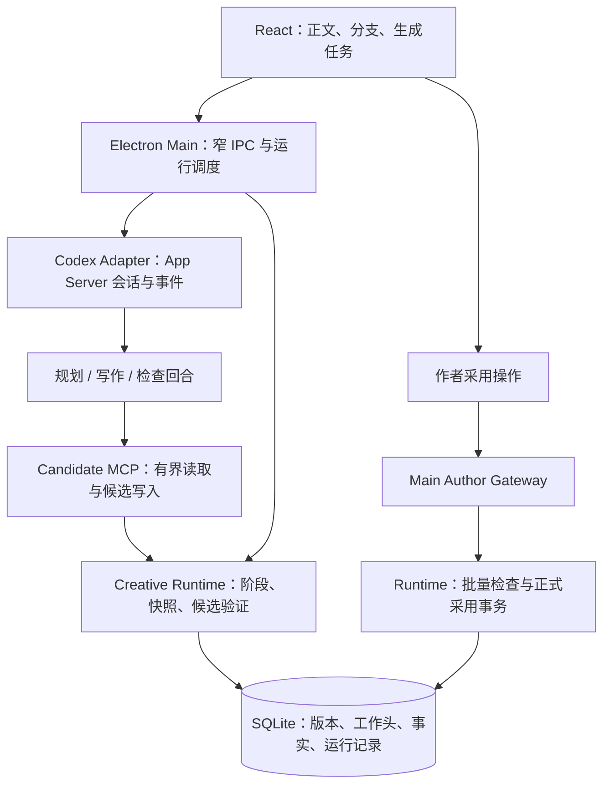

# Novel Codex：开放式创作与自动生成产品方案

> 当前工程约束：实施和验收遵循 [测试阶段工程策略](../../TEST_STAGE_ENGINEERING_POLICY.md)，不承担旧版本或旧数据兼容工作。

后续提案（2026-09-12）：用户提出先梗概／大纲／卷纲／单元再写章，已形成[作者主导分层创作 PRD](/Users/hilbert/private/codex/eternallight/novel-codex/docs/designs/PRODUCT_AUTHOR_DIRECTED_CREATION.md)。建议先补可靠性与规划到单章，再接连续分支。下文保留历史实施记录；本次静态核对发现完成判定、计划来源与上下文仍有缺口，AG-1 仅 schema v4 起步，不能把旧测试结果视为当前验证。新范围须另过实施评审。

版本：0.2 · 日期：2026-09-12 · 状态：AG-0 已实施并通过本地复核；AG-1～AG-4 待实施

适用工程：`eternallight/novel-codex`，基于当前本地 Codex CLI 工程。

本文回答：怎样让自动生成参与有作者意图、可探索、可持续修订的长篇创作，以及现有原型还需要补齐哪些能力。AG-0 的实现状态以本文和关联实施评审为准；试写分支、连续多章、多方案探索和审美记忆仍是后续方案，不表示已经实现。

## 1. 产品决策摘要

产品目标：作者给出一句创作意图，系统能自动准备材料、规划、写作、检查和保存；作者可以比较不同方向、修改局部，并让后续生成准确承接所选版本。

核心设计是把作品分为正式版本与可独立演进的试写分支。系统可以在分支内连续写作、积累临时事实；作者采用后，选定正文及相应事实才共同进入正式版本。这样既能减少操作次数，也能保留大胆试写的空间。

建议沿用现有 Electron/React + Python Runtime/SQLite + Codex App Server 架构。优先建设小说领域能力，不往 `codex-core` 添加小说专用业务。

实施顺序：先把一次自动写章做可靠，再支持分支内连续写章，再增加关键场景多方案和作者审美记忆。最早可交付结果是“一句章节意图 → 可读草稿与检查结果 → 一次采用 → 正确承接下一章”。

### 与既有文档的关系

- `PRODUCT_NEXT.md` 描述现阶段大纲、近期计划、草稿与联合采用的目标；本文在此基础上提出下一阶段演进。
- `ARCHITECTURE.md` 是现有架构说明；现状判断以本次阅读的源码为准，不能把历史方案中的目标当成现状。
- 本文新增试写分支、生成会话和有界探索，属于对既有“同轮多候选、连续长篇生成暂缓”的后续提案；不追溯改变既有版本验收结论。
- 保留“Agent 仅写候选，正式采用由作者发起”的边界。连续生成使用分支工作状态，不等于授权 Agent 自动采用正式稿。
- 0.1 版仅形成提案；0.2 版已按独立实施评审完成 AG-0 代码、Schema、接口、MCP、Skill 与 UI 变更。实施证据见 `../../design-reviews/AUTOGENERATION_IMPLEMENTATION_REVIEW.md`。

## 2. 用户、价值与产品边界

| 用户情境 | 要完成的事情 | 产品成功表现 |
| --- | --- | --- |
| 从一个片段开始 | 尚无完整大纲，也能开始写 | 最小计划随草稿产生，假设可见，不强制填表 |
| 持续写长篇 | 自动接着写，但不遗忘人物经历 | 能定位前文依据，正确区分事实、怀疑、秘密与计划 |
| 关键情节犹豫 | 看见几个有实质差异的可能性 | 分支有短试写和后果说明，可以保留、放弃或摘取 |
| 作者亲自改稿 | 修改被理解，并影响后续生成 | 新正文、事实修正和后文影响有来源，不只更改聊天记录 |
| 希望批量出初稿 | 减少每章重复操作 | 一次设定范围，完成多章待审稿，随时暂停和恢复 |

“创作上限”在本产品中具体指：扩大有价值的选择空间、保持长篇因果和信息边界、支持反复修订、保留作者的语言与判断。产品不能承诺生成文学杰作；需要用真实作品和作者反馈验证这些机制。

第一阶段聚焦单作者、本地小说工作区。macOS、Windows 是桌面验收目标；Runtime 及领域测试保持 Linux 可运行。漫画、视频、多人实时协作、云端无人值守调度、公开发布与商业付费体系不进入本方案首期。

创作结构保持可选：Scene 是便于保存、引用和比较的默认单元，Beat 可省略；片段式作品可用段落组。冲突、反转和悬崖结尾均不作为强制字段。

## 3. 当前工程基线与真实缺口

本方案最初基于源码静态核对形成；AG-0 完成后已运行 Runtime、Agent、TypeScript/Vite 构建和 macOS Electron 视觉走查，但尚未运行真实模型端到端写章与 Windows 实机旅程。父仓库中的 `eternallight/` 仍是未跟踪目录，因此父仓库 commit 不能单独复现原型内容。下表保留提案时的基线，AG-0 实施增量见其后的说明。

| 能力 | 源码中已有的基础 | 本方案需要补齐的部分 |
| --- | --- | --- |
| 应用与运行环境 | Electron/React；独立 Codex 环境；窄 IPC；Python/SQLite | 沿用分层，增加任务与分支视图 |
| Codex 接入 | App Server 握手、流式回合、恢复、中断、steer | 将一次对话调用组织为可恢复的多阶段生成会话 |
| 创作任务入口 | `classifyCreativeTask()` 按中文关键词判定用途 | 结构化指定章节、场景、操作与范围；组合意图可分阶段执行 |
| 目标定位 | 历史原型会猜测最后一章并使用无界场序哨兵 | 当前实现要求作者选中对象，并显式传入章节、场景范围、POV 与阅读位置 |
| 正文与版本 | 不可变 `draft_revisions`、场景组、候选/正式指针、检查点 | 每个分支独立指针、明确父版本、候选保存 CAS；当前每章一个候选头不能承载并列分支 |
| 正式采用 | ReviewBundle、正文与事实联合事务、版本校验、幂等回执、撤销 | 分支批量采用、采用前有效候选状态验证、跨章依赖一致性 |
| 生成完成 | TaskRun 保存状态和输出引用；回合返回后主进程会请求 complete | 按任务产物契约校验完成，不能以回合结束或模型自报完成代替章节交付 |
| 上下文 | 按阅读位置、故事时间过滤时间事实；writer 过滤部分秘密/他人知识；用途切换分离会话 | 真实 token/字节上限、正文原文检索、所有来源一致的版本快照、分支状态、角色能力绑定 |
| 信息边界 | MCP 请求携带 `purpose`；Runtime 校验 task/project/thread | 当前用途由请求传入，尚无完整的任务用途能力约束；需防止 writer 请求 planner 范围 |
| 检查 | 版本与证据非空检查；采用前调用现有正式状态的 Story Tests | 在实际待采用的合并结果上检查；验证证据锚点；单独提供语义审阅与未检查状态 |
| 后文影响 | 已确认事实的 predicate 与未来计划 `dependencyKeys` 求交 | 有版本和证据的依赖边；处理事实删除、否定、移动及旧证据失效 |
| 审美记忆 | Brief 等产物可提供作品方向 | 独立保存样段、作者修改及理由、偏好作用范围和撤销 |
| 产品交互 | 中央产物编辑、右侧协作、场景选择与事实决定 | 正文优先阅读、分支比较、连续生成进度、草稿依赖和失败恢复 |

几个关键界限：

- 当前 `budget` 在 Context 服务中被夹到 1～80 条，不是 token 限额；大型 artifact 也需要计入总预算。
- 当前历史事实查询与“当前 accepted artifact”读取并不构成完整历史快照，不能直接用于从旧章节可靠分叉。
- 当前检查能证明部分结构和版本约束，不能证明无剧透、无矛盾或文学质量合格。
- 当前 `plan_impacts` 是有限的依赖键匹配结果，不应在产品中称为完整因果分析。
- App Server 的 `thread/fork` 即使可用，也只解决会话历史分叉；不复制或隔离小说正文、事实和计划。

AG-0 已补齐的基线增量：正文入口使用结构化章节目标；TaskRun 固定 purpose/target/required output；Runtime 从持久化检查点核实完成；Writer Context 提供带 DraftRevision 来源的正式前文并受 UTF-8 字节硬预算约束；事实证据必须锚定对应场景；章节页显示生成与交付状态。以上仍不构成试写分支或连续多章能力。

## 4. 用户可见的自动生成方式

| 模式 | 作者输入 | 自动完成范围 | 结束位置 |
| --- | --- | --- | --- |
| 局部协作 | 选中段落/场景及修改意图 | 检索依据、生成修改稿、局部检查 | 可比较的候选修订 |
| 自动写一章 | 章节意图，可选字数、POV、禁改项 | 最小计划、分场景正文、检查、最多两轮局部修订 | 完整或明确标记未完成的待审章节 |
| 连续出初稿 | 起点、章节数量、自由度、预算 | 在一个试写分支内规划、写章、更新临时状态和近期安排 | 指定数量的待审章节，或有明确原因的暂停 |
| 探索关键选择 | 决策点与不确定问题 | 最多三个实质不同方向的短试写与后果说明 | 作者选取；也可预设由系统推荐并继续 |

自动化减少规划、执行和保存动作，不要求作者每完成一个场景都点击确认。正式采用默认在章节或连续稿审阅结束时进行一次。

初始参数仅为可调整的产品假设：近期规划窗口 3 章；连续生成默认 3 章、单次最多 5 章；关键节点最多 3 个方案、每次会话最多 2 个探索节点；每场景自动修订最多 2 轮。普通场景直接写，不强制搜索分支。

“写到某个事件发生”为语义终点，必须同时设置最大章数与调用预算。达到上限但事件尚未发生时保存结果并说明，不能无限续写或为达标强行改变剧情。

## 5. 核心旅程：从一句意图到可持续生成

示例输入：

> 写第三章。女儿回家吃饭，发现父亲可能参与了那场事故。两人都不直接说破。最后她决定留下过夜。约三千字。

### 5.1 建立生成任务

系统读取作者选中的正式稿或试写分支起点，建立不可变的 `GenerationBrief`。作者看到的是一张简短任务卡，详细依据按需展开。

| 内容 | 示例 | 处理原则 |
| --- | --- | --- |
| 起始状态 | 女儿怀疑，父亲不清楚她掌握的信息 | 引用前文；没有依据的推断标为假设 |
| 目标变化 | 女儿取得新线索，决定留下 | 允许心理或关系变化，不强制外部事件 |
| 必须保留 | 双方不直接摊牌 | 硬约束或明确的作者意图 |
| 尚未决定 | 父亲是否真凶 | 保持待定，不能生成成既成事实 |
| 自由范围 | 饭桌细节、动作、试探方式 | 自动发挥，不逐项询问 |
| 语言依据 | 作者认可的两段正文 | 引用版本；可移除，不擅自概括成永久偏好 |
| 停止与预算 | 本章结束；调用/输出上限 | 开始前可见，随时停止 |

自然语言用来补全意图，目标对象与执行权限由结构化请求确定。“检查第二章并续写第三章”需要两个有不同用途的阶段，不能依靠关键词排序只执行其中一个。

### 5.2 准备上下文

规划阶段读取相关全局方向和作者秘密；写作阶段读取经筛选的当前场景约束、近期正文、相关历史原文、角色知识与语言样本；批评阶段按检查类型读取候选及所需证据。

每份材料都带来源修订、分支、阅读位置与用途。既有前文原文优先于摘要；资料不足时标记缺口。硬约束放不下时应缩小任务或分页读取，不能静默丢弃后声称已遵守。

### 5.3 规划与可选试写

没有计划时生成最小场景安排，和正文一起作为候选保存。关键选择可试写“物品露出破绽”“家常话说漏信息”“女儿故意说错细节”等不同方向。

每个方案要说明人物行为为什么成立、会打开什么后续可能、会牺牲什么。仅替换措辞不算不同方案。先保存短试写，再展开选定方向；保留未选方案，不自动拼接互相矛盾的设定。

### 5.4 正文生成与保存

主笔保持统一叙述声音，按场景保存不可变检查点。复杂章可分场景生成，再做全章衔接；短章允许一次生成。禁止用凑字、重复解释强行达到目标长度。

每个检查点区分 `partial` 与 `sceneComplete`；流式片段不是完整场景。新细节可以进入候选正文，改变既定重大方向的内容形成单独提案。作者预设允许系统选择方向时可继续，但不能越过已锁定内容。

### 5.5 检查与有限修订

确定性检查先验证版本、来源、锁、引用和结构；语义检查再检查人物知识、动机、承接和语言。反馈定位具体段落，并解释修改的收益与代价。

有明确修复目标时局部修订，保留原版。审美分歧不会被当成硬错误；两轮后仍未解决则保留待审稿并列出问题。语义检查未执行或失败时显示“未检查”，不能显示“通过”。

### 5.6 选择工作版本或采用正式稿

单章模式：产出正文、检查、候选事实和必要的后文影响说明，等待作者审阅。

连续模式：编排器在允许范围内选择分支工作版本，推进分支工作头，随后下一章读取该工作状态。这个动作不移动正式指针；其中的 AI 提取事实仍标记为“试写假设”。

作者可以选取一个依赖完整的章节前缀，或经过验证的场景变更组，统一采用到正式稿。界面明确区分“用于接着试写”和“采用为正式稿”。

## 6. 版本、事实与分支规则

### 6.1 三种状态不可混淆

| 状态 | 内容 | 谁可推进 | 谁能读取 |
| --- | --- | --- | --- |
| 正式状态 | 作者采用的正文、事实、计划 | 作者网关发起，Runtime 联合事务 | 按用途和阅读位置读取 |
| 分支工作状态 | 已选试写稿、局部计划、临时事实 | 编排器按本次生成范围推进 | 本分支中被授权的任务 |
| 未选候选 | 备选正文、假设、检查意见 | Agent 或作者创建新修订 | 显式比较/审阅；不作为其他分支默认事实 |

例如 A 分支写“父亲是凶手”，B 分支写“父亲在替别人隐瞒”。B 的 Writer、检索结果和后章计划不得读取 A 的临时事实，即使它们属于同一作品、使用同一个模型。

### 6.2 建议新增的领域对象

| 对象 | 最小必要信息 | 生命周期 |
| --- | --- | --- |
| `GenerationBrief` | 目标对象、意图、约束、字数范围、语言样本引用、假设 | 每次修订新建，任务固定引用 |
| `GenerationSession` | project、branch、起始快照、执行范围、预算、状态、输出清单 | 编排多个 TaskRun；重启可恢复 |
| `StageRun` | session、stage、attempt、task/thread、上下文快照、输出要求 | 准备→执行→验证→完成/失败 |
| `StoryBranch` | 父分支/分叉点、正式基线、工作头、状态 | 创建→推进→比较→采用或保留 |
| `WorkingCommit` | 父工作头、选定正文/计划修订、临时事实变更、来源 | 不可变；事务推进工作头 |
| `ContextManifest` | 各类来源的精确版本、用途、位置、长度、遗漏、策略版本 | 创建后不可变；执行可重现输入选择 |
| `EvidenceAnchor` | draftRevision、sceneGroup、位置与原文校验值 | 编辑产生新锚点；旧锚点保留历史含义 |
| `CritiqueReport` | 检查类型、目标版本、证据、严重性、建议与代价 | 修订后标记需重检，不借用旧结论 |
| `StylePreference` | 作用范围、正反例、作者理由、来源、启用状态 | 推荐→作者启用→调整/停用 |
| `DependencyEdge` | 两端对象及修订、依赖类型、证据、失效条件 | 随版本维护，可追踪失效链 |

复用现有 ArtifactRevision、DraftRevision、TaskRun、ReviewBundle、AcceptanceCommit、TemporalStateEvent，不另造第二套正式版本系统。新增表名与字段最终由实施评审确定。

### 6.3 分支与采用不变量

1. 分支的基线包含正文、计划、设定、锁定和事实版本；不能只记录一个章节正文 ID。
2. 每次保存校验 `expectedWorkingHead` 和目标候选父修订。两个任务从同一工作头出发，后保存者必须得到冲突，不能无声取代先保存者。
3. 正文和对应临时事实在一个 WorkingCommit 中共同推进；相互依赖的多场景作为同一提交单元。不能把尚未选中的假设当成下一章前提。
4. AI 提取的临时事实注明“据当前试写暂定”；明确发生、人物声称、怀疑、梦境分别保存。未知不能自动升级成已知。
5. 作者修改第一章后，以它为前提的分支第二章及临时事实必须标记失效。新生成读取新工作头，旧稿可查看但不再默认参与上下文。
6. 部分采用不能只选依赖的后半段而漏掉必要前文；无法自动判定的组合进入审阅。首期连续稿采用支持依赖闭合的章节前缀，不提供任意跨分支自动合并。
7. 批量采用在一个 Runtime 事务中写正文指针、事实变更、影响项与回执，并一次增加正式 revision。不能由前端循环调用单章 accept，造成半成功。
8. 正式基线发生变化时，保留分支与全部草稿，生成新的基线调整候选并重新检查；不把已有分支引用自动替换成最新指针。
9. 替换正文时，根据证据来源废止失效事实，再写新事实；不能只追加新增事实而留下被删除剧情的旧事实。
10. 撤销产生新提交并恢复完整投影。存在后续依赖时先提示影响，不能通过删除历史绕开。

## 7. 长篇记忆与信息边界

事实的分类与可信状态分开：世界事实、人物信念、读者可知、作者秘密、未来计划；每条再记录已知、怀疑、否定或未知。正文中的“他说父亲死了”首先证明他说过这句话，未必证明死亡发生。

Context 必须同时固定 `projectId + branchId + workingHead + purpose + readingPosition`，并引用正式基线、具体 artifact/draft 修订。故事时间与阅读顺序是两个维度，倒叙不能只按章节号裁剪。

Runtime 从任务绑定读取允许用途，不能信任模型自行提交更高范围的 `purpose`。线程按作品、分支、用途和信息策略隔离；含 Planner 秘密的历史不能直接 fork 后交给 Writer。禁止泄露项本身也应避免暴露秘密，例如用不含答案的约束 ID，而不是把秘密写进“不要提到……”中。

检索先过滤分支、版本和信息权限，再做相关性排序。相关来源包括前文原文、人物状态、当前计划、远期承诺、作者样段。首期可扩展现有全文检索与显式引用，不以向量库为前置条件。

Context 预算须覆盖原文、摘要、候选产物、工具包装和遗漏说明；按实际 tokenizer 或经验证的保守计数方法执行。建议首期任务材料默认 8,000 tokens；单个新增注入片段/工具返回限制在 900 tokens 内，超出分页，均为待验证配置。不得把现有“80 条”当成 token 保障。

分页结果记录 `nextCursor`、省略类别、关键约束缺失与索引水位。索引落后时直接按版本读取关键原文或暂停相关检查；不能静默使用其他分支或旧版本填补。

如果需要改变 Codex 模型可见上下文本身，必须另按仓库要求使用 `ContextualUserFragment`、保持历史增量，并对超过 1k tokens 的新单项做规定的 P0 人工复核。首期应尽量通过小说 Runtime 的有界工具数据完成。

## 8. 检查、创作自由与审美记忆

| 检查类别 | 示例 | 处理方式 |
| --- | --- | --- |
| 确定性约束 | 旧版本、跨分支引用、锁定文本、证据不存在 | 拒绝不合法写入/采用，保留候选 |
| 叙事一致性 | 人物提前知道答案、行动前提不足 | 模型给出原文证据；标为疑点，支持作者解释或改写 |
| 场景效果 | 对话没有改变关系、细节缺乏作用 | 与本次意图比较；安静场景也可成立 |
| 文学与语言 | 过度解释、节奏重复、声音趋同 | 展示不同改法及代价，不合成为一个总分 |

检查目标是“所选正文 + 拟采用事实变更”的有效合并结果。仅检查现有正式稿不能证明新版本有效。检查报告必须绑定精确修订、场景选择、事实决定及上下文策略；任何依赖变化使相应检查过期。

机器检查不能证明人物动机或事实抽取绝对正确。批评者提出的歧义可以保持未解决；只有明确的结构、来源和作者硬约束才能作确定性阻塞。任何文学质量评级都不能赋予模型自动采用正式稿的能力。

作者可以把一次修改记录为偏好：“删去解释，让读者比人物先看懂背叛”。系统保存修改前后、理由和适用范围，比“文风克制”更可执行。默认只作用于当前作品；跨作品偏好需要作者显式启用，避免一次删句变成永久禁令。

样段和偏好支持禁用、重写、删除。系统可建议新的偏好，但未经作者启用只作为本次任务观察，不持续影响后续作品。模型选择通过实际中文片段与长篇承接任务比较，不能用编码能力推断文学表现。

## 9. 应用交互

沿用左侧导航、中央正文、右侧协作；生成任务成为可见的产品对象，聊天承载意图与解释。

| 区域 | 默认内容 | 关键操作 |
| --- | --- | --- |
| 左侧 | 作品、章节、试写分支、生成记录 | 定位当前章、切换分支、找回暂停任务 |
| 中央 | 正文与当前版本；未完成片段明显区分 | 编辑、选择场景、版本比较、保护原文 |
| 右侧 | 简短任务卡、当前阶段、必要选择 | 改意图、暂停、继续、展开依据与检查 |
| 审阅视图 | 文本差异、事实/认知变化、后文影响 | 采用选中内容、保留试写、返回修改 |

默认任务卡示例：

> 继续写第三章 · 试写分支「晚餐」
>
> 约 3,000 字；保留父亲身份悬念；写到女儿留下过夜。
>
> 正在写第二场景 · 第一场景已保存
>
> 操作：暂停 / 调整方向 / 查看已保存正文

模式与自由度使用作者能理解的语言：“严格按当前计划”“允许调整场景”“允许探索情节方向”。锁定项始终有效；其余差异在结果中说明。

新作品可直接输入片段或一句话开始。缺失设定作为可见假设，不要求创建完整大纲。已有作品首期通过单章粘贴建立候选；整本导入与准确世界重建另排阶段。

成功文案分别为“草稿已保存”“试写已推进”“已采用为正式稿”。无模型时生成不可用，但手工编辑与确定性检查可继续。连接恢复不代表生成完成。

键盘可完成发起、暂停、打开草稿、比较和采用；尊重中文输入法；状态不能只靠颜色；阶段播报不逐 token 打断屏幕阅读器。切换分支或产物时，未保存编辑不得被刷新覆盖。

## 10. 运行架构与代码落点



领域状态机与校验放在 Python Runtime；Electron 负责启动/恢复运行、领取待执行阶段、调用 Adapter 并转交结果，不在 Electron 再实现一套事实与版本规则。Codex 负责生成内容和调用工具，不拥有数据库状态迁移的最终决定权。

首期 Planner、Writer、Critic 是逻辑用途，可顺序使用同一模型但采用隔离上下文，无需立即建设并行多 Agent 集群。一个生成会话可对应多个 TaskRun 和多个模型线程。

| 代码位置 | 演进建议 |
| --- | --- |
| `runtime/creative_workspace/service.py` | 逐用例抽取被本功能涉及的逻辑；目前约 932 行，避免继续堆积生成状态机 |
| 新增 `generation.py` / `generation_repository.py` | 会话、阶段、完成契约、重试与检查点恢复 |
| 新增 `branches.py` / `branch_repository.py` | 分支快照、工作头、临时事实、分支采用 |
| 新增 `context.py` / `evidence.py` | 有界检索、原文锚点、用途权限、历史一致性 |
| 新增 `review.py` / `impact.py` | 候选合并检查、报告、正文变更后的事实失效与后文影响 |
| `runtime/creative_workspace/schema.py` | 当前 schema 初始化、索引与约束；测试数据可重建 |
| `runtime/server.py` / `runtime/mcp_server.py` | 结构化接口与候选工具，保持统一领域入口 |
| 新增 `electron/generation-runner.mjs` | 单会话调度、阶段领取、进程重连、事件转交 |
| `electron/codex-adapter.mjs` | 保持为传输适配；新增按会话所有者管理线程，避免共享单一可变 threadId |
| `electron/main.mjs` / `preload.cjs` / `src/types.ts` | 显式目标与生成操作 IPC，验证对象与版本 |
| 新增 `src/features/generation/` / `branches/` / `review/` | 从当前大组件中按功能提取；任务卡、分支比较与审阅 |
| `codex-runtime/skills/` | 与新工作流程同步，但不把权限和事务保障仅写进提示词 |

以上路径为相对于 Novel Codex 工程的候选落点；新增文件尚不存在。首期无需调整 Codex 公共协议、Rust 依赖或普通 Codex 的配置语义。

### 应用命令草案

下表是小说应用自己的命令，不是已有 App Server RPC；最终 HTTP/IPC 路由在实施评审中确定。

| 命令 | 必要输入 | 输出与责任 |
| --- | --- | --- |
| `generation.start` | project、target、mode、sourceSnapshot、intent、limits | sessionId；Runtime 固定任务范围 |
| `generation.pause/resume/cancel` | sessionId、expectedStateVersion | 新状态；恢复校验依赖，不复活旧已结束 TaskRun |
| `generation.get` | sessionId、eventCursor | 阶段、检查点、输出引用、分页事件 |
| `branch.create/selectWorking` | sourceSnapshot 或 branchId/head、候选引用 | 分支或 WorkingCommit；必须验证同分支归属 |
| `review.prepareBranch` | branch/head、章节/场景选择 | 不可变 ReviewBundle 与检查结果 |
| `review.acceptBranch` | reviewId、baseRevision、idempotencyKey | 原子采用回执；仅作者网关可调用 |

MCP 延用 `read_context`、`save_draft_checkpoint`、事实提议等能力，新增参数绑定 session/stage/branch/head/context；按需新增试写方案和检查报告保存工具。MCP 不暴露正式 accept、撤销、权限变更或任意 SQL。

`complete_task` 只表示提交完成声明。Runtime 必须核实目标章节、完整场景、持久化引用和所需检查，再将阶段标为完成；空 outputRefs、错误分支或仅有聊天正文不能满足写章任务。

## 11. 状态机、恢复与预算

```text
queued → preparing → planning → [exploring] → writing → checking → [revising]
       → readyForReview（单章）
       → advancingWorkingHead → 下一章 preparing（连续模式）
       → readyForReview（达到本次终点）

任意执行阶段 → pausing → paused / failed / cancelled
恢复：校验输入与工作头 → 新的 stage attempt → 从有效检查点继续
```

运行完成和正式采用是不同状态。`readyForReview` 表示本次输出满足交付结构，可以审阅，不表示艺术效果已被认可。

| 情况 | 系统行为 | 作者看到什么 |
| --- | --- | --- |
| 网络/模型失败 | 保留已落盘场景；重试同阶段新 attempt | 已保存范围、失败原因、继续入口 |
| 窗口/Runtime 重启 | 持久状态恢复；查询在途回合，无法确认时不重复推进 | “运行已中断，可恢复”，不显示伪完成 |
| 提交成功但回执丢失 | 先按幂等键查回执 | 同一份输出或采用记录 |
| 取消后迟到工具调用 | 校验 session/stage/attempt，拒绝继续写 | 取消保持生效，旧检查点仍可读 |
| 作者同时编辑 | 工作头或候选父版本校验失败，保存冲突信息 | 比较新旧版本，选择重新生成 |
| 正式版本更新 | 暂停依赖旧基线的阶段，保留分支 | 明确列出需要重新检查的内容 |
| 预算用尽 | 不再发起新回合，尽力保留已生成结果 | “部分完成”，剩余场景与检查明确可见 |
| 索引失效 | 使用权威版本读取关键材料或停止该检查 | 资料更新中/检索未完成 |

每个阶段必须有租约或等价的单执行者约束；多次恢复、重复事件不能生成两个 WorkingCommit。首期每个分支串行推进，可并行准备只读材料，不并行修改同一工作头。

预算区分模型调用次数、输入/输出 tokens、自动修订轮次、探索节点数与用户设定的时长。默认上限需要通过模型试用确定。首期可用“最多 20 次模型回合、每回合独立上限”作为单章调试起点，而非性能承诺。

模型使用量通常事后返回，因此产品必须区分估算和实际值。接近预算时预留一次在途回合的余量；不支持可靠限额的 provider 不显示精确费用承诺。后台运行仅限本地进程存活；应用退出后不承诺继续写作。

## 12. 分阶段交付与范围控制

采用 AG 编号，避免与既有 `PRODUCT_NEXT.md` 的 M0～M3 混淆。每阶段再按真实 diff 拆分小变更；复杂逻辑尽量少于 500 行、非机械变更不超过仓库要求的 800 行，不按文档规模合并为一个巨大实现。

| 阶段 | 交付 | 出口条件 | 暂不包含 |
| --- | --- | --- | --- |
| AG-0：单章生成可靠性 | 显式目标、用途绑定、正文上下文、完成契约、候选检查、基本恢复 | 写第三章不会误写最后一章；真实模型产出落盘、可审阅并承接下一章 | 多候选、分支连续生成 |
| AG-1：试写分支与连续稿 | 固定基线、独立工作头、临时事实、连续 1～5 章、批量采用 | 三章能依次承接；正式稿在作者采用前不变；重启和冲突可恢复 | 任意跨分支自动合并 |
| AG-2：关键选择探索 | 同节点最多三个短试写、后果比较、选定方向续写 | A/B 事实不串线；作者选定后能继续，非同义改写 | 全书树状穷举 |
| AG-3：作者审美与深层影响 | 样段、修改理由、偏好开关、证据依赖、后文重检 | 作者修订可解释地影响下一次生成；废弃事实不残留 | 自动综合文学分数 |
| AG-4：发布与长篇验证 | 长篇试用、双平台桌面验证、安装/恢复/导出 | 真模型与故障旅程有证据；作者可备份和导出正式稿/试写稿 | 无界整本生成承诺 |

最小实施切片建议：先贯通“中央选中第三章 → 结构化生成请求 → Runtime 绑定正确目标 → 已保存正文引用 → 完成校验”。随后补上下文与检查，再引入分支。不要在第一笔代码里同时改造所有存储与界面。

AG-0 已可给作者试用，但不能宣传为连续长篇自动创作；AG-1 才能交付本方案所说的连续初稿体验。

## 13. 验收矩阵

下列是全阶段验收要求。AG-0 中已有自动化覆盖的项目记录在实施评审中；真实模型体验与后续阶段仍未通过，不能用 fixture 结果替代创作验证。

| ID | 场景与预期 | 主要层 | 阶段 |
| --- | --- | --- | --- |
| G01 | 无大纲输入一句意图，正文实际保存，最小计划可查看 | UI/Runner/MCP | AG-0 |
| G02 | 选中第三章时工程已有第十章，任务仍绑定第三章；第十章不变 | IPC/Runtime | AG-0 |
| G03 | 模型回合成功但没有有效输出引用，任务不能标为交付完成 | generation | AG-0 |
| G04 | Writer 请求 Planner 用途被拒绝；切换角色不继承高范围历史 | context/runner | AG-0 |
| G05 | 倒叙和 POV 样例按两个时间维度取材；证据可回到原文 | context | AG-0 |
| G06 | 超长上下文分页或提示缺口；工具返回与整体预算均有硬上限 | context/MCP | AG-0 |
| G07 | 正式稿无错误但新候选包含非法引用，采用被拦截 | review | AG-0 |
| G08 | 生成第二场中断，第一场可读；恢复不重复正文，不伪造完整场景 | generation | AG-0 |
| G09 | 锁定场景在生成、局部修订和采用后内容保持一致 | draft/review | AG-0 |
| G10 | 分支 A/B 产生矛盾事实，各自后章只承接本分支 | branch/context | AG-1 |
| G11 | 连续三章使用此前试写状态，正式指针与正式事实保持不变 | branch/generation | AG-1 |
| G12 | 两个保存争用同一工作头，只有一个成功；另一个收到可恢复冲突 | branch | AG-1 |
| G13 | 批量采用提交前中断不产生半本正式稿；丢回执重试只有一笔提交 | acceptance | AG-1 |
| G14 | 只采用依赖完整的章节前缀；缺少前文的选择解释依赖缺口 | review/branch | AG-1 |
| G15 | 从旧基线分叉，正文、事实、计划都读取同一历史快照 | branch/context | AG-1 |
| G16 | 取消后迟到响应不能推进工作头；重启恢复不产生双执行 | generation | AG-1 |
| G17 | 到章数/调用上限保留部分完成状态；未检查明确显示 | generation/UI | AG-1 |
| G18 | 三个关键场景方案存在情节或人物选择差异；选定后正确续写 | 模型样例/作者 | AG-2 |
| G19 | 作者删去关键事实来源，后章依赖失效，后续生成不再引用旧事实 | impact/context | AG-3 |
| G20 | 对白谎言、梦境、怀疑保持对应类别，不自动当作世界真相 | review/context | AG-0/3 |
| G21 | 关闭一条审美偏好后，新任务不再注入；不影响其他作品 | preference/context | AG-3 |
| G22 | 全程键盘完成写章、暂停、比较与采用；未保存编辑不被刷新覆盖 | UI | 各阶段 |
| G23 | 模型不可用时编辑仍可用，生成清楚报不可用，不输出模板冒充正文 | UI/Runner | AG-0 |
| G24 | macOS/Windows 真实核心旅程、备份恢复、正式/试写导出无内容混淆 | 发布验证 | AG-4 |

保留并扩展当前 Runtime unittest 与 Electron node:test 的基础；继续新增分支、上下文、候选合并和恢复的行为测试，以及界面组件与键盘旅程测试。AG-0 已通过 `npm run test:runtime`（32 项）、`npm run test:agent`（25 项）和 `npm run build`；真实模型质量与跨平台体验仍单独验收。

真模型验收至少覆盖：新作第一章、指定中间章重写、父女晚餐样例的连续三章、修改第一章后续写、关键选择分支。记录模型与参数、输入版本、耗时、调用量、产物引用及人工判断，保留失败样例。

## 14. 怎样判断产品确实提高了创作质量

技术指标与文学指标分开。确定性不变量的验收目标为零跨分支污染、零未授权正式写入、零重复采用、零伪完成；这些是设计目标，不是已达成统计结论。

创作验证采用相同起点、相近生成预算的盲评：比较普通续写与完整工作流，不让评审看到方案名称或模型身份。关注人物可信度、信息控制、语言辨识度、想继续阅读的意愿与作者实际修改负担；模型自评不能作为唯一证据。

建议第一轮邀请 3～5 位作者各试写一个连续项目，并单独记录偏探索、偏连载、偏语言风格的结果。样本只用于发现问题，不据此宣传统计显著提升。

产品指标包括：首次得到可读草稿的耗时、作者为完成一章需要的操作次数、恢复成功率、可用方案数量、后续章节沿用错误事实的次数，以及作者是否认为系统保住了自己的声音。低修改率不必然更好，大幅改写也可能是有价值的探索。

长篇测试逐步扩大到已有 30～50 章的工程，加入远期伏笔、倒叙、同名角色、事实撤回与旧章修订。三章演示通过不能替代长篇有效性验证。

## 15. 关键取舍、风险与文档变更记录

| 取舍 | 选择与原因 | 代价及应对 |
| --- | --- | --- |
| 在 Codex core 中加小说逻辑，或独立领域层 | 沿用独立 Runtime；现有边界和数据库已经具备基础 | 多阶段调度需补齐，避免业务重复进入 Main |
| 每章批准后再继续，或分支内连续生成 | 分支临时状态承接，作者批量审阅 | 必须做分支隔离与来源跟踪；AG-1 前不宣传连续体验 |
| AI 自动改正式稿，或作者采用 | 保持作者采用正式稿 | 多章采用需要新的原子事务，不能循环旧接口 |
| 大模型多次自评取最高分，或有界探索 | 关键节点短试写，证据化检查，作者取舍 | 不能保证自动挑中最佳方案；记录推荐理由和备选 |
| 大量重构后再交付，或按用例拆分 | 先完成单章纵向切片，再局部抽取大模块 | 实施期间需要明确旧入口与新入口的统一权威边界 |

主要产品风险是结构化流程过重、试写事实自我强化、检查把作者有意的歧义抹平，以及上下文正确却语言平庸。应对依次是隐藏非必要表单、标记临时状态并保留原文、允许审美意见悬置、用真实作者样段和盲评迭代。

主要工程风险是历史快照不一致、分支候选互相覆盖、旧回合迟到写入、批量采用半成功，以及恢复后重复计费。以上风险已映射到版本/租约/事务/幂等验收；不能用提示词替代这些约束。

测试阶段数据库直接按当前 schema 初始化，schema 变化时同步重建 fixture 与测试数据，不提供旧程序读取、升级或降级路径。进入真实用户数据阶段后，数据保留策略必须作为新的明确产品范围重新评审。发布前应提供正式稿与试写稿分开导出。

### 0.1 提案记录与 0.2 实施状态

- 0.1 范围：仅新增产品文档；0.2 已实施 AG-0，未进入 AG-1～AG-4。
- 依据：当前源码静态核对、既有产品/架构文档、本次讨论。没有宣称真实作者访谈或外部专家参与。
- 适用规则：工程 `design-review-gate` 允许“纯文字说明且不改变契约或行为”使用简化方案记录；本文件的接口和对象是待评审草案，不是立即生效的契约。
- 复核重点：区分现状与建议；连续生成不绕过正式采用；分支具有完整状态；预算和完成有可验证边界；每个交付阶段有退出条件。
- 五角色状态：AG-0 已在 `../../design-reviews/AUTOGENERATION_IMPLEMENTATION_REVIEW.md` 完成实施前评审、条件消解与实施后复核；后续阶段仍须各自重新评审。
- 验证方式：AG-0 以本次实际命令结果、领域行为测试与 Electron 视觉走查为准；未执行的真实模型与 Windows 验收明确保留为发布风险。

## 16. 本地证据索引

以下路径用于在当前工作区直接定位，函数名与表名是主要查找依据，行号会随代码演进变化。

| 来源 | 本文使用的事实 |
| --- | --- |
| [工程规则](/Users/hilbert/private/codex/eternallight/novel-codex/AGENTS.md) | 测试阶段策略、隔离边界和设计评审要求 |
| [现有产品方案](/Users/hilbert/private/codex/eternallight/novel-codex/docs/designs/PRODUCT_NEXT.md) | 近期计划、候选生成、联合采用及既有范围 |
| [当前架构说明](/Users/hilbert/private/codex/eternallight/novel-codex/ARCHITECTURE.md) | Electron、Runtime、App Server 和权限分层 |
| [领域 schema](/Users/hilbert/private/codex/eternallight/novel-codex/runtime/creative_workspace/schema.py) | 候选/正式指针、修订、事实、TaskRun、检查点、采用记录 |
| [任务入口](/Users/hilbert/private/codex/eternallight/novel-codex/electron/main.mjs:196) | 关键词分类、章节默认选择、任务工作包 |
| [回合完成处理](/Users/hilbert/private/codex/eternallight/novel-codex/electron/main.mjs:399) | 一次 sendTurn 与后续 complete 请求 |
| [上下文实现](/Users/hilbert/private/codex/eternallight/novel-codex/runtime/creative_workspace/service.py:862) | 条目预算、时间过滤、用途过滤与当前 artifact 读取 |
| [候选草稿保存](/Users/hilbert/private/codex/eternallight/novel-codex/runtime/creative_workspace/service.py:449) | 不可变修订、场景组、单候选头与检查点 |
| [候选审阅](/Users/hilbert/private/codex/eternallight/novel-codex/runtime/creative_workspace/service.py:523) | 当前版本、事实证据非空检查 |
| [正式采用事务](/Users/hilbert/private/codex/eternallight/novel-codex/runtime/creative_workspace/service.py:652) | 幂等、正式状态检查、正文/事实提交及依赖键影响 |
| [MCP 工具](/Users/hilbert/private/codex/eternallight/novel-codex/runtime/mcp_server.py) | read_context、候选保存、事实提议和 complete_task |
| [Codex 适配器](/Users/hilbert/private/codex/eternallight/novel-codex/electron/codex-adapter.mjs) | App Server 会话、流式回合、中断、恢复、steer |
| [中央工作区](/Users/hilbert/private/codex/eternallight/novel-codex/src/CreativeWorkspaceView.tsx) | 当前编辑、候选与审阅交互基础 |
| [现有领域测试](/Users/hilbert/private/codex/eternallight/novel-codex/runtime/tests/test_creative_workspace.py) | 采用、锁、跨项目绑定、部分采用、上下文与撤销测试入口 |
| [现有适配器测试](/Users/hilbert/private/codex/eternallight/novel-codex/electron/tests/codex-adapter.test.mjs) | fixture 级握手、回合、输入、中断与恢复测试入口 |
| [Design Review Gate](/Users/hilbert/private/codex/eternallight/design-review-gate/SKILL.md) | AG-0 实施前五角色评审与实施后复核要求 |
| [AG-0 实施与复核](/Users/hilbert/private/codex/eternallight/novel-codex/design-reviews/AUTOGENERATION_IMPLEMENTATION_REVIEW.md) | 五角色评审、实际变更、命令结果、偏差和剩余风险 |
| [生成任务领域模块](/Users/hilbert/private/codex/eternallight/novel-codex/runtime/creative_workspace/generation.py) | 目标/用途绑定、产物权限、持久化完成校验 |
| [上下文字节预算](/Users/hilbert/private/codex/eternallight/novel-codex/runtime/creative_workspace/context_limits.py) | 序列化硬上限、降级顺序和 omissions |
